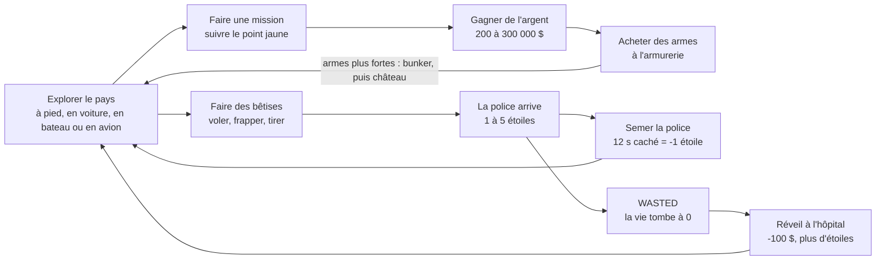

# GTAxel — Document de design

Mis à jour le 28 octobre 2026. Ce qui a changé, jour par jour, est dans le « Journal des modifications », tout à la fin.

## Vision

GTAxel est un jeu d'action en 3D, en monde ouvert, qui se joue dans le navigateur. Il mélange GTA (ville libre, voitures, police, braquages) et Wolfenstein : on incarne B.J. Blazkowicz (ou sa fille Jess, au choix), qui chasse les nazis de Los Santos et de ses environs jusqu'au boss final, Hitler, dans le château Wolfenstein, sur le mont Chiliad, puis braque un musée, une bijouterie et une grande banque, et enfin prend d'assaut un camp militaire dans une grosse armure, pour ouvrir un bunker secret où dort la seule DeLorean du pays : à 88 miles à l'heure, elle l'emmène au chapitre suivant. Car le jeu se joue en chapitres, un par héros : après B.J. à Los Santos, on devient Tony Stark (Iron Man), Bruce Wayne (Batman), Clark Kent (Superman), puis Peter Parker (Spiderman), des héros sans reproche que la police ne poursuit pas (voir « Les chapitres ») : à Malibu, Tony Stark tombe dans une embuscade, se réveille prisonnier au fond de la grotte des Dix Anneaux et s'en évade dans sa toute première armure, en ferraille, vole pour la première fois jusqu'à ce que son armure gèle, sauve les gens d'une tour en feu, affronte Iron Monger, court le Grand Prix de Santa Monica en Formule 1 jusqu'à ce que Whiplash la coupe en deux, abat les drones de Hammer avec War Machine, voit sa villa tomber dans la mer, découvre que le Mandarin n'est qu'un acteur, rattrape les 13 passagers d'Air Force One, appelle toutes ses armures à la fête, calme Hulk dans la Hulkbuster et abat l'armée d'Ultron. Entre deux missions, un bus, le « SKI SHUTTLE », l'emmène de la place du départ au pied du mont Gordo : il en dévale les pentes enneigées à ski, en snowboard ou en luge, saute sur les bosses, fait des figures en l'air, ou remonte la montagne en skis de rando. Le soleil fait le tour du ciel : après 5 minutes de jour, il se couche, et la nuit tombe, sombre et bleue, au clair de lune, avec les étoiles, les lampadaires, les fenêtres allumées, moins de passants et plus de gangs ; B.J. peut dormir dans une de ses 26 villas pour passer au moment suivant. Il a été imaginé par un garçon de 10 à 13 ans, qui doit pouvoir le modifier lui-même.

**Piliers de design**

- **Liberté** : dès le départ, on va où on veut, à pied ou en voiture volée. Les missions sont un fil conducteur, pas un couloir.
- **Pardonnant** : les ennemis visent mal, deux policiers seulement peuvent toucher B.J. à la fois, la vie remonte toute seule et la mort ne coûte que 100 $ : on doit pouvoir faire des bêtises sans être puni trop vite. Les braquages sont l'exception voulue : ils doivent être « le plus réalistes possible », donc dangereux (vigiles qui visent bien, mitrailleuses, fumée toxique, heavy robot). Mourir y coûte toujours 100 $, et on garde le butin déjà volé. Le camp militaire est exigeant lui aussi, mais il pardonne à sa façon : les militaires déjà éliminés le restent, et une armure neuve revient toujours. Dans les chapitres de super-héros, la police ne poursuit plus personne : ce sont les passants tués qui coûtent une amende, à partir du 3e, et chacun s'oublie au bout de 2 minutes ; la dette ne dépasse jamais 10 millions de dollars, et les appels de la police permettent toujours de regagner de l'argent.
- **Bidouillable** : tout tient dans un seul fichier `index.html`. Les réglages, les armes, les voitures, les ennemis, la carte (et celle des villes des autres chapitres : `VILLES`), les sommets, les remontées, les pistes de ski, la navette des pistes, les missions (et celles de chaque chapitre), l'armure d'Iron Man (ses 6 parties, les autres armures de Tony Stark, et les améliorations de son magasin), le magasin de Lucius Fox (les costumes de Batman, ses Batmobiles, ses gadgets et ses améliorations), les héros du menu, leurs couleurs de cheveux, les chapitres et les traductions sont des tableaux commentés en français, en haut du fichier. On voit une modification en appuyant sur F5. Les nombres de `REGLAGES`, `ARMES`, `ARMES_ROBOT`, `VOITURES`, `ENNEMIS`, `CAMP`, `ARMURE` et `IRONMAN` se changent aussi dans le menu, sans ouvrir le code (voir « L'écran des réglages »).
- **Zéro installation** : un double-clic ou un lien suffit, pourvu qu'on ait Internet. En ligne : [jlehen.github.io/GTAxel](https://jlehen.github.io/GTAxel/).

Pas de sang ni de gore : les personnages touchés tombent au sol. Pas de croix gammée non plus : les nazis se reconnaissent à leur uniforme, leur casque allemand et leur brassard rouge, et leurs bannières portent un W pour Wolfenstein.

## Boucle de jeu et contrôles

Le joueur alterne entre deux boucles. Les missions rapportent l'argent qui achète des armes ; les bêtises attirent la police jusqu'à ce qu'on la sème ou qu'on meure. Dans les chapitres de super-héros, la police est de son côté : les passants tués coûtent des amendes, et les appels de la police (des voyous qui braquent un magasin) rapportent des primes, autant de fois qu'on veut.

Une partie commence à pied, sans argent, avec les poings et un couteau. Le héros, B.J. Blazkowicz, est un costaud aux cheveux courts, en maillot blanc à manches courtes et pantalon militaire. Dans le menu, on peut prendre à sa place sa fille, Jess, et choisir la couleur des cheveux (voir « Le joueur ») ; au tout premier lancement, c'est B.J., blond. Après la 11e mission, la DeLorean l'emmène au chapitre 2 (voir « Les chapitres »). Le navigateur se souvient de la partie : on la reprend où on l'avait laissée.

**La vitesse du jeu** : tout le jeu va 13 % moins vite que l'horloge (`vitesseJeu: 0.87`, dans `REGLAGES`), pour laisser le temps de viser, surtout en se balançant d'immeuble en immeuble au bout de la toile de Spiderman. Tout ralentit pareil : B.J., les voitures, les balles, la police, les minuteries. Les vitesses et les durées de ce document sont celles du jeu : une seconde du jeu dure 1,15 s à l'horloge, et B.J., qui marche à 4 m/s, fait 3,5 m pendant une seconde d'horloge (mesuré : 6,96 m en 2 s, au lieu de 8 m). Le compteur affiche la vitesse du jeu. `vitesseJeu: 1` redonne la vitesse normale ; 0.5 met le jeu au ralenti.

### Contrôles

| Touche | À pied | En voiture |
| --- | --- | --- |
| Z Q S D ou flèches | Se déplacer | Accélérer, freiner, tourner ; en l'air à ski, en snowboard ou en luge : les figures (voir « La glisse ») |
| Q S D, 3 fois de suite | Danser comme Michael Jackson | Rien |
| Souris | Regarder | Tourner la caméra autour de la voiture |
| Clic gauche | Tirer ou frapper (pas en nageant ; en volant, tirer seulement). Le grappin en main (code `BATMAN`) : lancer le grappin sur le bâtiment visé ; la toile en main (code `SPIDERMAN`) : s'y balancer tant qu'on garde le bouton enfoncé | Rien ; en l'air à ski ou en snowboard : un grab |
| Clic droit | Viser (zoom, tir plus précis ; lunette avec le fusil de sniper) | Rien ; en l'air à ski ou en snowboard : un autre grab |
| Maj | Courir ; en volant, chaque appui le fait aller plus vite, et le garder enfoncé fait les figures (avec Q ou D : un tonneau ; avec Espace ou C : un looping) ; avec le code `BATMAN`, en l'air : déployer la cape pour planer | Rien ; à ski, en snowboard ou en luge : déraper (avec Q ou D, ou avec S) ; en avion et dans la Batmobile, en l'air : le garder enfoncé fait les figures (avec Q ou D : un tonneau ; avec Espace ou C : un looping) |
| Maj, 3 fois de suite (en moins de 0,6 s) | Voler comme Superman, ou arrêter de voler | Rien |
| Espace | Sauter (environ 1 m), rien en nageant | Frein à main, virage plus serré ; à ski, en snowboard ou en luge : sauter (bien plus haut sur une bosse) |
| Ctrl ou C | S'accroupir (bascule) | Rien |
| E ou F | Monter en voiture, en bateau, en avion, en hélicoptère, sur des skis, un snowboard ou une luge, acheter une arme ou le masque à gaz (au chapitre d'Iron Man, une armure ou une amélioration au magasin de Stark Industries, ou y choisir une armure qu'on a déjà ; au chapitre de Batman, un costume, une Batmobile, un gadget ou une amélioration au magasin de Lucius Fox, ou y choisir un costume ou une Batmobile qu'on a déjà), prendre l'ascenseur, la navette des pistes, un télésiège, la télécabine ou le monorail (à Gotham, dans une gare : voir « Gotham, la ville du chapitre 3 »), parler au garagiste, voler le butin, poser la perceuse ou l'explosif, éjecter le pilote du heavy robot ou monter dedans, monter dans l'armure du camp militaire, appuyer sur son bouton rouge, dormir près du lit d'une de ses villas (voir « Les villas de B.J. »), prendre dans ses bras quelqu'un à sauver (au chapitre d'Iron Man, dans l'armure : un habitant de la tour en feu, Pepper Potts ou Tony Stark ; voir « Les missions d'Iron Man ») ; sur le télésiège, sauter du siège. Avec le code `IRONMAN`, dans l'armure d'Iron Man : F fait voler (ou arrêter de voler), et E, s'il n'y a rien de tout ça à faire là, tire de la main droite (sauf si quelqu'un à sauver attend à moins de 30 m : voir « Le pompier volant ») | Descendre (pas en plein looping, ni en plein vol) ; en marche, ou en plein accident (tonneaux, tête-à-queue), B.J. saute et tombe par terre. À ski, au départ d'une remontée : la prendre, avec ses skis |
| R | Avec le code `IRONMAN`, dans l'armure d'Iron Man : le rayon du plastron ; dans War Machine (au chapitre d'Iron Man) : la mitrailleuse d'épaule, tant qu'on garde R enfoncé | En skis de rando : coller ou enlever les peaux (mode montée ou mode descente). Dans la Batmobile (code `BATMAN`) : déployer les ailes et s'envoler, ou se poser. Dans les autres Batmobiles du magasin de Lucius Fox, leur pouvoir : le turbo (celle de The Batman), le saut (le Tumbler), et avec Q ou D, le virage au grappin (celle de 1989 ; R tout seul : un demi-tour) |
| G | Avec le code `BATMAN` : lancer le grappin sur le bâtiment visé, quelle que soit l'arme en main (au chapitre de Batman, en civil : « Mets ton costume (H) pour lancer ton grappin »). Avec le code `SPIDERMAN` : y lancer une toile, et se balancer au bout tant qu'on garde la touche enfoncée. Au chapitre d'Iron Man, dans l'armure : les mini-missiles, s'il les a achetés | Rien |
| B | Avec le code `BATMAN` : rappeler la Batmobile, qui réapparaît à côté de B.J. ; celle d'avant s'en va (il n'y en a qu'une à la fois). Au chapitre de Batman, en costume, c'est la Batmobile qu'il a choisie (N) ; en civil : « Mets ton costume (H) pour appeler ta Batmobile » | Rien (« Descends d'abord ! » ; dans la Batmobile : rien du tout) |
| T | Dans un chapitre fini (sa DeLorean retrouvée) : faire venir la DeLorean, qui apparaît à côté de B.J., comme la Batmobile ; sinon, « La DeLorean est cachée quelque part : retrouve-la d'abord ! » | Dans la DeLorean : changer de destination sur son tableau de bord (les chapitres déjà ouverts, et le suivant). Voir « Le voyage en DeLorean » |
| A et E (Q et E sur un clavier QWERTY) | Avec le code `IRONMAN`, dans l'armure d'Iron Man : tirer du répulseur de la main gauche (A) ou de la main droite (E), tant qu'on garde la touche enfoncée. Dans la Mark 50 (au chapitre d'Iron Man) : A lève le bouclier, E tire au canon | Rien |
| A, Z, E, l'une après l'autre (Q, W, E sur un clavier QWERTY), en moins de 0,8 s | Avec le code `IRONMAN` : appeler l'armure d'Iron Man, qui arrive en volant, pièce par pièce, ou en sortir (elle reste debout, vide) | Rien |
| H | Au chapitre de Batman, où l'on commence en civil : mettre son costume (on devient Batman, ou Batgirl), même en l'air ou dans l'eau, ou repasser en civil (seulement posé par terre). Au chapitre d'Iron Man, où l'on commence en civil, ou avec le code `IRONMAN` : appeler l'armure (au chapitre d'Iron Man, celle qu'on a choisie avec J), qui arrive à sa façon, ou en sortir (comme A Z E, d'une seule touche) ; dans une autre armure que celle qu'on a choisie, on en sort, et la nouvelle arrive aussitôt. Seulement à pied, debout, par terre (voir « En civil, puis en costume ») | Rien (« Sois à pied, debout par terre ! ») |
| J | Au chapitre d'Iron Man : choisir l'armure suivante parmi celles qu'on a (H la fait venir). Voir « Les armures de Tony Stark et le magasin de Stark Industries ». Au chapitre de Batman : passer au costume suivant parmi ceux qu'on a (en costume, il se change tout de suite ; en civil, H le mettra). Voir « Le magasin de Lucius Fox » | Pareil |
| N | Au chapitre de Batman : passer à la Batmobile suivante parmi celles qu'on a (B la fera venir) | Pareil |
| O | Au chapitre de Batman, en costume : allumer ou éteindre la vision de détective, s'il l'a achetée | Pareil |
| K | Au chapitre de Batman, en costume, à pied : un fumigène, s'il en a acheté | Rien (« Descends d'abord ! ») |
| X | Au chapitre d'Iron Man, dans l'armure, par terre : le laser des bras, s'il l'a acheté. Au chapitre de Batman, en costume, à pied : le gel explosif, s'il l'a acheté (X : il en projette là où il vise ; X encore : il explose, même en civil ou en voiture) | Rien (sauf faire exploser le gel explosif déjà posé, au chapitre de Batman) |
| V | 1re ou 3e personne | Vue intérieure ou extérieure |
| 1 à 8, molette | Changer d'arme (9 : les armes des codes de triche : les yeux laser avec `SUPERMAN` ou `DIEU`, le sceptre de foudre avec `DIEU`, le grappin et les batarangs avec `BATMAN`, la toile d'araignée avec `SPIDERMAN`, le filet et le filet électrique avec les deux ; chaque appui passe de l'une à l'autre ; au chapitre de Batman, en civil : « Mets ton costume (H) pour avoir tes batarangs et tes filets ») | Rien |
| L | Avec le code `IRONMAN`, dans l'armure d'Iron Man : lever ou baisser le masque | Rien |
| M ou Tab | Ouvrir ou fermer la grande carte (dans l'armure d'Iron Man aussi) | Ouvrir ou fermer la grande carte |
| Entrée | Taper un code de triche | Taper un code de triche |
| Échap | Pause | Pause |

Les touches sont repérées par leur position : Z Q S D sur un clavier AZERTY, W A S D sur un QWERTY. Seule la touche M suit la lettre imprimée sur le clavier.

**En avion** : Z accélère, S ralentit (et freine au sol). L'avion va là où l'on regarde avec la souris ; au clavier, Q et D tournent, Espace et C lèvent ou baissent le nez. En l'air, en gardant Maj enfoncé, Q et D font un tonneau, Espace et C un looping. **En hélicoptère** : Espace monte, C descend, Z Q S D le font avancer, reculer et glisser sur le côté, la souris le tourne. Dans les deux, V passe de la vue derrière à la vue du cockpit, et E ne fait descendre qu'une fois posé (voir « Avions et hélicoptères »).

**Sur une échelle** : on grimpe en avançant vers le mur, on descend en s'en éloignant, Espace fait lâcher prise.

**Avec le code `BATMAN`** : le clic gauche, le grappin en main (ou G, avec n'importe quelle arme), lance le grappin, qui tire B.J. sur le toit du bâtiment visé (Espace le lâche en route). En l'air, garder Maj enfoncé déploie la cape : il plane là où l'on regarde, et pique si on regarde vers le bas. Dans la Batmobile, R déploie ses ailes et elle s'envole ; en l'air, Z accélère, S ralentit (jusqu'à tenir sur place), la souris (ou Q et D) la dirige, Espace la fait monter et C descendre, Maj enfoncé avec Q, D, Espace ou C fait un tonneau ou un looping, R la pose (elle descend vite sur ses réacteurs, les roues à plat, et freine juste avant le sol). À pied, B la rappelle : elle réapparaît à côté de lui, où qu'elle soit restée. **Avec le code `SPIDERMAN`** : avancer contre un mur y colle B.J. ; Z monte, S descend, Q et D vont de côté, Espace saute du mur. Le clic gauche, la toile en main (ou G), lance une toile sur le bâtiment visé, jusqu'à 300 m : de loin, elle le tire vers lui sans qu'il tombe ; de près, il se balance au bout tant qu'on garde le bouton (ou G) enfoncé, et Z Q S D lui donnent de l'élan ; on la lâche, et on en relance une autre en l'air, pour aller d'immeuble en immeuble. Le détail est dans « Codes de triche ».

**À ski, en snowboard ou en luge** : Z pousse sur le plat (à ski avec les bâtons, en snowboard avec le pied arrière), S freine (en chasse-neige, puis recule un peu), Q et D tournent, même sur place, Espace fait sauter d'un mètre, et bien plus haut sur une bosse. Maj avec Q ou D fait déraper dans le virage ; Maj avec S freine en travers. En l'air, Q et D font des vrilles, S un backflip, Z un frontflip, S avec Q ou D un cork, et les boutons de la souris des grabs. En skis de rando, R colle ou enlève les peaux. C'est la pente qui fait avancer (voir « La glisse »).

**Dans le heavy robot** : Z Q S D le font marcher (4 m/s, 6 m/s avec Maj), la souris le tourne et vise, le clic gauche tire à la mitrailleuse lourde, le clic droit lance une roquette, E fait descendre, V passe de la vue derrière l'épaule à la vue dans la cabine. On ne peut ni sauter, ni s'accroupir, ni changer d'arme, ni danser.

**Dans l'armure** du camp militaire : Z Q S D la font marcher (4,5 m/s, 7 m/s avec Maj), la souris la tourne et vise, le clic gauche tire à la grosse mitrailleuse, le clic droit crache les deux lance-flammes (jusqu'à 20 m), F tire les 10 fusées téléguidées (dans l'armure, F n'est plus un autre E), E fait sortir (ou appuie sur le bouton rouge, à côté de lui), V passe à la vue par les fentes du casque. On ne peut ni sauter, ni s'accroupir, ni changer d'arme, ni danser. Voir « Le camp militaire ».

**Dans l'armure d'Iron Man** (code `IRONMAN`) : A et E tirent des répulseurs des mains gauche et droite, R le rayon du plastron, F fait voler (le vol de Superman : mêmes touches, mêmes figures), L lève ou baisse le masque, et A, Z, E, l'une après l'autre, font sortir de l'armure. Ces touches sont repérées par leur position : A Z E sur un clavier AZERTY, Q W E sur un QWERTY. E fait d'abord ce qu'il fait d'habitude, quand il y a quelque chose à faire là (monter en voiture, acheter, prendre l'ascenseur...) ; sinon, la main droite tire. M ouvre la grande carte, comme d'habitude. Le reste ne change pas : on marche, on court, on saute, on change d'arme et on tire à la souris comme d'habitude. Voir « Les pouvoirs d'IRONMAN ». Au chapitre d'Iron Man, chaque armure a ses touches à elle (la Mark 50 : A le bouclier, E le canon ; War Machine : R la mitrailleuse d'épaule), G tire les mini-missiles et X le laser des bras s'il les a achetés, J choisit une autre armure, et H en sort (voir « Les armures de Tony Stark et le magasin de Stark Industries »).

### Déplacements

| Allure | Vitesse |
| --- | --- |
| Course (Maj) | 8 m/s |
| Marche | 4 m/s |
| En visant | 2,4 m/s |
| Accroupi | 2 m/s |
| Nage (Maj) | 4 m/s |
| Nage | 2,2 m/s |
| Moonwalk (pendant la danse) | 1,5 m/s, à reculons |
| Sur une échelle | 2,5 m/s, vers le haut ou vers le bas |
| En volant (Superman) | 12 m/s, + 12 m/s à chaque appui sur Maj, jusqu'à 100 m/s (360 km/h) |
| En planant (code `BATMAN`) | 16 m/s, en descendant de 2 m par seconde ; en piqué, jusqu'à 29 m/s, en descendant de 12 m par seconde (au chapitre de Batman, son costume et l'amélioration de sa cape le font planer plus loin, voir « Le magasin de Lucius Fox ») |
| Au bout du grappin (code `BATMAN`) | 30 m/s (au chapitre de Batman, jusqu'à 58,6 m/s avec l'amélioration du grappin) |
| Sur un mur (code `SPIDERMAN`) | 5 m/s vers le haut ou vers le bas, 3 m/s de côté |
| Au bout de la toile (code `SPIDERMAN`) | 35 m/s au plus (126 km/h) ; tiré de loin vers l'accroche : 20 m/s, 35 m/s avec Z |

Le code de triche `Z6PO` multiplie toutes ces vitesses par 0,6, sauf celles du vol, de la cape, du grappin et de la toile. Au chapitre de Batman, en costume, son costume change la marche et la course : 15 % plus vite en Batman Beyond, 30 % moins vite dans l'armure anti-Superman.

- Une marche de 60 cm au plus se monte sans sauter (`PASMAX`) : escaliers, trottoirs, lits, conteneurs empilés... Le terrain, lui, se monte à pied quelle que soit la pente.
- **Nage** : là où l'eau est trop profonde pour avoir pied (plus de 1,30 m), B.J. nage, couché à la surface. Il ne peut ni tirer, ni sauter, ni s'accroupir, et son arme est rangée. En nageant, il remonte sur une plage ou un ponton (marche de 1,90 m au plus). On ne se noie pas.

### Sauter, tomber, rouler

- **Le saut** monte à 1 m (`forceSaut` 6 m/s, `gravite` 18 m/s²). Sous un plafond, sa tête s'y cogne et il redescend (en sautant d'un lit ou d'une marche, sa tête entrait dans le plafond, et il était poussé de côté, souvent à travers le mur). En montant, B.J. replie les jambes (celle d'appel plus que l'autre) et lance les bras en avant ; en redescendant, il tend les jambes vers le sol et écarte les bras pour l'équilibre. S'il tombe de haut (plus de 9 m/s, soit après 2,25 m de chute), il pédale et fait des moulinets avec les bras. Avec une arme à la main, seules les jambes bougent. La pose change en douceur, en un dixième de seconde environ. Il la garde pendant tout le saut, sommet compris, jusqu'à ce qu'il retombe ; en descendant un escalier, elle ne vient que s'il tombe vite (plus de 4 m/s). Ses membres ont du poids (voir « Les personnages ») : ils restent un peu en arrière quand il s'élance, et les moulinets suivent les bras avec un temps de retard.
- **L'atterrissage** : il amortit en pliant les genoux, d'autant plus qu'il tombe vite (à fond à 14 m/s), puis se redresse en un tiers de seconde. Son buste, sa tête et ses bras continuent sur leur lancée, puis reviennent ; ses pieds, eux, restent posés.
- **Tomber de haut fait mal** : au-delà de 4 m (`hauteurSansMal`), il perd 10 points de vie par mètre en plus (`degatsChute`). Le gilet pare-balles ne protège pas. Mesuré : de 3 m, rien ; de 9 m, 50 points ; de 20 m, il meurt (on meurt à partir de 14 m). Tomber dans l'eau profonde ne fait rien. La hauteur est calculée d'après la vitesse à l'arrivée (hauteur = vitesse² ÷ 2 × gravité) : une échelle lâchée de haut, un toit, un avion qui explose en vol, tout compte.
- **La neige amortit très fort les chutes** : sur la neige, B.J. tombe comme de 5 fois moins haut (`amortiNeige`). Il ne se fait donc mal qu'au-delà de 20 m, perd 2 points par mètre en plus, et ne meurt qu'à partir de 70 m. Là où la neige s'en va par plaques, c'est entre les deux ; sur une route, dans une rue ou dans une ville, c'est un sol dur (sauf la place de la station de ski, enneigée). Au-delà de 1,40 m de chute, la neige vole sous ses pieds. Mesuré sur la place de la station : de 19 m, rien ; de 21 m, 2 points ; de 30 m, 21 points ; de 50 m, 59 points ; de 69 m, 98 points ; de 72 m, il meurt. Sur les pavés de Los Santos, rien n'a changé : de 9 m, 50 points ; de 15 m, il meurt. Une roulade dans la neige fait aussi 5 fois moins mal (voir « La glisse »).
- **Après une chute qui fait mal**, s'il ne bougeait pas, il se reçoit sur un genou, le poing droit au sol, la jambe gauche devant, le bras gauche en arrière, et reste ainsi 0,9 s sans pouvoir bouger ni sauter. S'il courait ou marchait (plus de 3 m/s à l'horizontale), il fait une roulade.
- **La roulade** : B.J. se met en boule (les genoux contre la poitrine, les bras autour, la tête rentrée) et roule dans le sens où il allait, sans qu'on puisse le diriger, ni tirer, ni monter en voiture. Il perd 12 m/s chaque seconde (12 m/s² de frottement), fait un tour tous les 3 m environ (2 tours par seconde au plus), bute contre les murs, et nage s'il roule dans l'eau profonde. Presque arrêté (moins de 1,5 m/s), il finit son tour, se déplie en un quart de seconde, se retrouve accroupi et se relève. Son arme est rangée pendant la roulade. Plus il va vite, moins il arrive à rester en boule (`raideur` de 25 à 8, entre 4 et 20 m/s) : ses bras et ses jambes battent. Dans une descente, même raide, il suit le sol sans s'envoler. La roulade ne vient qu'après une chute de haut : sauter d'une voiture, c'est autre chose (ci-dessous).
- **Sauter d'un véhicule lancé** : au-dessus de 4 m/s (14 km/h), B.J. ne se reçoit pas : il tombe. Ce n'est pas une roulade (en boule, ça ressemblait à des galipettes). Il part avec la vitesse du véhicule, et 2 m/s de côté pour s'en écarter ; il bascule sur le côté, la tête vers le dehors, et tape le sol au bout d'un quart de seconde : un bruit sourd, de la poussière (ou de la neige), la caméra tremble, et il rebondit. Puis il glisse en travers de la route en roulant sur lui-même comme un tronc d'arbre, les bras et les jambes qui battent. Il roule d'autant plus vite qu'il va vite, 1,1 tour par seconde au plus (`toursChute`), moins vite à plat que sur le côté, et rebondit chaque fois qu'il passe sur le côté (au-dessus de 8 m/s). Une fois par terre, il perd 12 m/s chaque seconde, bute contre les murs, et nage s'il arrive dans l'eau profonde. Presque arrêté (moins de 1,5 m/s), il finit à plat, sur le ventre ou sur le dos, y reste un instant (`reposChute` : 0,4 s à partir de 72 km/h, moins pour une petite chute, 0,1 s au moins), puis se relève en 0,8 s : il ramène ses pieds sous lui et pousse sur ses bras. Tant qu'il n'est pas debout, on ne peut ni le diriger, ni tirer, ni monter en voiture ; son arme est rangée. Dans une pente, il reste collé au sol, et penche avec lui quand il est couché.
- **Ce que ça coûte** : au-delà de 10 m/s (36 km/h, `vitesseSansMal`), ça fait mal au moment où il touche le sol : 1,5 point par m/s en plus (`degatsRoulade`), sans que le gilet protège ; même à 209 km/h (la Lamborghini), on perd 72 points au plus, donc on ne meurt pas si on avait toute sa vie. D'un véhicule en l'air (un tremplin, des tonneaux), il part de là-haut, avec son élan : la hauteur de la chute compte en plus, comme pour toute chute. Mesuré, sur le plat : à 18 km/h, il tombe sur le ventre, 2,7 m plus loin, et il est debout au bout de 1,8 s ; à 36 km/h, 3/4 de tour sur 7 m, sans mal, debout en 2,5 s ; à 72 km/h, 1 tour 1/4 sur 22 m, 15 points, 3,4 s ; à 108 km/h, 2 tours 1/4 sur 46 m, 30 points, 3,9 s ; à 209 km/h, 4 tours 3/4 sur 156 m, 72 points, 6,6 s. Sauté à 72 km/h d'une voiture à 6 m du sol : 41 points. Pas de chute en sortant d'un bateau (on tombe à l'eau). Un véhicule qui explose éjecte B.J. de la même façon, une moto accidentée aussi, et c'est ainsi qu'il tombe à ski (voir « La glisse »).
- **En mourant**, B.J. s'effondre comme les autres personnages (voir « Les personnages ») ; s'il était en l'air, il tombe jusqu'au sol. Tué en sautant d'un véhicule, il finit de rouler par terre, tout mou, et reste couché là où il s'arrête.
- **Avec le code `SUPERMAN` ou `DIEU`**, tomber de haut ne fait pas mal : B.J. se reçoit toujours sur un genou, et c'est ce qu'il y a dessous qui est écrasé (voir « Les super-pouvoirs de SUPERMAN et de DIEU »).
- **Avec le code `SPIDERMAN`**, tomber de haut ne fait pas mal non plus, et n'écrase rien : B.J. se reçoit sur un genou, ou en roulade s'il allait vite (plus de 6 m/s). Même en sautant d'une voiture en l'air (de plus de 4 m de haut), Superman et Spiderman se reçoivent ainsi, sur leurs pieds. Avec `BATMAN`, au contraire, une chute fait mal comme d'habitude : il faut déployer la cape (voir « Les pouvoirs de BATMAN »).
- **Dans l'armure d'Iron Man** (code `IRONMAN`), tomber de haut ne fait pas mal, et n'écrase rien : B.J. se reçoit toujours sur un genou, le poing au sol, avec un boum, et la caméra tremble un peu. Mesuré : de 25 m, il garde toute sa vie.

### La danse

Taper gauche, arrière, droite trois fois de suite (Q S D Q S D Q S D, ou A S D sur un clavier QWERTY) fait danser B.J. comme Michael Jackson. Il faut 9 touches sans aucune autre au milieu ; il n'y a pas de temps limite. Les touches sont dans le réglage `touchesDanse`.

La danse dure 6 s, en trois pas. Leurs durées sont dans le réglage `moonwalk` (3, 1 et 2 s).

| Pas | Durée | Ce que fait B.J. |
| --- | --- | --- |
| Moonwalk | 3 s | Il se met de profil et recule d'environ 4,4 m, à 1,5 m/s (`vitesseMoonwalk`). Ses jambes marchent vers l'avant, le pied qui avance glisse sur la pointe. La tête baissée, le coude en avant, il tient le bord de son chapeau de la main droite ; son bras gauche bouge à peine. « Moonwalk ! » s'affiche |
| Toupie | 1 s | Il fait 2 tours et quart sur la pointe des pieds, vite puis de moins en moins, la main droite toujours au chapeau, le bras gauche serré contre lui et un genou plié. Il pousse son petit cri : « hi-hiii ! » |
| Pose | 2 s | Face à la caméra, d'un coup sec, le geste de Michael Jackson : la main droite entre les jambes, le bras gauche tendu sur le côté, les genoux pliés et écartés, sur la pointe des pieds, le bassin en avant, la tête baissée sous le chapeau. « WHO'S BAD ? » s'affiche |

- La danse passe en 3e personne, pour qu'on la voie. Les angles sont pris par rapport à la caméra au moment où la danse commence ; ensuite, la souris tourne autour de B.J. sans le déranger.
- **Le chapeau** : un chapeau noir à ruban clair, rabattu sur les yeux. B.J. le porte du début à la fin de la danse, et seulement pour danser.
- B.J. range son arme pour danser. Le moonwalk s'arrête contre un mur comme une marche normale.
- Appuyer sur une touche pour bouger, sauter ou s'accroupir, tirer ou viser arrête la danse tout de suite. Monter en voiture, tomber à l'eau ou mourir aussi. La dernière touche de la suite, si elle reste enfoncée, ne l'arrête pas.
- On ne danse qu'à pied : en voiture, en bateau ou en nageant, la suite de touches ne fait rien.
- Comme ce sont les touches pour se déplacer, B.J. fait quelques pas de côté et en arrière avant de danser.

### Voler comme Superman

Taper Maj trois fois de suite, en moins de 0,6 s (`tripleMaj`), fait décoller B.J. : « Superman ! » s'affiche, il s'élance vers le ciel (à 8 m/s, il monte d'environ 4 m), puis flotte sur place. Ça marche à pied, en nageant, sur une échelle, pendant une roulade ou une danse ; pas en voiture, ni dans le heavy robot. Dans l'armure d'Iron Man (code `IRONMAN`), la touche F fait pareil, et l'arrête : « Iron Man ! » s'affiche, et il vole dans sa pose à lui, avec une flamme sous chaque botte et dans chaque main (voir « Les pouvoirs d'IRONMAN »).

- **Commandes** : Z le fait voler là où l'on regarde (vers le haut ou vers le bas, comme l'avion), S en arrière, Q et D sur le côté ; Espace le fait monter, C ou Ctrl descendre. Il vole à 12 m/s (`vitesseVol`). Il prend sa vitesse, et s'arrête, en une demi-seconde environ.
- **Accélérer** : chaque appui sur Maj en volant ajoute 12 m/s (`vitesseVolMaj`) : 24 m/s après 1 appui, 36 après 2, et ainsi de suite jusqu'à 100 m/s (360 km/h, `vitesseVolMax`), plus vite que l'avion. C'est en relâchant Maj qu'il accélère : garder Maj enfoncé ne compte que pour un appui, et un appui qui a servi à une figure ne compte pas. Quand il s'arrête (aucune touche pour avancer, glisser, monter ou descendre), il repart à 12 m/s. Pendant le vol, sa vitesse s'affiche en km/h, comme en voiture. Attention : 3 appuis en moins de 0,6 s arrêtent le vol, il faut les espacer.
- **La pose** : lancé, il se couche dans le sens où il va, le poing droit tendu au-dessus de la tête, le bras gauche le long du corps, les jambes tendues, un genou à peine plié. En montant tout droit, il reste debout, le bras levé. Sur place, ou en descendant tout droit, il flotte debout, les bras un peu écartés, les jambes qui pendent. Il bascule autour de son bassin, et plus il va vite, plus il se couche (à fond à partir de 6 m/s). Ses membres ont du poids : ils traînent un peu quand il tourne.
- **Les virages** : lancé, il penche dans ses virages, comme l'avion : une épaule plonge vers l'intérieur du virage, jusqu'à 36° (`roulisVirage`). Plus il va vite, plus il penche (à fond à partir de 6 m/s) ; sur place, il reste droit. Il ne penche pas quand il tire ou vise.
- **Les figures** (Maj enfoncé) : tant qu'on garde Maj enfoncé, Q, D, Espace et C ne le déplacent plus : ils font des figures. L'avion et la Batmobile font les mêmes, avec les mêmes touches (voir « Avions et hélicoptères » et « La Batmobile qui vole »).
  - **Le tonneau** (Maj + Q ou D) : il tourne sur lui-même, autour de son corps, de la tête aux pieds, vers la gauche ou vers la droite, à 7,5 radians par seconde (`vitesseTonneau` : un tour en 0,84 s), sans changer de route ni de vitesse. Sur place, debout, c'est une pirouette.
  - **Le looping** (Maj + Espace) : il monte, passe sur le dos, la tête en bas, replonge, et repart comme il était arrivé : au même endroit, à la même vitesse, dans la même direction. Avec Maj + C (ou Ctrl), le looping part vers le bas. Il tourne à 3 radians par seconde (`vitesseLooping` : un tour en 2,1 s), comme sur des rails : pendant la boucle, ni les touches ni la souris ne le dirigent. Plus il vole vite, plus la boucle est grande (son rayon : la vitesse ÷ `vitesseLooping`) : 8 m de haut à 12 m/s, 16 m à 24 m/s, 67 m à 100 m/s. Sur place, c'est un salto.
  - Tant qu'on garde les touches, il enchaîne les tours ; quand on les lâche, il finit son tour. À chaque tour, « TONNEAU ! » ou « LOOPING ! » s'affiche. On peut faire les deux à la fois. L'air siffle au départ d'une figure.
  - En plein looping, il ne se pose pas (s'il touche le sol ou l'eau, il glisse dessus et finit sa boucle) et il ne tire pas. Pendant un tonneau, il tire comme d'habitude.
  - Un appui sur Maj qui a servi à une figure ne le fait pas accélérer, et ne compte pas dans les 3 appuis qui arrêtent le vol : on enchaîne les tonneaux sans risquer de tomber.
  - À la 1re personne, la vue tourne avec lui : elle roule dans le tonneau et fait la boucle dans le looping. À la 3e personne, la caméra reste droite et le regarde faire.
  - Tant qu'il vole, l'aide rappelle les touches : « Maj + Q ou D : tonneau · Maj + Espace ou C : looping ».
  - Mesuré : Maj + D un quart de seconde, à 12 m/s : l'épaule droite plonge, un tour entier en 0,85 s, puis il s'arrête à plat, toujours à 12 m/s et sans un centimètre d'écart sur le côté ; D gardé et Maj tapé 3 fois de suite : il vole toujours, sans avoir accéléré ; Maj seul : 24 m/s. Maj + Espace à 24 m/s : 2,1 s, 16 m de haut, debout au quart du tour, sur le dos et le ventre vers le ciel en haut de la boucle, 24 m/s tout du long, revenu à 13 cm de son point de départ ; à 12 m/s : 8 m de haut, revenu à 7 cm ; à 100 m/s : 67 m, revenu à 56 cm. Maj + C à 2 m du sol : il glisse sur la piste, ne perd pas de vie, et vole toujours. Sur place : un salto, sans bouger d'un centimètre.
- **Se poser** : s'il touche le sol, un toit ou l'eau profonde en descendant, il se pose sans se faire mal, en pliant les genoux (dans l'eau, il se met à nager). En volant à l'horizontale ou en montant, il glisse sur le sol ou sur la pente sans se poser. Les murs l'arrêtent, comme à pied. Avec le code `SUPERMAN` ou `DIEU`, s'il arrive en piqué (plus de 12 m/s vers le bas, ce qui demande au moins un appui sur Maj), il écrase tout comme en tombant (voir « Les super-pouvoirs de SUPERMAN et de DIEU ») ; à la vitesse normale, il se pose en douceur.
- **Arrêter en l'air** : taper encore Maj trois fois de suite. Il tombe, et la chute compte comme les autres (voir « Sauter, tomber, rouler ») : de plus de 4 m au-dessus du sol, ça fait mal ; de 14 m, il meurt.
- **Tirer** : avec une arme à feu, le clic gauche tire et le clic droit vise, comme à pied (lunette du sniper comprise). Pour tirer ou viser, B.J. sort son arme, se tourne vers le viseur et tend les bras dans cette direction, même couché à l'horizontale ou en visant vers le haut ou vers le bas ; il se penche alors dans le sens où il va par rapport au viseur (en arrière s'il recule). Il range son arme peu après le dernier tir (une demi-seconde après la cadence de l'arme), et reprend sa pose de Superman. Au-dessus de 5 m/s, les balles s'écartent deux fois plus, comme en courant. Les poings et le couteau ne servent pas en l'air (ils toucheraient quelqu'un loin en dessous) : le viseur est caché. Avec les yeux laser, il se tourne vers le viseur mais garde sa pose de Superman : il n'a rien à tenir. Avec le sceptre de foudre, il le pointe vers le viseur du bras gauche, le bras droit le long du corps.
- En volant, B.J. ne s'accroupit pas et ne danse pas. Au-dessus de 6 m/s, il est plus dur à toucher, comme quand il court. Monter en voiture ou dans le heavy robot arrête le vol ; mort en plein vol, il tombe.

### Caméras

- **3e personne (par défaut)** : caméra 3,8 m derrière l'épaule droite. En visant, elle se rapproche à 1,8 m et le champ de vision passe de 70° à 45°. Elle avance quand un mur, une cloison, un plancher ou un meuble la gêne, et reste toujours à 25 cm de tout (`MARGE_CAMERA`) : plus près, le bord de l'image passerait à travers, et on verrait un instant la pièce d'à côté ou celle du dessus. Quand elle n'a plus la place de reculer (B.J. dos au mur ou dans un coin d'une petite pièce), elle arrive tout contre sa tête, et on ne verrait plus que son cou : à moins de 60 cm de sa tête, B.J. n'est plus dessiné, et on voit la pièce et son arme, comme à la 1re personne. Il revient quand la caméra s'éloigne à 80 cm (sinon, il clignoterait en longeant un mur).
- **1re personne (V)** : l'arme est dessinée par-dessus la scène, avec balancement et recul.
- **Lunette du fusil de sniper** : en visant, le champ de vision passe à 14° (70° divisé par le `zoom` de l'arme, qui vaut 5). L'écran devient noir autour d'un rond, avec deux traits noirs en croix. La souris est 5 fois plus douce, pour viser finement. L'arme en 1re personne n'est plus dessinée. En 3e personne, la caméra reste derrière l'épaule, et le noir cache B.J.
- **En voiture** : caméra 8 m derrière une voiture classique, 11 m derrière une limousine, 6 m derrière un tricycle. Elle recule avec la vitesse et se recale seule après 1,5 s sans bouger la souris. En vue intérieure (V), les yeux sont à la place du conducteur.
- **Mort** : vue plongeante sur le corps pendant 3,5 s.
- La caméra ne passe ni sous le terrain ni sous l'eau.

## Le monde

Ce chapitre décrit Los Santos, le pays du chapitre 1 (et, pour l'instant, des chapitres 4 et 5). Malibu et Gotham, les villes des chapitres 2 et 3, ont leur propre carte : voir « Malibu, la ville du chapitre 2 » et « Gotham, la ville du chapitre 3 », plus bas.

Le pays est une île inspirée de celle de GTA 5, en plus petit et plus simple : Los Santos au sud, avec son aéroport et son port, les collines de Vinewood, le désert de Grand Senora et Sandy Shores au bord de l'Alamo Sea, puis le mont Chiliad et Paleto Bay au nord, et à l'est les très hautes montagnes enneigées du mont Gordo et du San Chianski. Il mesure environ 5,5 km d'ouest en est (3,6 km sans les montagnes de l'est) et 5,2 km du nord au sud. Il faut à peu près 3 minutes en voiture classique pour le traverser du sud au nord.

Tout est construit au chargement à partir du tableau `CARTE` de `index.html` : 70 lignes de 74 signes, le nord en haut. Chaque signe est une case de 74 m. Une lettre (ou l'un des signes `%` et `?`) est un pâté de maisons de 60 m, entouré de rues de 14 m. Les autres signes sont du terrain, sans rues. Le pays est le même à chaque partie.

La carte compte 335 pâtés, dont 153 d'immeubles, 46 de maisons, 25 de tours, 23 de docks, 26 villas de B.J., une station de ski, les 4 du camp militaire et un bunker secret. Il y a aussi 63 cases de piste d'aéroport (dont 2 avec un avion et 2 avec un hélicoptère), 170 cases de route et 2 324 cases d'eau. Les très hautes montagnes ne sont pas dans la carte, mais dans le tableau `SOMMETS` (voir « Les sommets et la neige ») ; les remontées et les pistes de ski sont dans les tableaux `REMONTEES` et `PISTES_SKI`, et les arrêts de la navette des pistes dans le tableau `NAVETTE`.

### Les signes de la carte

| Signe | Contenu |
| --- | --- |
| `T` | Une grande tour de 20 à 45 étages, ou 4 tours de 12 à 29 étages, en verre ou modernes |
| `I` | 2 ou 4 immeubles de 3 à 10 étages, en brique, béton ou modernes, avec une porte sur la rue. On entre dans environ 1 sur 5 (voir « Les immeubles où l'on entre ») |
| `M` | 4 maisons avec pelouse et arbres, 1 voiture garée |
| `P` | Pelouse, allées pavées, fontaine, jusqu'à 14 arbres, 1 trousse de soin |
| `.` `X` `a`–`z` | Place pavée avec 4 arbres et 2 voitures garées, entourée de bornes en béton (une tous les 3 m, à 3 m du bord, sauf sur 12 m au milieu de chaque côté pour entrer en voiture). `X` est le départ, les autres minuscules sont les lieux de mission (sauf `v`) |
| `A` `H` `C` `S` `G` `K` `Z` `E` `L` `O` `v` `R` `J` `F` `D` `N` `B` `W` | Pâtés où l'on peut entrer (tableau plus bas) |
| `U` `V` `Q` | Pâtés à braquer, où l'on entre aussi : musée, bijouterie, grande banque (voir « Braquages ») |
| `%` | Camp militaire : 4 cases en carré (2 de large, 2 de haut), réunies derrière une même enceinte, avec leurs rues dedans. Des baraques, des miradors, des bâtiments à étage, le bureau de la commandante, et la grosse armure devant la porte nord (voir « Le camp militaire ») |
| `?` | Bunker secret, creusé dans la montagne : sa porte blindée ne s'ouvre qu'avec le bouton rouge du camp. Dedans, la seule DeLorean du pays |
| `Y` | Station de ski : une place enneigée, un chalet, et la gare du bas d'un télésiège qui monte au sommet le plus proche du tableau `SOMMETS` (voir « La station de ski et les remontées ») |
| `v` | Une villa de B.J. : une pelouse, une villa blanche à 2 étages avec un toit où l'on monte, une piscine, des palmiers et une voiture de sport. Il dort dans sa chambre, à l'étage (voir « Les villas de B.J. »). En ville, sur une colline ou au bord de la mer |
| `<` `\|` `$` `(` `>` `)` | Les monuments de Malibu : la villa de Tony Stark, la tour Stark, l'usine Stark Industries, la Stark Expo, le repaire du Mandarin, la grotte des Dix Anneaux (voir « Malibu, la ville du chapitre 2 ») |
| `{` `/` `£` `é` `[` `]` `}` `°` `§` | Les monuments de Gotham : le manoir Wayne, la tour Wayne, la banque de Gotham, la cathédrale, l'asile d'Arkham, Ace Chemicals, le zoo, le stade, le repaire du Sphinx (voir « Gotham, la ville du chapitre 3 ») |
| `~` | Eau : mer, lac ou rivière |
| `_` | Plage de sable |
| `,` | Herbe, avec des arbres par-ci par-là |
| `;` | Champs, en bandes jaunes et vertes |
| `:` | Désert, avec des cactus |
| `*` | Forêt de sapins |
| `1` à `9` | Colline ou montagne : 30 m par chiffre (`hauteurMontagnes`), donc 270 m pour un `9` |
| `=` | Route de campagne |
| `#` | Pont : une route qui passe sur l'eau |
| `+` | Pont en ville : les rues autour de cette case d'eau passent dessus |
| `&` | Ponton en planches, avec un hors-bord et un jet-ski amarrés |
| `-` | Jetée en planches sur la mer, qui prolonge la rue du pâté qu'elle touche ; sur sa case côté terre, la grande roue et les montagnes russes (voir « Malibu, la ville du chapitre 2 ») |
| `!` | Piste d'aéroport |
| `^` | Piste d'aéroport avec un avion à piloter |
| `@` | Piste d'aéroport avec une hélistation et un hélicoptère à piloter |

### Le relief et l'eau

- **Hauteur du terrain** : chaque case a une hauteur (tableau `ALTITUDE` : –9 m pour l'eau, 0,3 m pour la plage, 1,5 m pour l'herbe, 3 m pour le désert, 4 m pour la forêt, 30 m par chiffre). Le terrain passe en douceur d'une case à l'autre, avec des bosses en plus (jusqu'à 1,2 m, plus en montagne ; sur les sommets du tableau `SOMMETS`, de grandes arêtes à la place). Une route prend la hauteur moyenne des cases autour d'elle.
- **Villes à plat** : les pâtés qui se touchent (même en diagonale) forment une ville, toute à la même hauteur : celle du terrain le plus bas autour d'elle, jamais sous 0 m. Los Santos, Sandy Shores et Paleto Bay sont au bord de l'eau, donc à 0 m. La maison de Franklin, dans les collines, est à 30 m ; le château Wolfenstein, sur le mont Chiliad, à 150 m. Autour d'une ville et de ses rues, le terrain reste plat sur 4 m, puis rejoint le reste en 40 m. Le camp de la grotte des Dix Anneaux, à Malibu, n'a pas de rues : le terrain n'y est plat que sur le pâté, puis il rejoint le reste en 24 m, et la colline, derrière, monte à pic (voir « Malibu, la ville du chapitre 2 »).
- **Eau** : un grand plan à 1 m sous les rues (`EAU`), qui ondule et reflète le ciel. Là où le terrain passe dessous, il y a de l'eau. Les bords de l'eau sont sablés.
- **Couleurs** : herbe, forêt, champs, désert ou sable selon la case, mélangées d'une case à l'autre. La roche grise (ou rousse dans le désert) apparaît sur les pentes raides et au-dessus de 260 m. La neige couvre le haut des sommets du tableau `SOMMETS`, sauf leurs pentes de plus de 55°, et s'en va par plaques en descendant. Une colline (un chiffre) prend le sol qu'on trouve le plus autour d'elle, mais jamais le sable : au bord de la mer, elle reste verte, avec de la roche sur ses pentes raides (la pointe de Malibu).
- **Végétation** : 12 sapins par case de forêt, 5 en montagne (2 au-dessus de 7), 2 arbres par case d'herbe, 1 cactus par case de désert, 2 palmiers par case de plage à partir de la ligne `PALMIERS` de la carte (41 à Los Santos : les plages du sud ; 0 à Malibu : toutes), et des rochers dans les montagnes. Dans la neige, des sapins givrés, et plus aucun arbre au-dessus de 350 m. Rien ne pousse sur les pistes de ski, ni sous les câbles des remontées. Rien non plus sur une chaussée : aucun arbre, aucun cactus à moins de 3 m du bord d'une rue de ville (14 m de large), d'une route de campagne (10 m) ou d'une piste d'aéroport, et aucun rocher n'y dépasse (2 m de marge en plus de sa taille). C'est `presDeChaussee` qui le dit, pour toute la carte : une ville ajoutée dans la `CARTE` garde ses rues dégagées. Un arbre qui serait tombé là n'est pas replanté ailleurs : la case en a un de moins. Mesuré sur tout le pays : 6 377 arbres dans la campagne et 136 rochers ; le tronc le plus proche d'une chaussée est à 3,06 m de son bord.

### Les sommets et la neige

Les très hautes montagnes ne sont pas dessinées avec des chiffres dans `CARTE` (270 m au plus), mais décrites dans le tableau `SOMMETS`, juste après la carte : un nom, une case (`col`, `ligne`), une hauteur et un rayon en cases. Leur nom s'écrit sur la grande carte, juste sous le sommet.

| Sommet | Case | Hauteur | Rayon | Sommet mesuré |
| --- | --- | --- | --- | --- |
| Mont Gordo | colonne 54, ligne 20 | 900 m | 17 cases (1 258 m) | 855 m |
| San Chianski | colonne 57, ligne 34 | 650 m | 11 cases (814 m) | 606 m |

- **Forme** : un sommet ajoute `hauteur × (1 − d)²` à la hauteur des cases de terre (`sommetEn`), d allant de 0 au sommet à 1 au pied, au bout du rayon. La pente est raide en haut et douce en bas : pour le mont Gordo, environ 55° près du sommet, 45° à mi-hauteur (430 m), 35° à 225 m et 12° tout en bas. Là où deux sommets se chevauchent, c'est le plus haut des deux qui compte, ce qui creuse un col entre eux (à 210 m, entre le mont Gordo et le San Chianski). Comme le reste du terrain, le tout est adouci d'une case à l'autre : les sommets sont arrondis, un peu moins hauts que prévu.
- **Des replats et des murs** : la pente n'est pas régulière. Entre le sommet et le pied, elle s'adoucit et se raidit 5 fois (tous les 250 m sur le mont Gordo, tous les 160 m sur le San Chianski), de 35 % en plus ou en moins, sans jamais remonter. Ces vagues ne font pas des cercles parfaits : elles se décalent d'un versant à l'autre. Tout près du sommet (les premiers 8 % du rayon), il n'y en a pas. Sur les murs de plus de 55°, on voit la roche.
- **Pas dans l'eau** : une case d'eau ne monte pas (un sommet qui déborde sur la mer fait des falaises sur la côte), et un sommet posé sur l'eau déclenche une alerte.
- **Routes et villes** : le sommet est ajouté à la hauteur des cases avant le calcul des routes et des villes : une ville posée sur la pente est aplanie comme les autres.
- **Bosses** : sur les sommets, pas de petites bosses (on y skie), mais de grandes arêtes et de grands creux de 260 m de large, jusqu'à 6 % de la hauteur que le sommet ajoute à cet endroit. Ailleurs, les bosses suivent la hauteur du terrain sans les sommets.
- **La neige** dépend de la hauteur que la montagne ajoute au terrain : au-dessus de 150 m (`neigeHaut`), tout est blanc ; en dessous de 25 m (`neigeBas`), il n'y en a plus ; entre les deux, elle s'en va par plaques, de plus en plus rares en descendant (`neigeEn`). Mesuré à l'ouest du mont Gordo, loin des pistes : tout blanc jusqu'à 700 m du sommet, les trois quarts à 750 m, un tiers à la moitié vers 800 à 850 m, moins d'un cinquième à 900 m, plus rien à 1 000 m (la station est à 1 150 m). Les pistes de ski gardent leur neige jusqu'en bas, sur leur largeur et 12 m de chaque côté en s'effaçant. Sur les pentes de plus de 55° environ, la neige ne tient pas : on voit la roche. Elle se voit aussi sur la mini-carte et la grande carte.
- **Arbres** : dans la neige, tous les arbres sont des sapins givrés, d'un vert très pâle, et il n'en pousse plus au-dessus de 350 m.
- **Dans la carte**, les cases sous les sommets sont de l'herbe (`,`), avec de la forêt au pied, au nord, à l'est et au sud, et une plage là où cette terre touche la mer. Les anciennes collines à l'est de la Senora Freeway, au nord-est et au sud-est de Grapeseed (lignes 9 à 14 et 18 à 21), ont été aplanies : c'est maintenant le pied du grand massif.

### La station de ski et les remontées

La station de ski (`Y`, colonne 39, ligne 16) est au pied du mont Gordo, au bord de la Senora Freeway, juste à l'est de Grapeseed ; une case de route (`=`) la branche sur la freeway. C'est une place enneigée, avec un chalet et deux gares : celle du télésiège du mont Gordo (toit rouge) et, 22 m plus au nord, celle de la télécabine des Marmottes (toit jaune). Dans le coin sud-ouest, l'arrêt de la navette des pistes, avec son bus et son abribus (voir « La navette des pistes »). Sur les cartes, c'est un rond bleu marqué d'un flocon (❄). Avec ses 4 remontées, ses 8 pistes et son boardercross, c'est un vrai domaine skiable (voir « Les pistes de ski »).

| Remontée | De | À | Câble | Pylônes | Sièges | Trajet |
| --- | --- | --- | --- | --- | --- | --- |
| Télésiège du Mont Gordo | La station (2 m) | Près du sommet du mont Gordo (819 m) | 1 409 m | 22 | 59 sièges | 45 s |
| Télécabine des Marmottes | La station (2 m) | L'épaule nord-ouest du mont Gordo (279 m) | 774 m | 15 | 17 cabines | 29 s |
| Télésiège du San Chianski | Le col entre les deux montagnes (209 m) | Près du sommet du San Chianski (577 m) | 512 m | 8 | 33 sièges | 23 s |
| Télésiège du Col | Le col (210 m) | Le versant sud du mont Gordo (695 m) | 748 m | 12 | 40 sièges | 29 s |

- **Le tracé** : de chaque `Y`, un télésiège monte tout droit vers le sommet le plus proche du tableau `SOMMETS`, et s'arrête à 5 % de son rayon avant le sommet. Les autres remontées sont dans le tableau `REMONTEES`, après la carte : un nom, la case de la gare du bas (`de`) et celle de la gare du haut (`vers`), avec des virgules si on veut (48.5 = entre deux colonnes), et `cabines: true` pour une télécabine. Autour d'une gare qui n'est pas sur une place `Y`, le terrain est mis à plat sur 14 m, puis rejoint la pente en 20 m.
- **Les gares** : un quai en pierre de 8 × 12 m, quatre poteaux, un toit (rouge pour un télésiège, jaune pour la télécabine), et la grande roue où tourne le câble, à 3,2 m au-dessus du quai. Le câble reste à plat, à 3,2 m, jusqu'au portique de la gare, à 7 m du milieu : il passe sous le toit (5,2 m), et les sièges avec lui.
- **Les pylônes** : un tous les 60 m environ, 10 m au-dessus du terrain. Le câble passe partout à 7 m au moins au-dessus du terrain (3,2 m au sortir des gares, puis de plus en plus sur 20 m) : là où il frôle le plus, le jeu ajoute un pylône, jamais à moins de 10 m d'une gare, et recommence. Sur la traverse de chaque pylône et de chaque portique, sous chaque câble, un balancier porte 4 poulies noires où roule le câble. On bute contre les pylônes, à pied comme à ski.
- **Les sièges** : bleus, suspendus 2,4 m sous le câble, à deux places. Ils montent à droite (en regardant le haut), font le tour de la grande roue, et redescendent vides à gauche, à 42 m/s (150 km/h, `vitesseTelesiege`) : c'est bien plus vite qu'un vrai télésiège, pour monter en haut du mont Gordo en 45 s. Il en part un toutes les 1,7 s : en ligne, ils sont à 70 m les uns des autres.
- **Débrayables** : à moins de 9 m d'une gare, les sièges ralentissent à 2 m/s (`vitesseGare`) pour qu'on monte dessus, puis reprennent leur vitesse en 30 m. Ils se resserrent donc dans les gares : un tous les 3 m environ, aussi vite qu'aille la remontée. Avec `vitesseGare` égal à `vitesseTelesiege`, ils ne ralentissent plus. Mesuré, du moment où B.J. s'assoit à celui où il descend en haut, à pied, à ski et en snowboard : 44,4 à 44,9 s sur le télésiège du mont Gordo, 27,7 à 29,6 s en télécabine, 22,7 à 23,7 s sur le télésiège du San Chianski, 28,9 à 29,5 s sur celui du Col.
- **Le garde-corps** : deux bras, une barre devant le ventre et un repose-pieds. Il est levé dans les gares et se baisse en route, entre 12 et 30 m de la gare.
- **Les cabines** de la télécabine : une toutes les 4 s (168 m en ligne), rouges, jaunes, bleues, vertes ou orange. Un toit, un plancher, des parois basses sur trois côtés (on entre par la droite), un banc au fond, à deux places. Les skis, le snowboard ou la luge voyagent dehors, debout contre la paroi.
- **Monter** : à pied, ou sur des skis, un snowboard ou une luge, appuyer sur E sous le toit de la gare du bas, à moins de 3,5 m du départ (« Appuie sur E pour prendre le télésiège », ou « la télécabine »). B.J. s'assoit sur le siège libre le plus proche parmi ceux qui sont dans la gare : un vrai siège de la remontée, pas un siège à lui. S'il n'y en a pas (toutes les places prises, ou pas de cabine en gare), il suffit de rappuyer. Il ne peut pas tirer, ni danser, ni voler. La souris tourne la caméra.
- **Sur le siège**, ses skis sont à ses pieds, son snowboard pend à son pied avant (le droit), la planche de travers ; sa luge est posée sur ses genoux. Mesuré : le milieu des fixations des skis à 6 cm de ses pieds, la fixation avant du snowboard à 11 cm.
- **Sauter du siège** : E en route (« Appuie sur E pour sauter du télésiège », ou « de la cabine ») : il tombe, et la chute compte comme les autres (voir « Sauter, tomber, rouler » ; à ski, voir « La glisse »). La neige amortit la chute. Mesuré : à ski, sauté de 6 m, il se reçoit sans mal ; à pied, sauté du télésiège du mont Gordo là où il passe le plus haut (15,4 m au-dessus de la neige), il ne perd rien (sur un sol dur, il en mourrait).
- **En haut**, B.J. descend du siège 5 m avant le milieu de la gare, et se retrouve à 4 m à droite, tourné vers la pente, sur ses skis s'il en avait. La gare est sur un replat : il faut pousser (Z) pour en sortir.
- **Les skis, le snowboard, la luge et les skis de rando des gares** : un de chaque en bas et en haut de chaque remontée, à droite du câble (à 6,5, 7,8, 9,1 et 10,4 m), tournés vers la pente : 32 en tout. En bas, les skis de rando ont leurs peaux collées (mode montée) ; en haut, non. Ils reviennent : dès qu'il n'y en a plus à moins de 12 m de sa place (B.J. l'a pris et s'en est allé), il en revient un, en une demi-seconde (`garnir` ; ceux des autres skieurs qui passent par là ne comptent pas). Ceux que B.J. laisse ailleurs disparaissent quand il est à plus de 280 m, et il n'en traîne jamais plus de 6 à la fois (le plus loin s'en va). Ils sont à tout le monde : les prendre n'est pas un vol, même devant la police.

### La navette des pistes

Un bus blanc, le « SKI SHUTTLE », attend sur la place du départ, 13 m devant B.J. quand la partie commence. Près de sa porte, l'aide s'affiche (« Appuie sur E pour prendre la navette : Station de ski ») : E, et B.J. se retrouve à l'arrêt de la station de ski, au pied des pistes, tourné vers la montagne. Un autre bus y attend, pour le retour.

| Arrêt | Pâté | Où dans le pâté | Abribus |
| --- | --- | --- | --- |
| Los Santos | Colonne 21, ligne 45 (le départ, `X`) | Au nord de la place, tourné vers l'est | Non |
| Station de ski | Colonne 39, ligne 16 (`Y`) | Dans le coin sud-ouest, tourné vers l'est | Oui |

- **Le tableau `NAVETTE`**, après `PISTES_SKI` : un nom, un pâté (`col`, `ligne`), la place du bus dans ce pâté (`x`, `z`, en mètres depuis son coin nord-ouest), son `angle` (0, 90, 180 ou 270° : vers le sud, l'est, le nord ou l'ouest) et `abri: true` pour un abribus. Le bus emmène à l'arrêt suivant de la liste, et du dernier au premier : avec deux arrêts, c'est un aller-retour. Un arrêt posé ailleurs que sur un pâté déclenche une alerte.
- **Le bus** : 10 m de long, 2,50 m de large, 3,15 m de haut, blanc, avec des vitres sombres, « SKI SHUTTLE » en blanc sur bleu sur chaque flanc et au-dessus du pare-brise, une porte à droite et un coffre à skis sur le toit. C'est un décor : on bute dessus, on ne le conduit pas, on ne le vole pas, et il ne s'abîme pas (les balles y laissent des impacts, comme sur un mur).
- **L'arrêt** : un poteau avec le panneau « SKI SHUTTLE », devant la porte. À la station, un abribus en plus : un toit sur deux poteaux, une paroi vitrée et un banc.
- **Monter** : à pied, à moins de 3 m du quai (à 2,70 m à droite du bus, à la hauteur de sa porte). Le trajet est immédiat et gratuit, et on descend tourné comme le bus. La police ne suit pas : les étoiles restent, et se perdent comme d'habitude.
- **Sur les cartes** : un rond turquoise « N » à chaque arrêt, et « Navette des pistes » dans la légende.

### Les pistes de ski

Les pistes sont dans le tableau `PISTES_SKI`, après `REMONTEES` : un nom, une couleur, et les points par où elle passe (`[colonne, ligne]`, du haut vers le bas). Le jeu trace une courbe douce par ces points.

| Piste | Couleur | Longueur | De… à | Pente moyenne (la plus raide) | Kickers | Champs de bosses | Vagues | Elle va |
| --- | --- | --- | --- | --- | --- | --- | --- | --- |
| La Gordo | Noire | 1 051 m | 805 à 2 m | 37° (58°) | 3 | 2 | 2 | Du haut du télésiège du mont Gordo à la station, au sud du câble |
| Les Crêtes | Rouge | 525 m | 813 à 295 m | 45° (62°) | 2 | 1 | 1 | Du haut du télésiège du mont Gordo au haut de la télécabine |
| Les Marmottes | Bleue | 669 m | 283 à 2 m | 23° (32°) | 3 | 2 | 1 | Du haut de la télécabine à la station, entre les deux câbles |
| Boardercross | Rouge | 671 m | 253 à 11 m | 20° (43°) | 3 | | | Du haut de la télécabine à la station, au nord du câble |
| Le Col | Rouge | 630 m | 803 à 203 m | 44° (68°) | 2 | 1 | 1 | Du haut du mont Gordo au col |
| La Liaison | Rouge | 405 m | 683 à 443 m | 31° (49°) | 1 | 1 | 1 | Du haut du télésiège du Col à La Gordo |
| Le San Chianski | Noire | 298 m | 569 à 224 m | 49° (59°) | 1 | 1 | | Du haut du San Chianski au col |
| Hors-piste du Gordo | Jaune | 445 m | 811 à 307 m | 49° (58°) | 1 | 2 | | Du haut du mont Gordo au haut de la télécabine, tout droit |

- **Largeur** : 32 m (14 m pour un boardercross). Aucune piste ne remonte : c'est vérifié sur chacune, point par point.
- **Le balisage** : un piquet de 1,80 m de la couleur de la piste tous les 30 m de chaque côté (tous les 15 m sur le boardercross) ; ceux de droite, en descendant, ont le haut orange, comme sur les vraies pistes. Jaune, c'est un hors-piste. Au départ, un panneau à la couleur de la piste porte son nom, écrit des deux côtés. On passe à travers les piquets.
- **La neige** : une piste garde sa neige jusqu'en bas, même là où la montagne n'en a plus : de loin, ce sont des rubans blancs dans l'herbe. Aucun arbre, aucun rocher n'y pousse (ni à moins de 8 m sous un câble).
- **Les kickers** (`kickers: [520, 900]`, à tant de mètres du départ) : un tremplin de neige de 1,20 m de haut, 10 m de long et 7 m de large, sur un côté de la piste (une fois à gauche, une fois à droite). Il monte en courbe (13° de plus que la pente au bout), et au bout, le vide. Mesuré : sur Les Marmottes, à 43 km/h, 1 s en l'air et 19 m ; à 72 km/h, 1,2 s et 27 m ; sur La Gordo, à 90 km/h, 1 s et 27 m, à 2,3 m de la neige. On se reçoit toujours sans tomber. Il y en a 16 en tout.
- **Les champs de bosses** (`bosses: [120, 640]`, à tant de mètres du départ) : sur 56 m, 8 rangées de bosses rondes de 80 cm de haut, une rangée tous les 7 m, une bosse tous les 6 m, en quinconce, sur toute la largeur de la piste. Il y en a 10.
- **Les vagues** (`vagues: [380, 780]`) : trois grosses bosses à la file, de 1,30 m de haut et de 14 m de long chacune, en travers de toute la piste. Il y en a 6.
- **Pour qu'on les voie**, blanc sur blanc : les creux sont bleutés, les sommets tout blancs, et une ligne bleue est tracée sur le bout de chaque kicker et sur le sommet de chaque vague, comme dans les snowparks.
- **On ne s'envole pas tout seul** d'une bosse ou d'une vague : les jambes les amortissent. Il faut sauter (Espace) pendant qu'elle monte sous les skis, et là on décolle très haut (voir « La glisse »).
- **Sur les cartes**, chaque piste est un trait de sa couleur, et la légende de la grande carte les explique.

**Le boardercross** (`boardercross: true`) est une piste étroite, en zigzag :

- **Des virages relevés** : le bord extérieur de chaque virage monte comme un mur, jusqu'à 3,5 m (à fond dès que le virage tourne sur moins de 35 m de rayon).
- **Des bosses à la file** (les « whoops ») dans les lignes droites : 4 bosses de 90 cm, une tous les 12 m, tous les 150 m.
- **Trois kickers** au milieu de la piste (1 m de haut, 7 m de long, 11 m de large), et un bourrelet de neige de 50 cm le long de chaque bord.
- **Le chronomètre** : deux banderoles en travers, « DÉPART » (rouge, à 10 m du début) et « ARRIVÉE » (jaune, à 15 m de la fin). Sur des skis, un snowboard ou une luge, passer sous la première lance le chronomètre (« BOARDERCROSS : Top départ ! »), qui s'affiche à côté de la vitesse ; passer sous la seconde l'arrête (« 25.4 s : nouveau record ! »). Sortir de la piste de plus de 4 m annule le tour. Le record reste jusqu'à ce qu'on ferme la page. Mesuré : 25,4 s en suivant le milieu de la piste sans freiner, 113 km/h au plus, 3 décollages.
- Ce relief, comme les kickers, les bosses et les vagues des autres pistes, est trop fin pour la grille du terrain (un point tous les 9,25 m) : il est ajouté à la hauteur du terrain et dessiné par-dessus, avec un point par mètre.

**Les autres skieurs** : 30 personnes (`skieurs`) skient, font du snowboard, de la luge ou du ski de rando (un quart chacun ; les skis de rando sans leurs peaux, en descente), en anorak et bonnet de toutes les couleurs, les skieurs avec des bâtons. Ils amortissent les bosses sans sauter, et ne font pas de figures.

- Chacun descend une piste en slalom, à 25 à 47 km/h. En bas, il va au départ d'une remontée à moins de 100 m, s'assoit sur un siège libre et monte ; là-haut, il choisit une piste qui part à moins de 80 m. Si la piste finit loin de toute remontée, il continue sur une autre piste qui passe à moins de 100 m.
- Sur un siège, ils sont assis comme B.J., leur matériel aux pieds ; à deux par siège au plus.
- Ils apparaissent un par un (un toutes les demi-secondes), sur une piste au hasard, jamais à moins de 200 m de B.J.
- Ce sont des véhicules avec leur pilote : leur rentrer dedans à plus de 40 km/h les fait tomber, comme B.J. ; on peut leur prendre leurs skis (E), et une balle les touche. Tombé, le skieur devient un piéton, et un autre skieur le remplace ailleurs ; ses skis partent au loin, sans brûler ni exploser.
- Mesuré après 4 minutes : 17 sur les pistes, 8 sur les remontées, 5 en route vers un départ, aucun bloqué (avec les remontées à 15 m/s, après 6 minutes : 15, 12 et 3). B.J. prend les skis de l'un d'eux (il repart à pied, avec son bonnet), en fait tomber un autre d'une balle, rentre dans un troisième à 60 km/h (les deux tombent, 10 points de vie en moins) : 30 s plus tard, ils sont de nouveau 30.

### Les villes

| Ville | Où | Ce qu'on y trouve |
| --- | --- | --- |
| Los Santos | Sud | Vinewood et son musée d'art, le centre (tours, gratte-ciel Maze Bank, banque, grande banque Pacific Standard, commissariat), la bijouterie Vangelico, Vespucci et sa plage, la villa de Michael, l'hôpital, l'armurerie, LS Customs, le fleuve et ses deux ponts, l'aéroport, ses hangars, ses avions et ses hélicoptères, le port avec ses conteneurs et ses grues ; les gangs Families, Ballas et Vagos au sud ; le bus de la navette des pistes, sur la place du départ |
| Paleto Bay | Nord | Maisons, supérette, hôpital, armurerie, station-service, garage LS Customs |
| Grapeseed | Nord-est | Deux fermes et une supérette au milieu des champs |
| Sandy Shores | Au sud de l'Alamo Sea | Caravane de Trevor, bar Yellow Jack, supérette, hôpital, commissariat, armurerie, aérodrome avec un avion, le gang Lost MC |
| Harmony | Désert | Station-service et supérette |
| Chumash | Côte ouest | Maisons et supérette |
| Fort Zancudo | Côte ouest | Le bunker nazi, une caserne, un hangar avec un avion et une piste |
| Mont Chiliad | Nord | Le château Wolfenstein, au bout d'une route de montagne |
| Station de ski | Est, au pied du mont Gordo | Le télésiège du mont Gordo, la télécabine des Marmottes, un chalet, des skis, des snowboards, des luges et des skis de rando, l'arrivée de trois pistes, l'arrêt de la navette des pistes |
| Camp militaire | Tout au nord-est, sur la côte, au pied du mont Gordo | Le camp de la commandante Irene Engel et ses 150 militaires (4 pâtés derrière une même enceinte), la grosse armure devant la porte nord ; 280 m à l'ouest, un peu plus haut dans la montagne, le bunker secret et sa DeLorean |

Deux stations-service isolées bordent les grandes routes, et la maison de Franklin domine Los Santos dans les collines de Vinewood.

### Malibu, la ville du chapitre 2

Au chapitre 2, on ne joue plus à Los Santos : Malibu a sa propre carte, de la même taille (70 lignes de 74 cases). Elle est dans le tableau `VILLES`, juste après les gangs, avec ses autres tableaux, qui portent les mêmes noms que ceux de Los Santos (`CARTE`, `NOMS_LIEUX`, et `PANNEAUX`, `PALMIERS`) : au chargement, quand la `ville` du chapitre (dans `CHAPITRES`) est dans `VILLES`, ses tableaux remplacent ceux de Los Santos. Ce qu'elle n'a pas, elle ne l'a pas : sans `SOMMETS`, ni neige ni ski ; sans `GANGS`, `NAVETTE`, `CASCADES`, `REMONTEES` ou `PISTES_SKI`, rien de tout ça (pas de skieurs, et la légende de la grande carte ne montre que ce qu'il y a). Gotham, au chapitre 3, a aussi la sienne (voir « Gotham, la ville du chapitre 3 ») ; les chapitres 4 et 5 se passent encore à Los Santos.

C'est la côte de Los Angeles, en plus petit : la mer au sud et à l'ouest, les montagnes de Santa Monica au nord-ouest, la grande ville au sud-est, les collines d'Hollywood au-dessus, la vallée de San Fernando au nord et le désert de Mojave au nord-est. Elle compte 443 pâtés (Los Santos : 335), dont beaucoup de maisons et de parcs. Il y fait toujours 13 h.

| Lieu | Où (colonne, ligne) | Ce qu'on y trouve |
| --- | --- | --- |
| La pointe de Malibu | Ouest (11, 39) | Une falaise de 90 m (des `3`) au bout de la côte : le départ (`X`) et la villa de Tony Stark (`<`) |
| Malibu | Côte ouest (15 à 26, lignes 35 et 36) | Maisons, supérette, station-service, hôpital, au bord de la plage, avec un ponton ; la route des falaises est sa grande rue |
| La route des falaises | De l'ouest de Malibu à Santa Monica | Elle longe la mer en haut des falaises (60 à 70 m), puis descend jusqu'à Malibu, au bord de la plage, en pente douce : 35 % au plus (mesuré sur 20 m), et presque à plat sur la fin, pour arriver au niveau de la rue. Les collines au nord et au sud de ses deux dernières cases (colonnes 13 et 14) sont basses. Elle traverse Malibu et rejoint Santa Monica. À l'ouest, la route des crêtes monte dans les montagnes et rejoint Malibu Canyon, la route qui va de Malibu à la vallée (elle arrive dans la ville par une petite vallée, à 32 % au plus) |
| Santa Monica | Côte (30 à 37, 38 à 55) | Immeubles et maisons, hôpital, commissariat, supérettes ; la jetée (`-`), avec sa grande roue et ses montagnes russes, part de sa place (29, 46), vers l'ouest. Le Grand Prix de la mission « Whiplash » passe par la promenade du bord de mer (la rue de la colonne 30), puis au sud de la ville |
| Le centre-ville | (41 à 49, 39 à 47) | Les tours, la tour Stark (`\|`), un hôpital, un commissariat ; la tour voisine (46, 42), la plus haute après elle, brûle dans la mission « Le pompier volant » |
| La Stark Expo et l'usine | À l'est du centre-ville | La Stark Expo (`(`) dans son parc, l'usine Stark Industries (`$`), une station-service |
| Venice et le port | Sud | Des maisons, la plage, un ponton ; les docks (`D`) et leurs bassins |
| Burbank | Vallée de San Fernando (35 à 39, 17 à 20) | Une petite ville au milieu des champs, avec son hôpital. Le col de Cahuenga la relie au centre-ville, à travers les collines d'Hollywood |
| Le panneau HOLLYWOOD | Collines d'Hollywood (37, 31) | Les grandes lettres, sur la pente, face à la ville |
| La base aérienne Edwards | Désert, au nord-est (50 à 66, 9 à 12) | Deux pistes, deux avions, deux hélicoptères, des hangars, un hôpital, une station-service |
| La grotte des Dix Anneaux | Montagnes du désert (62, 27) | Le camp des Dix Anneaux, au pied d'une colline (62, 28), où s'enfonce la galerie de la grotte. Aucune route n'y va : on y arrive à travers les collines du désert |
| Le repaire du Mandarin | Tout au sud-est (67, 53) | Sur une colline au bord de la mer, au bout d'une route qui longe la côte : la DeLorean y est cachée |
| L'île de Catalina | Au large, au sud-ouest | Le village d'Avalon (maisons, supérette, une place) et son ponton |

**Les monuments** (dans `genererBloc`, juste après le bunker secret) :

- **La villa de Tony Stark** (`<`) : comme dans les films, où elle est dessinée d'après l'architecte John Lautner. Sur 40 × 22 m, un socle blanc percé d'une longue fenêtre en bande (l'atelier) et, au-dessus, le salon, en verre du sol au plafond (une vitre tous les 2 m, entre de fines lames blanches : `TEX.villaStark` ; la nuit, presque tout est allumé). Deux grands plateaux blancs aux bords arrondis dépassent tout autour, décalés l'un sur l'autre comme un toit qui tourne : au 1er étage (60 cm d'épaisseur), un balcon qui s'avance en rond vers le sud-ouest, jusqu'à 6 m au-dessus de la terrasse ; au toit (80 cm), un plus grand, qui s'avance de 8 m vers le sud-est. Sur leur bord, un garde-corps en verre ; dessous, de petites lampes. À l'est, le salon rond : un cylindre de verre de 6,6 m de rayon sur les deux étages, pris entre les deux plateaux, qui s'avance vers la mer (on ne fait que ce qui dépasse de la maison, et on n'y entre pas). Côté rue, un grand mur blanc courbe (un quart de cercle de 9,6 m de rayon) cache le coin nord-ouest. Le toit, où l'on monte, est dallé de pierre claire : l'hélistation où il se pose et, à l'ouest, un auvent arrondi sur quatre pilotis, 3,15 m plus haut, avec deux bains de soleil dessous. On se pose sur les plateaux (à 3,85 m et 7,8 m), sur le toit du salon rond et sur l'auvent (11 m). En bas, l'atelier : la grande porte du garage (7 m) donne sur la rue, au nord, face au départ ; dedans, deux de ses voitures (une Audi TT et une Lamborghini), deux établis et leurs écrans, la table des hologrammes, Dum-E (le robot bras) et, au fond, trois vitrines où ses armures attendent, debout (`presentoirs`, `exposerArmures` : chacune fusionnée en une forme par matière, rangée dans l'intérieur de la villa, qu'on ne dessine que de près). En haut, le salon : ses grandes baies donnent sur la mer, au sud et à l'ouest (on la voit de dedans : `vueMer`), un grand canapé face à la mer, un piano, un bar et, sur la table basse, son tout premier réacteur, sous verre (`vieuxReacteur`, `cadreReacteur` : voir « Les missions d'Iron Man »). Derrière, au-dessus de la falaise, une terrasse, une piscine et des garde-corps en verre. La maison elle-même (l'atelier, le salon, les plateaux, le salon rond, le mur courbe, le toit et son auvent) est construite à part, dans son propre groupe, avec ses boîtes de collision et ses intérieurs (`villaStark`, `aPart`) : la mission « La villa attaquée » la fait tomber dans la mer, et elle revient comme avant quand on est loin.
- **La tour Stark** (`|`) : 133 m de verre bleu sombre (un grand hall, puis 42 étages pleins), une couronne avec STARK en lettres lumineuses sur ses quatre côtés, et une antenne. Un ascenseur monte du hall jusqu'au toit. La plateforme d'Iron Man, avec son H, est accrochée au côté est, juste sous la couronne. Le lieu des missions est sur la place, devant la porte ; Ultron attend tout en haut de la couronne (`tourStark`).
- **L'usine Stark Industries** (`$`) : un hall en tôle de 44 × 26 m et 9 m de haut, où l'on entre par une porte de 9 m : deux chaînes de montage, avec des pièces d'armure rouges et dorées et des bras robots. Deux cheminées, des bureaux en verre, un parking. C'est le magasin d'Iron Man : ses armures en rang devant la chaîne de montage, sur des plateaux qui tournent, et ses améliorations sur des socles, près de la porte (voir « Les armures de Tony Stark et le magasin de Stark Industries »). Iron Monger attaque sur son toit (`usine`).
- **La Stark Expo** (`(`) : un globe d'acier de 22 m (12 méridiens, 7 parallèles, des continents) sur trois jambes, au milieu d'un bassin rond, sur une grande place pavée ; l'arche de l'entrée, au sud, avec STARK EXPO en lettres lumineuses ; des mâts et leurs drapeaux. Le lieu des missions (le point jaune) est sur la place, entre le bassin et l'arche.
- **Le repaire du Mandarin** (`>`) : un mur de pierre de 4,5 m, une porte de 12 m à l'ouest, entre deux piliers coiffés d'or, et les bannières rouges des Dix Anneaux (dix anneaux d'or en cercle, `TEX.dixAnneaux`) ; une villa blanche (le trône du Mandarin, sur son tapis, où attend Trevor Slattery : `trone`), une piscine, des palmiers. La DeLorean attend dans la cour, le nez vers la porte. Les soldats Extremis arrivent par la grande porte et de la cour, et Aldrich Killian attend dans la cour, devant la porte de la villa (`repaire`).
- **La grotte des Dix Anneaux** (`)`, `construireGrotte`) : le camp des Dix Anneaux, dans le désert, au pied d'une colline qui monte à pic. Pas de rues autour, ni trottoir, ni lampadaires : de la terre, et le sol des collines autour est du désert (sable, et roche rousse dans les pentes). Personne ne vient s'y promener.
  - **Le camp** : six tentes ouvertes devant (6 m de long, 4,40 m de large, 2,80 m de haut, deux lits de camp chacune), tournées vers le feu de camp ; leurs côtés et leur fond arrêtent les gens jusqu'à 1 m de haut (on voit et on tire par-dessus), et les balles traversent la toile. Deux murets de sacs de sable, des caisses, la bannière des Dix Anneaux sur son mât et une jeep (le 4x4 du désert).
  - **L'entrée** : au fond du camp, au milieu, elle s'ouvre dans la colline, sous un porche de rochers bosselés (couleur de la roche du désert), avec des rochers tombés à son pied, et une grande porte de planches et de bandes de fer, juste derrière.
  - **La galerie** s'enfonce dans la colline en tournant (tableau `GALERIE`, dans `VILLES` : `chemin`, les coins de son chemin, depuis le milieu du bord sud du pâté ; `largeur`, `hauteur` ; la vie des deux portes) : 7 m de large et 5 m de haut, 122 m de long en 6 bouts de chemin et 5 tournants. Des parois de roche bosselées (des grosses bosses et des petites), un plafond et ses stalactites, des cailloux au pied des parois, un étai en bois tous les 10 m (deux poteaux et une poutre, avec une lampe pendue dessous) et des caisses d'armes volées à Stark Industries. Mesuré : 32 m de colline au-dessus de la cellule.
  - **La cellule**, au bout (12 × 10 m), derrière un mur de roche percé d'une porte à barreaux de 3,20 × 3,40 m (la Mark I y passe) : la Mark I au milieu, face à la porte (`grotte`), le lit de camp où Tony se réveille, l'établi et ses outils, la forge et ses braises, des caisses, deux missiles Jericho vidés (il en a fait son armure) et une lampe au plafond.
  - **Dans le noir** : le jour n'entre presque pas dans la galerie. La lumière du ciel, ses reflets et le soleil y baissent (un peu à l'entrée, tout à fait 10 m plus loin), le fond se perd dans le noir, et ses lampes éclairent vraiment, même à 13 h, comme celles d'une maison la nuit, en plus fort (`sousTerre`, `ombreGrotte`).
- **La jetée** (`-`) : un pont en planches de 18 m de large sur des pilotis, avec des rambardes et des lampadaires ; il prolonge la rue, et on y roule en voiture. Sa case côté terre fait 44 m de large : d'un côté, la grande roue (26 m de haut, 16 nacelles rouges qui restent droites) tourne doucement ; de l'autre, sur les montagnes russes (une boucle rouge sur ses poteaux, jusqu'à 15 m de haut), un train de trois wagons roule, vite dans les descentes et lentement dans les montées (`fete`, `majFete`). Sur les cartes, la jetée est une bande marron (`jetees`).
- **Les grandes lettres** (`PANNEAUX`) : chaque lettre est une plaque blanche découpée de 9 × 13,5 m, posée sur la pente, tenue par deux poteaux, une tous les 10,5 m ; une espace fait un trou. Les lettres et les chiffres sont dessinés une fois pour toutes (`LETTRES_PANNEAUX`) : une lettre qui n'y est pas (une lettre accentuée) fait un trou aussi.

Mesuré, sur la même machine (en rendu logiciel), quand Malibu a été construite : elle se construisait en 7,3 s (Los Santos : 8,3 s), et au départ on dessinait 256 000 triangles (Los Santos : 530 000). Mesuré autrement le 27 octobre 2026 (un navigateur neuf par chargement, le temps jusqu'à ce que le jeu soit prêt, et les triangles des ombres comptés) : Malibu se construit en 3,1 s, et au départ on dessine 435 000 triangles ; c'est à ces chiffres-là que se comparent ceux de Gotham, plus bas.

### Gotham, la ville du chapitre 3

Au chapitre 3, on joue à Gotham, la ville de Batman. Comme Malibu, elle a sa propre carte, de la même taille (70 lignes de 74 cases), dans `VILLES`, avec ses `NOMS_LIEUX` et ses tableaux à elle : `GOTHIQUE` (le vieux quartier), `BATSIGNAL`, `MONORAIL`, `VISITABLES`, `BATCAVE`, `EGOUT` et `TUNNEL` (voir plus bas). Il y fait toujours nuit (1 h du matin), il pleut, et il y a du brouillard (voir « La pluie et le brouillard »). Ni neige, ni ski, ni palmiers (`PALMIERS: 70`, plus bas que la carte), ni gangs, ni armurerie, ni garage.

C'est une grande ville de la côte est, serrée entre sa rivière, à l'ouest, et la mer : 544 pâtés (Malibu : 443, Los Santos : 335), dont 328 d'immeubles et 133 de tours, 25 de maisons, 21 parcs, 12 docks, 5 supérettes, 4 stations-service, 2 hôpitaux, le commissariat, 3 places et 9 monuments.

| Lieu | Où (colonne, ligne) | Ce qu'on y trouve |
| --- | --- | --- |
| Le domaine Wayne | À l'ouest de la rivière, sur sa colline (10, 20) | Le manoir Wayne (`{`), à 90 m de haut, et le départ (`X`), juste à l'est. Une route descend vers l'est, passe la rivière sur un pont de trois cases et entre en ville ; une autre descend au sud, jusqu'à Bristol |
| Bristol | Au sud du domaine (8 à 13, 28 à 31) | Le quartier riche : des maisons, une supérette, une station-service, un parc |
| L'autoroute | Colonne 22, des lignes 12 à 40 ; puis la ligne 12, vers l'est | Elle longe la ville à l'ouest, du port jusqu'au nord, passe le canal sur un pont (22, 24), puis file vers l'est jusqu'au pont de l'île d'Arkham. Deux routes la relient au nord de la ville (35, 13 et 45, 13) |
| Le bas de la ville | Colonne 22, des lignes 25,3 à 39,4 | L'autoroute, le long des quais, dans un long tunnel de béton (`TUNNEL`, voir plus bas) ; « Bas de la ville » sur les cartes |
| Midtown | Le nord de la ville (25 à 45, 14 à 23) | Les tours de verre et de béton ; la tour Wayne (`/`, 35, 18) et sa place, la banque de Gotham (`£`, 38, 19), Robinson Park (40 à 43, 15 à 18) et son zoo (`}`, 41, 16), un hôpital, des supérettes, une station-service |
| Le canal | Ligne 24, de la rivière à la colonne 31 ; puis la colonne 31, jusqu'à la baie | Il coupe la ville en deux : 6 ponts en ville (`+`), le pont de l'autoroute, et un ponton (`&`, 31, 35), qui s'arrête au milieu du canal, avec un hors-bord et un jet-ski amarrés à son bout |
| Le vieux Gotham | Le centre, autour de la cathédrale (`é`, 36, 30) | Le quartier gothique (`GOTHIQUE`), le commissariat (`C`, 38, 28) et son Bat-signal, la gare du monorail du milieu |
| Les Narrows | À l'ouest du canal (25 à 30, 25 à 39) | Des immeubles serrés, une supérette, une station-service, le bout du monorail, le repaire du Sphinx (`§`, 26, 37) |
| East End | L'est et le sud-est (39 à 44, 27 à 39) | Des immeubles, quelques maisons, un hôpital, le stade (`°`, 44, 27) |
| Le port | La ligne 40, au bord de la baie | Les docks (`D`) et Ace Chemicals (`]`, 42, 40) |
| L'île d'Arkham | Au nord-est, en mer (48 à 56, 3 à 7) | L'asile d'Arkham (`[`, 51, 6), au bout d'un pont de 7 cases (518 m) qui part de l'autoroute |

**Le vieux Gotham** (`GOTHIQUE: { col: 36, ligne: 30, rayon: 6 }`, `estGothique`) : à moins de 6 cases de la cathédrale, tous les immeubles (`I`) et toutes les tours (`T`) sont gothiques (86 pâtés d'immeubles et 10 de tours) ; jusqu'à 8,1 cases (1,35 fois le rayon), de moins en moins souvent ; plus loin, des tours modernes de verre et de béton, comme à Los Santos.

- **Les vieux immeubles** (`immeubleGothique`) : de la pierre noire (`TEX.gothique` : des rangées de pierres, des fenêtres en ogive, dont un peu plus de la moitié s'allument la nuit, en jaune chaud et en orange, comme des bougies), une corniche où l'on se pose, une gargouille à chaque coin, et 6 fois sur 10 un toit pointu d'ardoise noire (parfois avec une flèche de métal) ; sinon, un toit plat entre quatre clochetons, parfois avec une statue. Ceux où l'on entre ont la même pierre noire.
- **Les vieux gratte-ciel** (`tourGothique`) : une tour de 20 à 37 étages (une fois sur deux), ou quatre de 12 à 27, chacune en trois gradins de pierre noire de plus en plus étroits (`TEX.gothiqueTour` : de grands piliers du haut en bas, des fenêtres étroites entre eux), des gargouilles au premier, des clochetons aux coins, et une grande flèche d'ardoise (1,6 à 2,6 fois la largeur du dernier gradin) avec sa pointe de métal.
- Sur les places du vieux quartier, une statue d'ange au milieu (`statue`), et sur les toits, des gargouilles (`gargouille`) : deux formes faites une fois pour toutes (`GEO_GARGOUILLE`, `GEO_STATUE`).
- **Moins d'immeubles où l'on entre** : `VISITABLES: 0.1`, un immeuble sur 10 (à Los Santos et à Malibu, 1 sur 5 : `immeublesVisitables`). Avec 1 sur 5, Gotham avait plus de 300 intérieurs, qui prenaient 166 Mo ; avec 1 sur 10, 165 intérieurs et 84 Mo (Los Santos : 221 intérieurs, 83 Mo ; Malibu : 166, 68 Mo).

**Les monuments** (dans `genererBloc`, avec ceux de Malibu ; leurs fonctions, `construireManoir` à `construireSphinx`, sont juste avant). Pour les missions qui viendront, chacun note ses lieux (`manoir.puits`, `tourWayne.hall`, `cathedrale.clocher`, `aceChemicals.cuve`, `zoo.dome`, `arkham.porte`), et le point jaune des missions est devant sa porte (sur sa place, son parvis ou dans sa cour).

- **Le manoir Wayne** (`{`) : un grand manoir de pierre grise (`TEX.manoir`, ses fenêtres presque toutes allumées), en U autour de sa cour, ouverte au sud : le corps de 40 × 14 m et ses deux ailes, 12 m de haut, de grands toits d'ardoise noire, une tourelle ronde de 17 m à chaque coin, coiffée d'un toit pointu, des cheminées. La porte sous son porche, une fontaine dans la cour, des arbres, et dans le jardin, le vieux puits (Bruce y est tombé, enfant : la Batcave est dessous ; voir plus bas). Une Lamborghini attend devant.
- **La tour Wayne** (`/`) : la plus haute de la ville. En bas, un grand hall de 46 × 34 m et 9 m de haut, où l'on entre par une porte de 8 m (l'accueil, où attend Lucius Fox, quatre grandes colonnes noires, les portes de l'ascenseur au fond : c'est le magasin de Lucius Fox, voir « Le magasin de Lucius Fox » ; `tourWayne.hall`), WAYNE ENTERPRISES au-dessus de la porte. Puis la tour de verre presque noir (`TEX.wayne` : peu de fenêtres allumées, entre des lignes d'or), en trois gradins de 30, 24 et 18 m de large ; au bord de chaque gradin et sur ses arêtes, des lignes d'or qui brillent (`or`), et WAYNE en lettres d'or sur les quatre côtés de la couronne. Le toit est à 174 m, l'antenne monte à 200 m. Un ascenseur monte du fond du hall jusqu'au toit. Devant, une place pavée entre deux parcs.
- **La banque de Gotham** (`£`) : un hall de marbre de 40 × 30 m (six colonnes devant, BANQUE DE GOTHAM, les guichets, la porte du coffre au fond, fermée), et au-dessus, une tour de verre de 84 m et son antenne. Le point jaune est sur la place pavée, devant sa porte ; les clowns du Joker sortent par ses deux portes (`banqueGotham.portes`).
- **La cathédrale** (`é`) : la nef de pierre grise (`TEX.cathedrale` : ses grands vitraux de toutes les couleurs brillent la nuit) de 32 × 16 m et 20 m de haut, son toit d'ardoise noire, ses bas-côtés et leurs dix arcs-boutants coiffés de clochetons, des gargouilles, l'abside ronde au nord. Au sud, sur le parvis, le clocher, une tour de pierre de 13 × 13 m et 56 m : le portail et son gâble, deux anges, la grande rosace (un vitrail rond de 9 m : `TEX.rosace`), une corniche à mi-hauteur et ses gargouilles. En haut, à 57 m, une plateforme de 15 × 15 m entourée d'un parapet de 55 cm, quatre clochetons et quatre gargouilles : on y monte au grappin (le combat contre le Joker, mission « La cathédrale » : `POINTS.clocher`) ; au milieu de chaque côté du parapet, une lanterne l'éclaire, la nuit (`lampesDehors`). Le point jaune des missions est sur le parvis, devant le portail (`POINTS.parvis` : on s'y réveille, mort pendant ce combat). Au milieu, quatre piliers portent le beffroi, sous lequel pend la cloche de bronze ; puis la flèche d'ardoise, jusqu'à 98 m, et sa croix.
- **Le commissariat** (`C`) : celui de Los Santos, mais son enseigne dit « GCPD » (la police de Gotham), et sur son toit, le grand projecteur du Bat-signal (voir « Les appels de la police »).
- **L'asile d'Arkham** (`[`) : sur son île, un grand mur de pierre noire de 5 m, une tour de guet à chaque coin, avec son projecteur, et au sud, la grille, sous une arche de fer et le nom de l'asile. Dans la cour, le bâtiment principal et ses deux ailes (`TEX.arkham` : de la pierre sombre, des fenêtres à barreaux, peu de lumière), de grands toits pointus, des gargouilles, et au milieu la tour de l'horloge (28 m), son cadran qui brille.
- **Ace Chemicals** (`]`) : au bord du port, l'usine de tôle, ACE CHEMICALS en grandes lettres vertes sur le toit, quatre grandes cuves d'acier ouvertes, pleines d'un liquide vert qui brille (`acide`), une grande cuve basse au bord de l'eau (celle où le Joker est tombé : `aceChemicals.cuve`), des tuyaux, une passerelle, deux cheminées, un 4x4.
- **Le zoo de Gotham** (`}`) : au milieu de Robinson Park, son entrée au sud, sous une arche avec son nom ; ses allées ; au milieu, derrière une barrière (au sud, au bout de l'allée, une porte de 3 m), le monde arctique (le repaire du Pingouin) : un sol de glace, un bassin, des rochers de glace, un dôme blanc et sa porte (`zoo.dome`), et 16 pingouins.
- **Le stade** (`°`) : la pelouse et ses lignes blanches (elle brille, comme un soir de match), ses buts (on y joue pendant la mission « Le stade », qui le fait sauter) ; tout autour, des gradins de sièges bleus et gris qui montent en marches (on y grimpe), les toits des grandes tribunes, quatre grands mâts d'éclairage de 28 m, STADE DE GOTHAM sur le mur sud.
- **Le repaire du Sphinx** (`§`) : une vieille bâtisse de brique, et sur son toit, un grand point d'interrogation vert en néon, de 14 m, qu'on voit de loin. Devant, une cour fermée par un mur, avec des points d'interrogation verts sur les piliers de son portail et sur ses murs. La DeLorean y attend, le nez vers le portail (`cachette: '§'`), et le Sphinx devant sa porte (mission « Les devinettes du Sphinx »).
- **Ronds** : les cuves, le dôme et l'abside sont ronds ; leurs boîtes de collision aussi, à peu près (huit boîtes en escalier, un peu plus grandes que le rond : `collisionRonde`).
- Sur les cartes, chacun a son rond (tableau `ICONES`) : ⌂ manoir Wayne, ⚙ tour Wayne (« Tour Wayne (magasin de Lucius Fox) » : le signe des magasins, comme Stark Industries à Malibu), $ banque de Gotham, † cathédrale, A asile d'Arkham, ⚗ Ace Chemicals, Z zoo, ◯ stade, ? vert repaire du Sphinx ; le commissariat s'appelle « Commissariat (Bat-signal) ».

**Les souterrains** (`SOUTERRAINS`) : la Batcave et l'égout. Chacun est fait de morceaux (des rectangles), chacun avec son sol et son plafond (`souterrainEn`) : pour quelqu'un dont les pieds sont dessous, c'est ce sol que donnent `hauteurTerrain` et `hauteurSol` (avec ses marches et ses rochers), pas la colline ni la rue au-dessus ; sans hauteur, on est en haut. La profondeur de l'eau aussi (`profondeur`, qui prend la hauteur : un bateau dans l'égout, une voiture qui coule). Ils sont construits avant les rues, sur une grille de 50 cm (`construireSouterrain`) : leurs parois de roche ou de brique (avec leurs boîtes de collision, un mètre dans la roche), les berges, le sol, le fond de l'eau et une voûte bosselée. Dedans, il fait sombre (`noir` : la lumière du ciel, celle de la lune et la brume baissent, comme dans la galerie de la grotte des Dix Anneaux), et ce sont leurs lampes qui éclairent (`lampes`, chacune avec sa force et sa portée). Ni arbre ni rocher devant l'entrée (`aire`). Leurs formes sont dans un groupe à part (`S.g`, comme la villa de Tony Stark), qu'on ne dessine que quand la caméra est dedans ou tout près (à moins de 30 m de ses bords, et pas plus de 10 m au-dessus de son plafond : `majMorceaux`) ; sinon, un bouchon noir cache son entrée (`S.bouchon` : le fond du puits, la bouche de l'égout). Au départ, devant le manoir, on ne dessine donc pas la grotte qui est dessous.

- **La Batcave** (`BATCAVE`, dans `VILLES['Gotham']` : ses morceaux, en mètres autour du puits) : sous le manoir Wayne, une grotte de 80 × 50 m, et 44 m de haut, du fond du lac (4 m sous le niveau de la mer) à sa voûte (40 m au-dessus, 50 m sous le jardin). Au milieu, un lac de 36 × 42 m (`morceaux`) ; tout autour, des rives de roche (1,6 m au-dessus de l'eau : en nageant, on y remonte d'un coup, comme sur un ponton) ; une grande corniche de roche de 24 × 6 m, à 20 m, au-dessus du lac (`corniche`) ; l'île du Batordinateur, au milieu du lac (`ile` : 12 × 9 m), avec son grand écran bleu qui brille (5,6 × 3 m, `TEX.batordinateur` : le plan des rues de Gotham et ses points rouges, la chauve-souris, des lignes de chiffres), son pupitre et son fauteuil ; sur la rive est, la vitrine du premier costume (`costume` : un socle, deux projecteurs, le mannequin, tourné vers le lac) et le vieil ascenseur (`ascenseur` : une cage de fer, qui monte jusqu'à la porte du manoir). 90 stalactites, 46 gros blocs de roche le long des parois (jusqu'à mi-hauteur), 40 stalagmites et 26 rochers sur les rives ; 5 vieilles lampes de chantier le long des rives (`lampes`), une sur l'île, la vitrine et l'ascenseur, et un peu de clair de lune sous le puits. 46 chauves-souris tournent sous la voûte en battant des ailes, avec leurs petits cris, quand Batman est dans la grotte (`nueeBatcave`, `majBatcave`). Le vieux puits du jardin y descend tout droit : un trou de 1,6 m dans l'herbe et le trottoir, sa margelle, et un cylindre de pierre jusqu'à la voûte, avec ses murs (`manoir.puits`). Au grappin, dans la grotte, on vise la voûte, la corniche ou les rochers ; en visant le puits, d'en bas, le câble le remonte jusqu'en haut, à côté de la margelle. Avant d'avoir trouvé son costume, l'ascenseur ne descend pas de la porte du manoir (on découvre la grotte par le puits) ; ensuite, il marche dans les deux sens (E).
- **L'égout** (`EGOUT` : sa `bouche`, sa `longueur`, sa `largeur`, son `canal`, sa `hauteur`, la `salle` et le `quai`) : sous la colline de Bristol, un tunnel de brique de 230 m, de 11 m de large et 5 m de haut, tout droit vers l'ouest : au milieu, un canal de 6 m de large et 2,2 m de profondeur (un bateau y passe) ; de chaque côté, un trottoir de 2,5 m, 1 m au-dessus de l'eau ; des arches de brique tous les 6 m, deux tuyaux le long de chaque mur, une lampe toutes les trois arches. Il s'ouvre sur la rivière par sa bouche, dans un mur de quai de béton épais de 9 m, haut de 9,5 m au-dessus de l'eau et large de 40 m (la colline est relevée derrière lui, et la rivière creusée devant), avec un cadre de pierre noire et un garde-fou en haut. Au bout, la salle du Pingouin, 32 × 26 m, 8 m de haut : le canal y entre sur 14 m (un bassin), des caisses, quatre lampes, et un parapluie géant rouge et blanc, au fond. `TEX.briqueEgout` : de vieilles briques sombres.
- **Le bas de la ville** (`TUNNEL`, dans `VILLES['Gotham']` : la colonne de l'autoroute (`route`), de la ligne `de` à la ligne `a`, sa `largeur` et sa `hauteur` ; `tunnel`, construit après l'égout) : comme Lower Wacker Drive dans *The Dark Knight*, l'autoroute passe le long des quais dans un long tunnel de béton : 1 043 m (colonne 22, lignes 25,3 à 39,4), 18 m de large, le plafond 9 m au-dessus du point le plus haut de la route (qui monte et descend un peu). Gotham est au niveau de la mer (ses rues à 0 m, l'eau à -1 m) : un tunnel creusé sous la ville serait sous l'eau ; le bas de la ville est donc une route couverte, sous un parc. Ses deux grands murs et son toit, de 1 m de béton (`beton2`, en morceaux de 37 m, pour être dessinés avec le morceau du pays où ils sont), avec leurs boîtes de collision ; deux rangées de piliers le long des murs (tous les 16 m) ; au plafond, une lampe au-dessus de chaque voie tous les 24 m, qui éclaire vraiment (`lampes`) ; à chaque bout, un portail de pierre noire et l'enseigne « LE BAS DE LA VILLE », en lettres jaunes. Sur le toit, le parc des quais : de l'herbe, une rambarde de chaque côté (on y monte au grappin). C'est un souterrain (dans `SOUTERRAINS`, avec `route: true`) : dedans, il fait sombre (`noir: 0.55`) et il ne pleut pas ; mais son sol est la route elle-même (`hauteurTerrain` et `hauteurSol` n'y changent rien), il est toujours dessiné, comme un pont, et la police vient y chercher les assommés comme dans une rue (`sousLaTerre` : seulement la Batcave et l'égout). Les arbres et les rochers restent à 8 m de ses murs (`aire`). Le camion du Joker y passe, dans la mission « Le camion du Joker ».
- **Le ponton du canal** (`&`, 31, 35) : sur un canal aussi étroit (28 m), la jetée, qui fait d'habitude 36 m, s'arrête au milieu (18 m : la moitié de la largeur de l'eau, plus 4 m), et les bateaux sont amarrés à son bout, à 3,5 m de chaque côté : les bateaux passent à côté, et le hors-bord a la place de tourner. Sur la mer, rien ne change.

**Le monorail** (`MONORAIL`, construit juste avant les rues ; `majMonorail`, à chaque image) :

- **La voie** : une poutre de béton de 1,5 m de large, 11 m au-dessus du milieu des rues (`hauteur`), portée par des piliers, un tous les 30 m environ, jamais dans un carrefour. Elle va d'un carrefour de `points` au suivant, tout droit, et tourne en douceur (une courbe de 10 m de chaque côté du coin) : des Narrows (colonne 26,5, ligne 34) vers l'est jusqu'à la colonne 35, puis vers le nord jusqu'à la tour Wayne (ligne 18,5). Elle dépasse de 22 m chaque bout : 1 816 m en tout. Elle a ses boîtes de collision : on ne passe pas à travers, et on peut marcher dessus.
- **Les gares** (`gares` : un nom, une colonne, une ligne) : Narrows, Vieux Gotham et Tour Wayne. Un quai couvert de 38 m, à côté de la voie (au sud ou à l'est), sa rambarde, ses poteaux, trois lampes, MONORAIL sous le bord du toit, et un ascenseur qui monte du trottoir au quai (E, comme les autres ascenseurs ; les passants passent devant). Sur les cartes : un rond rouge foncé « M », avec le nom de la gare (« Gare du monorail » dans la légende).
- **Le train** : 3 wagons (`wagons`) blancs de 11,4 m, une bande rouge, des fenêtres allumées tout autour ; ils sont creux : un plancher, des parois, un plafond et sa lampe. Il roule à 14 m/s au plus (`vitesse` : 50 km/h), démarre et freine en douceur (1,2 m/s²), attend 8 s à chaque gare (`arret`), et au bout de la ligne, repart dans l'autre sens. Mesuré : 85 s des Narrows au Vieux Gotham (1 032 m), 63 s du Vieux Gotham à la tour Wayne (740 m).
- **Monter** : sur le quai, quand le train attend, l'aide dit « Appuie sur E pour monter dans le monorail » ; E, et B.J. est debout dans le wagon le plus proche, vu de ses yeux (V : de dehors) ; ses fenêtres à lui disparaissent, pour qu'on voie la ville. L'aide dit la prochaine gare (« Monorail : prochaine gare, Tour Wayne ») ; à chaque gare, « MONORAIL · Gare : Vieux Gotham » et un bip ; E en route : « Les portes sont fermées : attends la prochaine gare ! ». E en gare : il descend sur le quai, tourné vers la rue, et sa vue d'avant revient. Dans le train, on ne tire pas, on ne danse pas, pas de grappin ni de cape, et l'arme reste rangée. Mesuré : monté au Vieux Gotham, descendu aux Narrows 82,6 s plus tard, debout sur le quai, à 11,5 m.

Mesuré le 27 octobre 2026, sur la même machine (en rendu logiciel, foule « Beaucoup », un navigateur neuf par chargement, deux essais ; Malibu, mesurée de la même façon : voir plus haut) : Gotham se construit en 3,1 s, comme Malibu, et dessine sa première image en 3 s (Malibu : 3,2 à 3,4 s) ; le jeu y prend 178 Mo de mémoire (Malibu : 165 Mo). Au départ, devant le manoir, on dessine 230 000 triangles en 170 appels de dessin, 4,9 ms par image (au départ de Malibu : 435 000 triangles, 810 à 890 appels, 12 à 14 ms) ; au milieu de la ville, 673 000 triangles en 600 appels, 7,4 à 7,7 ms (au centre de Malibu : 718 000 à 750 000 triangles, 650 à 810 appels, 11 à 12 ms). C'est le brouillard qui fait la différence : voir « La pluie et le brouillard ».

Avec les souterrains et les missions de Batman (mesuré le même jour, de la même façon, deux essais, avant et après) : la construction prend le même temps (5,5 s ; avant, 5,4 à 6 s), la mémoire passe de 187 à 192-193 Mo. Au départ, devant le manoir, la Batcave qui est dessous ajoutait 145 000 triangles (384 000 à 390 000) : maintenant qu'elle n'est dessinée que de près, on en dessine 237 000 (avant les missions : 241 000), en 181 appels (209), 4,5 ms (4,4) dans un troisième essai, sur une machine moins chargée ; dans la grotte, 461 000 triangles au lieu de 490 000, 4,3 ms (4,2 au même endroit, avant), et dans l'égout, 461 000 au lieu de 620 000. En ville, 11,4 à 11,5 ms (avant : 10,5 à 11). Pendant les missions : dans la Batcave, 6,6 à 6,8 ms (490 000 triangles) ; la poursuite sur l'autoroute, 6,6 à 7,9 ms (avant, au même endroit : 6,1 à 6,4) ; le canard sur le canal, 9,3 à 10 ms (8 à 10,3) ; dans la salle de l'égout, avec ses hommes, 7,6 à 7,9 ms (620 000 triangles ; avant, sur la colline au-dessus : 5,9 à 6,3) ; au zoo, avec les antennes, leurs gardes et les 20 pingouins-missiles, 13,7 à 15,5 ms (avant, sans eux : 10,2 à 10,8 ; 750 à 870 appels de dessin au lieu de 340 à 470) ; le combat contre le Pingouin, 18,2 à 18,3 ms (avant, au même endroit : 13,9 à 18,4).

Avec les missions de Double-Face et de Bane (mesuré le 27 octobre 2026 aussi, un essai avant et un après, mais sur une machine très chargée : les temps par image varient beaucoup d'un essai à l'autre, ce sont les appels de dessin et les triangles qui comptent) : la mémoire passe de 192 à 193 Mo ; au départ et en ville, presque rien ne change (199 appels au lieu de 192, 464 au lieu de 404). Pendant les missions, comparé au même endroit sans mission : près d'une bombe et de ses gardes, 707 appels (717) ; Double-Face au port, 525 (628) ; le match, vu de 100 m, 982 appels au lieu de 688 (les joueurs, la foule en deux dessins seulement), 600 000 triangles au lieu de 476 000 ; le BOUM du stade, 1 964 appels au lieu de 1 361 (les explosions, les mottes, la fumée, les feux) ; les mercenaires sur la pelouse, 2 575 au lieu de 1 950 ; Bane dans l'égout, 265 (203) ; la revanche, avec les policiers et leurs voitures, 881 (764) ; le Bat et la bombe au-dessus de la mer, 48 appels ; la boule de feu en mer, vue de 300 m, 185 appels, 5,7 ms. Depuis, au BOUM du stade, les 11 trous ne coûtent plus qu'un appel de dessin (un `InstancedMesh`), et les mottes 33 au lieu de 66, sans ombre ; et les formes des bombes, des traces, des trous, du ballon et de la bombe de Bane sont libérées quand elles s'en vont (`jeterBombe`).

Avec les missions du Joker et du Sphinx et le bas de la ville (mesuré le 28 octobre 2026, un essai avant et un après, sur une machine chargée : ce sont les appels de dessin et les triangles qui comptent) : la construction prend le même temps (3,4 s ; avant, 3,3 s), et la mémoire ne change pas (194 Mo). Au départ, 177 appels de dessin (avant : 175) ; dans le tunnel, 171 appels et 212 000 triangles (au même endroit, avant, sur l'autoroute à l'air libre : 173 et 206 000) ; en ville, 325 appels (275 : cet endroit varie beaucoup d'un essai à l'autre). Pendant les missions, comparé au même endroit sans mission : les clowns devant la banque, 419 appels (435) ; le bus, 343 (401) ; le camion dans le tunnel, 235 (135) ; la parade (la mesure d'avant la comparait à une ville évacuée : refaite à foule égale, 30 passants), 466 appels, 482 juste avant au même endroit (la rue fermée, il y a moins de voitures) : ses chars, ses ballons et sa foule n'en coûtent que 26 (41 avant que les formes des chars soient faites une seule fois), le reste, ce sont les passants ; le Joker en haut du clocher, à foule égale, 470 appels pendant le combat (le Joker, un clown, ses farces), 416 au même endroit sans combat, 458 000 triangles dans les deux cas ; une devinette et son piège, 481 (281) ; le Sphinx dans sa cour, 391 (324).

### Les routes

- **En ville**, les rues longent chaque pâté, avec trottoirs de 20 cm, lampadaires tous les 18 m (une voiture lancée les renverse) et passages piétons à chaque carrefour. Une rue qui traverse l'eau (`+`) est un pont avec des garde-fous.
- **Dos d'âne** : une rue de ville sur 8 environ (`dosDAne`, 0,12) a un dos d'âne en son milieu, jamais sur un pont : 86 en tout. C'est une bosse arrondie de 12 cm (`hauteurDosDAne`) sur 4 m, peinte de bandes jaunes et noires en biais, sur toute la largeur de la rue. Les voitures qui circulent ralentissent à 18 km/h en passant dessus (pas la police). Voir « Conduite » pour ce qu'il fait à la voiture de B.J.
- **À la campagne**, les cases `=` et `#` qui se touchent (même en diagonale) forment des routes de 10 m de large, arrondies dans les virages. Le bout d'une route se branche sur le coin de pâté le plus proche, dans son prolongement (s'il y en a un ; sinon, la route finit en cul-de-sac, au milieu de rien). Aucune route ne va à la grotte des Dix Anneaux, à Malibu, qui n'a pas de rues : celle qui y montait depuis la base aérienne s'arrêtait à 44 m de son camp, et elle a été enlevée ; Malibu n'a plus de cul-de-sac. Les grandes routes :
  - la **Great Ocean Highway**, qui longe la côte ouest de Los Santos à Paleto Bay, avec deux ponts ;
  - la **Senora Freeway**, qui monte de Los Santos à Sandy Shores, puis à Grapeseed et Paleto Bay par la côte nord ;
  - la **Route 68**, qui traverse le pays d'ouest en est, par Harmony ;
  - la route des collines de Vinewood, de Los Santos à la Route 68 ;
  - la route du château, qui grimpe de Grapeseed au sommet du Chiliad ;
  - une case de route, qui relie la Senora Freeway à la station de ski, au pied du mont Gordo ;
  - la route du camp, qui quitte la Senora Freeway au nord de la station de ski, contourne le mont Gordo par le nord en longeant la côte, et arrive au coin nord-ouest du camp militaire, tout au nord-est du pays (2,1 km, 27 cases `=`, 26 m au plus haut, 19 % au plus raide) ; une centaine de mètres avant le camp, la route du bunker secret la quitte vers le sud et grimpe dans la montagne (200 m, 2 cases, jusqu'à 40 %).
- Une route monte et descend en douceur : sa hauteur est lissée le long de son tracé, et le terrain est creusé ou remblayé sur 7 m de chaque côté, puis rejoint le reste en 13 m. La route du château reste raide : environ 30 %.
- **Le terrain colle à la chaussée** : il est fait de triangles de 9,25 m de côté, que le ruban d'une route traverse en biais. Chaque coin de tout ce qui touche la chaussée prend la hauteur de la route juste en face de lui, 25 cm dessous : on creuse ou on remblaie (un coin qui touche deux routes prend la plus basse). La route en face est cherchée sur 8 morceaux de chaque côté : près d'un carrefour, où ses points sont serrés, 2 ne suffisaient pas, et le coin prenait la hauteur du carrefour, plus bas. Dans un creux de la route (en bas d'une descente), le terrain, tendu tout droit d'un coin à l'autre, passerait encore au-dessus du goudron : là, les coins descendent juste ce qu'il faut pour qu'il reste au moins 10 cm dessous. Sous une rue, le terrain est 5 cm plus bas qu'elle : les quatre coins de chaque carré de la grille qui touche la rue (`coinRue`). Avant le 24 octobre 2026, un coin en haut d'un talus faisait passer l'herbe par-dessus le goudron : le terrain cachait 18 % des routes de Los Santos et 36 % à Malibu (jusqu'à 13 m au-dessus), et 0,7 % et 0,2 % des rues (jusqu'à 21 m). Ce jour-là, tous ces coins ont été abaissés jusqu'au point le plus bas de la route autour d'eux (`sousLaChaussee`) : plus rien n'était caché, mais dans une pente, chaque coin descendait d'un pas de pente de trop, et la route flottait au-dessus de l'herbe (2,5 m sur la route du repaire du Mandarin, jusqu'à 18 m à Paleto Bay). Mesuré tous les 50 cm, juste au bord du goudron (le sol d'à côté : terrain, rue, pâté ou autre route) : il était plus de 50 cm plus bas que le goudron sur 46 % des routes de Los Santos et 64 % à Malibu ; le 25 octobre, sur 2,9 % (370 m) et 1,6 % (152 m), au bout des routes, jusqu'à 8,6 m ; maintenant, sur 0,8 % (97 m) et 0,7 % (57 m), jamais plus de 1,5 m (à Malibu, sans la route de la grotte, enlevée le 26 octobre) (voir « Pas trop raide » et « Limites actuelles »), et le terrain ne cache toujours rien. Au bord d'une route qui longe une colline, le terrain fait un talus plus raide. Le ruban d'une route est dessiné par tronçons de 12 points : chaque point prend sa direction d'après ses voisins sur toute la route, pour que deux tronçons se raccordent sans fente (avant, dans un virage, il en restait une en biais, où l'on voyait l'herbe).
- **Pas trop raide** : une case de route prend la hauteur moyenne des collines autour d'elle, mais son bout se branche sur le carrefour d'une ville, à la hauteur de la ville, ou sur un croisement de campagne.
  - **À plat près d'une ville** : le terrain y est à plat sous les rues, jusqu'à un carré de la grille autour d'elles (`coinRue`). En face de chacun de ces coins, la route ne passe pas plus de 25 cm au-dessus de la rue (un peu plus quand le coin est loin du milieu de la route : il compte moins) : elle reste à plat sur 17 à 23 m après le carrefour, selon qu'elle part tout droit ou en biais. Avant, elle montait dès le carrefour, au-dessus de ce terrain plat, et flottait (7,6 m au carrefour est de Paleto Bay, 5,3 m en bas de la route de Franklin, 3,3 m à Malibu) ; son bord passait aussi au-dessus de la rue. Une route qui arrive par en dessous garde sa pente : la relever en ferait une digue (essayé : la route du château montait sur une crête étroite, jusqu'à 13 m au-dessus de sa colline).
  - **À plat près d'un croisement** : toutes les routes restent à la hauteur du croisement sur 13 m, au-dessus comme en dessous, puisque le terrain y suit la plus basse. À Malibu, sur la route du départ, deux routes partaient de croisements (23, 30) et (11, 35) à plus de 50 %, et flottaient jusqu'à 8,6 m.
  - **Puis pas plus de 35 %** : en partant du carrefour, du croisement ou du bout à plat, la route ne monte (ni ne descend) pas plus raide que `penteRoute` (dans `REGLAGES` : 0.35, 35 m pour 100 m), et s'y engage en douceur (sa pente grandit sur 10 m). Quand la colline d'à côté est bien plus haute, la route s'y enfonce. Seulement sur ce bout trop raide, cherché une fois sur la route lissée : plus loin, on n'y touche pas (la route du château, raide au milieu, ne change pas ; quand on le cherchait à chaque tour du lissage, un point juste à la limite, au bout de la rue du château, la faisait relever de 6 m à 13 m sur 250 m). Au-delà de 40 m, la pente permise grandit de 1 % par mètre : la route rejoint sa colline, au lieu de s'y enfoncer de plus en plus.
  - **Ce que ça a changé** : avant le 25 octobre, à Paleto Bay, deux routes tombaient comme des murs sur le carrefour (19 m de haut en 17 m ; 103 % et 85 % sur 20 m), et le bas de l'une pendait dans le vide, au-dessus de la mer ; la route de la maison de Franklin aussi (70 %). Le 25 octobre, elles sont passées à 35 % (3 routes, sur 616 m, jusqu'à 24 m plus bas). Depuis le 26 octobre, à Los Santos, 14 routes bougent encore de plus de 30 cm (1 592 m), jusqu'à 11 m plus bas : celle de Paleto Bay rejoint sa colline à 46 % sur 20 m, 73 m après le carrefour, celle de Franklin à 42 %. À Malibu, 6 routes (861 m), jusqu'à 7 m plus bas, et plus aucune ne part d'un croisement à plus de 35 % (52 % et 54 % sur 10 m avant). Mesuré au banc d'essai de la circulation (B.J. immobile 4 minutes, foule « Beaucoup » : 110 à 260 voitures passent à moins de 250 m) : aucun accident, ni avant ni après, aux deux carrefours de Paleto Bay, en bas de la route de Franklin, sur la route du château, et à Malibu sur les falaises, au départ, dans le canyon et au croisement (23, 30).
  - **Pour une ville qu'on dessine**, mieux vaut des collines basses (`,`, `1`) autour des dernières cases de route avant une ville plus basse, pour que sa dernière case soit presque à la hauteur de la ville (la route s'enfonce moins) : c'est ce qui a été fait au bas de la route des falaises, à Malibu, qui descendait de 78 m à 0 m en 150 m (jusqu'à 117 % sur 20 m). Les voitures qui roulent toutes seules restent collées à la route (voir « La population »).
- **Ponts** : une route au-dessus de l'eau reste au moins 3,5 m au-dessus de la surface, pour que les bateaux passent dessous. Le tablier fait 1,2 m d'épaisseur, avec deux rambardes et un pilier tous les 3 points de la route. Les rambardes ne retiennent pas : on peut tomber à l'eau.
- **Pontons** : une jetée de planches de 36 m part de la plage vers le large, 50 cm au-dessus de l'eau. Il y en a 5 : Vespucci, Paleto Bay, Sandy Shores (sur l'Alamo Sea), le port de Los Santos et Chumash.

### Les pistes de cascades

Deux pistes pour faire le fou en voiture, inspirées du jeu *Stunts* (1990). Elles sont décrites dans le tableau `CASCADES` : une case de départ, une direction, puis des morceaux posés bout à bout. Une piste fait 9 m de large, en goudron avec des bordures rouges et blanches. Toute la piste est à une seule hauteur, celle du terrain en moyenne ; le terrain est mis à plat dessous sur 7,5 m de chaque côté du milieu, puis rejoint le reste en 15 m. Il n'y pousse ni arbre ni rocher. Une voiture attend à côté du départ.

| Piste | Où | Départ | Morceaux, dans l'ordre | Voiture |
| --- | --- | --- | --- | --- |
| Stunt Park de Palomino | À l'est de Los Santos, au sud du réservoir | Colonne 32, ligne 49, vers l'est | Tremplin (2,5 m, trou de 16 m), looping, 4 bosses, virage relevé de 180°, tire-bouchon, pont de 5 m, tremplin (3 m, trou de 22 m) | Porsche |
| Sauts de Grand Senora | Dans le désert, à l'est de Harmony | Colonne 27, ligne 30, vers l'est | Tremplins de 3 et 4 m (trous de 25 et 35 m), pont de 6 m, tremplin de 5 m (trou de 45 m) | Classique |

| Morceau | Forme | Réglages (et leur valeur si on n'en met pas) |
| --- | --- | --- |
| `droit` | Une ligne droite, par terre | `longueur` (30 m) |
| `virage` | Un arc de cercle. Relevé, il penche vers l'intérieur : le bord extérieur monte à 4,5 m pour 30°. Il se relève sur le premier quart et redevient plat sur le dernier | `sens` (`'gauche'` ou `'droite'`), `angle` (90°), `rayon` (25 m), `releve` (0°) |
| `tremplin` | Une rampe à 30 % jusqu'à la hauteur, un trou, puis une rampe à 20 % pour retomber. Avec `saut: 0`, la rampe s'arrête dans le vide | `hauteur` (3 m), `saut` (20 m) |
| `looping` | Un cercle debout. La sortie est décalée de 11 m à droite de l'entrée | `rayon` (9 m) |
| `tire-bouchon` | La piste fait un tour complet sur elle-même en avançant : au milieu, à deux rayons de haut, on roule la tête en bas | `longueur` (40 m), `rayon` (5 m) |
| `pont` | Une rampe à 25 %, un pont sur des piliers, une rampe pour redescendre | `hauteur` (5 m), `longueur` (30 m) |
| `bosses` | Des bosses de 10 m de long, qui font décoller à grande vitesse | `nombre` (4), `hauteur` (1,2 m) |

- **Rampes pleines** : les rampes, les bosses et les virages relevés sont en béton jusqu'au sol. On bute contre leurs côtés et contre le bout d'un tremplin, on ne passe pas au travers. Là où le bord est à plus de 1 m du sol, deux rambardes retiennent la voiture. Sous un pont, on passe entre les piliers.
- **Vitesse** : le premier tremplin de Palomino se saute entre 60 et 80 km/h environ ; plus vite, on dépasse la rampe d'arrivée et on retombe par terre. Le looping demande au moins 76 km/h en bas, le tire-bouchon environ 60 km/h (voir « Conduite »).
- Sur la mini-carte et la grande carte, les pistes sont des traits orange, et un rond « C » orange marque leur départ, avec leur nom.

### Les bâtiments où l'on entre

Un bâtiment visitable a des murs de 30 cm, une porte, un sol, des lampes au plafond et des meubles. Ceux qui ont des étages ont un escalier au fond à gauche : une volée par étage, qui va à droite puis revient à gauche, avec un trou dans le plancher au-dessus.

| Lettre | Bâtiment | Étages visitables | Ce qu'il y a dedans |
| --- | --- | --- | --- |
| `A` | Armurerie | Rez-de-chaussée | Comptoir, armes au mur, les 5 stands d'armes, le stand du masque à gaz, 1 gilet pare-balles |
| `H` | Hôpital | Hall (4 étages pleins au-dessus) | Accueil, chaises, lits, 2 trousses de soin. On se réveille devant la porte |
| `C` | Commissariat | 2 étages et le toit | Accueil, bancs, 3 cellules à barreaux ; bureaux et 1 gilet en haut ; 2 voitures de police garées devant |
| `S` | Supérette 24/7 | Rez-de-chaussée | Rayons, frigos, caisse, 1 trousse de soin, 1 voiture garée |
| `G` | Garage LS Customs | Un grand atelier de 5,5 m de haut | Pont élévateur, pneus, établi, 1 voiture, le garagiste (combinaison bleue, casquette rouge) qui blinde les voitures. On y entre en voiture par une porte de 11 m |
| `K` | Banque | Hall de 5 m de haut | Colonnes, guichets, coffre-fort ouvert avec des lingots et 2 000 $ (voir « Argent ») |
| `Z` | Gratte-ciel Maze Bank | Hall, et le toit à 141 m | Accueil, ascenseur jusqu'au toit, hélistation, antenne, garde-fou |
| `E` | Station-service | Petite boutique | Rayon, frigos, caisse, 1 trousse de soin ; pompes sous un auvent |
| `L` | Maison de Franklin | 2 étages et le toit | Salon (canapé, télé), cuisine, chambre en haut (B.J. peut y dormir), 1 voiture |
| `O` | Villa de Michael | 2 étages et le toit | Comme chez Franklin (B.J. y dort aussi), en plus grand ; piscine (on ne nage pas dedans), palmiers, une Porsche |
| `v` | Villa de B.J. | 2 étages et le toit | En bas : salon, cuisine, table à manger, billard ; en haut : sa chambre, avec le lit où il dort, un coin télé, deux bornes d'arcade. Dehors : terrasse, piscine, palmiers, une voiture de sport (voir « Les villas de B.J. ») |
| `R` | Caravane de Trevor | Une pièce | Lit, table, cartons ; dehors, un vieux canapé, des fûts et un 4x4. C'est la planque des braquages : le lieu des missions est au milieu de la pièce |
| `J` | Bar Yellow Jack | Rez-de-chaussée | Bar, bouteilles, tabourets, billard, tables, 1 tricycle devant |
| `F` | Ferme | Grange et grenier | Bottes de paille ; silo dehors ; 1 4x4 |
| `D` | Docks | Entrepôt (une fois sur deux) | Conteneurs dedans et dehors, empilés jusqu'à 3 ; ou un parc à conteneurs avec une grue à portique |
| `N` | Hangar d'avions | Un hangar de 10 m de haut | Un avion à piloter, le nez vers la porte de 32 m |
| `B` | Bunker nazi | Le bunker, par l'ouest | Voir ci-dessous |
| `W` | Château Wolfenstein | Le donjon : 4 étages de 4 m et le toit crénelé | Trône, grande table ; 2 trousses de soin (au 2e étage et sur le toit) |
| `U` | Musée d'art de Los Santos | Une grande salle de 6 m de haut | Portique à 6 colonnes et fronton, sol en marbre, le grand tableau derrière un cordon rouge, la couronne, 2 vitrines de bijoux, 2 statues, 4 autres tableaux, des bancs ; 4 vigiles et 2 chiens |
| `V` | Bijouterie Vangelico | Une boutique de 3,6 m de haut | Façade noire et or, murs en bois, 8 vitrines de bijoux, le gros diamant sur une colonne noire ; 1 vigile devant la porte |
| `Q` | Banque Pacific Standard | Un hall de 6 m de haut (4 étages pleins au-dessus) | Portique à piliers, guichets, colonnes de marbre ; au fond, le couloir des lasers, la porte ronde du coffre-fort, la grille et le pactole ; 3 vigiles |
| `%` | Camp militaire | Le bureau de la commandante (une entrée et le bureau, 4 m de haut), trois bâtiments à étage (un rez-de-chaussée, un étage, et un escalier jusqu'au toit) et le garage (5 m de haut) | Dans le bureau : une cloison entre l'entrée et le bureau, la table de la commandante avec un écran, son fauteuil, une grande bannière, la table des cartes, des armoires en fer, le pupitre du bouton rouge ; Irene Engel (voir « Le camp militaire »). Dans les bâtiments à étage : des lits de camp en fer, des caisses à l'étage, et sur le toit deux banquettes de tir derrière le muret. Dans le garage : un 4x4 du désert, un établi, des pneus |
| `?` | Bunker secret | Un garage de 5 m de haut, une fois sa porte blindée ouverte | Un grand écran et son pupitre, des caisses, deux accumulateurs dorés, et la DeLorean, le nez vers la porte |

- **Bunker** (`B`) : enceinte de 4 m avec une seule entrée à l'ouest, sacs de sable. Le bunker lui-même s'ouvre aussi à l'ouest : dedans, le Kommandant, 2 soldats, des caisses, une table et un fusil d'assaut. Dehors, 6 soldats, 2 trousses de soin et 1 gilet.
- **Château** (`W`) : remparts crénelés de 7 m avec une grande porte au sud, 4 tours à toit pointu, bannières rouges. Hitler et 8 soldats gardent la cour. Dans la cour aussi : 2 trousses, 1 mitraillette, 1 gilet.
- Les tours, les maisons et 4 immeubles sur 5 sont pleins : on ne peut pas y entrer. Un immeuble plein a une porte fermée (un panneau sombre) sur la rue.

#### Les immeubles où l'on entre

Dans les pâtés `I`, un immeuble sur 5 environ (`immeublesVisitables`, 0,2) se visite : 104 sur la carte. Sa porte (1,8 m de large) donne sur la rue la plus proche, au nord ou au sud du pâté. Dedans, l'escalier monte au fond à gauche, comme dans les autres bâtiments, et chaque étage est meublé (voir plus bas). Un immeuble visitable a au plus 6 étages : s'il devait en avoir plus, il est ramené à 6. Il y en a de 5 sortes, tirées au hasard, toujours les mêmes d'une partie à l'autre :

| Sorte | Nombre | Comment on arrive en haut |
| --- | --- | --- |
| Escalier jusqu'au toit | 33 | L'escalier intérieur monte jusqu'au toit, qui a un garde-fou de 1,1 m |
| Échelle | 13 | L'escalier s'arrête au dernier étage. Une échelle en métal monte le long du mur de côté, du trottoir jusqu'à 1 m au-dessus du garde-fou |
| Escalier de secours | 23 | L'escalier s'arrête au dernier étage. Dehors, contre le mur de côté, un escalier en métal monte en zigzag (deux volées côte à côte, un palier à chaque étage) jusqu'en haut du garde-fou ; dedans, une marche de 55 cm aide à passer du toit au garde-fou |
| Terrasse, par l'intérieur | 16 | Le bas prend tout le pâté, sur 2 étages de moins ; l'escalier intérieur arrive sur son toit, la terrasse. Un haut plus petit (la moitié côté porte, 30 cm en retrait des bords) est posé dessus, avec sa porte sur la terrasse et son propre escalier, jusqu'à son toit une fois sur deux |
| Terrasse, par dehors | 19 | Pareil, mais on monte sur la terrasse par un escalier de secours dehors |

- Les échelles et les escaliers de secours sont sur le côté du bâtiment qui donne sur une rue, jamais entre deux immeubles.
- **Grimper à l'échelle** : en bas, on avance vers le mur, à moins de 70 cm de l'échelle : B.J. l'attrape, face au mur. En avançant vers le mur, il monte à 2,5 m/s ; en s'en éloignant, il descend. En haut, il passe par-dessus le garde-fou et se retrouve sur le toit. Pour redescendre, on avance vers le bord du toit, juste au-dessus de l'échelle. Espace fait lâcher prise (on ne se fait pas mal en tombant). Au pied d'une échelle, l'aide dit « Avance contre l'échelle pour grimper ».

**Les étages**, tirés au hasard un par un (toujours les mêmes d'une partie à l'autre), ont du parquet et sont de 3 sortes :

| Sorte | Combien (sur 503 étages) | Ce qu'il y a dedans |
| --- | --- | --- |
| Appartement | 266 (seulement dans les immeubles profonds, la moitié des étages) | Derrière des cloisons, à gauche du couloir : une salle de bain (carrelage bleu clair au sol et en bas des murs, sauf devant la porte, baignoire pleine d'eau, toilettes, lavabo et miroir, machine à laver) et une chambre (lit double avec couette, oreillers et deux tables de nuit à lampe, mur de couleur et tableau au-dessus du lit, armoire, commode et miroir, tapis, bureau avec un ordinateur). De l'autre côté : un salon (télé allumée sur son meuble, contre un mur de couleur, avec un tableau au-dessus ; canapé en face, table basse, tapis, lampadaire, plante, bibliothèque) et, au fond, la cuisine le long du mur (placards, plan de travail, évier, plaques, placards du haut, frigo) avec une table à manger et 4 chaises |
| Loft | 121 | La même chose, sans cloisons ni salle de bain : le lit à gauche, le salon et la cuisine à droite |
| Bureaux | 116 | Des rangées de bureaux (un écran allumé, une chaise), des armoires à dossiers, une fontaine à eau, des plantes, 4 lampes au plafond |

- **Le chemin reste libre** : de la porte, un couloir de 2,6 m va tout droit jusqu'au fond, puis un passage de 1,6 m longe l'escalier vers la gauche. Les cloisons s'arrêtent au plafond ; les portes sont des passages de 1 m à 1,2 m, sans porte.
- **Les grands immeubles** (45 m de large) ont en plus, de chaque côté, une cloison avec un passage : à gauche une chambre d'enfant (un lit, un bureau, une bibliothèque, des cubes de jouets), à droite une salle de jeux (un billard, deux bornes d'arcade allumées, un canapé rouge et une télé).
- Dans le haut plus étroit d'une terrasse (10 m de profondeur), il n'y a que des lofts et des bureaux.
- Les meubles se montent comme des marches s'ils font moins de 60 cm (un lit, une chaise, une table basse) ; les plus hauts arrêtent B.J. Les tableaux, les tapis, les lampes et les placards du haut ne gênent pas.

#### Les objets à voler et les bonus

Sur certains meubles d'un étage sur deux environ (une table de nuit, la commode, le lavabo, la table basse, le plan de travail, la table à manger, un bureau), un objet attend, qui tourne et flotte comme les autres objets du jeu, au-dessus d'un anneau de couleur. On le prend en passant dessus. Il y en a 418 (un étage sur deux en a un, un sur huit en a deux), toujours aux mêmes endroits.

- **Les objets de valeur** (anneau violet, deux tiers des objets) : le tableau `TRESORS`, en haut de `index.html`, dit leur nom, leur forme et ce qu'ils rapportent. On les voit deux fois plus grands que nature.

| Objet | Prix | Objet | Prix |
| --- | --- | --- | --- |
| Collier de perles | 250 $ | Liasse de billets | 300 $ |
| Montre en or | 400 $ | Console de jeux | 200 $ |
| Bague en diamant | 600 $ | Ordinateur portable | 350 $ |
| Gros diamant | 1 000 $ | Téléphone | 150 $ |
| Lingot d'or | 1 500 $ | | |

  « Montre en or volé ! +400 $ » s'affiche. Voler sous les yeux de la police (un policier à moins de 50 m qui voit B.J., ou une voiture de police) donne une étoile ; sinon, personne ne dit rien.
- **Les bonus** (anneau turquoise, sauf la trousse et le gilet, qui gardent leur couleur) : une trousse de soin (+50 vie), un gilet pare-balles, une caisse de munitions (la moitié d'un chargeur d'achat pour chaque arme à feu qu'on a, sauf le bazooka : « + munitions pour tes armes » ; on ne la prend pas sans arme à feu), une boisson énergisante (une canette verte : on court plus vite pendant 30 s) et un pot-de-vin (une enveloppe pleine de billets : une étoile de moins ; on ne le prend pas sans étoile). Comme les trousses, on ne prend pas un bonus qui ne sert à rien.
- **Ils reviennent** : un objet pris revient à sa place au bout de 10 minutes (`retourTresors`, 600 s).

Un étage fait 3 m, sauf mention contraire. Les trousses de soin et les gilets pare-balles réapparaissent 60 s après avoir été ramassés.

### Le ciel et la vue

- Ciel réaliste avec des nuages qui avancent lentement, un soleil qui fait le tour du ciel (voir « Le jour et la nuit ») et des ombres autour du joueur.
- **Le relief se voit de très loin** : les montagnes, les collines, les côtes et la mer se voient jusqu'à 10 km (`distanceRelief`), de plus en plus pâles dans la brume, qui commence à 180 m. De Los Santos, on voit le mont Gordo et le San Chianski, à 3 km ; du sommet du mont Gordo, tout le pays, ses lacs et son désert.
- **Les détails arrivent après** : les bâtiments, les arbres, les routes, les voitures et les gens ne se voient que jusqu'à 900 m (`distanceVue`). Entre 720 m et 900 m, ils s'effacent en pointillés ; plus loin, il ne reste que le terrain, et une ville n'est qu'une tache grise. Le pays est découpé en morceaux de 8 × 8 cases : ceux qui sont trop loin pour qu'on y voie des détails ne sont dessinés qu'en relief simplifié (un point tous les 37 m, au lieu de 9,25 m).
- Les vitres des immeubles reflètent le ciel ; les murs, les pavés et les tuiles ont du relief.
- Tout autour de l'île, la mer s'étend jusqu'à l'horizon. On ne peut pas s'éloigner à plus de 30 m du bord de la carte.
- **Dans le brouillard** (à Gotham), on ne voit qu'à 380 m, sous un ciel couvert : voir « La pluie et le brouillard ».

### Le jour et la nuit

Le soleil fait le tour du ciel. La journée a 4 moments, l'un après l'autre (12 min 30 s en tout), et l'heure de la montre s'affiche en haut à droite, à 5 minutes près : « ☀ 13:00 » le jour, « ☾ 23:40 » dès que le soleil est couché. Une partie commence au matin, à 7 h. Dans un chapitre qui a une `heure` (tableau `CHAPITRES`), le temps ne passe pas : Malibu reste à 13 h, Gotham à 1 h du matin, Metropolis à midi (voir « Les chapitres »).

| Moment | Durée (à l'horloge) | Heures | Le soleil |
| --- | --- | --- | --- |
| Jour | 5 min (`dureeJour`, 300 s) | 7 h → 19 h | Il se lève à l'est (5° au-dessus de l'horizon), passe au sud à 13 h, à 56° de haut, et redescend à l'ouest (3°) |
| Crépuscule | 1 min (`dureeCrepuscule`) | 19 h → 20 h 30 | Il se couche à l'ouest au bout de 16 s, et finit 8° sous l'horizon : le ciel devient orange et rouge, puis bleu foncé, puis noir |
| Nuit | 6 min (`dureeNuit`) | 20 h 30 → 6 h | Il passe sous la terre, jusqu'à 56° sous l'horizon (vers 1 h). La lune, elle, est en haut |
| Lever du soleil | 30 s (`dureeLever`) | 6 h → 7 h | De 6° sous l'horizon à 5° au-dessus, à l'est : il se lève au bout de 16 s |

- **Les durées se comptent à l'horloge**, pas en temps du jeu : le jour dure vraiment 5 minutes à la montre, même si `vitesseJeu` (0,87) ralentit le reste du jeu. Le temps ne passe pas dans le menu, en pause, ni quand la grande carte est ouverte. Il passe au vrai temps même si le jeu rame (une image qui dure plus de 1 s compte pour 1 s). Un moment qui dure 0 s est sauté ; si tout dure 0 s, le temps s'arrête.
- **Chaque nouveau moment s'annonce** au milieu de l'écran : « Le soleil se couche », « C'est la nuit », « Le soleil se lève », « C'est le matin ».
- **La lumière** : le soleil éclaire en blanc, en orange quand il est bas, et s'éteint en se couchant. La lune prend alors sa place : toujours à l'opposé du soleil (elle se lève à l'est quand il se couche à l'ouest), pleine, avec une lueur bleutée autour. Elle éclaire en bleu, avec des ombres, et le ciel aussi, en bleu foncé : tout est sombre, mais on distingue les formes (`clairDeLune`, 0,3 : 0 pour une nuit toute noire, 1 pour une nuit bien claire). Avec 0,3, la lune a une force de 1,2 (le soleil : 4,5) et la lumière du ciel de 0,92 (le jour : 0,35, mais d'un bleu bien plus clair) ; la brume devient orange au coucher, violette, puis bleu nuit ; les reflets du ciel sur les vitres et les voitures s'éteignent.
- **Le ciel la nuit** : bleu nuit (noir avec `clairDeLune` à 0), avec 1 800 étoiles, qui apparaissent quand le soleil descend de 3° à 10° sous l'horizon et tournent lentement autour de l'étoile polaire, au nord. Le ciel se dégage : moins de nuages.
- **Une nuit au clair de lune** : à la campagne, loin des lampadaires, tout est sombre et bleu, mais on distingue le sol, les arbres, B.J., les montagnes qui se découpent sur le ciel, les étoiles, et au loin les fenêtres allumées des villes. Les phares servent quand même !
- **Ce qui s'allume** (dès que le soleil est à 2° au-dessus de l'horizon, 5 s après le début du crépuscule ; tout est allumé à 6° dessous, au bout de 51 s ; tout s'éteint au lever) :
  - les fenêtres des immeubles, des tours, des maisons, des magasins, de l'hôpital, du musée... : environ une sur deux (8 sur 10 chez B.J.), en jaune chaud, en blanc ou en bleu télé, plus claires en haut ;
  - les lampadaires : leur lampe brille, avec un halo autour. Les 8 plus proches de B.J. (`lumieresNuit`) éclairent vraiment le sol, les murs, les voitures et les gens, jusqu'à 35 m ; les autres brillent seulement. Un lampadaire renversé s'éteint. Quelques lampes, dehors, loin des lampadaires, comptent avec eux (`lampesDehors`) : à Gotham, les quatre lanternes du parapet du clocher de la cathédrale, et la lumière sous sa cloche (jusqu'à 18 et 20 m) ;
  - dans un bâtiment où l'on entre, les lampes au plafond de l'étage où est B.J. éclairent vraiment la pièce (8 au plus, elles aussi) ; dans le hall de la tour Wayne, haut de 9 m, ses 4 lampes et les 9 spots du magasin de Lucius Fox aussi, plus forts et qui portent plus loin (`haut`, `force`, `portee`) ;
  - les phares : la voiture de B.J. éclaire la route devant elle, jusqu'à 90 m. Les voitures qui roulent toutes seules posent devant elles, par terre, une tache de lumière en éventail de 16 m. Une voiture garée a les phares éteints ; des phares cassés n'éclairent plus. Les feux arrière brillent plus fort.
- **Moins de monde, plus de gangs**, dès que le soleil est à 2° sous l'horizon (28 s après le début du crépuscule) et jusqu'à 2° sous l'horizon au lever (11 s après son début) :
  - il ne reste que 30 % des piétons de la foule choisie dans le menu (`pietonsNuit`) et 40 % des voitures (`voituresNuit`) : avec Beaucoup, 18 piétons et 13 voitures. Pas dans un chapitre à heure fixe (`heure`) : à Gotham, où il fait toujours nuit, la ville ne se vide jamais, et la foule reste celle du menu (mesuré, B.J. immobile au milieu de la ville, foule Beaucoup : 60 piétons, et 232 voitures passées en 4 minutes ; avant, 18 piétons et 92 voitures). Les piétons en trop rentrent chez eux quand on ne les voit pas (derrière la caméra, ou à plus de 120 m), quelques-uns toutes les demi-secondes ; les voitures en trop s'en vont en roulant. Mesuré, B.J. immobile en ville : de 60 à 18 piétons en 10 s, de 32 à 13 voitures en 30 s ;
  - les gangs sont 2 fois plus nombreux dans leur quartier (`gangsNuit`) : 10 Families, 10 Ballas, 10 Vagos, 8 Lost MC, en rond plus grand. Un gang change de taille quand B.J. est à plus de 250 m de son quartier, comme quand il revient au complet ;
  - 6 de leurs membres (`rodeursNuit`) se promènent par deux dans les rues des villes, autour de B.J. : un gang au hasard, avec ses couleurs et son arme. Le premier va de coin en coin comme un piéton, le deuxième marche dans ses pas, 1,50 m derrière lui. Ils attaquent comme les autres (on en frappe un, on tire à moins de 50 m, on s'approche à 15 m arme à la main : tout son gang attaque), le poursuivent jusqu'à 100 m, puis reprennent leur promenade. Tués, ils lâchent leur arme et de l'argent, sans étoile. Au lever du jour, ils rentrent chez eux : ceux qui sont à plus de 80 m disparaissent.

### La pluie et le brouillard

Un chapitre peut avoir sa météo : `pluie` et `brouillard`, dans `CHAPITRES`. Pour l'instant, seul Gotham en a (`pluie: 1`, `brouillard: 380`) : il y pleut et il y a du brouillard tout le temps, et comme il y fait toujours 1 h du matin, c'est une nuit de pluie.

| Réglage | Ce qu'il change | Gotham | Exemples |
| --- | --- | --- | --- |
| `pluie` | Combien il pleut : 2 600 gouttes par point (jusqu'à 3) | 1 | 0.3 : quelques gouttes ; 2 : un déluge ; sans : pas de pluie |
| `brouillard` | Au-delà de tant de mètres (60 au moins), on ne voit plus rien | 380 | 300 : épais ; 1000 : léger ; sans : la brume de tous les jours, qui laisse voir à 10 km |

- **Le brouillard** commence à 6 % de sa distance (23 m à Gotham) et cache tout à 380 m. Le fond du ciel a sa couleur, violet sombre la nuit, gris le jour (`C_COUVERT`) : ce qui est loin s'y fond, sans qu'on voie où le jeu arrête de le dessiner. Car le jeu ne dessine rien à plus de 40 m au-delà, ni les bâtiments, ni le relief lointain (`vueDetails` remplace `distanceVue`) : plus le brouillard est épais, moins le jeu rame. Le Bat-signal, lui, se voit à travers.
- **Le ciel couvert** (`COUVERT`, avec la pluie ou le brouillard) : ni ciel bleu, ni soleil, ni lune, ni étoiles. Une nappe de nuages bas (`nuages`, à 300 m, ou 60 m au-dessus de la caméra si elle monte plus haut : `HAUT_NUAGES`), faite de taches claires et sombres, dérive doucement et se fond dans le brouillard au loin ; elle a sa couleur, en plus clair, comme éclairée par-dessous par les lumières de la ville. La nuit, une lumière grise et douce tombe des nuages (force 0,9) et la lumière d'ambiance est plus forte (1,1 au lieu de 0,92) : sans lune, on distingue les rues, les murs et les gens (`couvrirCiel`).
- **La pluie** (`pluie`, `majPluie`) : des traits gris-bleu de 90 cm qui tombent à 24 m/s, un peu penchés par le vent (3 m/s), dans une boîte de 60 × 60 m sur 45 m de haut autour de la caméra. Les gouttes restent à leur place dans le monde (on passe à travers en avançant) ; celle qui sort de la boîte revient de l'autre côté. Il ne pleut pas dans une maison (`auSec`).
- **Le bruit de la pluie** : un souffle aigu (autour de 2 600 Hz) et un grondement grave (sous 420 Hz), plus forts avec plus de pluie (jusqu'à 2), à 60 % en voiture, presque rien dans une maison.
- **Les rues mouillées** brillent : la chaussée, les routes, les trottoirs et les pavés sont plus lisses (`roughness` 0,4 à 0,55 au lieu de 0,85 à 0,95) : les lampadaires et les phares s'y reflètent. L'eau est d'un vert-gris sombre.
- **Les fenêtres** : sous un ciel couvert, celles des tours de verre, de béton et de brique brillent moins (`eclat` : 0,45) ; celles du vieux Gotham, du manoir et de la cathédrale, en jaune chaud et en vitraux, ressortent.

Mesuré au milieu de Gotham (rendu logiciel, foule « Beaucoup », deux essais) : avec la pluie et le brouillard, 7,4 à 7,7 ms par image et 673 000 triangles ; sans la pluie, pareil (7,5 à 7,7 ms : la pluie ne coûte presque rien) ; sans le brouillard, 9,1 à 10,5 ms et 830 000 triangles ; sans les deux, 9,2 à 9,6 ms ; avec un déluge (`pluie: 2`), 8,5 à 11,7 ms. Si le jeu rame, moins de pluie, ou un brouillard plus épais.

### Les villas de B.J.

B.J. a 26 villas, partout sur l'île : en ville, sur les collines et au bord de la mer (`v` dans la `CARTE`). Sur les cartes, un ⌂ orange les marque : « Ta villa (pour dormir) ».

| Où | Case (colonne, ligne) | Hauteur |
| --- | --- | --- |
| Los Santos, à côté de la villa de Michael, près de la plage | 14, 44 | 0 m |
| Los Santos, sur la rive est | 30, 49 | 0 m |
| Sandy Shores | 29, 25 | 0 m |
| Paleto Bay, au bord de la mer | 20, 6 | 0 m |
| Au sommet d'une colline, au mont Josiah | 14, 23 | 150 m |
| Sur les pentes du mont Chiliad | 20, 10 | 90 m |
| Dans les collines, au-dessus de Chumash | 10, 38 | 90 m |
| Sur une colline au-dessus de la baie, à Tataviam | 35, 42 | 90 m |
| Au bord de la plage de la côte nord, dans la forêt | 53, 4 | 0,3 m |
| Au bord de la plage de la côte est, au pied du mont Gordo | 69, 25 | 0,3 m |
| Au bord du détroit, au sud de Fort Zancudo | 5, 30 | 0 m |
| Vinewood, au nord-est de Los Santos | 26, 44 | 0 m |
| Los Santos, au bord du fleuve, à l'est | 29, 46 | 0 m |
| Vespucci, sur la plage | 12, 48 | 0 m |
| Vespucci, au sud, près de la plage | 14, 53 | 0 m |
| Grapeseed | 34, 16 | 1 m |
| Paleto Bay, au pied du mont Chiliad | 23, 8 | 0 m |
| Un hameau de la côte ouest, au bord de la plage | 4, 40 | 0,3 m |
| Sur une colline du désert, au sud-est de Sandy Shores | 40, 31 | 90 m |
| Au pied du mont Gordo, à l'est de Grapeseed | 40, 20 | 13,5 m |
| Sur une presqu'île de l'Alamo Sea | 26, 19 | 0 m |
| Au bord de la mer, sur la côte nord, au bord de la route | 43, 7 | 0 m |
| Sur la plage du sud, à côté de l'aéroport | 14, 65 | 0 m |
| Au bord de la route de la côte ouest | 5, 35 | 0,8 m |
| Au bord de la plage de la côte est, au nord, dans la forêt | 68, 12 | 0,3 m |
| Au bord de la plage de la côte est, au sud, au pied du San Chianski | 66, 39 | 0 m |

- **La villa** : sur une pelouse, une villa moderne de 22 × 14 m, blanche, avec de grandes baies vitrées, sur 2 étages, et un toit plat où l'escalier monte (garde-fou de 1,1 m). Devant la porte (2,4 m de large, au sud), une terrasse pavée ; plus loin, une piscine de 14 × 8 m bordée de pierre (on n'y nage pas), 5 palmiers, et une voiture de sport garée : une Porsche, une Lamborghini, une Audi TT ou une Rolls-Royce, tirée au hasard, toujours la même.
- **Dedans** : en bas, le salon devant (télé, canapé, table basse, tapis, lampadaire, bibliothèque), la cuisine et la table à manger au fond, et un billard ; l'escalier au fond à gauche. En haut, la chambre de B.J. (un lit double, ses deux tables de nuit à lampe, une armoire, une commode, un bureau, un tapis), un coin télé et deux bornes d'arcade. Rien à voler : c'est chez lui.
- **Où on la pose** : en ville, une villa remplace un pâté (9 villas sont à la place de pâtés de maisons, 2 à la place de pâtés d'immeubles). Sur une colline ou au bord de la mer, c'est un pâté tout seul, à plat, à la hauteur de la plus basse des cases autour, avec ses rues et ses lampadaires. Les 15 villas qui ne touchent ni une ville ni le bout d'une route ne sont reliées à rien : on y va à travers champs. Ni voitures ni piétons n'apparaissent autour d'elles. Aucune n'est sur une piste de ski ni sous une remontée (le chalet du mont Gordo est à plus de 90 m de la piste la plus proche, à 267 m d'un câble).
- **Dormir** : à l'étage, près du lit (à moins de 2,4 m de son milieu), l'aide dit « Appuie sur E pour dormir jusqu'au coucher du soleil » (ou jusqu'à la nuit, jusqu'au lever du soleil, jusqu'au matin, selon le moment). E : l'écran devient noir en 1 s (« Zzz… »), le moment suivant commence, B.J. retrouve toute sa vie, puis l'écran se rallume en 1 s : « Bien dormi ! Le soleil se couche » (« C'est la nuit », « Le soleil se lève », « C'est le matin »). Pendant ce temps, il ne bouge pas. On peut redormir tout de suite : 4 fois, et la journée a fait le tour.
- **Chez Michael et chez Franklin** aussi, B.J. dort dans le lit, à l'étage, de la même façon (28 lits en tout). Près d'un autre lit (dans un appartement, la caravane de Trevor, l'hôpital), l'aide et E disent : « Ce lit n'est pas à toi : dors dans une de tes villas (⌂ sur la carte), chez Michael ou chez Franklin ».
- **Pas avec la police aux trousses** : avec au moins une étoile, l'aide dit « Sème d'abord la police, puis reviens dormir », et E répond « Sème d'abord la police ! ».

### La population

Seuls les environs du joueur sont vivants. Piétons et voitures apparaissent hors de sa vue et disparaissent quand il s'éloigne. Leur nombre se choisit dans le menu (voir « La foule », plus bas). La nuit, il y en a moins (voir « Le jour et la nuit »), sauf à Gotham, où il fait toujours nuit.

| | Piétons | Voitures en circulation |
| --- | --- | --- |
| Nombre (choix du menu) | 15, 30, **60** ou 120 | 8, 16, **32** ou 60 |
| Apparaissent entre | 45 et 170 m | 60 et 230 m |
| Disparaissent au-delà de | 200 m (60 m derrière B.J. qui roule vite) | 280 m (120 m derrière B.J. qui roule vite) |
| Vitesse | 1,4 m/s | 11 m/s (40 km/h) |

- **La foule** : dans le menu, une ligne de boutons pour les piétons et une pour les voitures en circulation : Peu, Normal, Beaucoup ou Énorme (en gras dans le tableau : Beaucoup, le choix au tout premier lancement). Les nombres sont dans le tableau `FOULES`, tout en haut du fichier. Le jeu en tient compte tout de suite, même dans le menu de pause, et le navigateur s'en souvient pour la prochaine fois. Toutes les demi-secondes, il en apparaît jusqu'à un huitième du nombre choisi (15 piétons et 8 voitures pour Énorme) : la ville se remplit en quelques secondes, sans tout faire apparaître d'un coup, ce qui ferait sauter l'image. Les voitures de police et les voitures garées ne comptent pas.
- **En roulant vite** (plus de 10 m/s, soit 36 km/h, plus vite qu'en courant), ce qui est derrière B.J. ne sert à rien, puisqu'il s'en éloigne : les piétons et les voitures en circulation n'apparaissent plus que devant lui, et ceux qu'il a laissés derrière disparaissent dès 60 m (piétons) et 120 m (voitures). Sinon, en voiture, la foule restait derrière lui et la rue devant était vide. Avec Énorme, à 90 km/h en ville, il y a ainsi en moyenne 38 piétons devant B.J. (à moins de 150 m) et 23 voitures (à moins de 250 m), autant qu'à l'arrêt ; sans cela, il n'y en avait que 5 et 8. La police n'est pas concernée.
- **Dans un bâtiment** : un passant, un policier sans étoile ou un membre de gang qui se promène (entré en poursuivant B.J., ou en s'enfuyant) en ressort par la porte, puis reprend son chemin. À l'étage, il ne sait pas descendre l'escalier : il attend, et s'en va dès qu'on ne le voit plus. Un personnage qui bute contre un mur s'arrête au lieu de marcher sur place. Un passant qui ne peut pas aller tout droit là où il va (bloqué depuis 1 s, ou qui repart après avoir eu peur avec un immeuble entre lui et son coin) cherche son chemin autour des murs et des meubles, puis le suit de tournant en tournant ; s'il n'y en a pas (il est enfermé), il attend, et s'en va dès qu'on ne le voit plus.
- **Piétons** : ils ne vivent qu'en ville (il n'en apparaît pas autour du camp militaire, du bunker secret ni des villas de B.J.). Ils vont de coin en coin sur les trottoirs et traversent aux passages piétons (30 % de chances à chaque coin). Ils s'enfuient pendant 8 s si on tire à moins de 40 m ou si on les frappe ; s'ils butent contre un mur en fuyant, ils repartent du côté où l'on passe, le plus loin possible de B.J. Mesuré, B.J. immobile 150 s à 12 carrefours de Los Santos et à 10 de Malibu, en tirant toutes les 10 s (foule Énorme) : avant, 10 et 7 passants restaient bloqués plus de 12 s, presque tous dans l'allée de 5 m entre deux immeubles d'un même pâté, où ils s'étaient enfuis (ils y glissaient le long du mur, vers leur coin, qui était derrière l'immeuble) ; maintenant, aucun. Ils n'ont pas tous la même taille (10 % de moins à 6 % de plus que B.J.), ni la même carrure. 4 sur 10 ont les cheveux longs, la moitié des manches courtes, 1 sur 4 un short.
- **Voitures** : elles roulent sur la voie de droite, en ville comme sur les routes de campagne, et choisissent leur direction à chaque carrefour (60 % tout droit). Elles ne prennent pas une rue où une voiture est arrêtée, si elles peuvent passer par une autre : c'est un bouchon. Dans un cul-de-sac, elles font demi-tour. Elles restent collées à la route, celles de la police aussi : elles ne décollent pas en haut d'une côte raide ou d'une bosse, et seul un vrai trou (plus de 1,5 m) les fait tomber. Avant, elles sautaient dans les côtes raides, s'abîmaient en retombant, et certaines finissaient par brûler et exploser. Mesuré, B.J. immobile 4 minutes à cinq endroits (en haut et en bas de la route des falaises, à Malibu ; en bas de la route de Franklin, sur la route du château, à Paleto Bay) : avant, 22 accidents et des dizaines de chocs qui abîmaient les voitures ; maintenant, aucun. Elles regardent là où elles vont, s'arrêtent devant un obstacle, et font demi-tour après 5 s bloquées. Dans un carrefour, deux voitures qui se bloquent l'une l'autre en se croisant ne s'attendent pas : celle qui a la priorité (tirée au sort) passe d'abord. Avec la foule Énorme, B.J. immobile en ville pendant 3 min, il y a en moyenne moins d'une voiture arrêtée sur 60 (0,3 à 0,5 selon les essais), et au plus 2 à 4 à la file ; elles roulent en moyenne à 36 km/h. Avant, les bouchons ne se défaisaient pas : 18 voitures arrêtées en moyenne, jusqu'à 39 dans le même bouchon, 25 km/h de moyenne. Dans une rue fermée par deux voitures garées, 2 voitures attendent devant en moyenne (12 avant, en un bouchon de 25). Le type de chaque voiture est tiré au sort (voir « Véhicules »). Elles n'apparaissent pas dans le tour d'un pâté qui n'est relié à aucune route (une villa de B.J. sur une colline ou au bord de la mer) : elles y tourneraient en rond.
- **Voitures garées** : il y en a devant les maisons, les places, les magasins et dans les garages, prêtes à être volées. Leur type est tiré au sort de la même façon, sauf chez Michael (une Porsche), Franklin (une classique), Trevor (un 4x4), à la ferme (un 4x4), au Yellow Jack (un tricycle) et au commissariat (2 voitures de police).
- Personne d'autre que B.J. ne va dans l'eau profonde : les piétons et les ennemis font demi-tour au bord.

### Les gangs

Quatre gangs traînent dans leur quartier, un pâté de maisons chacun (tableau `GANGS`, en haut de `index.html`). Sur la mini-carte et la grande carte, leur quartier est colorié de leur couleur, et la légende les nomme (« Gang Ballas »).

| Gang | Couleur | Où | Membres | Arme |
| --- | --- | --- | --- | --- |
| Families | vert vif | Sud de Los Santos (colonne 18, ligne 55) | 5 | Pistolet |
| Ballas | violet | Sud de Los Santos (22, 56) | 5 | Mitraillette, en rafales |
| Vagos | jaune | Est du fleuve, à Los Santos (30, 54) | 5 | Pistolet |
| Lost MC | noir | Sandy Shores, près de la supérette (33, 24) | 4 | Fusil à pompe |

- **Tant qu'on les laisse tranquilles**, ils restent en rond au milieu de leur pâté, entre les maisons, et se font face. Un membre de gang porte un maillot et une casquette de la couleur de son gang.
- **Ils attaquent** si on en frappe, en blesse ou en renverse un, si on tire à moins de 50 m d'eux, ou si l'un d'eux voit B.J. à moins de 15 m avec une arme à feu à la main (pas en voiture). Alors tout le gang attaque (même ceux qui se promènent la nuit), comme des policiers : 70 points de vie (2 balles de pistolet), 6 dégâts par balle (`ENNEMIS.gang.degats`), le double au fusil à pompe de près. Ils ne quittent pas leur pâté.
- **Ils se calment** quand B.J. est à plus de 100 m, ou quand il meurt.
- **Un membre tué** lâche son arme et 20 à 99 $. Ça ne donne pas d'étoile : la police ne s'en mêle pas.
- **Ils reviennent** : quand B.J. est à plus de 250 m de leur quartier, un gang qui a perdu des membres revient au complet.
- **La nuit** (voir « Le jour et la nuit ») : chaque gang est 2 fois plus nombreux dans son quartier (`gangsNuit`), et 6 de leurs membres se promènent par deux dans les rues, autour de B.J. (`rodeursNuit`).

## Combat et armes

Il y a 8 armes, dont 2 au départ (poings et couteau), et neuf autres qu'on n'a qu'avec un code de triche : les yeux laser, le sceptre de foudre, le grappin, les trois batarangs, le filet, le filet électrique et la toile d'araignée. Le pistolet, la mitraillette, le fusil à pompe et le fusil d'assaut s'achètent à l'armurerie ou se ramassent sur les ennemis. Le fusil de sniper s'achète seulement à l'armurerie : aucun ennemi ne le lâche. Le bazooka ne s'achète pas : c'est Hitler qui le lâche. Un tir à la tête fait 2,5 fois plus de dégâts. L'armure d'Iron Man (code `IRONMAN`) a ses armes à elle, hors du tableau `ARMES` : les répulseurs des mains et le rayon du plastron (voir « Les pouvoirs d'IRONMAN ») ; au chapitre d'Iron Man, ses autres armures en ont d'autres, avec les améliorations de son magasin : le canon, le bouclier, la mitrailleuse d'épaule, les mini-missiles et le laser des bras (voir « Les armures de Tony Stark et le magasin de Stark Industries »). Au chapitre de Batman, le magasin de Lucius Fox vend aussi des gadgets, hors du tableau `ARMES` : la vision de détective, les fumigènes, le gel explosif et les gants électriques (voir « Le magasin de Lucius Fox »).

### Les armes

| Arme | Dégâts par coup | Coups par seconde | Portée | Prix | Munitions achetées | Particularité |
| --- | --- | --- | --- | --- | --- | --- |
| Poings | 15 | 2,2 | 2 m | départ | illimitées | Repousse la cible de 50 cm |
| Couteau | 50 | 2 | 2,3 m | départ | illimitées | Repousse la cible de 50 cm |
| Pistolet | 40 | 3,3 | 90 m | 200 $ | 36 | Un clic par tir |
| Mitraillette | 22 | 12,5 | 60 m | 800 $ | 150 | Automatique, peu précise |
| Fusil à pompe | 8 plombs × 20 | 1,1 | 30 m | 1 200 $ | 30 | Très dispersé |
| Fusil d'assaut | 34 | 8,3 | 130 m | 2 000 $ | 120 | Automatique, précis |
| Bazooka | 250 au centre | 0,67 | 150 m | lâché par Hitler | 10 roquettes | Explose dans un rayon de 6 m |
| Fusil de sniper | 150 | 0,67 | 250 m | 2 500 $ | 20 | Un clic par tir, lunette qui grossit 5 fois |
| Yeux laser | 40 | 15 | 200 m | codes `SUPERMAN` et `DIEU` | illimitées | Automatique : deux rayons rouges qui partent des yeux |
| Sceptre de foudre | 400 au centre | 2 | 200 m | code `DIEU` | illimitées | Automatique : la foudre tombe tout de suite là où on vise, et grille tout dans un rayon de 4 m |
| Grappin | 0 | 2 | 90 m | code `BATMAN` | illimitées | Un crochet au bout d'un câble : il hisse B.J. sur le toit du bâtiment visé |
| Batarang enflammé | 60, puis 15 deux fois par seconde | 2,5 | 80 m | code `BATMAN` | illimitées | Il vole à 40 m/s ; des flammes brûlent 4 s dans un rayon de 2,5 m, et les voitures prennent feu |
| Batarang électrique | 20 | 2,5 | 80 m | code `BATMAN` | illimitées | Paralyse 6 s tous ceux qui sont à moins de 4 m ; les voitures qui roulent tombent en panne |
| Batarang explosif | 200 au centre | 1,25 | 80 m | code `BATMAN` | illimitées | Explose dans un rayon de 4 m ; B.J. tout près prend jusqu'à 40 points (à Gotham, Batman sait le lancer : le quart, 10 points au plus, `REGLAGES.explosifsBatman` ; et il ne s'arme qu'après 3 m de vol, `armeExplosifs` : celui qui touche un pilier juste devant sa main tombe sans exploser) |
| Filet | 0 | 1 | 60 m | codes `BATMAN` et `SPIDERMAN` | illimitées | Emballe 12 s tous ceux qui sont à moins de 2,5 m ; une voiture prise dedans s'arrête net, 12 s |
| Filet électrique | 10 par seconde | 1 | 60 m | codes `BATMAN` et `SPIDERMAN` | illimitées | Pareil, et il électrocute ceux qu'il a pris, et le conducteur d'une voiture : un piéton en meurt en 5 s |
| Toile d'araignée | 0 | 2,9 | 300 m (90 m pour une voiture) | code `SPIDERMAN` | illimitées | Se colle au bâtiment visé : B.J. se balance au bout tant qu'on garde le bouton enfoncé ; sur une voiture, il l'attrape pour la lancer |

- Racheter une arme déjà possédée coûte moitié prix et ne donne que des munitions.
- Une arme ramassée donne la moitié des munitions ; si on l'a déjà, le quart.
- Les coups de poing et de couteau touchent l'ennemi le plus proche devant soi, jusqu'à 50° de côté.
- La dispersion est divisée par 2 en visant et doublée en courant.
- Renverser quelqu'un avec une voiture à plus de 14 km/h fait 200 dégâts.
- **Pneus** : une balle dans un pneu le crève (pas sur une voiture blindée). À plus de 50 km/h, la voiture part en tête-à-queue : de quoi arrêter une voiture de police (voir « Accidents »).
- **Fusil de sniper** : une balle suffit pour un piéton, un policier ou un soldat. Il en faut 3 pour le Kommandant (2 à la tête) et 6 pour Hitler (3 à la tête). Dans la lunette, la balle s'écarte d'au plus 13 cm à 200 m ; sans viser, d'au plus 37 cm à 50 m. Un nazi touché de loin est alerté, mais il ne tire que s'il voit B.J. à moins de 45 m : on peut l'abattre sans risque, par l'entrée du bunker ou la porte du château.
- **Yeux laser** (touche 9) : on ne les a que tant qu'un code de triche qui les donne est allumé (`SUPERMAN`, `DIEU` : ceux qui ont `laser: true`). Ils ne s'achètent pas, ne se ramassent pas, et `IDKFA` ne les donne pas. Tant qu'on garde le clic gauche enfoncé, deux rayons rouges vont des yeux de B.J. au point visé, avec un grésillement et des étincelles là où ils touchent. Chaque tir (15 par seconde) compte comme une balle de pistolet, sans jamais manquer de munitions : ça fait fuir les piétons, alerte les ennemis et donne des étoiles comme une arme à feu. Mesuré : un policier meurt en 2 tirs (moins d'un dixième de seconde), un soldat en 3, le Kommandant en 0,7 s, Hitler en 1,5 s ; une voiture classique prend feu au bout de 4 s de rayons sur le même côté, et explose 5 s plus tard. B.J. n'a rien à la main : ses bras bougent comme sans arme, et les vigiles et les gangs ne le prennent pas pour un homme armé. En 1re personne, les rayons partent du bas de l'image et se rejoignent sur le viseur.
- **Sceptre de foudre** (touche 9 aussi) : l'arme de Zeus. On ne l'a que tant qu'un code de triche qui le donne est allumé (`DIEU` : ceux qui ont `eclair: true`), et B.J. le prend en main dès qu'on tape le code. C'est un gros éclair doré qui brille, de 85 cm de long et 30 cm de large, au bout d'un manche en or avec son pommeau : 1,45 m en tout. B.J. le tient debout dans la main gauche, comme un bâton, le coude plié, un peu penché vers le dehors ; à chaque éclair, il le lance vers l'avant. Tant qu'on garde le clic gauche enfoncé, la foudre part du bout du sceptre, 2 fois par seconde, et tombe tout de suite là où on vise, jusqu'à 200 m : un éclair en zigzag, blanc dans son halo bleu, avec des branches. Là où elle tombe, c'est comme une explosion, mais blanche et bleue : dans un rayon de 4 m (`eclair`), les personnages perdent jusqu'à 400 points (au centre, de moins en moins vers le bord) et volent à la renverse, les voitures sautent (une voiture blindée encaisse, comme pour une roquette), la vitre du heavy robot casse ; il n'y a pas de bonus à la tête. Mesuré : de 5 piétons à 0, 1,5, 3, 3,9 et 6 m du point touché, les trois premiers sont tués, le 4e perd 12 points, le 5e n'a rien ; un policier ou un soldat meurt au premier éclair, le Kommandant au 2e, Hitler au 3e ; une voiture classique saute au premier. La foudre blesserait aussi B.J. à moins de 4 m (jusqu'à 40 points, comme une explosion), mais `DIEU` le rend invincible. Si elle ne touche rien (dans le ciel), elle part à 200 m et ne fait rien. Elle ne manque jamais de munitions ; elle fait fuir les piétons, alerte les ennemis et donne des étoiles comme une arme à feu, et pour les vigiles et les gangs, B.J. est un homme armé. En 1re personne, le sceptre est dressé à gauche de l'image, et la foudre part de son bout. `DIEU` donne aussi les yeux laser : chaque appui sur 9 passe d'une arme à l'autre.
- **Batarangs** (touche 9) : les armes de Batman. On ne les a que tant qu'un code de triche qui les donne est allumé (`BATMAN` : ceux qui ont `batarang: true`). Ce sont des étoiles de métal noir en forme de chauve-souris, de 34 cm d'un bout à l'autre, avec au milieu une pastille de la couleur de ce qu'elles font. B.J. en tient une par le bout de l'aile, le bras levé, et la lance là où on vise : elle vole tout droit en tournoyant, à 40 m/s (`vitesseBatarang` : 15 m en 0,4 s), jusqu'à 80 m, et s'arrête sur le premier mur, la première voiture ou le premier personnage (si elle passe à moins de 80 cm du milieu de son corps), ou par terre. Si elle ne touche rien, elle est perdue (l'explosive, elle, saute quand même au bout de ses 80 m). Chaque appui sur 9 passe à la suivante, et elles ne manquent jamais. Lancer un batarang ne fait presque pas de bruit : personne ne s'enfuit et aucun ennemi n'est alerté avant qu'il arrive. Là où il arrive, les piétons à moins de 15 m s'enfuient, et ceux qu'il touche réagissent comme à une balle (une étoile pour un policier touché ou un piéton tué, l'alarme pour un vigile, tout le gang pour un de ses membres).
  - **Enflammé** (pastille orange) : des flammes brûlent pendant 4 s (`duree`) dans un rayon de 2,5 m (`rayon`). Ceux qui sont là perdent 60 points tout de suite, puis 15 points deux fois par seconde tant qu'ils y restent ; B.J. aussi, s'il marche dedans (5 points à chaque fois). Les voitures touchées prennent feu, et explosent 5 s plus tard (pas les voitures blindées). Mesuré : de 3 piétons à 0, 1,5 et 4 m du point touché, les deux premiers sont tués, le 3e n'a rien ; une voiture classique à 3,5 m prend feu, et explose au bout de 5 s.
  - **Électrique** (pastille bleue) : une décharge. Un éclair saute sur chacun de ceux qui sont à moins de 4 m : il perd 20 points et reste paralysé 6 s (voir « Les personnages »). Les voitures qui roulent toutes seules tombent en panne pendant 6 s : elles s'arrêtent en roue libre, des étincelles sur le capot (les policiers d'une voiture de police n'en descendent qu'après). Mesuré : de 3 policiers à 0, 3 et 6 m, les deux premiers perdent 20 points et restent paralysés 6 s, le 3e n'a rien.
  - **Explosif** (pastille rouge) : il explose comme une roquette, dans un rayon de 4 m, avec 200 points au centre. Mesuré : de 3 soldats à 0, 2 et 5 m, les deux premiers sont tués et projetés, le 3e n'a rien.
- **Grappin** (touche 9, code `BATMAN` : ceux qui ont `grappin: true`) : un pistolet noir, avec au bout du canon un crochet d'argent à trois griffes. B.J. le prend en main dès qu'on tape le code, et le tient comme un pistolet. Un clic sur un bâtiment, jusqu'à 90 m (`portee`), lance le crochet, et le câble le hisse jusqu'au toit (voir « Les pouvoirs de BATMAN ») ; la touche G fait pareil, quelle que soit l'arme en main. Il ne fait pas de bruit, et ne blesse personne ; mais les vigiles et les chiens le prennent pour une arme.
- **Filet** et **filet électrique** (touche 9 aussi, codes `BATMAN` et `SPIDERMAN` : ceux qui ont `filet: true`) : une boule de mailles (bleue pour le filet électrique) que B.J. lance du bras droit ; elle vole comme un batarang (40 m/s, jusqu'à 60 m), et s'arrête sur le premier mur, la première voiture ou le premier personnage, ou par terre. En arrivant, elle s'ouvre, et prend tout ce qui est à moins de 2,5 m (`rayon`), pendant 12 s (`duree`) :
  - **Les gens** sont emballés dedans, dans un cocon de mailles, debout, la tête dehors (voir « Les personnages ») : ils gigotent, sans pouvoir bouger ni tirer. Le filet ne fait pas mal, mais ça compte comme un coup : un policier donne une étoile, un vigile déclenche l'alarme, un gang attaque. Mesuré : de 2 piétons à 0 et 1,3 m, les deux sont emballés, et ne bougent plus de 3 s.
  - **Les voitures** (pas les bateaux, les avions, les hélicoptères ni les skis) : le filet les recouvre, elles s'arrêtent net et ne repartent pas avant la fin, avec leur conducteur dedans. Prendre ainsi une voiture de police, ou une voiture avec quelqu'un dedans devant la police, donne une étoile. B.J. qui monte dedans arrache le filet. Mesuré : une voiture lancée à 54 km/h roule à 1,3 km/h une demi-seconde après (sans filet : 25 km/h), et n'avance plus que de 4 cm en 5 s ; une voiture de la circulation glisse 1,4 m, puis ne bouge plus.
  - **S'il n'a pris personne**, il retombe par terre, ouvert : une cloche de mailles blanches de 2,5 m de rayon et 1,5 m de haut.
  - **Le filet électrique** (`electrique: 10`) électrocute ce qu'il a pris : un éclair à l'ouverture, puis 10 points par seconde (un coup de jus tous les quarts de seconde : de petits éclairs sur le cocon, des étincelles, un grésillement), à ceux qui sont emballés et au conducteur d'une voiture prise (pas à travers un blindage). Ses mailles sont bleues et clignotent. On peut en mourir : un piéton (50 points) meurt en 5 s ; un policier en 7 s, un soldat en 9 s, un vigile en 10 s (calculé) ; un policier d'élite, le Kommandant et Hitler y survivent. Mort, il tombe, et le filet s'en va ; le conducteur tué tombe de sa voiture. Un piéton tué ainsi donne une étoile, comme d'habitude. Mesuré : un piéton a 45 points 0,5 s après, 18 au bout de 3,5 s, et il est mort avant 6,5 s.
- **Toile d'araignée** (touche 9, code `SPIDERMAN` : ceux qui ont `toile: true`) : pour se balancer d'immeuble en immeuble. B.J. n'a rien à la main, et la prend dès qu'on tape le code. Un clic sur un bâtiment, jusqu'à 300 m (`portee` : quatre pâtés de maisons plus loin), y colle un fil blanc, avec un « thwip » : il se balance au bout tant qu'on garde le bouton enfoncé, et la lâche quand on le lâche (voir « Les pouvoirs de SPIDERMAN ») ; la touche G fait pareil. Sur une voiture, à 90 m au plus (`porteeVoiture`), elle l'attrape (même chose) ; plus loin, elle ne la prend pas (elle s'accroche au bâtiment derrière, s'il y en a un). Ailleurs (sur quelqu'un, par terre, dans le vide) : le fil part, mais ne s'accroche à rien, et « Vise un bâtiment ou une voiture » s'affiche. Pour emballer les gens, c'est le filet.
- **Bazooka** : la roquette part du canon vers le viseur et vole tout droit à 25 m/s (90 km/h, `vitesseRoquette`), plus vite que B.J. qui court (8 m/s). Elle explose sur le premier mur ou voiture qu'elle touche, si elle passe à moins de 1 m du milieu du corps d'un personnage, par terre si on vise le sol, ou au bout de 150 m. Les dégâts baissent avec la distance à l'explosion, jusqu'à 0 à 6 m ; il n'y a pas de bonus à la tête. L'explosion blesse aussi B.J. s'il est trop près (jusqu'à 40 points s'il est collé) et fait exploser les voitures à moins de 6 m. Un personnage tué par une explosion compte comme s'il avait été abattu : un piéton ou un policier donne une étoile.

### Les impacts de balles

Chaque balle laisse une trace là où elle finit : celles de B.J. comme celles des ennemis.

- **Sur les murs** (et les planchers, les plafonds, les meubles : tout ce qui est construit) : un trou noir entouré de plâtre arraché, clair, avec quelques fissures, de 11 à 19 cm de large, et une petite bouffée de poussière. Pas d'impact sur les arbres, les lampadaires, les personnages et le heavy robot.
- **Par terre, dehors** : le même impact, posé sur le sol et une fois et demie plus gros (de 17 à 29 cm : vu de biais, il paraît petit). Sur une place, un trottoir, une rue ou une route, il est clair, comme de la pierre éclatée ; dans l'herbe, le sable, le désert, un parc (`P`) ou un jardin (`M`), il a la couleur de la terre, et sa poussière aussi ; sur la neige, c'est un trou sombre bordé de blanc. Sur une route ou sur le terrain, il suit la pente. Dans l'eau, pas d'impact : une petite éclaboussure blanche. Le sol arrête la balle à l'endroit exact où elle le touche, la rue ou le trottoir compris (avant, seul le terrain comptait, 20 cm sous le trottoir, et au mètre près).
- Il reste 500 impacts en tout, sur les murs et par terre (`impactsMurs`) : au-delà, le plus vieux s'efface.
- **Sur les voitures** : un trou noir de 3 cm, entouré de métal nu là où la peinture est partie, et deux étincelles. Il en reste 20 par voiture (`impactsVoiture`). Le trou est collé à la tôle : il suit la voiture, s'enfonce avec la tôle quand elle se cabosse, et part avec le pare-chocs ou le rétroviseur qui tombe. Pas de trou dans une vitre (elle se fêle), un pneu (il crève), un blindage (des étincelles seulement) ni des skis. Les trous s'effacent quand la voiture explose, ou quand le garage la répare. Les bateaux, les avions et les hélicoptères en prennent aussi.
- **Les balles des ennemis** : une balle arrêtée par un mur y laisse son impact. Une balle ratée ne s'arrête plus en l'air à côté de B.J. : elle continue tout droit, 60 m au plus, et laisse son impact là où elle finit (le mur derrière lui, le plancher, ou par terre autour de lui). Quand B.J. est en voiture, la balle s'arrête dans la tôle, touchée ou ratée, et y fait un trou. Mesuré : 6 soldats à 14 m, B.J. à 2 m devant une façade, pendant 30 s : 83 impacts, tous sur la façade ; B.J. en voiture, 6 soldats à 14 m, pendant 25 s : 17 à 20 trous ; B.J. au milieu d'une place, 6 soldats à 14 m, pendant 30 s : 23 à 38 impacts par terre, jusqu'à 45 m derrière lui.
- **Les yeux laser** (codes `SUPERMAN` et `DIEU`) laissent sur les murs et par terre une marque noire de brûlé, sans plâtre clair, et sur les voitures les mêmes trous que les balles. **La foudre** du sceptre (code `DIEU`) laisse la même marque noire, trois fois plus grosse (de 34 à 58 cm sur un mur, de 50 à 86 cm par terre).
- Le grappin, les batarangs, les filets et la toile d'araignée ne laissent pas d'impact.
- Le réglage `tailleImpacts` grossit tous les impacts (1 : normal, 3 : énormes).

### Les personnages

| Type | Vie | Arme | Coups de pistolet pour tuer | Ce qu'il lâche |
| --- | --- | --- | --- | --- |
| Piéton | 50 | aucune | 2 | 10 à 69 $ (6 fois sur 10) |
| Policier | 70 | pistolet | 2 | Un pistolet |
| Soldat nazi | 90 | fusil d'assaut | 3 | Une mitraillette ou un fusil d'assaut |
| Kommandant | 450 | fusil à pompe | 12 (5 à la tête) | Un fusil à pompe et 1 000 $ |
| Hitler (boss final) | 900 | bazooka | 23 (9 à la tête) | Le bazooka et 2 000 $ |
| Vigile (braquages) | 100 | pistolet, fusil à pompe, mitraillette ou fusil d'assaut | 3 | Son arme |
| Chien de garde | 45 | ses crocs | 2 | Rien |
| Policier d'élite (4 étoiles) | 140 | fusil d'assaut | 4 | Un fusil d'assaut |
| Membre de gang | 70 | celle de son gang (tableau `GANGS`) | 2 | Son arme et 20 à 99 $ |
| Militaire (camp militaire) | 75 | mitraillette | 2 | Sa mitraillette, 1 fois sur 4 |
| Irene Engel (commandante du camp) | 300 | pistolet | 8 (3 à la tête) | Son pistolet et 3 000 $ |
| Combattant des Dix Anneaux (Malibu) | 75 | fusil d'assaut | 2 | Son fusil d'assaut, 1 fois sur 4 |
| Iron Monger (Malibu) | 9 000 | mitrailleuse au bras, missiles | 225 | Rien |
| Habitant de la tour en feu (Malibu) | 50 | aucune | 2 | Rien |
| Whiplash (Malibu) | 4 500 (8 000 dans son armure) | deux fouets électriques | 113 (200) | Rien |
| Drone de Hammer (Malibu) | 200 | mitrailleuse au bras | 5 | Rien |
| Hélicoptère du Mandarin (Malibu) | 1 100 | mitrailleuse, roquettes | 28 | Rien : il tombe et explose |
| Soldat Extremis (Malibu) | 220 | ses poings, son feu | 6 (il guérit) | Rien : il explose |
| Aldrich Killian (Malibu) | 5 000 | ses poings, son feu | 125 (il guérit, et la première fois, il s'enfuit avant) | Rien |
| Pepper Potts ou Tony Stark (`{ami}`), Trevor Slattery (Malibu) | 100 | aucune | on ne peut pas les blesser | Rien |
| Passager d'Air Force One (Malibu) | 50 | aucune | 2 | Rien |
| Hulk (Malibu) | 9 000 (sa colère) | ses poings, ses sauts, des voitures | 225 | Rien : il se calme, et redevient Bruce Banner |
| Sentinelle d'Ultron (Malibu) | 120 | des rayons rouges | 3 | Rien |
| Ultron (Malibu) | 6 000 | des rayons rouges, son grand rayon | 150 | Rien |

Leur vie et leur arme sont dans le tableau `ENNEMIS`. Les corps disparaissent au bout de 15 s. Le chien est un berger allemand, fauve au dos noir, oreilles dressées ; mort, il tombe sur le côté. Le policier d'élite porte un casque, une tenue noire et un gilet pare-balles. Le militaire porte un treillis vert sombre et un casque noir ; Irene Engel a de longs cheveux gris, un uniforme noir et un brassard rouge. À Malibu, le combattant des Dix Anneaux porte une veste couleur sable et un foulard sur la tête ; Iron Monger est une armure d'Iron Man grise et massive, 2,6 fois plus grande que Tony Stark ; Whiplash, un grand costaud aux cheveux longs, en combinaison grise, avec un harnais et un réacteur sur la poitrine (dans son armure, gris sombre, 1,25 fois plus grand) ; un drone de Hammer, une armure d'Iron Man sans personne dedans, grise et vert olive, les yeux rouges ; l'hélicoptère du Mandarin, celui du jeu, vert sombre ; les soldats Extremis, en noir, et Aldrich Killian, blond, en costume sombre, ont la peau orange qui brille comme de la lave, et des veines de lumière sur les bras et la poitrine ; Trevor Slattery porte la robe verte et or du Mandarin, une barbe et les cheveux longs ; les passagers d'Air Force One sont en costume ; Hulk est tout vert, énorme (2,3 fois plus grand que Tony), en short violet, pieds nus ; une sentinelle d'Ultron est une armure argentée aux yeux rouges, et Ultron, chromé, est 1,3 fois plus grand (voir « Les missions d'Iron Man »).

Un personnage a un visage (yeux, sourcils, bouche, nez, oreilles), des coudes et des genoux. Ses genoux se plient quand il marche, quand il s'accroupit et quand il s'assoit sur un tricycle ou une moto. Plus il va vite, plus ses coudes sont pliés et plus il se penche en avant.

**Coups, chutes et morts** :

- **Des membres qui ont du poids** : quand un personnage ne se tient plus (tué, renversé, soufflé, bousculé ; B.J. en l'air, en roulade ou jeté d'une voiture), son buste, sa tête, ses bras et ses jambes sont comme des pendules. Ils traînent derrière quand le corps tourne, continuent quand il s'arrête d'un coup, pendent vers le sol, claquent par terre et y restent. Ses muscles les ramènent vers sa pose avec une force, la `raideur` : 0 ou presque pour un mort (tout mou), 9 pour un vivant qui vole (il se débat), 8 pour B.J. jeté d'une voiture, 25 pour B.J. qui saute. Les articulations ont des limites : un genou ou un coude ne plie pas à l'envers, la tête et le buste ne partent pas trop loin. Ni les mains, ni les pieds, ni la tête ne passent sous le sol.
- **Touché sans être tué** (une balle, un coup de poing ou de couteau), il encaisse : le buste et la tête partent en arrière pendant 0,3 s. La tête et les bras suivent avec un temps de retard (la tête part jusqu'à 40° en arrière), puis tout revient en place en une demi-seconde.
- **Tué**, il s'effondre en 0,8 s : ses genoux lâchent d'abord (le bassin descend de 30 cm), puis il bascule, de plus en plus vite, à la renverse si B.J. était devant lui, sur le ventre s'il était derrière. Ses muscles lâchent en même temps : ses bras pendent, traînent derrière lui pendant la chute et retombent où ils peuvent, sa tête ballotte. Il finit à plat, sur le dos ou sur le ventre, les bras et les jambes là où ils sont tombés : le long du corps, écartés, au-dessus de la tête, un genou plié... Au bout de 3 s, il ne bouge plus. Le chien, lui, tombe sur le côté, comme avant.
- **Renversé par une voiture** (celle de B.J., ou une voiture en accident), il vole devant elle, un peu plus vite qu'elle (× 1,1) et vers le haut (2 m/s + le quart de sa vitesse), en tournant tête en arrière (les jambes fauchées partent devant) et un peu de côté (jusqu'au quart de cette vitesse), les membres qui battent et traînent : vivant, il se débat ; mort, il est tout mou. Il retombe, rebondit un peu (30 %), roule et glisse (il perd 90 % de sa vitesse chaque seconde au sol), puis se couche à plat, sur le dos ou sur le ventre selon comment il est tombé. Il perd 10 points de vie par m/s au-delà de 2 m/s (`degatsRenverse`) : un piéton (50 points) survit sous 25 km/h, et se relève. Mesuré : à 15 km/h, son bassin monte à 1,1 m du sol, il retombe à 2 m et se relève en 1,1 s ; à 60 km/h, son bassin monte à 1,75 m et il retombe mort à 25 m. Un chien renversé meurt toujours, sans voler.
- **Soufflé par une explosion**, il est projeté loin d'elle et à la renverse : jusqu'à 12 m/s de côté et 9 m/s vers le haut, moins s'il était loin. Mesuré : trois soldats à 2, 4 et 6 m d'une explosion retombent à 11 à 19 m ; le plus proche est tué, les deux autres se relèvent. Raza, le chef des Dix Anneaux, reste debout, comme Iron Monger, Whiplash, Killian et Hulk (`LOURDS`), et les explosions ne lui font que 20 % de leurs dégâts (`explosions`, dans sa ligne d'`ENNEMIS`).
- **Bousculé par B.J.** : en marchant, B.J. pousse les passants de son chemin, et ils vacillent. En courant (plus de 6 m/s), il les renverse : ils tombent à la renverse (3,5 m/s), sans se faire mal, puis se relèvent. C'est comme un coup sans dégâts : un piéton s'enfuit, un policier donne une étoile (s'il n'y en avait pas), un vigile déclenche l'alarme, un membre de gang fait attaquer tout son gang. B.J. ne renverse ni le Kommandant ni Hitler.
- **Se relever** : couché mais vivant, il se relève en 1,1 s, en pliant les genoux, ses membres encore mous reprenant des forces, puis repart (un piéton en courant : il a eu peur).
- **Pris** (les codes `BATMAN` et `SPIDERMAN`) : emballé dans un filet, il est debout dans un cocon de mailles blanches qui va de ses chevilles à ses épaules, la tête dehors, et il gigote (on le voit à travers les mailles) ; dans le filet électrique, les mailles sont bleues, il tremble, de petits éclairs courent sur lui, et il perd 10 points par seconde ; paralysé par un batarang électrique, il tremble, les bras écartés, avec des étincelles. Tant que ça dure (12 ou 6 s), il ne bouge plus, ne tire plus et ne voit plus B.J. ; ensuite il est libre, et un piéton s'enfuit. On peut le blesser ou le tuer pendant ce temps : mort, il tombe, et le cocon s'en va. Projeté par une explosion, il vole, se relève, et reste pris le temps qui restait. Les chiens se prennent aussi (le cocon d'un chien est couché). Le reprendre remet le compte à zéro.

### Le joueur

- **Garçon ou fille** : on le choisit dans le menu, avec la couleur des cheveux, au départ comme en pause. Le personnage change tout de suite, et le navigateur s'en souvient pour la prochaine fois. Le menu le montre de face, avec son nom (voir « Interface et son »). Chacun a sa ligne dans le tableau `HEROS` : son nom, sa carrure, sa jupe, ses talons.
- **B.J. Blazkowicz**, le garçon, est musclé : les épaules 10 % plus larges que celles des autres personnages, la taille serrée, les bras 20 % plus gros (les avant-bras 10 %), les cuisses 10 %, le cou 20 %, et des pectoraux (une bosse de 3 cm de chaque côté).
- **Jess Blazkowicz**, la fille (c'est la fille de B.J. dans *Wolfenstein: Youngblood*), est plus fine : les épaules et les bras 10 % plus fins, la taille serrée. Elle a une queue de cheval qui tombe entre les omoplates, une mèche devant chaque oreille, des cils, des sourcils plus fins, des lèvres roses, un peu de poitrine (2,6 cm), une jupe kaki qui s'arrête au-dessus du genou, les jambes nues, et des talons hauts rouges qui la grandissent de 5,5 cm.
- **Ce qui ne change pas** : le maillot blanc, la vie, la vitesse, les armes, la hauteur de la caméra. Les textes du jeu disent « B.J. » pour les deux, sauf le menu, qui donne le nom du héros choisi.
- **Sous une autre tenue** : la jupe s'en va dès qu'une tenue de glisse ou un code de triche rhabille le bassin (à ski, `SUPERMAN`, `DIEU`, `SLIP`, `BEBE`, `GOKU`, `Z6PO`), et les talons dès qu'on touche aux chaussures (avec `CHAUSSURE`, elle est à plat : une chaussure et une chaussette). Torse nu (`DIEU`, `BEBE`), la fille a la poitrine plate. Un blason (le « S » de Superman, le mammouth des skis de rando) et le soutien-gorge de `SOUTIF` suivent les bosses de la poitrine ou des pectoraux, et le gilet pare-balles prend la carrure du héros.
- **Cheveux** : blonds, châtains, bruns, noirs, roux, roses, bleus ou verts (tableau `CHEVEUX` ; une couleur qu'on y ajoute a son bouton dans le menu). Les tenues de glisse et les codes de triche s'ajoutent par-dessus : `SUPERMAN` les fait noirs, `DIEU` blancs, `GOKU` dorés (la queue de cheval aussi), et `Z6PO` les enlève.
- **Vie** : 100 points. Elle remonte de 8 points par seconde après 5 s sans être touché, soit de 0 à 100 en 12,5 s. Une trousse de soin rend 50 points. Tomber de haut en fait perdre (voir « Sauter, tomber, rouler »).
- **Boisson énergisante** (un bonus des immeubles) : pendant 30 s (`dureeEnergie`), B.J. va 40 % plus vite à pied et à la nage (`vitesseEnergie`, 1,4) : 11,2 m/s en courant.
- **Masque à gaz** : il s'achète 500 $ à l'armurerie (`prixMasque`), une fois pour toutes. B.J. le met tout seul dans la fumée toxique de la bijouterie, qui ne lui fait alors plus rien. On le voit sur son visage : du caoutchouc noir, deux hublots, une cartouche filtrante.
- **Gilet pare-balles** : 100 points de protection (`giletMax`), qui prennent les dégâts à la place de la vie. Il ne se recharge pas tout seul : il faut ramasser un autre gilet. Il y en a 7 : dans les 3 armureries, au premier étage des 2 commissariats, dans le bunker (près de l'entrée) et dans le château (près de la porte). Quand B.J. en porte un, on le voit sur son torse, en bleu foncé.
- **Quand il est touché** : l'écran rougit sur les bords et un son grave retentit.

### Les ennemis

Un ennemi ne tire que s'il voit le joueur : ligne de vue dégagée, à moins de 70 m pour un policier, 45 m pour un soldat, un militaire (67 m quand il est posté en hauteur, une fois et demie plus loin), un vigile, un membre de gang ou un combattant des Dix Anneaux (67 m pour un garde posté dans la galerie de la grotte, une fois et demie plus loin), 70 m pour Raza, le Pingouin, Double-Face et le Joker, 80 m pour Bane, 50 m pour un mercenaire de Bane, 45 m pour un clown du Joker ou un homme du Sphinx, 60 m pour le Sphinx, 120 m pour Iron Monger et un drone de Hammer, 60 m pour Whiplash et un soldat Extremis (80 m pour Whiplash dans son armure et pour Killian), 220 m pour un hélicoptère du Mandarin, 120 m pour Hulk et une sentinelle d'Ultron, 150 m pour Ultron, et 14 m pour Irene Engel, qui ne voit pas plus loin que son bureau (`vue`). Il tire toutes les 1 à 2 s, 0,6 à 1,2 s pour le Kommandant, 1,5 à 3 s pour Hitler, 2,5 à 4 s pour Raza, 1,2 à 2,2 s pour un homme du Pingouin, 1,6 à 2,6 s entre deux rafales pour le Pingouin, 0,5 à 0,9 s pour Double-Face (une main, puis l'autre), 1,5 à 2,5 s pour un mercenaire de Bane, 1 à 1,4 s entre deux coups de poing de Bane et 0,7 à 1,4 s pour Irene Engel (`tir`). Les militaires, ainsi que les vigiles et les policiers d'élite armés d'une mitraillette ou d'un fusil d'assaut, tirent en rafales : 3 à 5 balles à 0,13 s d'écart, puis une pause de 1,2 à 2 s. Il avance à 4,5 m/s (`vitesse`) si le joueur est à plus de 22 m et recule (à 2 m/s) s'il est à moins de 6 m ; Raza, lui, garde ses distances : il recule aussi vite qu'il avance dès que le joueur est à moins de 21 m (`recule`), hors de portée des lance-flammes de la Mark I (20 m). Tous ces chiffres, et ceux du tableau ci-dessous, sont dans le tableau `ENNEMIS`, une ligne par sorte d'ennemi (le policier d'élite a la sienne, `elite`).

**Les murs protègent** : un mur, un plancher, un toit, un meuble haut, un tronc d'arbre ou une colline entre les yeux de l'ennemi et ceux de B.J. (à 1,5 m au-dessus des pieds) l'empêche de le voir, même un mur de 30 cm. Par une porte ouverte, il le voit. Chaque balle s'arrête aussi sur le premier mur de son chemin : son trait s'arrête là, elle y laisse un impact (voir « Les impacts de balles »), et elle ne blesse pas. On est donc à l'abri dans un immeuble (loin de la porte), à l'étage, derrière le mur d'enceinte du fort ou accroupi derrière le muret d'un toit. C'est vrai pour tout ce qui tire des balles : policiers, soldats, vigiles, gangs, heavy robot et mitrailleuses de la banque. Mesuré dans un immeuble, avec 3 étoiles, pendant 90 s : au premier étage ou dans un coin du rez-de-chaussée, aucune balle ne touche B.J. ; face à la porte, 20 à 30 le touchent, toutes par la porte. En faisant le tour du fort par dehors pendant 3 minutes : aucune (avant la correction : 128, toutes à travers le mur).

**Invisible** (code `INVISIBLE`) : aucun ennemi ne voit B.J., de près comme de loin : ni les policiers, ni les soldats, ni les vigiles, ni les gangs, ni les chiens, ni le heavy robot. Ils ne lui tirent donc plus dessus, et ne le mordent plus. Un ennemi déjà en alerte (un coup de feu, l'alarme d'un braquage) ne sait plus où il est : il reste sur place et le cherche du regard, son arme à la main. Les roquettes déjà parties, les explosions, la fumée toxique et les mitrailleuses de la banque (ce sont des machines, déclenchées par les lasers) lui font mal quand même.

| Ennemi | Dégâts par balle |
| --- | --- |
| Policier | 5 |
| Soldat | 7 |
| Kommandant | 12 |
| Hitler | 35 par roquette, au centre de l'explosion |
| Vigile | 9, le double au fusil à pompe à moins de 15 m |
| Policier d'élite | 6 |
| Chien de garde | 12 par morsure, toutes les 0,9 s ; il court à 9 m/s |
| Heavy robot | 10 par balle de mitrailleuse, 40 par roquette (`degats`, `degatsRoquette`) |
| Mitrailleuses de la banque | 5 par balle (`degatsMitrailleuse`, dans `REGLAGES`) |
| Membre de gang | 6, le double au fusil à pompe à moins de 15 m |
| Militaire | 10 |
| Irene Engel | 12 |
| Combattant des Dix Anneaux | 8 |
| Raza, leur chef | 90 par roquette, au centre de l'explosion |
| Iron Monger | 8 par balle de sa mitrailleuse (rafales de 8), 25 par missile, au centre de l'explosion |
| Whiplash | 16 par coup de fouet, 10 par éclair (dans son armure : 40 et 16) |
| Drone de Hammer | 4 (rafales de 5) |
| Hélicoptère du Mandarin | 6 par balle (rafales de 6), 28 par roquette, au centre de l'explosion |
| Soldat Extremis | 15 par coup de poing ou boule de feu, 20 par seconde dans son feu ; 25 quand il explose, au centre |
| Aldrich Killian | 14 par coup de poing ou boule de feu, 14 par seconde dans son feu |
| Hulk | 80 par coup de poing (il l'envoie voler), 90 par voiture qu'il lui lance, 60 quand il retombe d'un saut à côté de lui |
| Sentinelle d'Ultron | 5 par rayon |
| Ultron | 12 par rayon (rafales de 3), 35 par grand rayon |
| Voyou (appels de la police) | 6 |
| Homme du Pingouin (Gotham) | 5 |
| Le Pingouin | 5 par balle de la mitraillette de son parapluie (rafales de 4), 25 par roquette, au centre de l'explosion |
| Homme de Double-Face (Gotham) | 5 |
| Double-Face | 5 par balle, d'un pistolet puis de l'autre (pile : une balle toutes les 0,2 s, pendant 3,5 s) |
| Mercenaire de Bane | 4 |
| Bane | 12 par coup de poing (le 3e de suite, un revers, l'envoie loin), 25 quand il lui rentre dedans en chargeant ; à la revanche, 30 % de moins |
| Clown du Joker (Gotham) | 5 |
| Le Joker | 6 par balle de son revolver (sa toute première sort un drapeau « BANG ! », sans faire mal), 10 par dentier qui explose (au centre), 4 par jet de sa fleur à l'acide (de tout près, au plus toutes les 4 s), 2,5 par seconde dans son gaz qui fait rire ; du toit de son camion, 12 par roquette (au centre) |
| Homme du Sphinx (Gotham) | 5 |
| Le Sphinx | 5 par coup de sa canne électrique (de tout près), 8 par point d'interrogation qui explose (au centre) |

Avec le code de triche `Z6PO`, les balles font moitié moins mal (2,5 pour un policier), même celles des mitrailleuses de la banque, du heavy robot et des gangs ; pas les roquettes ni les morsures de chien.

La chance de toucher vaut 35 % à courte distance (`precision`) et baisse avec l'éloignement : environ 25 % à 25 m et 7 % au-delà de 50 m. Les vigiles et le heavy robot visent mieux : 50 % de près ; les policiers d'élite, Irene Engel et les militaires, 40 % ; les mitrailleuses de la banque, 30 % (`precisionMitrailleuses`, dans `REGLAGES`). Elle est divisée par 2 si on est accroupi, et multipliée par 0,6 si on court. En voiture, elle est multipliée par 0,7 et on ne prend que 40 % des dégâts ; dans une voiture blindée, rien ne passe ; dans le heavy robot, on ne prend que 30 % des dégâts (`protectionRobot`) ; dans l'armure du camp militaire, c'est elle qui prend tout, à la place de B.J. ; dans l'armure d'Iron Man (code `IRONMAN`), on ne prend que 30 % des dégâts (`IRONMAN.protection`)

**Chacun son tour** : seuls les 2 policiers les plus proches qui voient B.J. peuvent le toucher (`tireursPolice`, dans `REGLAGES`) ; les policiers d'élite et le heavy robot comptent parmi eux. Les autres tirent quand même, mais leurs balles passent à côté : ça siffle de partout, sans tuer en quelques secondes. Abattre les plus proches donne leur tour aux suivants. Les roquettes du robot n'attendent pas leur tour. Les nazis, les vigiles, les gangs, les chiens et les mitrailleuses de la banque ne sont pas concernés : leurs combats ont un nombre fixe d'ennemis. Les militaires du camp ont leur propre règle, parce qu'ils sont 150 : à pied, seuls les 2 plus proches qui voient B.J. peuvent le toucher (`CAMP.tireurs`) ; dans l'armure, bien plus grosse, les 6 plus proches (`CAMP.tireursArmure`).

Hitler tire au bazooka. Sa roquette vole comme celle du joueur : il vise B.J. là où il est au moment du tir (il ne prévoit pas où il va). Elle explose si elle passe à moins de 1 m de lui, sur un mur ou une voiture, ou par terre. Elle laisse une traînée de fumée grise, qui aide à la voir venir. À 20 m, elle met 0,8 s à arriver : en courant sur le côté dès qu'on voit la flamme, on l'esquive encore, de justesse. Une roquette ratée vise le sol à 3 à 6 m de B.J. et peut encore le blesser (rayon de 5 m). Elle explose aussi sur les soldats, policiers ou passants qui se trouvent sur son chemin, et les blesse comme le bazooka de B.J. (jusqu'à 250) : on peut se cacher derrière eux. Un piéton ou un policier tué par Hitler ne donne pas d'étoile à B.J. Hitler n'est jamais blessé par sa propre roquette. Elle fait exploser la voiture de B.J. s'il est dedans. À Malibu, Raza, le chef des Dix Anneaux, tire au bazooka lui aussi (90 points au centre). Une explosion qui atteint B.J. (une roquette, une voiture qui saute, ou la sienne, de trop près) fait trembler la caméra, d'autant plus fort qu'elle est proche ; dans l'armure du camp militaire ou la Mark I, elle la fait aussi reculer (voir « L'armure »).

**Temps de survie estimé, sans bouger ni se soigner** :

| Situation | Temps moyen avant de mourir |
| --- | --- |
| 1 policier à 10 m | environ 85 s |
| Le Kommandant à 10 m | environ 20 s |
| Hitler à 10 m, sans bouger | environ 16 s |
| Les 8 soldats à 20 m qui voient le joueur | environ 10 s |
| Un fourgon blindé débarque 4 policiers d'élite à 22 m (4 étoiles) | environ 13 à 17 s |

Avec un gilet pare-balles, ces temps doublent à peu près. Contre Hitler, on tient bien plus longtemps en esquivant ses roquettes. Ce sont des calculs à partir des réglages, pas des mesures en jeu, sauf le fourgon blindé : mesuré 40 fois devant la bijouterie (15 s en moyenne, de 10 à 22,5 s ; à 10 m, 12 s en moyenne).

Les nazis (soldats, Kommandant et Hitler) ne quittent jamais l'enceinte du bunker ou du château. Ils attaquent quand ils voient le joueur, ou quand il tire à moins de 50 m. Les militaires ne sortent pas non plus de leur camp, mais ils n'attaquent qu'une fois son alarme déclenchée (voir « Le camp militaire ») ; Irene Engel reste au fond de son bureau. À Malibu, les Dix Anneaux et Raza ne quittent pas leur grotte (ceux du camp s'arrêtent à l'entrée de la galerie, ceux de la galerie restent à leur poste), ni Iron Monger celui de l'usine Stark Industries, même en volant, ni les soldats Extremis celui du repaire du Mandarin (ou du port) ; Whiplash et Hulk, eux, vont partout, les drones, les hélicoptères, les sentinelles et Ultron volent partout, et Aldrich Killian saute par-dessus les murs. Dans les chapitres de super-héros, les voyous des appels de la police ne quittent pas le pâté du magasin qu'ils braquent. À Gotham, les hommes du Pingouin restent dans la salle de l'égout, le Pingouin sur la pelouse du zoo, les hommes de Double-Face près de leur bombe, Double-Face sur le port, les mercenaires dans le stade et Bane dans la salle de l'égout (à la revanche, dans sa rue) (voir « Les missions de Batman ») ; et personne n'y meurt (voir « Batman ne tue jamais »).

## Police et recherche

Le niveau de recherche va de 0 à 5 étoiles. Chaque bêtise ajoute une étoile ; 12 s sans être vu par la police en retirent une, comme un pot-de-vin trouvé dans un immeuble. À 0 étoile, les policiers sont pacifiques. Dans les chapitres de super-héros, la police est du côté du héros : rien ne donne d'étoile (voir « Un héros sans reproche »).

### Ce qui donne une étoile

- Tuer un piéton, à l'arme ou en l'écrasant.
- Tuer un policier.
- Tuer quelqu'un au volant, d'une balle ou en faisant exploser sa voiture : il compte comme un piéton ou un policier abattu (voir « Dégâts »).
- Frapper un policier, tirer à moins de 30 m de lui ou tirer sur sa voiture quand il est au volant, quand on n'a encore aucune étoile.
- Voler une voiture de police, ou n'importe quelle voiture sous les yeux de la police. Voler un objet de valeur dans un immeuble sous les yeux de la police.
- Renverser un policier en le bousculant, quand on n'a encore aucune étoile.
- Braquer la banque : prendre les 2 000 $ du coffre donne 3 étoiles d'un coup.
- Déclencher l'alarme d'un braquage : on monte d'un coup à 4 étoiles (musée, bijouterie) ou 5 (banque Pacific Standard).
- Tuer un vigile.

### La réponse de la police

| Étoiles | Policiers au plus (à pied et en route) | Voitures de police en route, au plus | En plus | Temps minimum pour tout perdre |
| --- | --- | --- | --- | --- |
| 1 | 2 | 0 | | 12 s |
| 2 | 6 | 1 | | 24 s |
| 3 | 10 | 2 | | 36 s |
| 4 | 16 | 4 | Une voiture sur deux est un fourgon blindé, avec 4 policiers d'élite | 48 s |
| 5 | 22 | 5 | Le heavy robot | 60 s |

Ces nombres sont dans les réglages `policiers` et `voituresPolice`. Les policiers qui arrivent en voiture comptent déjà (2 par voiture, 4 par fourgon) : la police ne dépasse pas le nombre du tableau.

- **À pied** : un renfort apparaît toutes les 4 s, hors de vue, entre 45 et 170 m, au coin d'un pâté : il n'y en a pas en pleine campagne.
- **En voiture** : dès 2 étoiles, une voiture de police apparaît toutes les 6 s entre 90 et 230 m. Elle roule à 65 km/h, sur les rues comme sur les routes de campagne, et prend à chaque carrefour le chemin le plus court jusqu'au joueur (recalculé chaque seconde). À moins de 30 m, elle s'arrête et 2 policiers en descendent.
- **Fourgons blindés** : dès 4 étoiles (`etoilesBlindes`), une voiture sur deux est un fourgon blindé. Il roule à 122 km/h (`vitesseBlindes`) : il rattrape une voiture classique, pas une Porsche. Les balles ne lui font rien, il tient 3 roquettes. Arrivé, il débarque 4 policiers d'élite, qui tirent en rafales. Chacun son tour (voir « Les ennemis ») : seuls les 2 plus proches peuvent toucher B.J.
- **Après une alarme de braquage**, pendant une minute, les renforts à pied et en voiture arrivent 3 fois plus vite (toutes les 1,3 s et toutes les 2 s).
- **Être vu** : un policier vivant à moins de 50 m avec une ligne de vue dégagée, ou une voiture de police conduite à moins de 50 m. Les étoiles clignotent en bleu tant que la police voit le joueur. Un mur cache (voir « Les ennemis ») : dans un immeuble, loin de la porte, les policiers à pied ne voient plus B.J.
- **Invisible** (code `INVISIBLE`) : la police ne voit jamais B.J., ni à pied ni en voiture ; les étoiles s'en vont donc toutes seules, une toutes les 12 s. Les voitures de police ne savent plus où il est : à chaque carrefour, elles tournent comme la circulation. Mesuré : 3 étoiles, un policier à 12 m pendant 13 s : il ne tire pas, et il reste 2 étoiles.
- **Fin de poursuite** : à 0 étoile, les renforts à plus de 50 m disparaissent ; les autres s'en vont dès qu'on ne les voit plus (derrière la caméra, ou à plus de 120 m). Avant, ils restaient et se promenaient comme des passants, et l'un d'eux pouvait rester coincé dans la maison où B.J. s'était caché, à marcher contre un mur. Mourir remet aussi les étoiles à 0.

La sirène s'entend à moins de 180 m d'une voiture de police en route, et les policiers apparaissent en points rouges et bleus sur la mini-carte.

### Le heavy robot

À 5 étoiles (`etoilesRobot`), la police envoie un heavy robot, comme dans *Wolfenstein : The New Order*. Il arrive 15 s après la 5e étoile, hors de vue, entre 70 et 170 m ; il n'y en a qu'un à la fois, et le suivant arrive 15 s après qu'on s'en est débarrassé. Quand on perd toutes ses étoiles, il repart s'il est à plus de 50 m.

- **Le robot** : 4,7 m de haut, gris-bleu acier, sur deux grosses jambes avec des vérins. Son torse est une caisse blindée, avec « POLICE » sur le ventre, deux gyrophares, deux phares et deux pots d'échappement. Devant, derrière une vitre blindée, un policier est assis aux commandes. Au bras gauche, une mitrailleuse à 6 canons qui tournent ; au bras droit, un lance-roquettes à 4 tubes.
- **Il marche** à 4 m/s (`ENNEMIS.robot.vitesse`, la même quand B.J. le pilote), droit sur B.J. quand il le voit (à moins de 110 m), sinon par les rues, en suivant le chemin des voitures de police. Chaque pas fait un bruit sourd, et fait trembler la caméra quand il est à moins de 40 m. Il bute contre les murs et les autres robots, ne passe pas sous les portes et ne va pas dans plus de 2 m d'eau.
- **Il écrase** ce qu'il trouve sur son chemin en marchant, qu'il soit piloté par la police ou par B.J. : un personnage à moins de 1,7 m de son centre est tué (1 000 dégâts) et projeté de côté (5 m/s, et 3 m/s vers le haut) ; une voiture qu'il touche a le toit aplati d'un bout à l'autre (voir « Dégâts ») : les vitres éclatent, le conducteur est tué, puis elle prend feu et explose au bout de 5 s. Il passe ensuite à travers l'épave. Les bateaux, les avions, les voitures blindées, les carcasses brûlées et la voiture où se trouve B.J. l'arrêtent, comme un mur. Quand B.J. le pilote, ce qu'il écrase compte comme s'il l'avait tué (une étoile par piéton ou policier).
- **Il tire** quand il voit B.J. et lui fait face : des rafales de 10 énormes balles (un gros trait jaune), à 0,12 s d'écart, puis une pause de 1,5 à 2,5 s ; et une roquette toutes les 5 à 8 s, comme celles d'Hitler (rayon 5 m). Ses balles cabossent la voiture où se trouve B.J.
- **Le vaincre** : son blindage arrête tout (les balles ricochent), sauf la vitre de la cabine. Elle tient 350 points (`ENNEMIS.robot.vitre`) : 9 balles de pistolet, 11 de fusil d'assaut, ou 2 roquettes. Une fois la vitre en éclats, on peut abattre le pilote (70 points, tête × 2,5 ; une explosion le blesse aussi), ou s'approcher à moins de 3,8 m et appuyer sur E pour l'éjecter : il tombe à côté et attaque. Sans pilote, le robot s'agenouille.
- **Le piloter** : E à côté d'un robot sans pilote fait monter B.J. dans la cabine (on le voit assis, derrière la vitre cassée). La mitrailleuse lourde fait 45 dégâts par balle, 11 balles par seconde, et porte à 150 m ; les roquettes font 250 dégâts (rayon 6 m), une toutes les 1,2 s. Il a 500 balles et 12 roquettes (tableau `ARMES_ROBOT`). Dedans, on ne prend que 30 % des dégâts. En mourant, B.J. est éjecté.
- Sur la mini-carte, le robot est un gros point qui clignote en rouge et bleu, gris quand personne ne le pilote.

## Véhicules

Tous les véhicules se volent, garés ou en circulation, police comprise. Il suffit d'appuyer sur E à moins de 1,30 m du bout du véhicule (3,50 m de son milieu pour une voiture classique), et à peu près à la même hauteur que lui. Si quelqu'un conduit, il est éjecté : un civil s'enfuit, un policier attaque. En montant, le nom du véhicule s'affiche en haut de l'écran pendant 2 s (« PORSCHE », « VOITURE DE POLICE »…), dans la langue choisie.

### Les types de véhicules

Il y a 14 types de voitures (dont la Formule 1 de Tony Stark), une moto, un Segway, un tricycle, la voiture et le fourgon blindé de la police, la Batmobile du code `BATMAN` et les trois autres Batmobiles du magasin de Lucius Fox (au chapitre de Batman), 2 bateaux, un avion, un hélicoptère, les trois véhicules du Pingouin, les trois du Joker, le Bat et le Batpod (au chapitre de Batman), et pour la glisse des skis, un snowboard, une luge et des skis de rando (voir « La glisse »). Ils sont décrits dans le tableau `VOITURES`, en haut de `index.html`.

| Type | Vitesse maximale | 0 à 100 km/h | Virage | Chance | Taille (long. × larg. × haut.) | Couleurs | Signes particuliers |
| --- | --- | --- | --- | --- | --- | --- | --- |
| Classique | 115 km/h (32 m/s) | 2,0 s | 1 | 6 | 4,4 × 1,8 × 1,45 m | les 10 | Berline à 4 portes, pare-chocs chromés |
| Porsche | 180 km/h (50 m/s) | 1,3 s | 1,2 | 2 | 4,3 × 1,9 × 1,28 m | rouge, jaune, gris, noir, bleu | Basse, phares ronds, aileron, 2 pots d'échappement |
| Minibus | 90 km/h (25 m/s) | jamais | 0,8 | 3 | 5 × 1,95 × 2,1 m | 5 couleurs vives | Haut couleur crème, phares ronds, 4 vitres de chaque côté |
| 4x4 du désert | 108 km/h (30 m/s) | 1,7 s | 0,9 | 2 | 4,8 × 2,05 × 2 m | sable, kaki | Grosses roues, pare-buffle, galerie avec jerricans, roue de secours, 4 projecteurs |
| Limousine | 101 km/h (28 m/s) | 2,7 s | 0,6 | 1 | 7,4 × 1,85 × 1,45 m | noir, blanc | Très longue, 4 vitres de chaque côté, baguettes chromées |
| Tricycle | 72 km/h (20 m/s) | jamais | 1,4 | 1 | 2,5 × 1,3 × 1,25 m | les 10 | Moto à 3 roues : on voit le pilote, et rien ne le protège |
| Moto | 173 km/h (48 m/s) | 1,2 s (calculé) | 1,3 | 2 | 2,2 × 0,8 × 1,2 m | rouge, noir, bleu, jaune, vert | Réservoir, carénage, selle, pot chromé ; la fourche, le guidon et le phare tournent avec la roue avant. Elle penche dans les virages. On voit le pilote, et rien ne le protège |
| Segway | 22 km/h (6 m/s) | jamais | 2,2 | 1 | 0,8 × 0,75 × 1,3 m | noir, blanc | Deux roues côte à côte, une plateforme, un manche et un guidon : on s'y tient debout. Tourne presque sur place |
| DeLorean | 151 km/h (42 m/s) | 2,1 s (calculé) | 1 | 0 | 4,2 × 1,86 × 1,14 m | inox | Un coin tout plat en inox brossé, lamelles noires sur la vitre arrière, bande noire sur les flancs ; derrière, les tuyaux et le réacteur de la machine à remonter le temps. À 88 miles à l'heure, voir plus bas. On ne la croise plus : la seule du pays est dans le bunker secret |
| Coccinelle | 108 km/h (30 m/s) | 3,1 s (calculé) | 1,1 | 2 | 4,05 × 1,55 × 1,5 m | jaune, bleu, rouge, vert, crème | Toute ronde, ailes bombées, phares ronds sur les ailes, marchepieds, pare-chocs chromés ; son moteur pétarade |
| Skoda Kodiaq | 130 km/h (36 m/s) | 2,1 s (calculé) | 0,95 | 2 | 4,76 × 1,88 × 1,68 m | vert, blanc, bleu nuit, gris, bordeaux | Le modèle 2025 : un grand SUV carré, feux très fins, feux arrière reliés par un trait, passages de roue noirs, barres de toit |
| Audi TT | 158 km/h (44 m/s) | 1,7 s (calculé) | 1,15 | 1 | 4,05 × 1,78 × 1,35 m | gris, jaune, rouge, noir, bleu | Toute ronde, toit en dôme, les quatre anneaux chromés sur la calandre |
| Lamborghini | 209 km/h (58 m/s) | 1,1 s (calculé) | 1,2 | 1 | 4,8 × 2,03 × 1,14 m | vert pomme, orange, jaune, violet, noir | La plus rapide : un coin très plat et très large, prises d'air noires sur les flancs, grand aileron |
| Rolls-Royce | 144 km/h (40 m/s) | 2,5 s (calculé) | 0,7 | 1 | 5,8 × 2 × 1,65 m | noir, bleu nuit, bordeaux, gris | Longue, haute et carrée, grande calandre chromée, la statuette sur le capot, baguette chromée ; le moteur le plus silencieux |
| Audi Quattro de rallye | 166 km/h (46 m/s) | 1,4 s (calculé) | 1,25 | 1 | 4,2 × 1,82 × 1,36 m | blanc | Une boîte des années 80 : énorme aileron, becquet, 4 phares de course sur le capot, bandes et bavettes rouges ; son moteur pétarade |
| Austin Mini | 122 km/h (34 m/s) | 2,3 s (calculé) | 1,5 | 2 | 3,05 × 1,41 × 1,35 m | vert anglais, rouge, jaune, bleu, blanc | Toute petite, toit blanc, phares ronds, calandre chromée ; tourne très sec |
| Stark F1 | 223 km/h (62 m/s) | 0,9 s | 1,35 | 0 | 5,1 × 1,9 × 1 m | rouge | La Formule 1 de Tony Stark, rouge et blanche : une coque étroite, un nez pointu, les roues dehors, un aileron devant et un derrière ; on voit le pilote, la tête dehors. On ne la croise jamais : elle attend sur la ligne de départ du Grand Prix (mission « Whiplash ») |
| Voiture de police | 115 km/h (32 m/s) | 2,0 s | 1 | 0 | 4,4 × 1,8 × 1,45 m | blanc | Classique avec bande bleue et gyrophares |
| Fourgon blindé | 137 km/h (38 m/s) | 2,3 s (calculé) | 0,8 | 0 | 5,8 × 2,3 × 2,55 m | noir | Caisse d'acier, petites vitres, grosses roues, pare-buffle, marchepieds, « POLICE » sur les flancs, gyrophares, projecteurs. Blindé : les balles ricochent, il tient 3 roquettes |
| Batmobile | 223 km/h (62 m/s) | 0,9 s (calculé) | 1,25 | 0 | 5,6 × 2,2 × 1,2 m | noir | La plus rapide du jeu : très longue et très basse, une petite cabine, deux grands ailerons en aile de chauve-souris, un réacteur qui rougeoie à l'arrière, un pot chromé de chaque côté. Blindée comme le fourgon : les balles ricochent, elle tient 3 roquettes. Elle vole (R) : jusqu'à 252 km/h en l'air. Elle n'apparaît qu'avec le code `BATMAN` |
| Batmobile de 1989 | 238 km/h (66 m/s) | 1,0 s | 1,1 | 0 | 6,4 × 2,3 × 1,25 m | noir | Très longue et très basse : devant, la grande prise d'air ronde de sa turbine (un anneau chromé et ses pales) ; une petite verrière loin derrière, deux immenses ailerons en aile de chauve-souris, des baguettes noires sur les flancs, la tuyère de son réacteur. Blindée (3 roquettes). R : le virage au grappin (voir « Le magasin de Lucius Fox ») |
| Batmobile de The Batman | 252 km/h (70 m/s) | 0,8 s | 1,2 | 0 | 5,2 × 2,15 × 1,32 m | noir | Une voiture de course musclée : haute et large, un gros pare-chocs, des ailes élargies, une plaque sur le capot, son moteur à l'air derrière la cabine, avec ses cheminées chromées, et la tuyère de sa postcombustion. Blindée (3 roquettes). La plus rapide au sol ; R : le turbo, jusqu'à 340 km/h |
| Bat | 29 km/h (8 m/s) au sol ; en l'air, 288 km/h (80 m/s) | en l'air, 1,3 s | 1,4 | 0 | 6,4 × 9,1 (ailes) × 1,7 m | noir | Le vaisseau de Batman, dans *The Dark Knight Rises* : plat et anguleux, en forme de chauve-souris, quatre rotors dans ses ailes. Il vole (R) : voir « La Batmobile qui vole ». Blindé (6 roquettes). La mission « La bombe de Bane » le donne |
| Batpod | 187 km/h (52 m/s) | 0,9 s | 1,5 | 0 | 2,9 × 1 × 1,15 m | noir | La moto de Batman dans *The Dark Knight* : deux énormes roues, un corps noir blindé, Batman couché dessus. Il ne part jamais en accident (`stable`) et pousse les voitures (`belier`), mais il est ouvert : ce qui touche Batman le blesse. R : le câble (voir « Le Batpod »). La mission « Le camion du Joker » le donne |
| Tumbler | 180 km/h (50 m/s) | 1,2 s | 1 | 0 | 4,7 × 2,9 × 1,75 m | gris très sombre | Le char de *The Dark Knight* : des plaques d'acier anguleuses, un long nez en coin, le cockpit au milieu et sa vitre en fente, ses roues avant dehors, au bout de bras, d'énormes roues arrière sous des garde-boue anguleux, un réacteur. Blindé : il tient 8 roquettes, et pousse les voitures qu'il percute. R : un saut de 4 m |
| Voiture du Pingouin | 166 km/h (46 m/s) | pas mesuré | 1 | 0 | 5,8 × 2 × 1,65 m | violet très sombre | Le modèle de la Rolls-Royce (`rolls`). On ne la croise pas : elle s'enfuit dans la mission « Poursuite sous la pluie », à 122 km/h (`vite`), et ne part jamais en accident contre une voiture (elle la pousse) |
| Camion | 94 km/h (26 m/s) | jamais | 0,7 | 0 | 8,6 × 2,5 × 3,7 m | gris, rouge, bleu, vert, jaune | La cabine devant, une grande caisse derrière (ses nervures, la porte arrière), un pot d'échappement debout. On ne le croise que pendant la poursuite du Pingouin (6 sur l'autoroute et dans les rues), et en épave en feu, devant le mur de feu |
| Bus du Joker | 108 km/h (30 m/s) | 3,0 s | 0,75 | 0 | 10,4 × 2,5 × 3,1 m | jaune | Un bus scolaire (`bus`) : jaune, deux bandes noires sur les flancs, 8 fenêtres de chaque côté, la calandre noire, les clignotants rouges en haut. On ne le croise pas : le Joker s'enfuit avec dans la mission « Le braquage des clowns », à 97 km/h (`vite`) |
| Camion du Joker | 130 km/h (36 m/s) | jamais (98 km/h au bout de 25 s) | 0,75 | 0 | 8,6 × 2,5 × 3,7 m | violet | Le camion (`camion`), violet, « HA HA HA » en grandes lettres vertes sur ses flancs (`deguiserCamion`), et le Joker debout sur le toit, son bazooka à l'épaule, tourné vers l'arrière. Mission « Le camion du Joker », à 119 km/h (`vite`) |
| Hélicoptère du Joker | 144 km/h (40 m/s) | — | 1 | 0 | 11,5 × 2,4 × 3,4 m | violet | L'hélicoptère (`helico`), violet, et son échelle de corde. Il vient chercher le Joker (« La parade au gaz », « La cathédrale ») ; on ne monte pas dedans : il ne cogne rien, c'est un décor qui vole |
| Canard du Pingouin | 86 km/h (24 m/s) | pas mesuré | 1 | 0 | 5,4 × 2,6 × 3 m | jaune | Un bateau (`canard`) : une coque, un corps tout rond, un long cou, une grosse tête, deux yeux, un bec orange, la queue qui pointe derrière ; le Pingouin est assis au milieu. Il s'enfuit dans la mission « Le canard du Pingouin », à 79 km/h au plus |
| Hors-bord | 108 km/h (30 m/s) | pas mesuré | 0,8 | 0 | 5,5 × 2,1 × 1,4 m | blanc, rouge, bleu, noir | Coque en V, pare-brise, moteur à l'arrière ; on voit le pilote |
| Jet-ski | 86 km/h (24 m/s) | pas mesuré | 1,5 | 0 | 3 × 1,15 × 1,1 m | jaune, bleu, rouge, vert | Petite coque, selle, guidon ; on voit le pilote |
| Avion | 252 km/h (70 m/s) | décolle à 115 km/h, en 5,3 s | — | 0 | 16 × 20 (ailes) × 5,2 m | le dessus blanc ; rouge, bleu, vert, orange | Petit avion de ligne à deux moteurs sous les ailes, train d'atterrissage, hublots, cockpit |
| Hélicoptère | 144 km/h (40 m/s) | 115 km/h en 4 s (mesuré) | — | 0 | 11,5 × 2,4 × 3,4 m | bleu, rouge, noir, jaune | Cabine en bulle vitrée, longue queue, deux patins, un grand rotor et un petit à l'arrière, qui tournent |

- **Chance** : sur 28 véhicules tirés au sort, il y a en moyenne 6 classiques, 3 minibus, 2 Porsche, 2 4x4, 2 motos, 2 Coccinelle, 2 Kodiaq, 2 Mini, et 1 de chacun des autres (limousine, tricycle, Segway, Audi TT, Lamborghini, Rolls-Royce, Quattro). La DeLorean n'est plus tirée au sort (`chance: 0`) : il n'y en a qu'une, cachée dans le bunker secret au chapitre 1, ailleurs dans les autres (voir « Les chapitres »). La voiture et le fourgon de police ne sont jamais tirés au sort : ils n'arrivent que quand on est recherché. La Batmobile non plus : elle n'apparaît qu'avec le code `BATMAN` (les trois autres, au chapitre de Batman, quand on les a achetées ; le Bat et le Batpod, quand les missions « La bombe de Bane » et « Le camion du Joker » les ont donnés) ; ni la Formule 1 de Tony Stark, qui n'attend qu'au départ du Grand Prix.
- **Virage** : 1 = comme la classique. Le Segway, la Mini et le tricycle tournent sec, la limousine et la Rolls-Royce très large.
- **La moto penche** vers l'intérieur des virages, roues et pilote compris, comme une vraie : de l'angle dont la pencherait la force du virage (atan(accélération de côté ÷ 9,8)), jusqu'à 50°. Garée, elle tient droite.
- **La DeLorean à 88 miles à l'heure** (142 km/h, 39,3 m/s), comme dans *Retour vers le futur* : un éclair, un grand boum, « 88 MILES À L'HEURE ! Retour vers le futur ! », et pendant 1,5 s deux traînées de feu derrière les roues arrière. Ça recommence si elle repasse sous 126 km/h. C'est ce qui arrive tant qu'on n'a pas retrouvé la DeLorean du chapitre ; ensuite, à cette vitesse, elle voyage dans un autre chapitre (voir « Le voyage en DeLorean »).
- Les vitesses et les temps du tableau ont été mesurés en ligne droite, pied au plancher.
- En circulation, tout le monde roule à 40 km/h.
- **Avions et hélicoptères** (`vole: 'avion'` ou `'helico'`) : voir plus bas. La Batmobile et le Bat, eux, volent comme des voitures (`vitesseVol`) : voir « La Batmobile qui vole », plus bas aussi.
- **Bateaux** (`bateau: true`) : on ne les croise pas en circulation, ils attendent aux pontons. Ils flottent, n'avancent que là où il y a au moins 50 cm d'eau, et s'arrêtent net contre la plage, un ponton ou un pilier de pont. Leur nez se lève quand ils foncent. Comme sur le tricycle, rien ne protège le pilote. En descendant au large, on nage.

### La glisse : skis, snowboard, luge, skis de rando

Ce sont des véhicules du tableau `VOITURES` avec `glisse: true`, sans roues ni moteur. On les prend aux gares des remontées (voir « La station de ski et les remontées »). En montant dessus, leur nom s'affiche avec leurs commandes (« SKIS », « Z : pousser · S : freiner · Espace : sauter · Maj : déraper »).

| Type | Vitesse maximale (le long de la pente) | Poussée | Virage | Taille (long. × larg.) | Couleurs | Pose de B.J. |
| --- | --- | --- | --- | --- | --- | --- |
| Skis | 108 km/h (30 m/s) | 3 m/s² | 1,5 | 1,75 × 0,45 m | rouge, bleu, jaune, noir, blanc | Debout, les genoux pliés, les mains en avant, un bâton dans chaque main. Il penche dans les virages, les skis aussi |
| Snowboard | 115 km/h (32 m/s) | 2,5 m/s² | 1,3 | 1,55 × 0,5 m | vert, orange, violet, noir, bleu | De côté sur la planche, le pied droit devant, les pieds écartés, les bras écartés, la tête tournée vers l'avant. Il penche en avant ou en arrière dans les virages |
| Luge | 79 km/h (22 m/s) | 2 m/s² | 0,8 | 1,3 × 0,5 m | bois clair, bois foncé, rouge | Assis, les jambes tendues devant, les mains sur les montants. Il penche avec la luge |
| Skis de rando | 101 km/h (28 m/s) | 3 m/s² | 1,6 | 1,7 × 0,45 m | blanc, orange, turquoise, noir | En descente : comme à ski, mais plus droit. En montée : le pas alternatif, le talon libre (voir « Les skis de rando ») |

- **C'est la pente qui fait avancer** : elle accélère de 9,8 × sin(pente) m/s chaque seconde en descente, et freine autant en montée. La neige freine de 0,4 m/s chaque seconde (`frottementNeige`) ; sans neige (herbe, route, rue, ville), 15 fois plus : on s'arrête vite. Entre les deux, là où la neige s'en va par plaques, ça freine d'autant plus qu'il en reste moins. La place de la station compte comme de la neige. L'air freine de 0,004 × vitesse², et tourner freine de 0,1 × vitesse. Pour ralentir, on tourne en travers de la pente, ou on dérape.
- **Les touches** : Z pousse sur le plat, jusqu'à 4 m/s. S freine de 12 m/s chaque seconde, puis fait reculer un peu (2 m/s). Q et D tournent, même à l'arrêt, pour se mettre dans la pente ; à pleine vitesse, deux fois moins vite. Espace fait sauter (une fois par appui). Maj fait déraper.
- **Pousser** (Z, sous 16 km/h) : à ski, B.J. plante ses deux bâtons devant lui et pousse jusque derrière, un geste par seconde environ. En snowboard, il se tourne vers l'avant, sort le pied arrière (le gauche) de la planche et pousse avec, comme en trottinette ; le pied avant reste sur sa fixation. Mesuré : le pied avant à 5 cm de sa fixation, le pied arrière à 16 à 32 cm à côté de la planche, de 30 cm derrière à 30 cm devant. En luge, il ne bouge pas.
- **Le saut** (Espace) : 4,5 m/s (`sautGlisse`) en plus de la vitesse à laquelle la pente descend sous les skis. On décolle donc d'un mètre de la neige, à l'arrêt comme à fond dans une pente raide. Mesuré : 1,05 m sur le plat ; 0,75 m à 85 km/h dans une pente de 35°, 0,7 s en l'air, sans chute ; sur Les Marmottes, à 67 km/h, 0,90 m, 0,8 s en l'air et 15 m.
- **Le saut sur une bosse** : si on saute pendant que la bosse monte encore sous les skis (un kicker, une vague, un champ de bosses, un virage relevé du boardercross), on décolle bien plus haut. La montée de la bosse lance déjà les skis vers le haut, et le jeu ajoute 4 m/s (`sautBosse` ; en entier dès qu'on est à 40 cm au-dessus du pied de la bosse). « Pop ! » s'affiche, avec un bip. Trop tôt, c'est un saut ordinaire ; trop tard, quand la bosse redescend déjà, c'est un saut plus petit encore. Mesuré à ski sur la première vague des Marmottes, à 76 km/h : au milieu de la montée, 10,2 m au-dessus de la neige, 2,7 s en l'air et 57 m ; au sommet, 4,6 m, 1,75 s et 37 m ; juste après le sommet, 0,7 m et 0,3 s. Sur une bosse du champ de bosses, à 56 km/h : 8 m et 2,5 s. Au bout d'un kicker de La Gordo, à 70 km/h : 5,7 m, 1,7 s et 33 m (sans sauter : 1,7 m, 0,8 s et 15 m).
- **La vitesse maximale** compte le long de la pente : dans une pente raide, on avance moins vite à l'horizontale (le compteur donne la vitesse à l'horizontale). Mesuré sur La Gordo, depuis le haut, 3 s de poussée puis plus rien, en suivant la piste : à ski, 69 km/h au bout de 3 s, 59 km/h à 10 s (un replat), 78 km/h à 25 s (à 282 m de haut), 95 km/h à 40 s (à 66 m) ; en snowboard, 91 km/h à 25 s ; en luge, 69 km/h à 25 s et 72 km/h à 40 s (à 205 m).
- **Collé à la neige** : les jambes amortissent les bosses, même quand la pente plonge après un replat. Les skis ne quittent la neige qu'à un vrai rebord (si la neige passe en une image à plus de 15 cm, plus 2 cm par m/s, sous eux : le bout d'un kicker) ou quand on saute. Ils suivent la neige sous leur milieu. Dans une pente, le sol descend sous les skis de vitesse × tangente de la pente (au lieu du sinus des voitures), pour qu'ils restent collés même à 50°.
- **Les genoux amortissent** : debout, ils se plient sur le haut d'une bosse et se tendent dans le creux, de 15 cm au plus. Mesuré dans un champ de bosses, à 68 km/h : les skis montent et descendent de 80 cm, les hanches de 64 cm. La caméra, elle, ne saute pas : elle suit la pente sans les bosses.
- **La réception** : seul compte ce qui tape en travers de la pente. Dans une pente raide, on se reçoit en douceur, comme au bas d'un tremplin, et la vitesse de la chute qui va dans le sens de la pente n'est pas perdue. La neige ne fait pas rebondir, et elle amortit très fort : on ne déchausse qu'en y tapant à plus de 33,5 m/s en travers, soit 57 m de chute sur du plat. C'est √5 fois les 15 m/s de `chuteGlisse`, le seuil sur un sol dur (herbe, route : 11 m de chute), parce que la neige fait tomber comme de 5 fois moins haut (`amortiNeige`). Mesuré sur la neige de la station : lâché de 8, 25, 50 et 56 m, on se reçoit sans tomber ; de 60 m, on tombe. Sur le goudron de la rue d'à côté : de 8 m, on se reçoit ; de 12 m, on tombe. Une réception un peu rude soulève de la neige.
- **La chute** : un choc à plus de 40 km/h (un sapin, un pylône, une voiture, un autre skieur), une réception trop dure ou une figure qui finit sur la tête fait tomber B.J. : il est éjecté comme d'une moto, tombe et roule dans la neige en dévalant la pente (voir « Sauter, tomber, rouler ») et, au-dessus de 36 km/h, se fait mal : 1,5 point par m/s en plus sur un sol dur, 5 fois moins dans la neige (`amortiNeige`). Mesuré : lancé à 72 km/h contre un pylône, 3,5 points (22 avant que la neige amortisse) ; sauter d'une moto à 72 km/h en ville, toujours 15 points. Tombé à 65 km/h dans une pente à 45° : il s'arrête 19 m plus loin, sans jamais quitter la neige de plus de 40 cm, et perd 2,4 points.
- **Les skis restent près de lui**, 3 fois sur 4 (`skisPlantes`, 0,75) : ils glissent et culbutent à côté de B.J. pendant sa chute, puis se plantent dans la neige à 1,50 m de lui quand il s'arrête (à moins de 1,5 m/s) : la spatule vers le ciel (de 63 à 80°), le talon enfoncé de 25 cm, tournés et penchés au hasard. Le snowboard et les skis de rando font de même ; une luge reste couchée sur le côté. Hors de la neige, rien ne se plante : ils restent posés par terre. E les reprend. La 4e fois, ils partent au loin avec leur élan, comme un véhicule accidenté (voir « Accidents ») ; arrêtés, même retournés, on peut les reprendre. Mesuré : sur 40 chutes en snowboard contre un pylône à 72 km/h, 31 fois plantés, à 1,2 m de B.J. (1,5 m depuis qu'il tombe au lieu de faire une roulade) ; la fois où ils partent, on les retrouve à 18 m ; une figure ratée : plantés à 1,2 m.
- **Déraper** (Maj, au-dessus de 11 km/h) : avec Q ou D, les skis se mettent en travers du virage (de 43°, en un quart de seconde), le virage tourne 1,8 fois plus sec (`derapage`), ça freine de 5 m/s chaque seconde, et la neige vole. Avec S, c'est le freinage des hockeyeurs : les skis presque en travers de la pente (75°), et 9 m/s de frein en plus des 12 de S. B.J. tourne avec ses skis. Mesuré à ski : Maj + D pendant 1 s à 54 km/h, on tourne de 219° au lieu de 121°, et on finit à 33 km/h au lieu de 56 ; lancé à 72 km/h, on s'arrête en 1,2 s et 11,5 m avec Maj + S, en 2,1 s et 21 m avec S seul. Hors de la neige, les skis se mettent aussi en travers, sans gerbe de neige.
- **Penché, la main sur la neige** : debout, B.J. penche dans les virages (jusqu'à 50° de la verticale), mais jamais à plus de 52° de la neige : dans une pente raide, en tournant vers le haut, il ne s'enfonce plus dans la montagne. À plus de 30° de la neige, il tend la main vers elle (à ski, celle du côté où il penche ; en snowboard, penché en avant, les deux), tout à fait à 50°. Si la main arrive sous la neige, le bras se relève juste ce qu'il faut. Mesuré, virage à fond à 86 km/h dans une pente de 50° : 54° au plus (le temps que le corps suive la pente), et la main, au plus bas, à 0 à 3 cm au-dessus de la neige.
- **Les tenues de glisse** (tableau `TENUES_GLISSE`) : B.J. se change en montant, et remet sa tenue en descendant. À ski, la combinaison fluo des années 80 : rose avec trois éclairs en zigzag (jaune, vert, bleu), un bras bleu et un bras jaune, gants et chaussures verts (avec leur tige, qui penche en avant comme le tibia), bandeau jaune, lunettes miroir. En snowboard, la tenue du rider : veste kaki à capuche, pantalon noir très large, bonnet, gants et chaussures orange, masque bleu. En luge, la surprise : le Père Noël sur son traîneau, manteau rouge bordé de blanc, ceinture noire, bonnet à pompon et grande barbe blanche. En skis de rando, le collant-pipette (voir « Les skis de rando »). Un code de triche actif passe par-dessus.
- **Ils ne s'abîment jamais** : ni bosses, ni trous de balles, ni feu, ni explosion, même retournés après une chute. Une roquette les envoie valser, intacts (mesuré : un snowboard posé, soufflé à 18 m, qu'on reprend ensuite). Avant, des skis restés couchés après une chute prenaient feu et explosaient au bout de 5 s, comme une voiture sur le toit. B.J. range son arme, et rien ne le protège des balles.
- **La caméra** plonge avec la pente (de 80 % de la pente, en plus du regard) : sinon, dans une pente raide, on ne verrait que le ciel. Elle reste derrière B.J. dans le sens où il va : elle ne tourne ni avec ses vrilles, ni avec ses dérapages.
- **Le son** : pas de moteur, seulement le souffle du roulement, qui monte avec la vitesse, jusqu'à 4 fois plus fort dans un dérapage (la neige racle). Espace ne fait pas crisser de pneus.

#### Les figures

En l'air, dès que les skis ont quitté la neige (un saut, un kicker, un siège de télésiège qu'on quitte en route), les touches font des figures. Chaque figure réussie donne des points.

| Touches | Figure | À quelle vitesse | Points |
| --- | --- | --- | --- |
| Q ou D | Une vrille à plat : 180, 360, 540, 720… | 7,5 radians par seconde (`vitesseVrille`) : un 360 en 0,84 s | 100, 300, 600, 1 000… (50 × n × (n + 1) pour n demi-tours) |
| S | Un backflip (salto arrière) | 6,5 radians par seconde (`vitesseSalto`) : un tour en 0,97 s | 500, 1 500 pour un double, 3 000 pour un triple |
| Z | Un frontflip (salto avant) | Comme le backflip | Comme le backflip |
| S avec Q ou D | Un cork : la vrille désaxée, le corps couché de 63° en arrière | Comme la vrille | Le double de la vrille |
| Z avec Q ou D | Un misty : la même, couché en avant | Comme la vrille | Le double de la vrille |
| Clic gauche | Un grab : à ski le safety (la main droite attrape le ski droit, à côté de la chaussure), en snowboard l'indy (la main arrière attrape la planche entre les pieds) | Tant qu'on tient le bouton | 100, plus 300 par seconde (2 s au plus) ; rien en dessous de 0,25 s |
| Clic droit | Un grab : le mute (à ski, la main gauche attrape le ski droit, devant la fixation ; en snowboard, la main avant attrape la planche) | Tant qu'on tient le bouton | Comme l'autre |

- **Quand on lâche les touches**, B.J. finit tout seul le demi-tour commencé (le tour entier, pour un salto) s'il en a déjà fait le quart ; sinon il revient. Puis il ne tourne plus : il n'y a plus qu'à se recevoir.
- **La réception** : droit, ou à l'envers d'un demi-tour (à 34° près), la figure est réussie. Son nom s'affiche avec ses points (« CORK 720 ! », « 2000 points : nouveau record ! »), à la place de « SAUT ! », avec un bip. Le record, celui de la meilleure figure, reste jusqu'à ce qu'on ferme la page. Plus de travers : « Réception de travers ! », pas de points, et il ne garde que 60 % de sa vitesse. La tête en bas (un salto ou un cork à plus de 57° de la verticale) : « AÏE ! Figure ratée », et c'est la chute.
- **Les noms** se mettent bout à bout : « BACKFLIP SAFETY », « 360 MUTE », « DOUBLE BACKFLIP ». Ils ne sont pas traduits : ce sont les mots des skieurs.
- **Le switch** : après un nombre impair de demi-tours, B.J. glisse à l'envers, le dos vers la pente, la tête tournée par-dessus l'épaule (en snowboard, l'autre pied devant). Les commandes ne changent pas. Une figure partie à l'envers s'appelle « SWITCH 180 ». Un autre demi-tour le remet à l'endroit.
- **La pose** : en l'air, les genoux se plient un peu plus. Pour un grab, B.J. se met en boule, les genoux contre la poitrine, une main sur le ski ou sur la planche, l'autre bras en l'air. Mesuré : la main à 15 cm du ski, à 10 cm de la planche. Dans un salto ou un cork, B.J. et son engin basculent ensemble autour de son ventre (90 cm au-dessus des skis).
- **En luge**, les vrilles et les saltos marchent aussi (le Père Noël fait des backflips), pas les grabs. En skis de rando, tout marche en mode descente.
- **Mesuré**, à ski, en sautant sur la première vague des Marmottes (2,7 s en l'air) : Q pendant 0,8 s, « 360 », 300 points ; D pendant 0,3 s, « 180 », 100 points, et il repart en switch ; S pendant 0,8 s, « BACKFLIP », 500 ; S pendant 1,8 s, « DOUBLE BACKFLIP », 1 500 ; S + Q pendant 1,5 s, « CORK 720 », 2 000 ; Z + D pendant 1 s, « MISTY 540 », 1 200 ; clic gauche pendant 1,2 s, « SAFETY », 460 ; Q pendant 0,8 s et clic droit pendant 1,4 s, « 360 MUTE », 820 ; S tenu jusqu'au sol : la chute, 3 points de vie (la neige amortit) ; Q tenu jusqu'au sol : « Réception de travers ! », 56 km/h au lieu de 93. En snowboard : « INDY », « 540 MUTE ». En luge : « BACKFLIP ».

#### Les skis de rando

Ils servent à monter la montagne sans remontée. Ils ont deux modes, et la touche R passe de l'un à l'autre (« MODE MONTÉE », « MODE DESCENTE »).

- **Le mode montée** : les peaux sont collées sous les skis (une bande rose, avec son étrier sur la spatule) et la talonnière est tournée de côté : le talon est libre. Z fait grimper à 5 m/s (`vitesseRando`), moins vite quand c'est raide (la vitesse est multipliée par 1,15 moins le sinus de la pente, jamais moins de 0,45 : 4 m/s dans une pente de 19°) ; S freine, puis fait reculer à 1,5 m/s ; Q et D tournent. Les peaux accrochent : on ne glisse jamais en arrière, même dans une pente raide. Pas de saut, pas de dérapage, pas de figures.
- **En descente avec les peaux**, on glisse quand même vers l'avant, mais mal : à partir de 6° de pente, de plus en plus vite avec la pente, jusqu'à 8 m/s (29 km/h, `vitessePeaux`) dès 25°, en prenant 3 m/s chaque seconde. B.J. se laisse glisser les pieds côte à côte, et le jeu rappelle une fois toutes les 20 s : « Avec les peaux, ça glisse mal : enlève-les (R) pour descendre ». Mesuré dans une pente de 31°, sans toucher aux touches : 29 km/h avec les peaux ; R, et sans les peaux 65 km/h au bout de 4 s.
- **Le pas** : chaque pied avance avec son ski, jusqu'à 28 cm devant, pendant que l'autre recule d'autant ; les pieds suivent la pente. Le talon du pied de derrière se lève (jusqu'à 40°) : il n'est pas attaché au ski. Les bras plantent les bâtons à l'opposé des pieds, et le buste se penche dans la pente. Les deux skis sont des pièces à part : chacun suit son pied.
- **Changer de mode** (R) : B.J. s'arrête tout seul (il freine de 14 m/s chaque seconde : 0,6 s depuis 29 km/h) ; à plus de 36 km/h (10 m/s), il faut d'abord ralentir (« Ralentis d'abord ! »). Puis il ne bouge plus pendant 3,2 s, 1,6 s par ski, le droit puis le gauche : il prend le ski, le tient debout sur son talon à côté de lui, la semelle tournée vers lui et vers la caméra, et de l'autre main décolle la peau, de la spatule vers le talon (ou la déroule, du talon vers la spatule). On entend le « scratch » de la peau. Puis il repose le ski. Descendre des skis (E) annule tout.
- **Le mode descente** : comme des skis (101 km/h au plus, virage 1,6), avec les sauts, les dérapages et les figures. B.J. s'y tient plus droit que sur des skis de piste, les genoux à peine pliés (le tibia penché de 11° au lieu de 26°) : ses chaussures de rando sont hautes et raides.
- **La tenue** : le collant-pipette des skieurs-alpinistes. Tout fin (les jambes 16 % plus étroites), noir, les manches rouges, une bande rouge le long de chaque jambe, une ceinture rouge. Le logo de la marque Mammut en blanc, le mammouth et son nom, sur la poitrine et dans le dos, et « MAMMUT » écrit le long de chaque cuisse. Un bandeau rouge, des lunettes de soleil noires, des bâtons. Les chaussures de rando sont blanches, avec une tige haute et toute droite et deux crochets rouges.
- **Où les trouver** : aux gares, avec les autres engins (les plus loin du câble). En bas d'une remontée, ils sont en mode montée ; en haut, en mode descente. On peut aussi les prendre sur une remontée.
- **Mesuré** : la montée de La Gordo, de la station au sommet, en suivant la piste : 5 min 58 s pour 795 m de dénivelé, avec des passages à 62° ; 10 s de montée dans une pente de 19° : 39 m, 14 m plus haut. Puis les peaux enlevées en haut, et toute la piste redescendue sans tomber.

### Avions et hélicoptères

Il y a 8 avions : un dans chaque hangar (`N`, 5 à l'aéroport de Los Santos et 1 à Fort Zancudo), un sur la piste de Los Santos et un sur l'aérodrome de Sandy Shores (`^`). Il y a 2 hélicoptères, sur les hélistations de l'aéroport de Los Santos (`@`). On les vole avec E, comme une voiture ; une annonce rappelle les commandes. Ils ne s'abîment pas (ni bosses, ni vitres, ni accidents), mais une roquette les fait exploser, même en vol.

- **La caméra** : dedans, la souris ne tourne plus la caméra autour de l'appareil, elle vise, comme à pied. L'avion et l'hélicoptère se tournent vers là où l'on regarde. La mini-carte dézoome deux fois plus qu'en voiture. En vol, le compteur donne aussi la hauteur au-dessus du sol ou de l'eau (« 216 km/h · 85 m »).
- **L'avion au sol** : il roule comme une voiture (Z : plus vite, jusqu'à 70 m/s en l'air ; S : il freine fort), tourne vers où l'on regarde quand il roule, et cogne les murs et les voitures avec son fuselage (pas avec ses ailes). À 115 km/h (`decollage`, 32 m/s), une annonce dit de regarder vers le haut ; dès qu'on lève le nez (souris ou Espace), il décolle. Il lui faut environ 85 m de piste.
- **L'avion en l'air** : il tourne vers où l'on regarde (au plus 0,7 radian par seconde), en penchant dans le virage (de 0,9 radian par radian par seconde, `roulisVirage` : jusqu'à 36°), et son nez suit le regard, vers le haut ou le bas (au plus 0,6 radian, soit 34°). Il ralentit en montant et accélère en piquant. Sans gaz, il garde sa vitesse. Sous 115 km/h, il décroche : il tombe, de plus en plus vite, et pique du nez. On ne monte pas au-dessus de 600 m (`PLAFOND`).
- **Les figures de l'avion** (en l'air, Maj enfoncé) : les mêmes que celles de Superman (voir « Voler comme Superman »), avec les mêmes touches. Tant qu'on garde Maj enfoncé, Q, D, Espace et C ne tournent plus et ne bougent plus le nez : ils font les figures.
  - **Le tonneau** (Maj + Q ou D) : l'avion roule sur lui-même, autour de son fuselage, à 4,5 radians par seconde (`tonneau`, sur sa ligne de `VOITURES` : un tour en 1,4 s), sans changer de route ni de vitesse ; la souris le dirige toujours.
  - **Le looping** (Maj + Espace ; Maj + C : vers le bas) : son nez fait un tour entier à 1,5 radian par seconde (`looping`, sur sa ligne aussi : un tour en 4,2 s), et il repart comme il était arrivé. Comme sur des rails : pendant la boucle, il garde son cap et sa vitesse, la souris ne le dirige plus, et il ne décroche pas. Plus il vole vite, plus la boucle est grande : 43 m de haut à 115 km/h, 93 m à 252 km/h. Il lui faut sa vitesse de décollage (115 km/h) : sinon, « Pas assez d'élan ! ».
  - Tant qu'on garde les touches, il enchaîne ; quand on les lâche, il finit son tour. « TONNEAU ! » ou « LOOPING ! » s'affiche à chaque tour, et l'aide rappelle les touches tant qu'il vole. Dans le cockpit (V), la vue tourne avec l'avion.
  - **Attention au sol** : l'avion explose toujours si son nez, une aile ou sa queue touche quelque chose, et il ne se pose pas en pleine figure : s'il touche le sol à ce moment-là, il s'écrase. Un tonneau demande 10 m sous l'avion (ses ailes en font 19), un looping vers le bas presque 100 m à pleine vitesse.
  - Mesuré, à 252 km/h : Maj + D un instant : l'aile droite plonge, un tour en 1,4 s, « TONNEAU ! », même vitesse, même hauteur, même cap. Maj + Espace : 4,2 s, 93 m de haut, le nez au ciel au quart du tour, sur le dos en haut de la boucle, 252 km/h tout du long, revenu à 78 cm de son point de départ ; Maj + C : pareil, 93 m vers le bas. À 90 km/h : « Pas assez d'élan ! », pas de looping. Un tonneau à 6 m du sol : il explose au bout d'un quart de seconde. Posé doucement, à plat, sans figure : il se pose comme avant.
- **Se poser** : l'avion se pose quand il touche le sol (ou un toit) en descendant de moins de 5 m/s, à peu près à plat (penché de moins de 20°, le nez pas plus bas que 9°), et pas en plein tonneau ni en plein looping. Sinon, il s'écrase et explose. Il explose aussi si son nez, le bout de ses ailes ou sa queue touche un bâtiment, un arbre ou une colline. Sur l'eau, il coule, et B.J. en sort à la nage.
- **L'hélicoptère** : son rotor met 2 s à tourner à fond ; ensuite, Espace le fait monter et C descendre, à 8 m/s (`montee`), et il tient en l'air tout seul. En l'air, Z Q S D le font avancer, reculer ou glisser sur le côté (jusqu'à 144 km/h devant, 60 % de côté), en accélérant de 8 m/s par seconde ; il penche le nez en avant quand il avance, et sur le côté quand il glisse. Il penche aussi dans ses virages quand il avance, comme l'avion (jusqu'à 36°, `roulisVirage`), à fond à partir de 36 km/h ; sur place, il tourne à plat, et en reculant il penche de l'autre côté. Il se pose sur le sol ou sur un toit. Il bute contre les murs, et s'y écrase s'il y fonce à plus de 54 km/h ; il s'écrase aussi s'il tombe à plus de 9 m/s.
- **Descendre** : on ne descend qu'une fois posé (« Pose-toi d'abord ! »). Si l'appareil explose en vol, B.J. est éjecté et tombe : de plus de 14 m, il meurt en arrivant en bas (il n'y a pas de parachute).
- **Sans pilote** : un avion ou un hélicoptère abandonné en l'air (B.J. est mort aux commandes) tombe et s'écrase ; posé, il reste où il est.
- Dedans, on est protégé comme dans une voiture : 40 % des dégâts, et on ne peut pas tirer.

### La Batmobile qui vole

La Batmobile (code `BATMAN`) est une voiture qui vole, comme la DeLorean de *Retour vers le futur 2*. Dans le tableau `VOITURES`, c'est `vitesseVol: 70` : la vitesse en l'air, en m/s ; `descente: 25` est la vitesse à laquelle elle descend pour se poser (en m/s aussi : 90 km/h). Les deux se changent aussi dans ⚙ Réglages. Une autre voiture à qui on donne `vitesseVol` vole de la même façon (sans `descente`, elle se pose à 25 m/s aussi) : ses roues basculent à plat, mais elle n'a ni ailes ni flammes (elles sont dans le modèle de la Batmobile).

- **Décoller** (R, dedans) : en une seconde, deux grandes ailes noires sortent de ses flancs (8 m d'envergure, le bord arrière découpé comme une aile de chauve-souris : le dessin `ailes` de son modèle), ses quatre roues basculent à plat, et elle monte toute seule à 4 ou 5 m du sol. Sous chaque roue, une flamme bleue la tient en l'air ; derrière, son réacteur crache une flamme orange. « BATMOBILE » s'affiche, avec les commandes. Ça marche à l'arrêt comme en roulant, et même en plein saut ; pas en accident, ni dans un looping.
- **En l'air** : elle va là où l'on regarde (la souris, ou Q et D), comme l'avion : elle tourne au plus de 1,2 radian par seconde, en penchant dans le virage, et son nez suit le regard, vers le haut ou vers le bas (35° au plus). Z accélère (jusqu'à 252 km/h), S ralentit, jusqu'à l'arrêt : elle ne décroche jamais, ses roues la tiennent sur place. Espace la fait monter et C descendre (10 m/s de plus). Elle ne monte pas plus haut que 600 m. Le compteur donne sa vitesse et sa hauteur.
- **Les figures** (en l'air, Maj enfoncé) : les mêmes que celles de Superman, à la même vitesse (`vitesseTonneau`, `vitesseLooping` : la Batmobile n'a pas de nombres à elle). Maj + Q ou D : un tonneau, en 0,84 s ; Maj + Espace : un looping, en 2,1 s (Maj + C : vers le bas), 47 m de haut à 252 km/h ; à l'arrêt, c'est un salto sur place. Avec Maj, ces touches ne la font plus tourner, monter ni descendre. Pendant un looping, elle garde son cap et sa vitesse, et la souris ne la dirige plus. Elle ne craint rien : si elle touche le sol ou l'eau en pleine figure, elle les frôle et finit son tour. En pleine figure, R ne fait rien : elle la finit d'abord. « TONNEAU ! » et « LOOPING ! » s'affichent, l'aide rappelle les touches tant qu'elle vole, et la vue intérieure (V) tourne avec elle. Mesuré, à 252 km/h : un tonneau en 0,85 s ; un looping en 2,1 s, 47 m de haut, revenue à 39 cm de son point de départ ; un looping vers le bas à 3 m du sol : elle frôle la piste, sans casse, et vole toujours à 252 km/h ; à l'arrêt : un salto, sans bouger d'un centimètre ; R en plein tonneau : rien ; R ensuite, à 20 m du sol : posée en 2 s, bien à plat.
- **Les murs** : elle bute contre, sans casse (elle est blindée), et perd 70 % de sa vitesse. Le sol, un toit et l'eau : elle les frôle sans s'écraser.
- **Se poser** (R encore) : elle ralentit, se remet à plat et descend vite sur ses réacteurs : elle prend 20 m/s de vitesse par seconde vers le bas, jusqu'à 25 m/s (90 km/h : `descente`). Puis elle freine juste avant le sol, de 15 m/s par seconde : à chaque hauteur, elle ne descend pas plus vite que √(4 + 30 × sa hauteur) m/s. À 25 m/s, le freinage commence donc à 21 m du sol et dure une seconde et demie, et elle touche le sol à 2 m/s. Tant qu'elle tombe, les flammes bleues sous ses roues sont courtes (60 cm) ; dès qu'elle freine, elles s'allongent (1,5 m). Ses ailes rentrent en une seconde, mais ses roues restent couchées à plat, avec leurs flammes, jusqu'à 1,5 m du sol : c'est seulement là qu'elles se remettent droites, en un quart de seconde, et que les flammes s'éteignent. Lancée, elle regarde devant elle : elle glisse encore de sa vitesse ÷ 0,92 mètres avant de s'arrêter, et si un toit plus haut que le sol l'attend sur ce chemin (regardé tous les 8 m), c'est pour lui qu'elle freine. Comme elle se pose plus tôt qu'avant, il lui reste un peu d'élan en touchant le sol : elle roule quelques mètres, comme une voiture (et fauche un lampadaire s'il y en a un devant). Posée, elle roule de nouveau. Au-dessus de l'eau, R ne fait rien (« Pas sur l'eau : elle coulerait ! ») ; si elle se pose quand même dans l'eau (elle a glissé en descendant), elle coule, comme une voiture.
- **Descendre** : on ne descend qu'une fois posée (« Pose-toi d'abord ! »). Si une roquette la renverse en vol, elle tombe, comme une voiture en accident ; sans personne dedans, elle se pose toute seule.
- **Le Bat** (`VOITURES` : `'Bat'` ; sa forme : `MODELES`, `'bat'`) : le vaisseau de *The Dark Knight Rises*, que donne la mission « La bombe de Bane ». Tout noir, plat et anguleux, en forme de chauve-souris vue du ciel (ses ailes font 9,1 m) : au milieu, son fuselage et la verrière du cockpit ; dans ses ailes, quatre rotors dans leurs conduits ronds (deux grands derrière, deux petits devant), qui tournent quand il vole ou que Batman est dedans, avec un anneau de lumière dessous (on le voit voler, la nuit) ; deux canons sous le nez, trois pieds. Comme l'avion, seul son fuselage cogne. Il vole comme la Batmobile, sans ailes qui sortent ni roues qui basculent (`vitesseVol: 80` : 288 km/h ; `descente: 20`) : R le fait décoller, ou se poser ; au sol, il n'avance qu'à 29 km/h (`vitesse`). Blindé : il tient 6 roquettes (`roquettes`), et explose à la 7e. Quand on l'a choisi (N), B le fait venir : « Le Bat arrive ! » : il descend du ciel, de 45 m plus haut et 40 m derrière, et se pose à côté de Batman ; s'il nage, il l'attend en l'air, juste au-dessus de l'eau (E : il monte dedans, et le Bat décolle tout de suite). Détruit, coulé ou laissé loin, B en fait venir un autre (il n'y en a qu'un à la fois, Batmobile ou Bat). Dans la Batcave ou l'égout, même à la nage, « pas de place ici », comme pour la Batmobile. Mesuré : B, posé à 7 m de lui en 5,1 s ; R, 4 m de haut en 1 s ; au-dessus de la mer, Z : 100 km/h en 1,3 s, 200 en 2,5 s, 250 en 3,2 s, 288 km/h (496 m en 8 s) ; S : arrêté en 3,6 s ; Espace 3 s : 27 m plus haut ; un quart de tour à 288 km/h en 2,5 s ; R de 43 m : posé en 3,2 s (20 m/s au plus vite) ; R au-dessus de l'eau : « Pas sur l'eau : il coulerait ! » ; 7 roquettes : il explose (Batman, éjecté, garde 72 points de vie), et B en fait venir un autre.
- Mesuré : décollage, 1,8 m en 0,5 s, 4,8 m et les ailes sorties en 2 s ; Z pendant 3 s, le nez levé de 14° : 252 km/h et 37 m de haut ; S jusqu'à l'arrêt, puis 2 s sur place : pas un centimètre de perdu ; R à 19,5 m du sol : les ailes rentrées en 1 s, 18 m/s au plus vite, les roues encore à plat et les flammes allumées jusqu'à 1,5 m du sol, les roues droites à 22 cm, posée au bout de 1,98 s, à 2,5 m/s (quand elle descendait à 6 m/s, avant le 4 octobre 2026 : 3,65 s). De plus haut, à l'arrêt, elle atteint 25 m/s et touche le sol à 2,3 m/s : de 40 m, en 2,9 s (avant : 7,1 s) ; de 100 m, en 5,3 s (17,1 s) ; de 300 m, en 13,3 s (50,4 s). Les flammes : 0,5 m pendant la chute, 1,3 à 1,7 m pendant le freinage. Lancée à 126 ou à 252 km/h, à 30, 45 et 70 m du sol, dans 8 directions (48 atterrissages) : elle touche toujours le sol, ou un toit, à 2 à 2,5 m/s, avec 1 à 7 m/s d'élan (11 et 23 m/s en se posant sur un toit proche, 20 et 5 m sous elle) ; aucun accident, B.J. n'a rien, trois lampadaires fauchés. Avec `descente: 50`, de 100 m : 41 m/s au plus vite, 4,7 s. Sans personne dedans, de 40 m : 2,9 s aussi.

### Le Batpod

Le Batpod (`VOITURES` : `'Batpod'` ; sa forme : `MODELES`, `'batpod'`, `deuxRoues`), la moto de *The Dark Knight*, sort de la Batmobile dans la mission « Le camion du Joker », qui le donne (`donne: 'Batpod'`). Ensuite, comme le Bat, N le choisit et B le fait venir à côté de Batman (voir « Le magasin de Lucius Fox »).

- **Sa forme** : deux énormes roues (47 cm de rayon, très larges), un corps noir bas et blindé entre elles, des tuyaux de chaque côté ; Batman y est couché, les mains en avant (`siege`, `ouvert` : on le voit).
- **Toujours debout** (`stable: true`) : rien ne le fait partir en accident (ni un mur, ni une voiture, ni une explosion : `commencerAccident` et `heurter` le laissent) ; contre un mur, il s'arrête. Il pousse les voitures (`belier`), comme le Tumbler. Blindé (`blinde`) : les balles ne l'abîment pas ; mais Batman est à l'air : il prend les coups comme à pied (voir « Protection »).
- **Le câble** (R, `cable` : `portee: 22`, `tenir: 2`, `recharge: 2` ; `tirerCable`) : deux câbles gris acier partent de son nez, avec un « pfiou » (`filNoir`). La voiture la plus proche juste devant lui (à moins de 22 m de son arrière, à moins de 29° de son nez, à moins de 4 m plus haut ou plus bas ; pas un bateau, un avion, un hélicoptère, des skis, ni un autre Batpod) s'en prend les roues : elle part en accident, monte de 3 m (7,5 m/s vers le haut) et fait un demi-tour par-dessus son nez (2,1 radians par seconde) ; elle retombe presque toujours sur le toit (`renverser`), et ne prend jamais feu (`increvable`) : elle reste là, sur le toit, et n'explose pas. C'est la faute de Batman (`v.faute` : ses victimes comptent). Personne devant : « Raté ! Approche-toi : la voiture doit être juste devant toi ». Puis 2 s pour le ravoir (« Le câble : encore 1 s »).
- **Le camion du Joker** est plus dur : le câble s'enroule autour de ses roues (« LE CÂBLE ! Il s'enroule autour des roues du camion... reste juste derrière lui ! » : `poursuite.cable`, `majCable`), les deux câbles tendus entre le Batpod et le camion, et il faut rester juste derrière lui pendant 2 s (`tenir` : à moins de 28 m, et à moins de 49° de son nez). Trop loin, de côté, ou descendu : « LE CÂBLE A CASSÉ ! Rapproche-toi, juste derrière le camion, et recommence (R) ».
- **Mesuré** : voir le tableau des véhicules (plein gaz, dans le tunnel du bas de la ville), et « Le camion du Joker ».

### Conduite

| Caractéristique | Valeur |
| --- | --- |
| Marche arrière | 36 km/h |
| Freinage | 2,5 fois plus fort que l'accélération |

- La direction ne répond pas à l'arrêt. Elle est la plus vive vers 20 km/h, puis deux fois moins à pleine vitesse.
- Les roues avant braquent quand on tourne. La carrosserie pique du nez au freinage, se cabre à l'accélération et penche dans les virages (4° au plus).
- Le frein à main (Espace) freine fort et serre le virage.
- Contre un mur ou une autre voiture, au-dessus de 22 km/h, il y a un bruit de choc et la voiture perd 65 % de sa vitesse. Au-dessus de 11 km/h (vers le mur), elle s'abîme (voir « Dégâts ») ; au-dessus de 40 km/h, c'est l'accident (voir « Accidents »).
- **Lampadaires** : au-dessus de 11 km/h, la voiture les renverse. Chacun lui fait perdre 15 % de sa vitesse et un petit creux étroit (0,12). Il tombe dans le sens où elle roule, reste par terre, et se relève quand B.J. est à plus de 300 m. Plus doucement, il arrête la voiture comme un mur.
- **Bornes en béton** (voir « Les signes de la carte ») : hautes de 45 cm (`hauteurBornes`), elles tapent dans le bas de caisse. Sous 14 km/h, elles arrêtent la voiture, quand le pare-chocs qui avance arrive contre elles. Une borne qui est déjà sous la voiture (après un accident, ou arrivée par le côté) ne la retient pas : elle repart. Plus vite, elles abîment le dessous et le bas du pare-chocs (0,025 par m/s) et la font sauter : elle monte à 25 % de sa vitesse et en perd 25 % (30 % sous 31 km/h, pour un petit saut). Au-dessus de 8,5 m/s (31 km/h), c'est un accident : elle décolle le nez en l'air (0,06 × sa vitesse, en radians par seconde), et si la borne tape d'un côté, elle se renverse de l'autre (jusqu'à 0,12 × sa vitesse). Le 4x4 et le fourgon, 50 cm sous la caisse, passent au-dessus sans rien sentir.
- En descendant, le joueur sort du côté qui n'est pas contre un mur. La voiture continue sur son élan puis s'arrête. Si elle roule à plus de 14 km/h, B.J. roule par terre (voir « Sauter, tomber, rouler »).
- **Dos d'âne** : la voiture monte et descend avec la bosse. Prise vite, elle garde l'élan de la montée en passant le sommet, et saute : à 100 km/h, elle monte à 39 cm et reste environ une demi-seconde en l'air, sur une quinzaine de mètres ; à 30 km/h, elle ne fait que passer dessus.
- **Pentes** : la voiture suit le sol et penche avec lui, en avant et sur le côté. La pente la freine en montée et la pousse en descente (`graviteVoiture`, 9,8 m/s², × le sinus de la pente) : une classique monte la route du château sans peine.
- **Sauts** : la voiture tombe avec la vraie gravité (9,8 m/s², `graviteVoiture`). Elle décolle quand le sol descend plus vite qu'elle ne tombe (pas une voiture de la circulation, qui reste collée à la route : voir « La population ») : au bout d'un tremplin, en haut d'une bosse ou d'une côte prise vite, un peu en montant sur un trottoir. Au bout d'un tremplin, elle garde tout l'élan de la rampe, même quand ses roues avant sont déjà dans le vide. En l'air, ni gaz, ni frein, ni volant, et son nez suit peu à peu la trajectoire. Un saut de moins de 30 cm ne compte pas : les amortisseurs le prennent, et on garde la main.
- **Retomber** : elle rebondit un peu (20 % de la vitesse du choc, au-dessus de 3 m/s). Au-dessus de 7 m/s (une chute de 2,5 m sur du plat), elle s'abîme : ses roues se tordent, et l'avant ou l'arrière se cabosse si elle retombe sur le nez ou sur l'arrière (penchée de plus de 17° par rapport au sol). Retomber sur une rampe dans le sens de la pente ne fait presque rien. Après plus de 0,8 s en l'air, « SAUT ! » annonce la longueur du saut.
- **Loopings et tire-bouchons** : la voiture y roule comme sur des rails, sur son élan : ni moteur, ni frein, ni volant, et la pente la ralentit en montant. Elle reste plaquée tant que (vitesse² × courbure) + (9,8 × la part de la piste tournée vers le haut) reste positif. En haut d'un looping de 9 m, il faut 9,4 m/s, donc au moins 76 km/h en bas ; en haut du tire-bouchon, 9,2 m/s, soit environ 60 km/h en bas. Sinon, elle tombe (« Pas assez d'élan ! ») comme elle est, souvent sur le toit : c'est un accident (voir « Accidents »). Le toit s'écrase, et si elle reste sur le toit, elle prend feu puis explose. Trop lente avant d'être à la verticale, elle redescend en arrière. À la sortie, « LOOPING ! » ou « TIRE-BOUCHON ! » s'affiche. On y entre par un bout ou par l'autre, en avant ou en marche arrière. En vue intérieure (V), la caméra tourne avec la voiture.
- **Dans l'eau** : à plus de 40 cm d'eau, la voiture freine fort. À plus de 1,10 m, elle coule : B.J. en sort à la nage, et on ne peut plus y remonter. Elle disparaît au bout de 25 s, quand le joueur est à plus de 60 m.

### Protection

En voiture, le joueur ne prend que 40 % des dégâts, et les ennemis le touchent 30 % moins souvent. En contrepartie, on ne peut pas tirer depuis une voiture.

Le tricycle, la moto, le Segway, le hors-bord, le jet-ski, les skis, le snowboard et la luge n'ont pas de carrosserie : ils ne protègent pas. Le Batpod non plus : il est blindé (les balles ne l'abîment pas), mais il est ouvert (`ouvert`, dans `MODELES`), et Batman y prend les coups comme à pied. On y prend les mêmes dégâts qu'à pied, et on ne peut pas tirer non plus.

### La voiture blindée façon Mad Max

Le garagiste de LS Customs blinde les voitures rapides, celles qui vont à au moins 144 km/h (`vitesseBlindable`, 40 m/s) : parmi les voitures du jeu, la Porsche, la Lamborghini, l'Audi Quattro, l'Audi TT, la DeLorean et la Rolls-Royce (la moto n'a pas de carrosserie à blinder). On gare la voiture dans le garage, on descend, et on appuie sur E devant le garagiste : il prend 5 000 $ (`prixBlindage`), des étincelles jaillissent de la soudure, et la voiture est blindée. S'il n'y a pas de voiture dans le garage, si elle n'est pas assez rapide, déjà blindée, ou s'il manque de l'argent, il le dit.

- **Ce qui se voit** : des plaques d'acier rouillé soudées sur les flancs (un peu de travers, avec des rivets et des soudures), sur le capot, le toit et l'arrière ; des barreaux sur le pare-brise et la vitre arrière, deux barres sur les vitres de côté ; un pare-chocs en acier à 5 pointes ; deux pots d'échappement tout droits derrière.
- **Ce que ça fait** : les balles ricochent (« piou ») sans rien abîmer ; les chocs l'abîment 3 fois moins ; elle encaisse 3 roquettes (`roquettesBlindage`), qui la cabossent, et explose à la 4e. Un message dit combien de roquettes elle peut encore prendre. Tant qu'elle tient, rien n'atteint B.J. à l'intérieur : ni balle, ni explosion.
- **Ce que ça coûte** : elle est plus lourde et garde 92 % de sa vitesse et de son accélération (`lourdeurBlindage`) : une Porsche blindée monte à 166 km/h.
- Le garage la répare comme les autres, sans enlever le blindage. Le fourgon blindé de la police, s'il est volé, protège de la même façon, et la Batmobile du code `BATMAN` aussi (le garagiste dit qu'elle est déjà blindée).

### Dégâts

Une voiture a cinq côtés, qui s'abîment de 0 (neuve) à 1 (épave) : l'avant, l'arrière, la gauche, la droite et le toit. Les bateaux ne s'abîment pas. Le réglage `degatsVoitures` multiplie tous les dégâts (0 = jamais).

| Ce qui arrive | Dégâts, du côté touché |
| --- | --- |
| Choc contre un mur, un pilier, une voiture | (vitesse vers l'obstacle − 3 m/s) × 0,03 : 0,2 à 36 km/h, 0,5 à 72 km/h, 0,8 à 108 km/h. Frotter un mur en biais abîme peu. L'autre voiture prend autant, de son côté |
| Retomber à plus de 7 m/s | (vitesse − 7) × 0,05 à l'avant ou à l'arrière si elle tombe sur le nez ou l'arrière ; la moitié aux roues |
| Pendant un accident, taper le sol à plus de 3 m/s | (vitesse − 3) × 0,08, là où elle a tapé : le toit, un flanc, un coin (le coup le plus fort de chaque image). Une roue qui tape se tord. Contre un mur ou une voiture, c'est comme sur la route |
| Un lampadaire renversé | 0,12, sur 30 cm de large |
| Une borne en béton | 0,025 par m/s, au dessous et au bas du pare-chocs |
| Une balle | Dégâts de l'arme ÷ 2 000 (0,02 au pistolet), un petit creux de 3 cm avec un trou de balle au milieu (voir « Les impacts de balles »), et la vitre la plus proche (à moins de 80 cm) se fêle, puis se brise. Rien sur une voiture blindée. Une balle dans un pneu le crève (voir « Accidents ») ; ailleurs, elle touche aussi celui qui conduit (voir plus bas) |
| Écrasée par le heavy robot, ou par B.J. qui tombe du ciel (codes `SUPERMAN` et `DIEU`) | 1 au toit, sur chaque cercle de la voiture : le toit s'enfonce de 50 cm d'un bout à l'autre, les vitres éclatent, et elle prend feu. Une voiture blindée ne s'écrase pas : le robot bute contre |
| Une roquette | Tout casse, et la voiture explose (voir plus bas) |

Ce qui se voit :

- **Tôle** : ce qui tape pousse la carrosserie comme un bélier arrondi, de 80 % de la force en mètres (19 cm à 40 km/h, 41 cm à 72 km/h, 65 cm à 108 km/h contre un mur). Ce qui dépasse devant lui est aplati, le reste se froisse, et le capot ou le coffre gondole vers le haut. Le bélier est large de 0,5 m + 0,7 m par point de force pour un mur ou une voiture, de 30 cm pour un lampadaire, de 1,2 m pour le sol. On compte depuis la tôle telle qu'elle est : un deuxième choc au même endroit enfonce plus loin, jusqu'à 90 cm à l'avant et à l'arrière (le capot, le coffre) et 50 cm sur les flancs et le toit. Chaque choc fait sa bosse : une voiture peut être cabossée à plusieurs endroits.
- **Hauteur du choc** : contre un mur, la voiture tape à 35 cm au-dessus du bas de sa caisse. Contre une autre voiture, chacune tape à la hauteur du pare-chocs de l'autre : un fourgon ou un 4x4 enfonce une Porsche au niveau des vitres, une Porsche enfonce le bas d'un fourgon.
- **Vitres** : un choc de plus de 0,08 près d'une vitre la fêle (des fissures blanches) ; une vitre déjà fêlée, ou un choc de plus de 0,3, la brise : elle tombe en éclats, et à sa place on voit le trou sombre de l'habitacle, avec des bouts de verre pointus restés coincés dans le cadre. Un côté abîmé à plus de 0,7 brise toutes ses vitres, et un toit à plus de 0,4 les brise toutes.
- **Pièces qui partent** : les pare-chocs et leur plaque (avant ou arrière, à partir de 0,45 à 0,65), les rétroviseurs (sur le côté, 0,25 à 0,45), l'aileron de la Porsche, et sur le 4x4 le pare-buffle, la roue de secours et la galerie du toit. Elles volent, rebondissent, puis restent 30 s par terre.
- **Phares** : ils s'éteignent quand l'avant passe 0,35 ; les feux arrière, quand l'arrière passe 0,35.
- **Roues** : un choc à moins de 1,5 m d'une roue la tord : elle part de travers (jusqu'à 11°), penche et se dandine en tournant. Des roues avant tordues tirent la voiture d'un côté : il faut tenir le volant. Une chute trop dure tord les quatre.
- **Moteur** : quand l'avant est abîmé, la vitesse maximale baisse (−45 % pour une épave).
- **Fumée et feu** : dès qu'un côté (le plus abîmé) passe 0,5, la voiture fume gris par le capot ; au-dessus de 0,8, noir. À 1 (`degatsFeu` : une épave), elle prend feu : des flammes sortent du haut de la carrosserie côté moteur, dans quelque sens qu'elle soit (sur ses roues, le côté ou le toit), et « AU FEU ! » s'affiche si B.J. est dedans. Elle explose au bout de 5 s (`dureeFeu`) : il faut en sortir avant (E). Les seuils de fumée suivent `degatsFeu` (la moitié, puis les 8 dixièmes) ; `degatsFeu: 2` = jamais de feu. Il faut deux chocs à 72 km/h du même côté, ou, toujours du même côté, 50 balles de pistolet, 59 de fusil d'assaut ou 91 de mitraillette. Une voiture blindée aussi prend feu, mais s'abîme 3 fois moins aux chocs et pas du tout aux balles.
- **Pneus crevés** : la roue s'aplatit, la voiture s'affaisse de ce côté, tire de ce côté (il faut tenir le volant) et perd 15 % de sa vitesse maximale par pneu crevé.
- **Réparer** : entrer en voiture dans un garage LS Customs la répare, gratuitement (« Voiture réparée ! »), pneus compris. Une voiture en feu qui arrive à temps au garage s'éteint.
- **Celui qui conduit** : une balle dans la voiture (pas dans un pneu) le touche aussi, des dégâts de l'arme. Il a autant de vie qu'à pied : 50 pour un passant, 70 pour un policier (2 balles de pistolet). Tué, il tombe à côté de la portière, et la voiture roule sur sa lancée puis s'arrête. Ça compte comme un piéton ou un policier abattu : une étoile, et il lâche de l'argent ou son arme. Tirer sur une voiture de police conduite donne aussi une étoile quand on n'en a aucune. Les balles ne traversent pas une voiture blindée. En plein accident aussi, on peut toucher le conducteur.

### Accidents

Un gros choc, un souffle d'explosion, une borne prise vite, un pneu qui crève à grande vitesse ou une chute de looping : la voiture n'est plus tenue par ses roues. Elle vole, tourne, rebondit et glisse comme une vraie boîte, avec son poids et sa forme, puis s'arrête. Pendant ce temps, ni gaz, ni frein, ni volant, et on ne peut pas descendre. Toutes les voitures, celle de B.J. comprise, font des accidents de la même façon.

| Ce qui arrive | Quand | Ce que ça fait |
| --- | --- | --- |
| Choc contre une voiture | À plus de 40 km/h l'une vers l'autre (`seuilAccident`, 11 m/s) | Les deux voitures sont repoussées : chacune change de vitesse de 1,3 × la vitesse du choc, partagée selon leur poids (la plus légère prend le plus gros coup). Le coup, donné à la hauteur du centre de gravité, la fait tourner sur elle-même s'il tape un bout. La voiture tapée de côté se renverse dans le sens du coup : ses pneus accrochent la route, le haut continue |
| Choc contre un mur | À plus de 40 km/h vers le mur | Elle rebondit (30 % de sa vitesse vers le mur), pivote si elle tape d'un coin, se renverse si elle tape de biais |
| Explosion à côté | Toujours | La carcasse monte à 7 à 10 m/s en tournoyant, poussée à 4 m/s loin de l'explosion (moins haut pour une voiture lourde). Une voiture blindée qui encaisse est soulevée 3 fois moins fort, et retombe presque toujours sur ses roues |
| Borne en béton | À plus de 31 km/h | Elle décolle, le nez en l'air, et se renverse si la borne tape d'un côté |
| Balle dans un pneu | À plus de 50 km/h (`vitesseCrevaison`, 14 m/s) | Tête-à-queue du côté du pneu crevé (au départ, un tour en 3 s à 90 km/h), et un coup de côté pris au hasard : parfois, elle se renverse |
| Chute de looping ou de tire-bouchon | Pas assez d'élan | Elle tombe comme elle est, avec sa vitesse |
| Le câble du Batpod | R, juste derrière elle | Elle monte à 7,5 m/s en avançant (40 % de sa vitesse, de 5 à 11 m/s), et bascule par-dessus son nez à 2,1 radians par seconde : un demi-tour en l'air, et elle retombe sur le toit (voir « Le Batpod ») |

- **Le poids** : en gros, le volume de la voiture (longueur × largeur × hauteur), une fois et demie plus pour une voiture blindée. Un fourgon pèse 3 Porsche : il renverse une Porsche, une Porsche rebondit sur lui.
- **Ce qui la fait tourner** : un coup qui ne passe pas par son milieu. Elle tourne facilement autour de sa longueur (les tonneaux), moins bien sur elle-même ou d'avant en arrière. Un coup de côté la fait en plus basculer dans le sens du coup, de 0,15 radian par seconde par m/s de coup (plus ou moins 40 %, au hasard), fois `forceTonneaux` (1) : 0 = elle glisse sans jamais se retourner, 2 = deux fois plus fort. Une voiture haute et étroite (le minibus) se renverse bien plus facilement qu'une voiture basse et large (la Porsche).
- **Mesuré** : une voiture garée prend un coup de côté (5 essais par case, le hasard du coup change à chaque fois). « 2/5 » : elle a basculé (sur le côté ou plus loin) 2 fois sur 5 ; souvent, elle fait un tour complet et retombe sur ses roues. Une voiture qui en tape une autre pareille de côté à 72 km/h lui donne un coup d'environ 13 m/s, à 100 km/h d'environ 18 m/s.

| Coup de côté | 7 m/s | 10 m/s | 13 m/s | 17 m/s | 21 m/s |
| --- | --- | --- | --- | --- | --- |
| Minibus | 3/5 | 5/5 | 5/5 | 5/5 | 5/5 |
| Classique | 0/5 | 1/5 | 2/5 | 4/5 | 4/5 |
| Porsche | 0/5 | 0/5 | 1/5 | 3/5 | 3/5 |

- **Ce qui touche** : le bas de ses 4 roues (3 pour le tricycle), les 8 coins de sa caisse et les 4 coins de son toit. Ils rebondissent un peu (25 %) sur le sol. Les roues frottent fort de côté (0,75) et presque pas dans le sens où elles roulent (0,03) ; la tôle frotte moyennement (0,5). Vue du ciel, elle garde sa file de cercles contre les murs, les lampadaires et les autres voitures, qu'elle pousse (et peut faire partir en accident à leur tour : carambolage). Contre une voiture, c'est la vitesse du point qui tape qui compte, rotation comprise : une voiture qui tourne en toupie, même presque sur place, frappe avec ses bouts, et même un petit coup pousse une voiture déjà accidentée. Quand deux voitures se touchent en plusieurs points (un choc en plein flanc touche les deux cercles de l'autre), le coup est donné au milieu de ces points, dans leur direction moyenne, avant comme pendant un accident : sinon, il partirait d'un bout, et la voiture touchée tournerait sur elle-même pour rien, puis reviendrait taper l'autre.
- **Les piétons** : une voiture accidentée renverse les personnages que touche sa file de cercles, là où elle va à plus de 4 m/s (rotation comprise) : 200 dégâts, et ils volent comme sous une voiture qui roule (voir « Les personnages »). C'est un crime (une étoile, ou une victime pour un héros sans reproche) seulement si c'est la faute de B.J. (voir « Explosions »).
- **Jamais d'accident** : le Batpod (`stable: true`), ni contre une voiture, ni contre un mur, ni dans une explosion. Le camion du Joker, retourné par le câble, ne prend pas feu (`increvable`) : les clowns doivent en sortir.
- **Deux-roues et tricycle** : rien ne retient leur pilote. Quand une moto, un Segway ou un tricycle part en accident, B.J. est éjecté et tombe par terre, avec la vitesse du véhicule (et ses dégâts au-delà de 36 km/h : voir « Sauter, tomber, rouler ») ; un autre pilote est projeté comme un piéton renversé, et se relève. Sauf dans un looping : on y reste en selle.
- **Les dégâts** : chaque image, le coup le plus fort contre le sol (au-dessus de 3 m/s) cabosse la carrosserie là où il a tapé : le toit quand elle retombe à l'envers, un flanc quand elle roule sur le côté.
- **La fin** : dès qu'elle est droite sur ses roues, sans tourner ni glisser de côté, depuis 0,3 s, on reprend la main, même si elle roule encore. Sinon, il faut qu'elle soit arrêtée (ou que l'accident dure depuis 12 s, qu'elle touche le sol et qu'elle aille à moins de 3 m/s et tourne à moins de 3 radians par seconde : jamais figée en l'air, ni en pleine culbute ; le souffle d'une explosion remet ce compteur à zéro, pour qu'elle retombe et se pose d'abord). Le conducteur d'une autre voiture en sort alors, secoué : un civil s'enfuit, un policier attaque.
- **Couchée sur le côté ou sur le toit** : elle prend feu (« AU FEU ! », de la fumée noire), et explose au bout de 5 s (`dureeFeu`). Il faut en sortir avant (E). On ne monte pas dans une voiture en plein accident ni couchée. Si un autre choc la remet sur ses roues avant, le feu s'éteint, sauf si elle est trop abîmée (voir « Dégâts »).
- **Sauter en route** : E fait sortir B.J. même en plein accident (tonneaux, tête-à-queue, voiture en l'air) ; seul le looping l'interdit. Il est jeté dehors avec la vitesse de la voiture à ce moment-là, de la hauteur où elle est, et tombe par terre (voir « Sauter, tomber, rouler ») ; la voiture finit son accident sans lui. Mesuré : en tonneaux à 99 km/h, il sort, roule par terre et se relève en 4 s, avec 26 points de moins.
- **La caméra** ne tourne pas avec la voiture pendant l'accident ; en vue intérieure (V), on tourne avec elle.
- Dans l'eau profonde, l'accident s'arrête : la voiture coule, comme d'habitude. Une épave de la circulation disparaît quand B.J. est loin, comme les voitures qui circulent.

### Explosions

Une voiture explose quand une roquette explose à côté d'elle (6 m pour celle du joueur, 5 m pour celle d'Hitler ou du heavy robot), ou quand elle a brûlé 5 s (trop abîmée, ou couchée). Une voiture blindée encaisse 3 explosions avant d'exploser à la 4e.

- L'explosion fait jusqu'à 150 dégâts aux personnages à moins de 7 m, et jusqu'à 40 à B.J. (`degatsExplosion`).
- Les voitures à moins de 7 m explosent à leur tour : on peut faire sauter toute une file.
- Si B.J. est dedans, il est éjecté avant l'explosion.
- Celui qui la conduisait est tué : il tombe à côté. Lui et ceux que l'explosion tue autour comptent comme des piétons ou des policiers abattus (une étoile, ou une victime pour un héros sans reproche) seulement si c'est la faute de B.J.
- **La faute de B.J.** (`v.faute`) : une voiture la garde dès qu'il l'a conduite, qu'il lui a tiré dessus (balle, yeux laser, répulseur, foudre), qu'il l'a cognée avec sa voiture, fait tournoyer au bout de la toile, écrasée en tombant du ciel ou avec le robot, fait brûler (batarang enflammé, lance-flammes de l'armure) ou sauter (une explosion qu'il a faite), et quand une voiture déjà marquée la pousse (un carambolage). Une voiture de la circulation qui a un accident toute seule, puis brûle et explose, n'est pas sa faute ; une roquette d'Hitler ou du heavy robot non plus. Mesuré : une voiture jamais touchée prend feu au milieu de 4 passants et les tue tous, sans victime ni étoile ; la même, conduite par B.J. ou touchée d'une balle : 5 victimes (avec son conducteur) au chapitre 2, 5 étoiles au chapitre 1. En tonneaux dans 4 passants : aucune victime si B.J. n'y est pour rien, 4 sinon.
- Toutes ses vitres volent en éclats, ses pièces partent en l'air et sa tôle s'enfonce des quatre côtés.
- Il reste une carcasse noire, qui brûle 12 s. Le souffle la fait voler en tournoyant (voir « Accidents »). On ne peut plus monter dedans. Elle disparaît au bout de 40 s, quand le joueur est à plus de 60 m.
- Une voiture en feu (trop abîmée, ou couchée sur le côté ou sur le toit) explose d'elle-même au bout de 5 s, blindée ou pas.

### Ce que les voitures ne font pas (encore)

Un conducteur blessé, mais pas tué, continue sa route comme si de rien n'était ; il ne sort pas non plus d'une voiture en feu (il meurt dans l'explosion). Il ne garde pas ses blessures quand il sort (tiré dehors par B.J., ou après un accident). Les voitures ne dérapent pas dans les virages. Les portes ne s'ouvrent pas. On ne voit personne dans les voitures fermées : seul le pilote d'un tricycle, d'une moto ou d'un Segway est visible. Il n'y a pas de klaxon, et les feux arrière ne s'allument pas plus fort au freinage.

## Missions et progression

Le chapitre 1 compte 11 missions (tableau `MISSIONS`), qui s'enchaînent dans l'ordre et rapportent 728 200 $ au total. Les autres chapitres ont les leurs : le chapitre 2 en a 13, les 12 missions d'Iron Man puis la DeLorean (voir « Les missions d'Iron Man ») ; le chapitre 3 en a 13, les 12 missions de Batman puis les devinettes du Sphinx, qui mènent à la DeLorean (voir « Les missions de Batman »). Les 6 premières emmènent le joueur de la livraison d'un colis au combat final contre Hitler (18 200 $ en tout). L'argent gagné avant le bunker (3 000 $ une fois le pistolet payé) suffit pour s'offrir le fusil d'assaut ou le fusil de sniper, mais pas les deux. Les 4 suivantes sont les braquages : d'abord la voiture blindée pour s'enfuir, puis le musée, la bijouterie et la grande banque (voir « Braquages »). La dernière est l'assaut du camp militaire (voir « Le camp militaire »).

| # | Mission | Étapes | Récompense |
| --- | --- | --- | --- |
| 1 | Le colis | Aller au point `a`, puis au point `b` dans le centre de Los Santos | 500 $ |
| 2 | Armé jusqu'aux dents | Acheter un pistolet à l'armurerie | 200 $ |
| 3 | Voleur de voitures | Amener une voiture dans un garage LS Customs (`G`, le plus proche) | 1 000 $ |
| 4 | Course-poursuite | Monter à 3 étoiles, puis semer la police | 1 500 $ |
| 5 | Opération bunker | Aller au point `d`, à Fort Zancudo, puis éliminer le Kommandant dans le bunker | 5 000 $ |
| 6 | Le château Wolfenstein | Éliminer Hitler dans le château, sur le mont Chiliad | 10 000 $ |
| 7 | Mad Max | Amener une voiture rapide (une Porsche) au garage LS Customs, puis payer le garagiste pour la blinder (5 000 $) | rien |
| 8 | Le musée d'art | Garer la voiture blindée devant le musée (`U`), voler le grand tableau, les 2 vitrines de bijoux, la couronne et les 2 statues, puis semer la police et rapporter le butin à la planque : entrer, à pied, dans la caravane de Trevor (`R`) | 60 000 $ |
| 9 | La bijouterie Vangelico | Garer la voiture blindée devant la bijouterie (`V`), voler le gros diamant, puis semer la police et le rapporter à la planque | 100 000 $ |
| 10 | Le casse de la Pacific Standard | Garer la voiture blindée devant la banque (`Q`), passer les lasers, percer le coffre-fort, faire sauter la grille, prendre le pactole, puis semer la police et le rapporter à la planque | 250 000 $ |
| 11 | Le camp militaire | Aller au camp (`%`), devant la porte nord, là où attend l'armure ; éliminer les 150 militaires ; appuyer sur le bouton rouge, dans le bureau de la commandante ; monter dans la DeLorean, dans le bunker secret (`?`) ; tenir 88 miles à l'heure pendant 3 s, pour partir au chapitre 2 | 300 000 $ |

Les premières missions restent dans Los Santos. Le bunker est à environ 2,5 km du garage, par la Great Ocean Highway ; le château est tout au nord. La planque des braquages, la caravane de Trevor à Sandy Shores, est à environ 2 km des trois bâtiments. On y revient comme on veut, à pied ou dans n'importe quel véhicule (la voiture blindée n'est exigée que pour se garer devant le bâtiment à braquer), puis on entre dans la caravane à pied : la colonne jaune est au milieu de la pièce. Le camp militaire est au nord-est, à 1,5 km de l'hôpital de Sandy Shores (là où l'on se réveille si on y meurt).

Pour tester une mission sans refaire les précédentes, le code de triche `MISSION` suivi d'un numéro y saute directement, dans le chapitre où l'on est (voir « Codes de triche »).

La dernière mission de chaque chapitre finit par le voyage en DeLorean : la page se recharge dans le chapitre suivant. « Pays libre : fais ce que tu veux ! » ne s'affiche plus que si l'on saute au-delà de la dernière mission (`MISSION12` au chapitre 1, `MISSION14` au chapitre 2, `MISSION14` au chapitre 3).

### Types d'étapes

Une mission est une liste d'étapes. Chaque étape est validée dès que sa condition est vraie :

| Type | Condition |
| --- | --- |
| `aller` | Être à moins de 4 m du lieu. Un lieu est une lettre de la carte : s'il y en a plusieurs (un garage `G`), c'est la plus proche qui compte ; à la place, un carrefour (`noeud` : [colonne, ligne]) ou le milieu d'une case (`case` : [colonne, ligne] ; sur une route de campagne, on y est sur la route). On peut exiger `sansPolice: true` (0 étoile). Le lieu `R` est dans la caravane de Trevor, au milieu de la pièce : il faut y entrer, à pied (être à moins de 2,5 m du point, sur le plancher : ni derrière un mur, ni sur le toit). À Gotham, `point` : un endroit de la Batcave ou de l'égout (`POINTS` : `'corniche'`, `'ile'`, `'manoir'` en haut du vieil ascenseur, `'salle'`), le ponton du canal (`'ponton'`) ou la plateforme en haut du clocher de la cathédrale (`'clocher'` : à moins de 7,5 m de son milieu, et pas plus de 3 m plus bas ou plus haut), avec son rayon et sa hauteur (`arrive`). Avec `signal: true`, le Bat-signal s'allume tant qu'on n'y est pas (« Pile ou face », « Le braquage des clowns ») |
| `voiture` | Être en voiture à moins de 7 m du lieu. On peut exiger `rapide: true` (une voiture qui va à au moins `vitesseBlindable`), `blindee: true` (une voiture blindée) et `sansPolice: true` (0 étoile). Devant un pâté à braquer, le lieu est l'endroit où se garer, sur la place devant l'entrée |
| `eliminer` | Plus aucun personnage de ce type en vie (`soldat`, `boss`, `hitler`, `militaire`, `engel`, ou à Malibu `anneaux`, `raza`, `monger`, `whiplash`, `whiplashArmure`, `drone`, `helico`, `extremis`, `killian`, `hulk`, `sentinelle` ou `ultron`, ou à Gotham `homme` (un homme du Pingouin), `pingouin`, `bandit` (un homme de Double-Face), `doubleFace`, `mercenaire` (un mercenaire de Bane), `bane`, `clown` (un clown du Joker), `joker`, `acolyte` (un homme du Sphinx) ou `sphinx` ; à Gotham, assommés : voir « Batman ne tue jamais »). Pour `militaire`, ceux qui attendent encore dans les baraques comptent : il faut avoir éliminé les 150. Avec `nombre`, ils arrivent au début de l'étape, aux sorties du lieu, jamais plus de `ensemble` à la fois, et ceux qui doivent encore arriver comptent ; ceux qui restent quand on quitte l'étape s'en vont (`vague`). Dans le texte de l'étape, `{n}` est remplacé par le nombre qu'il reste. À la place d'un lieu, un carrefour (`noeud` : [colonne, ligne]) : ils arrivent là. À la grotte des Dix Anneaux, `depuis` dit d'où ils arrivent : `'galerie'` (postés dans la galerie, ils ne bougent pas, et voient une fois et demie plus loin), `'tentes'` (ils sortent des tentes du camp, deux places par tente) ou `'chef'` (au nord du camp) ; ceux du camp y restent (ils s'arrêtent à l'entrée de la galerie). `allies` : les armures qui se battent avec lui (`'War Machine'`). `fuite` : quand il n'a plus que cette part de sa vie (0,5 : la moitié), il s'enfuit, et c'est gagné. Avec `point` (à Gotham, `'salle'`), ils arrivent par les sorties de la salle de l'égout, et y restent (`'clocher'` : le Joker, sur la plateforme du clocher, qu'il ne quitte pas) ; au stade (`lieu: '°'`), par ses deux tunnels et sur la pelouse, et deux se postent en haut des grandes tribunes ; à la banque de Gotham (`lieu: '£'`), par ses deux portes ; au repaire du Sphinx (`§`), le Sphinx, devant sa porte. `pres: 'camion'` : ils sortent du camion du Joker, retourné par le câble du Batpod (de ses deux côtés), et restent autour (sur 30 m devant et derrière lui, entre les murs du tunnel) ; `pres: 'char'` : ils sautent du char du Joker, à la parade, et restent à 30 m de lui. `revanche` (contre Bane) : si Batman meurt, il se réveille dans la rue, au carrefour `noeud`, avec `policiers` policiers et `voitures` voitures de police, et Bane revient, avec au plus `vie` de sa vie (0,6 : 60 %) et `mercenaires` mercenaires (voir « Bane ») |
| `etoiles` | Avoir au moins ce nombre d'étoiles |
| `semer` | Revenir à 0 étoile |
| `arme` | Posséder l'arme nommée |
| `blindage` | Avoir une voiture blindée par le garagiste |
| `voler` | Tout le butin du pâté (lettre `lieu`) est dans le sac |
| `bouton` | Le bouton rouge du camp militaire est enfoncé |
| `conduire` | Être au volant d'une voiture de ce nom (`voiture: 'DeLorean'`). Au volant de la DeLorean, l'étape marque la DeLorean du chapitre comme retrouvée : elle peut voyager |
| `voyager` | La DeLorean est partie dans un autre chapitre (88 miles à l'heure tenus 3 s : voir « Le voyage en DeLorean ») ; la récompense est payée, et la page se recharge 3,3 s plus tard |
| `embuscade` | Être arrivé au rendez-vous (`case`, `lieu` ou `noeud`), à moins de 12 m, où les Dix Anneaux attaquent, et s'être réveillé prisonnier au fond de leur grotte (voir « La grotte des Dix Anneaux ») |
| `armure` | Être dans la Mark I, l'armure en ferraille de la grotte des Dix Anneaux (au chapitre d'Iron Man) |
| `casser` | Avoir cassé cette porte de la grotte des Dix Anneaux (`porte` : `'cellule'` ou `'grotte'`). Avec `cible` et `nombre`, des ennemis arrivent au début de l'étape, comme pour `eliminer` ; ceux qui restent s'en vont quand elle est cassée |
| `porter` | Porter l'armure d'Iron Man de ce nom (`armure: 'Mark II'`), arrivée en entier. Une armure qui a `mission: true` lui est donnée au début de l'étape |
| `anneaux` | Être passé, en volant, dans tous les anneaux, dans l'ordre (`anneaux` : [colonne, ligne, hauteur au-dessus de ce qu'il y a dessous] pour chacun) |
| `givre` | Être monté à `hauteur` mètres dans une armure d'Iron Man, où elle gèle, puis avoir rallumé ses réacteurs (F) quand le givre fond, ou touché le sol |
| `sauver` | Avoir porté jusqu'aux pompiers les `nombre` habitants du toit de la tour en feu (`col`, `ligne` : une case `T`). Un habitant tué est remplacé par un autre, qui sort sur le toit |
| `reacteur` | Avoir rejoint l'ancien réacteur, au salon de la villa de Tony Stark, en moins de `secondes` (sinon, il perd connaissance et la mission reprend au début) |
| `course` | Être passé, en voiture, dans toutes les portes de la course, dans l'ordre (`portes` : des carrefours [colonne, ligne]). La voiture `voiture` attend sur la ligne de départ (`depart`) |
| `emmener` | Avoir emmené `{ami}`, dans ses bras, à plus de `loin` mètres du lieu avant la fin des `secondes` (sinon, tout explose, et l'étape recommence) |
| `repecher` | Avoir ramené `{ami}`, tombé à l'eau, en haut de la falaise, sur la place du départ (`X`), dans ses bras, et s'y être posé |
| `parler` | Être allé voir celui qui attend (`qui` : `'trevor'`), tout près, et l'avoir écouté jusqu'au bout |
| `puits` | S'être approché à moins de 2,4 m du vieux puits du manoir Wayne : la margelle s'effondre, il tombe tout au fond, et l'étape est finie quand il est dans la Batcave, posé ou dans l'eau |
| `costume` | Avoir pris son premier costume, dans sa vitrine, au fond de la Batcave (E, à moins de 4 m) |
| `batmobile` | Être monté dans sa Batmobile, appelée avec B : elle arrive à travers le mur de feu, du côté de `vers` ([colonne, ligne]), jusqu'au point jaune (`case`) |
| `poursuite` | Avoir rentré `coups` fois dans la voiture `voiture` (celle du Pingouin, le bus du Joker), qui tourne en rond par les cases de `chemin` (le plus court chemin par les rues et les routes, sur la voie de droite), avec `camions` camions devant elle et `feux` feux au bord de la route, à `vite` m/s, puis l'avoir vu s'enfuir : le Pingouin par une bouche d'égout, le Joker (`qui: 'joker'`) dans un nuage de fumée violette. `cable: true` : les coups ne comptent pas, il faut la renverser avec le câble du Batpod (R) ; `batpod: true` : quand Batman arrive à 75 m d'elle, le Joker tire sur sa voiture, et le Batpod en sort (voir « Le camion du Joker ») ; `bazooka` : les secondes entre deux roquettes du Joker, du toit de son camion |
| `parade` | Avoir crevé les `ballons` ballons géants du Joker, tirés par des chars qui descendent la rue, du carrefour `de` au carrefour `a` (à `vitesse` m/s), avant qu'ils arrivent au-dessus de la foule, aux 60 derniers mètres (un ballon qui y arrive crève tout seul, son gaz tombe sur la foule, et le Joker en lâche un autre, au début de la rue) |
| `devinettes` | Avoir répondu juste (1, 2 ou 3) à toutes les devinettes du Sphinx (`DEVINETTES`), l'une après l'autre, chacune à son endroit ; une mauvaise réponse : `pieges` hommes du Sphinx arrivent, et on ne peut répondre de nouveau que quand ils sont tous à terre (voir « Les devinettes du Sphinx ») |
| `suivre` | L'avoir suivie (`voiture` : le canard du Pingouin) jusqu'au bout de son `chemin` (des cases [colonne, ligne], au milieu de l'eau, ou des endroits de `POINTS` : `'egout'`, `'bouche'`, `'bassin'`), sans la perdre (elle l'attend quand il est à plus de `attend` mètres), et l'avoir vu s'enfuir |
| `brouiller` | Avoir brouillé toutes les `antennes` ([colonne, ligne]), gardées chacune par `gardes` hommes du Pingouin, avant que les `pingouins` pingouins-missiles arrivent (`secondes`) |
| `bombes` | Avoir désamorcé (E, tout près) toutes les bombes de Double-Face (`bombes` : des pâtés [colonne, ligne], la bombe est à leur coin nord-ouest), gardées chacune par `gardes` hommes, avant leur minuterie (`secondes`, une par bombe). Une minuterie à zéro : la pièce de Double-Face ; face, `encore` secondes de plus ; pile, la bombe saute, et une autre est cachée dans une de ses `cachettes`, pour `nouvelle` secondes |
| `stade` | Être arrivé au stade (à 80 m du lieu), où il y a match : Bane fait sauter le terrain, se montre, puis repart |
| `bat` | Être monté dans le Bat, qui descend du ciel quand il arrive au lieu (à 45 m) |
| `bombe` | Avoir emporté la bombe de Bane (posée au lieu) sous le Bat, au large, à plus de `loin` mètres de toute terre (le point jaune montre la mer : `large`, [colonne, ligne]), avant la fin des `secondes` (sinon, `encore` secondes de plus), en être sauté (E), et l'avoir vue exploser |
| `chute` | Avoir rattrapé, en volant, les `nombre` passagers qui tombent d'Air Force One (il tourne en rond à `hauteur` mètres au-dessus de la case `col`, `ligne`), puis les avoir posés sur la plage (`depot` : [colonne, ligne]) ; s'il en tombe un dans la mer, l'étape recommence |

Une mission peut avoir `armures: true` : avant de l'avoir finie, Iron Man n'a aucune armure (la grotte des Dix Anneaux, la mission 1 de Malibu : voir « En civil, puis en costume »). À Gotham, `costume: true` : avant de l'avoir finie, pas de costume (« La Batcave ») ; `batmobile: true` : pas de Batmobile (« Poursuite sous la pluie ») ; `donne: 'Bat'` : la mission donne le Bat (dès qu'il arrive, à sa première étape), qui reste à lui (« La bombe de Bane » ; avant elle, le code `MISSION` le reprend) ; `donne: 'Batpod'` : pareil pour le Batpod (« Le camion du Joker » : dès qu'il sort de la Batmobile) ; `evacuer: true` : pendant toute la mission, la police fait évacuer la ville (4 fois moins de passants et de voitures, comme pendant les bombes de Double-Face : « Le braquage des clowns », « Le camion du Joker », « Les devinettes du Sphinx »).

Dans le texte d'une étape, `{n}` devient ce qu'il reste (des ennemis, des anneaux, des gens à sauver), `{t}` les secondes qui restent (avant d'avoir besoin de l'ancien réacteur, avant que les drones explosent, avant que les pingouins-missiles arrivent, avant que la prochaine bombe de Double-Face saute, avant que la bombe de Bane explose, avant que le prochain ballon du Joker arrive au-dessus de la foule), `{d}` la distance de la terre la plus proche et `{loin}` celle qu'il faut (la bombe de Bane), `{k}` le numéro de la devinette du Sphinx, `{p}` la portée du câble du Batpod, `{h}` la hauteur à atteindre et `{y}` celle où il est, `{f}` la facture des dégâts (contre Hulk), `{ami}` le nom de celui qui l'aide (`ami`, `amiFille` dans `CHAPITRES` : Pepper Potts, ou Tony Stark avec la fille du menu). Pendant le givre, quand Iron Man porte quelqu'un, ou pendant que Happy arrive avec la valise de la Mark V, le texte dit ce qu'il faut faire tout de suite (`texteEtape`) ; pour Batman aussi : monter dans la Batmobile arrivée, rejoindre la voiture ou le canard du Pingouin qui l'attend, le Pingouin qui s'enfuit, le canard arrêté au bout de l'égout, et, hors de la grotte, comment y redescendre pour prendre son costume (le vieil ascenseur, ou le puits) ; la pièce de Double-Face qui tourne, le BOUM du stade, la revanche, le Bat arrivé, puis la bombe à emporter, le moment de sauter, et celui de planer ; le bus du Joker qui l'attend, le Batpod sorti de la Batmobile (y monter), le câble qui s'enroule (rester juste derrière), le camion retourné, le Joker qui s'échappe dans un nuage de fumée, le Joker pendu à l'échelle de son hélicoptère (le grappin), et pour les devinettes, le piège (combien d'hommes du Sphinx restent), la devinette à l'écran, ou où chercher la suivante.

### Guidage

- Un point jaune sur la mini-carte montre l'objectif. Il reste collé au bord quand l'objectif est loin.
- Dans le monde, une colonne jaune lumineuse de 5 m marque le lieu, ou une flèche jaune flotte au-dessus de la cible à éliminer ou du butin à voler. Pendant un braquage, elle montre le plus proche de ce qu'on peut prendre ou actionner tout de suite (la perceuse, puis l'explosif, puis le pactole), et le garagiste pour la mission Mad Max. Dans la planque, la colonne est au milieu de la caravane et dépasse du toit : on la voit de dehors. Au camp militaire, la colonne est d'abord devant la porte, là où attend l'armure ; puis la flèche flotte au-dessus d'un militaire (ou du camp, le temps que les renforts sortent) ; puis la colonne marque le bouton rouge, et enfin la DeLorean. Si la DeLorean à retrouver a explosé, la colonne marque sa cachette, où une neuve revient au bout de 4 s.
- Pour Iron Man : la colonne marque le rendez-vous de l'embuscade (puis plus rien, le temps qu'il se réveille), la Mark I, la porte à casser, puis l'ancien réacteur ; une flèche flotte au-dessus des Dix Anneaux, de Raza, d'Iron Monger (au-dessus de sa tête, bien plus haut) et de l'habitant à sauver le plus proche (quand il en porte un, la colonne marque les pompiers). Pour les anneaux, pas de colonne : le suivant brille en or. Pour la course, la colonne marque la Formule 1, puis plus rien : la porte suivante brille en or. Une flèche flotte aussi au-dessus de Whiplash, des drones, des hélicoptères, des soldats Extremis, de Killian, de Trevor, de `{ami}`, du passager qui tombe le plus près, de Hulk, des sentinelles et d'Ultron ; quand Iron Man porte `{ami}`, la colonne marque où l'emmener. Pendant le compte à rebours des drones de Hammer, un cercle rouge, sur la mini-carte et sur la grande carte, montre jusqu'où ira la boule de feu. Pour la chute libre, la colonne marque d'abord Air Force One, tout là-haut, et à la fin, la plage.
- Pour Batman : la colonne marque le vieux puits, la vitrine du costume, la corniche, l'île, le haut du vieil ascenseur, l'autoroute, le ponton, la salle de l'égout, le zoo, le commissariat, le stade, la tour Wayne et, la bombe de Bane accrochée, la mer (`large`) ; une flèche flotte au-dessus de la Batmobile arrivée, de la voiture ou du canard du Pingouin (puis du Pingouin qui s'enfuit), de l'antenne la plus proche qui n'est pas encore brouillée, de l'homme du Pingouin le plus proche et du Pingouin, de la bombe de Double-Face qui sautera la première, de Double-Face, des mercenaires, de Bane, du Bat arrivé et de la bombe de Bane, du bus et du camion du Joker, des clowns, du ballon du Joker le plus avancé (le plus près de la foule), du Joker, de l'homme du Sphinx le plus proche (pendant un piège) et du Sphinx ; la colonne marque aussi la banque de Gotham, le début de la parade, le parvis de la cathédrale, puis la plateforme du clocher, et le point d'interrogation de la devinette du Sphinx où l'on en est. Le point jaune de la mini-carte suit la bombe la plus pressée.
- Dans les chapitres de super-héros, un appel de la police a ses repères en rouge : un point rouge sur la mini-carte (collé au bord, lui aussi) et sur la grande carte (avec un anneau qui bat), une colonne rouge sur le magasin braqué, puis, à moins de 40 m, une flèche rouge au-dessus du voyou le plus proche (voir « Les appels de la police »).
- Le texte de l'étape s'affiche en bas de l'écran. À la fin, un bandeau annonce « MISSION RÉUSSIE » et la récompense.

### Argent

| Source | Montant |
| --- | --- |
| Missions | 200 à 300 000 $ |
| Hitler | 2 000 $ |
| Le Kommandant | 1 000 $ |
| Irene Engel | 3 000 $ |
| Piétons tués | 10 à 69 $, 6 fois sur 10 (rien dans les chapitres de super-héros) |
| Objets volés dans les immeubles | 150 à 1 500 $ (tableau `TRESORS`) |
| Coffre de la banque | 2 000 $ et 3 étoiles ; il se remplit de nouveau au bout de 5 minutes |
| Mort | -100 $ (jamais sous 0 ; une dette d'amendes reste) |
| Appel de la police (chapitres de super-héros) | +5 000 $ quand les voyous qui braquent le magasin sont tous à terre, autant de fois qu'on veut (voir « Les appels de la police ») |
| Amende (chapitres de super-héros) | -200 $ à la 3e victime, puis le double à chaque victime, jusqu'à -100 000 ; l'argent ne descend jamais sous -10 000 000 $ (voir « Un héros sans reproche ») |
| Blindage chez le garagiste | -5 000 $ |
| Magasin de Stark Industries (chapitre 2) | -8 000 à -120 000 $ pour une armure, -15 000 ou -20 000 $ pour une amélioration, -10 000 à -100 000 $ pour un niveau du réacteur (voir « Les chapitres ») |
| Masque à gaz | -500 $ |

### Mort

Quand la vie tombe à 0, l'écran passe en noir et blanc avec « WASTED » pendant 3,5 s. Le joueur se réveille devant l'hôpital le plus proche (il y en a 3 : Los Santos, Sandy Shores, Paleto Bay) avec toute sa vie, 100 $ de moins (sans descendre sous 0 ; s'il a des dettes d'amendes, elles restent) et 0 étoile. Il garde ses armes, ses munitions, son masque, le butin déjà dans son sac et sa progression dans les missions ; les militaires du camp déjà éliminés le restent. S'il pilotait le heavy robot, il en est éjecté. Pendant l'évasion de la grotte des Dix Anneaux, à Malibu, il se réveille dans sa cellule, et pas à l'hôpital (voir « La grotte des Dix Anneaux »). À Gotham, mort dans la Batcave, il se réveille au bord de son lac, près du vieil ascenseur (« Tu te réveilles au bord du lac de la Batcave ») ; mort dans l'égout, à son entrée, sur le trottoir (« Tu te réveilles à l'entrée de l'égout ») : il n'a que 230 m à courir pour retrouver la salle. Battu par Bane (mission « Bane » : dans l'égout, ou d'un coup de Bane), ce n'est pas « WASTED » : « BANE T'A BATTU... », sans perdre d'argent, et il se réveille dans la rue, pour la revanche, avec toute la police de Gotham (voir « Bane »). Mort pendant le combat contre le Joker, en haut du clocher (ou tombé du clocher), il se réveille sur le parvis de la cathédrale (« Tu te réveilles sur le parvis de la cathédrale (-100 $) ») : il n'a qu'à remonter au grappin.

## Braquages

Trois bâtiments de Los Santos se braquent : le musée d'art (`U`), la bijouterie Vangelico (`V`) et la banque Pacific Standard (`Q`). Chacun a son alarme, ses gardes et son butin. On peut y entrer à toute heure : tant qu'on ne vole rien, qu'on ne tire pas et qu'on ne sort pas d'arme devant un vigile, rien ne se passe. Ils sont faits pour être réalistes et dangereux ; les missions 8 à 10 les enchaînent (voir « Missions »).

### Le butin

- On vole avec E, à moins de 2 m de l'objet. Un objet sous vitrine fait voler la vitre en éclats. Tout va dans le sac, qu'on voit sur le dos de B.J. ; on peut continuer à tirer.
- Le butin n'a pas de prix à l'objet : c'est la récompense de la mission qui le paie, quand on entre à pied dans la planque (la caravane de Trevor), avec 0 étoile ; peu importe comment on y est venu. Le sac se vide alors.
- Le butin volé ne revient pas. Mourir ne fait pas perdre le butin déjà dans le sac.

| Bâtiment | Butin |
| --- | --- |
| Musée d'art | Le grand tableau, une « Nuit étoilée » de 4,2 × 2,6 m (on découpe la toile, le cadre doré reste) ; la couronne en or à 8 pointes, sertie de rubis et de saphirs, sur un coussin de velours ; le collier de rubis ; les bagues en diamant ; la statue grecque en marbre, grandeur nature ; le chat égyptien en or |
| Bijouterie Vangelico | Le gros diamant, taillé en brillant, qui tourne et scintille sous sa cloche de verre |
| Banque Pacific Standard | Le pactole : deux palettes de liasses de billets, avec des lingots d'or dessus |

### L'alarme

L'alarme se déclenche quand on vole un objet, quand on pose la perceuse, quand on touche un laser, quand on blesse un vigile ou un chien, quand on tire à moins de 50 m de l'un d'eux, ou quand un vigile ou un chien voit B.J. à moins de 15 m avec une arme à feu à la main (pas en voiture).

- Les étoiles montent d'un coup : 4 pour le musée et la bijouterie, 5 pour la banque. Pendant une minute, les renforts de police arrivent 3 fois plus vite.
- Tous les vigiles et les chiens du bâtiment attaquent.
- On l'entend jusqu'à 250 m : une sonnerie à deux notes, hachée 16 fois par seconde. Les gyrophares du bâtiment (sur la façade et au plafond) clignotent en rouge, et une lumière rouge clignote dedans.
- Elle s'arrête quand on a semé la police (0 étoile) ou qu'on est mort ; les vigiles se calment.

### Les vigiles et les chiens

- **Les vigiles** (chemise grise, pantalon et casquette noirs) restent dans leur pâté. Ils ont chacun leur arme, pistolet, fusil à pompe, mitraillette ou fusil d'assaut, et visent bien (voir « Les ennemis »). Musée : 4 vigiles (dont un sur la place), banque : 3, bijouterie : 1 devant la porte.
- **Les chiens** (2 au musée) restent aussi dans leur pâté. En alerte, ils courent à 9 m/s, plus vite que B.J., et mordent (12 points toutes les 0,9 s). Ils ne mordent pas à travers une carrosserie : autour d'une voiture ou du robot, ils aboient.

### La bijouterie : la fumée toxique

Quand l'alarme sonne, des bouches au plafond lâchent une fumée verdâtre qui remplit la boutique en 5 s. Dedans, sans masque à gaz, B.J. tousse et perd jusqu'à 12 points de vie par seconde (`degatsFumee`) : le gilet ne protège pas. L'écran se voile de vert. Avec le masque à gaz (armurerie, 500 $), la fumée ne fait plus rien et le voile est léger. La fumée se dissipe en 15 s après l'alarme.

### La banque : lasers, mitrailleuses, coffre-fort

- **Le couloir des lasers** : derrière le hall, un couloir de 3,6 m de large et 11 m de long mène au coffre. 7 lasers rouges le barrent : 4 en travers (dont un à 35 cm du sol, à sauter, un à 1,35 m, à passer accroupi, et deux qui montent et descendent) et 3 debout, qui balaient le couloir de gauche à droite. Il faut passer entre eux, au bon moment.
- **Les mitrailleuses** : si B.J. touche un laser, l'alarme sonne et 3 mitrailleuses automatiques descendent du plafond (deux dans le couloir, une dans la salle du coffre). Elles suivent B.J. et tirent pendant 5 s (`dureeMitrailleuses`), 5 balles par seconde chacune, s'il est en vue. Debout, sans gilet, deux mitrailleuses font perdre environ 75 points en 5 s (on peut en mourir, avec un peu de malchance) ; accroupi, deux fois moins. On peut les détruire : 60 points chacune.
- **La perceuse thermique** : devant la porte ronde du coffre-fort (3,2 m, en acier, avec son volant à trois branches et ses 16 boulons), E pose une perceuse jaune sur son pied magnétique. Elle perce pendant 40 s (`dureePerceuse`), avec des étincelles et un bruit strident ; l'aide affiche le pourcentage. L'alarme sonne tout de suite : il faut tenir. Puis la porte pivote sur ses gonds en 3 s.
- **L'explosif** : derrière la porte, une grille de barreaux ferme la salle du coffre. E colle un pain de plastic avec son détonateur ; la diode clignote et bipe, de plus en plus vite, pendant 5 s (`dureeCharge`). L'explosion (rayon 5 m, jusqu'à 70 points pour B.J.) fait voler les 4 panneaux de la grille. Il faut s'éloigner !
- **Le pactole** est alors au fond, entre les murs de coffres de location.

## Le camp militaire

Tout au nord-est du pays, sur la côte, au pied du mont Gordo, la commandante Irene Engel (la générale de *Wolfenstein II*) tient un camp militaire : 4 cases `%` en carré (colonnes 64 et 65, lignes 7 et 8). Elle y garde un bouton rouge, qui ouvre un bunker secret creusé un peu plus haut dans la montagne (`?`, colonne 61, ligne 9). C'est la 11e mission (voir « Missions »), mais on peut y aller quand on veut. Les nombres sont dans les tableaux `CAMP` et `ARMURE`, juste après `ENNEMIS`, et dans les lignes `militaire` et `engel` d'`ENNEMIS`.

### Le camp

- **Où** : au niveau de la mer, sur la pointe nord-est, entre la plage et la forêt. Une route de 2,1 km y mène (27 cases `=`) : elle quitte la Senora Freeway au nord de la station de ski, contourne le mont Gordo par le nord (26 m au plus haut, 19 % au plus raide) et arrive au coin nord-ouest du camp. Sur les cartes, un seul rond vert kaki marqué d'une étoile (★), posé devant la porte nord.
- **4 pâtés en un** : les 4 cases `%` sont construites d'un coup, avec celle du nord-ouest, comme un seul terrain de 134 m de côté (deux pâtés de 60 m et la rue de 14 m entre eux, dans chaque sens). Il en faut 4 en carré, 2 de large et 2 de haut : sinon, un message le dit au chargement. Les deux rues qui se croisent au milieu du camp sont dessinées, mais ne font pas partie du réseau de la circulation : aucune voiture n'y passe, et elles n'ont pas de dos d'âne. Les rues qui font le tour du camp, dehors, sont des rues ordinaires.
- **L'enceinte** : des murs de béton de 4 m, à 3,50 m du bord (127 m de côté). Deux portes de 8 m, au bout des deux rues : une au nord, une à l'ouest, chacune entre deux piliers de 5,40 m coiffés d'un gyrophare, avec deux bannières. Au sud et à l'est, le mur est d'un seul tenant et barre le bout des rues. L'armure attend dehors, contre le mur nord, 15 m à l'ouest de la porte.
- **Dedans**, dans les quatre cours :
  - cinq baraques en tôle de 26 × 8 m, à deux portes chacune : trois au nord, deux au sud. On n'y entre pas : c'est de là que sortent les renforts ;
  - quatre miradors, aux quatre coins : une plateforme à 5,45 m sur quatre pieds, un garde-corps, un toit de tôle, un gyrophare ;
  - trois bâtiments à étage où l'on entre (18 × 11 m au sud-ouest et au sud-est ; 14 × 11 m au nord-est : les transmissions, avec leur antenne de 16 m) : un rez-de-chaussée, un étage, et un escalier jusqu'au toit. Sur le toit, derrière le muret de 1,10 m, deux banquettes de tir de 45 cm : un militaire monté dessus dépasse du muret et tire dans la rue. Un gyrophare au-dessus de la porte ;
  - le garage (16 × 14 m, 5 m de haut, une porte de 9 × 4 m sur la rue), avec un 4x4 du désert dedans ;
  - six bâtiments où l'on n'entre pas : le réfectoire, le poste de garde, l'infirmerie (avec sa croix rouge), l'atelier, l'armurerie et le hangar ;
  - un château d'eau, deux citernes de carburant, des conteneurs empilés, des fûts, une aire d'hélicoptère (vide) ;
  - 7 murets de sacs de sable et 7 caisses, pour se mettre à couvert ; 3 trousses de soin et 2 gilets pare-balles (dont un au carrefour central).
- **Le bureau de la commandante**, au nord-est (18 × 13 m, 4 m de haut) : sa porte, au sud, donne sur la rue. Elle fait 3 m de large et 3,20 m de haut, assez pour l'armure. Une cloison coupe la pièce en deux : l'entrée, puis le bureau, où l'on passe par l'est. De la rue, par la porte, on ne voit donc ni la commandante ni son bureau (vérifié depuis 3 559 points du camp, un tous les 2 m : on ne la voit que de l'intérieur du bâtiment). Dans le bureau : sa table avec un écran, son fauteuil, une grande bannière, la table des cartes, des armoires en fer, et dans le coin nord-ouest le pupitre du bouton rouge.

### L'alarme

- **Tant que B.J. reste dehors, le camp le laisse tranquille** : les militaires se tiennent à leur poste et ne tirent pas, même s'ils le voient, même s'il est devant la porte. Il a tout son temps pour monter dans l'armure. Mesuré : 10 s devant la porte nord, à 15 m de ses deux gardes, pas une balle.
- **Elle se déclenche** dès que B.J. passe l'enceinte (à pied, dans l'armure, en voiture, par la porte ou par-dessus le mur ; pas en survolant le camp à plus de 40 m de haut), ou dès qu'il s'en prend au camp de dehors : un militaire touché, ou un coup de feu à moins de 50 m d'un militaire. « ALARME ! Tout le camp te tombe dessus ! »
- **Tout le camp attaque** : tous les militaires passent en alerte d'un coup, et ceux qui arrivent ensuite aussi. La sirène hurle (voir « Sons »). Les 12 gyrophares clignotent en rouge, un peu plus de 2 fois par seconde : 4 sur les piliers des portes, 4 sur les miradors, 4 au-dessus des portes (les trois bâtiments à étage et le bureau de la commandante). Une vraie lumière rouge clignote avec eux, au gyrophare le plus proche de B.J.
- **Elle se tait** quand B.J. meurt, quand il est à plus de 190 m du centre du camp (à 125 m des murs, à peu près), ou quand le dernier militaire est éliminé. Les militaires encore en vie se calment ; elle sonnera de nouveau à la prochaine intrusion. Ressortir ne suffit pas : juste derrière le mur, elle sonne toujours, et les militaires qui voient B.J. lui tirent dessus (sans sortir du camp).

### Les militaires

- **150 à éliminer** (`CAMP.militaires`), en treillis vert sombre et casque noir : 75 points de vie, une mitraillette, 10 points par balle, en rafales de 3 à 5 balles, 40 % de chances de toucher de près (voir « Les ennemis »).
- **Jamais plus de 8 à 15 à la fois** (`CAMP.ensemble`) : 8 au début, puis de plus en plus à mesure qu'on en élimine, jusqu'à 15 à la fin. Tant que B.J. est à plus de 250 m du centre du camp, le camp se remplit d'un coup, chacun à son poste : 20 postes au sol (aux portes, le long des rues, devant les bâtiments) et 10 en hauteur.
- **D'en haut** : jusqu'à 5 militaires (`CAMP.enHaut`), et jamais plus d'un sur trois, sont postés en hauteur : sur les 4 miradors et sur les 6 banquettes de tir des toits. Ils ne bougent pas de leur poste, voient une fois et demie plus loin que les autres (67 m au lieu de 45), et tirent dans les rues et les cours. Soufflé de son poste par une explosion, un militaire continue à pied. Pendant l'alarme, celui qui n'a pas vu B.J. depuis 20 s quitte son poste (il disparaît, quand B.J. ne le voit pas, et un autre sort d'une baraque) : les derniers militaires ne restent donc pas perchés hors de vue, à l'autre bout du camp.
- **Les renforts** : pendant le combat, il en arrive un toutes les 0,6 s (`CAMP.renfort`) tant qu'il en manque. Deux fois sur trois, il sort d'une baraque, par l'une des trois portes les plus proches de B.J. parmi celles qu'il ne voit pas (sinon par la plus éloignée de lui). Une fois sur trois, s'il reste de la place en hauteur, il prend un poste que B.J. ne voit pas, à moins de 60 m de lui. Avant l'alarme, quand B.J. est près du camp, celui qui manque revient à un poste au sol qu'il ne voit pas.
- **Ils contournent les bâtiments** : un militaire qui voit B.J. se bat comme les autres ennemis (il s'arrête à 22 m, recule à moins de 6 m). Celui qui ne le voit pas prend le plus court chemin jusqu'à lui, par les rues, les cours et les portes, au lieu de buter contre les murs (voir « Choix techniques »). Mesuré : B.J. caché derrière un bâtiment, les militaires, partis de 70 m, l'ont en vue 12 s plus tard ; caché au fond du bureau de la commandante, ils entrent par la porte et contournent la cloison. Ils ne sortent pas de l'enceinte et ne montent pas les escaliers.
- **Chacun son tour** : à pied, seuls les 2 militaires les plus proches qui voient B.J. peuvent le toucher (`CAMP.tireurs`) ; dans l'armure, bien plus grosse, les 6 plus proches (`CAMP.tireursArmure`). Les autres tirent à côté.
- **Le compte continue** : un militaire éliminé le reste, même si B.J. meurt ou s'en va. L'objectif dit combien il en reste ; une annonce le rappelle tous les 25, puis « CAMP VIDÉ ! ». Un militaire lâche sa mitraillette une fois sur quatre.

### L'armure

Une grosse armure en ferraille, comme la toute première d'Iron Man : 2,85 m de haut, un torse en tonneau, un plastron et des genouillères en tôle rouillée, un casque rond avec deux fentes pour les yeux et une pour la bouche, un réacteur qui luit sur la poitrine, deux bonbonnes dans le dos, un panier de 5 fusées sur chaque épaule. Elle attend debout, dehors, contre le mur nord du camp, les bras ballants.

- **Monter** : E à moins de 2,60 m (« Appuie sur E pour monter dans l'armure »). B.J. disparaît dedans ; E le fait sortir, à côté. C'est un petit cousin du heavy robot : dedans, on ne peut ni sauter, ni s'accroupir, ni changer d'arme, ni danser, ni voler, et V passe à la vue par les fentes du casque. Le réacteur brille plus fort quand elle est pilotée, et ses avant-bras se lèvent vers là où l'on vise.
- **Marcher** : Z Q S D, à 4,5 m/s, 7 m/s avec Maj (`vitesse`, `course`) ; la souris la tourne et vise. Pour les collisions, elle fait 1,50 m de large et 2,70 m de haut : elle passe par les grandes portes (celles du camp, du bureau de la commandante, du garage et du bunker), pas par celles des autres bâtiments. Elle n'écrase rien, bute contre les voitures, monte les marches, et ne va pas dans plus de 1 m d'eau.
- **1 000 points** (`points`) : tout ce qui toucherait B.J. (balles, roquettes, explosions), c'est elle qui l'encaisse, point pour point ; sa vie et son gilet ne bougent pas. Une barre dorée, au-dessus de la barre de vie, montre ce qu'il lui reste. Ses propres fusées ne lui font rien.
- **Le souffle** : une explosion qui l'atteint (une roquette de Raza, une voiture qui saute à côté) la fait reculer, de moins en moins vite, à l'opposé de l'explosion (ou du tireur, quand la roquette l'a touchée en plein), et elle penche du côté où elle recule ; la tôle grince, et la caméra tremble (`soufflerJoueur`, `r.souffle`). Mesuré, une roquette de Raza en plein : 1 m en 0,2 s, 1,8 m en 1 s, penchée de 14° ; une qui tombe à 3 à 4 m : 0,4 à 0,6 m. Ses propres fusées ne la font pas reculer.
- **À 0 point, elle casse** : une boule de feu qui ne blesse personne, des bouts de tôle qui volent, « ARMURE DÉTRUITE ! », et B.J. se retrouve à pied à côté, avec toute sa vie. Une armure neuve revient à son poste, devant le camp, dès que B.J. est à plus de 150 m de ce poste (donc aussi quand il se réveille à l'hôpital). Une armure laissée abîmée, ou ailleurs qu'à son poste, y revient toute neuve quand B.J. est à plus de 250 m d'elle.
- **Ses armes** ne manquent jamais de munitions, et font le même vacarme qu'une arme à feu : les piétons s'enfuient, les ennemis sont alertés.

| Arme | Touche | Dégâts | Portée | Particularité |
| --- | --- | --- | --- | --- |
| Grosse mitrailleuse | Clic gauche | 30 par balle, 12,5 balles par seconde | 120 m | Automatique : quatre canons qui tournent, sur l'avant-bras droit. Un tir à la tête fait 2,5 fois plus mal |
| Double lance-flammes | Clic droit | 180 par seconde, à tous ceux qui sont dans les flammes | 20 m | Deux jets partent des poignets, vers là où l'on regarde, et s'élargissent (12° de chaque côté). Un mur les arrête. Les voitures prennent feu (pas les blindées), et explosent 5 s plus tard |
| Fusées téléguidées | F | 150 au centre, dans un rayon de 3 m | 90 m | Les 10 partent d'un coup ; 5 s pour les recharger |

- **Les fusées** : F les tire toutes, une tous les 5 centièmes de seconde, d'un panier puis de l'autre, réparties sur les ennemis que l'armure voit à moins de 90 m, les plus proches d'abord (s'ils sont moins de 10, ils en reçoivent plusieurs). Elles montent, puis tournent toutes seules vers leur cible, de plus en plus sec, à 32 m/s, en laissant une traînée de fumée. Si leur cible tombe avant, elles prennent l'ennemi le plus proche qu'elles voient. Un mur ou le sol les arrête. Sans ennemi en vue, elles ne partent pas (« Fusées : aucun ennemi en vue »). Un ennemi, c'est un nazi, un militaire, un vigile, un chien ou un membre de gang en alerte, un policier quand on est recherché, ou le heavy robot de la police.
- **Mesuré** : la mitrailleuse abat un militaire à 7 m en 0,2 à 0,7 s ; les lance-flammes, en 0,5 s à 7 m comme à 19 m (à 21 m, rien), et tous ceux qui sont dans le jet avec lui ; une salve de 10 fusées, juste après la porte nord, élimine 5 ou 6 des 8 militaires présents (elle ne vise que ceux que l'armure voit). En 2 s de marche, l'armure fait 9 m ; en 1 s de course, 7 m.

### Irene Engel

- La commandante du camp : de longs cheveux gris, un uniforme noir, un brassard rouge. 300 points de vie, un pistolet, 12 points par balle, une balle toutes les 0,7 à 1,4 s, 40 % de chances de toucher de près.
- **Elle garde son bureau** : elle reste au fond, derrière la cloison, et ne voit pas à plus de 14 m. Elle n'attend pas l'alarme pour attaquer, mais elle ne tire que quand B.J. entre dans son bureau.
- **Une boss facultative** : le bouton rouge marche même si elle est encore en vie. Tuée, elle lâche son pistolet et 3 000 $, et ne revient pas.
- **Mesuré** : depuis l'armure, la mitrailleuse l'abat en 1,1 à 1,6 s ; à pied, B.J. immobile à 5,6 m d'elle, sans tirer, meurt en 16 à 32 s.

### Le bouton rouge et le bunker secret

- **Le bouton** : un gros bouton rouge sur un socle jaune, sur son pupitre. E à moins de 2,60 m (« Appuie sur E pour appuyer sur le bouton rouge »), à pied ou depuis l'armure. Tant qu'il reste un militaire : « BOUTON VERROUILLÉ », et le nombre qu'il reste. Le camp vidé, il clignote. Enfoncé, il passe au vert : « BUNKER OUVERT ! ».
- **Le bunker secret** : à 23 m d'altitude, 280 m à l'ouest du camp, au pied de la montagne. Sa route (200 m, 2 cases `=`) quitte celle du camp une centaine de mètres avant le camp, et monte vers le sud, jusqu'à 40 % au plus raide. Comme toute ville posée dans une pente, son pâté est à plat, taillé dans la montagne : du côté de la montagne, une falaise de roche, de 8 m au plus. Sur les cartes, un rond gris foncé marqué « ? ».
- **Le bâtiment** : 26 × 24 m de béton, 5 m de haut, avec une porte blindée de 9 × 4 m à l'est, renforcée de trois barres, et un voyant au-dessus : rouge tant qu'elle est fermée, vert ensuite. Fermée, c'est un mur : elle arrête B.J., les balles et les regards.
- **La porte s'ouvre** en descendant dans le sol, en 4 s, dans un grondement. Elle ne se referme pas.
- **La DeLorean** attend dedans, le nez vers la porte : c'est la seule du pays (voir « Les types de véhicules »). Si elle explose ou coule avant qu'il la retrouve, une neuve revient dans le bunker au bout de 4 s, dans trois éclairs (voir « Le voyage en DeLorean »). C'est elle qui emmène au chapitre 2 (voir « Les chapitres »). Une fois retrouvée, elle n'y revient plus : elle est à B.J. Quand il revient au chapitre 1, elle arrive avec lui, et le bunker est vide.
- **Le code `MISSION11`** remet tout à zéro : les 150 militaires, la commandante, l'alarme éteinte, le bunker refermé avec la DeLorean dedans (si elle n'est pas déjà à B.J.), une armure neuve à son poste.

### La difficulté

Le nombre de militaires (150), leur vie (75), leurs dégâts (10), les points de l'armure (1 000) et la portée des lance-flammes (20 m) sont ceux qui ont été demandés. Le reste a été réglé avec un joueur automatique, pour que l'assaut soit exigeant sans être impossible : un bon joueur garde la moitié de son armure, un joueur moyen en garde entre le cinquième et la moitié, un débutant la casse avant la fin et doit aller en chercher une neuve (les militaires éliminés le restent).

| Joueur automatique, dans l'armure, debout au carrefour central | Ce qui arrive |
| --- | --- |
| Bon : il réagit en 0,35 s, vise à 30 cm près, et tire ses fusées dès qu'il voit 3 militaires (2 assauts) | Camp vidé en 95 à 99 s ; il reste 590 points à l'armure |
| Moyen : 0,8 s, 70 cm, les fusées 1,5 s après avoir vu 2 militaires (5 assauts) | Camp vidé en 97 à 102 s ; il reste 200 à 590 points |
| Le même, resté juste après la porte nord (2 assauts) | Camp vidé en 95 à 139 s ; il reste 50 à 280 points |
| Débutant : 1,3 s, 1,10 m, les fusées au bout de 4 s, jamais les lance-flammes (5 assauts) | L'armure casse au bout de 78 à 98 s, après 98 à 137 militaires |
| Moyen, sans jamais tirer les fusées (2 assauts) | L'armure casse au bout de 43 à 44 s, après 28 à 29 militaires |
| À pied, juste après la porte nord, sans bouger : un bon tireur, avec un fusil d'assaut et un gilet (3 assauts) | Il meurt au bout de 16 à 33 s, après 14 à 36 militaires |

- **C'est le rythme des renforts qui fait la durée** : 150 militaires, un toutes les 0,6 s, soit 90 s au moins. Un bon joueur n'en a que 5 en face de lui en moyenne (9 au plus) ; un débutant, 6 à 8 (jusqu'à 13).
- **Les fusées font l'essentiel** : sans elles, une armure ne suffit pas pour le cinquième du camp.
- **À pied, c'est presque impossible**, mais pas tout à fait : chaque vie élimine une ou deux dizaines de militaires, et le compte continue.
- **D'en haut** : 10 militaires postés sur les miradors et les toits (deux fois plus que dans le jeu), B.J. à pied au carrefour central : 6 le voient, et il perd 80 points de vie en 10 s.
- **La précision a suivi le camp** : dans le premier camp (un seul pâté, une cour de 45 × 51 m), les militaires touchaient 27 % du temps de près. Dans le grand, ils arrivent de plus loin et moins nombreux à la fois : à 27 %, le bon joueur gardait 720 à 770 points, le moyen 490 à 630, et le débutant vidait le camp avec 70 à 270 points. À 40 %, on retrouve la difficulté du premier camp.
- **Les tout premiers réglages étaient bien trop faciles** : avec 2 tireurs à la fois, 20 % de précision et un renfort toutes les 0,7 s, même le débutant vidait le camp en gardant 700 points d'armure ; et la commandante, qui tirait alors depuis son bureau par la porte ouverte, faisait à elle seule plus de dégâts que tout le camp (d'où la cloison, et sa vue de 14 m).

### Et avec plus de militaires ?

Évalué le 4 octobre 2026, sans rien changer au jeu : pourrait-on en mettre plus, à la fois ou en tout, sans le rendre injouable ? Oui, un peu. Ce n'est pas l'ordinateur qui limite, c'est l'armure.

**La fluidité** : B.J. au carrefour central, invincible, tous les militaires en vie en train de l'attaquer.

| Militaires à la fois | Calcul d'une image | Appels de dessin | Triangles |
| --- | --- | --- | --- |
| 0 | 3,0 ms | 321 | 137 000 |
| 15 (le plus qu'on voit dans le jeu) | 2,7 ms | 721 | 224 000 |
| 30 | 3,0 ms | 1 112 | 278 000 |
| 50 | 2,9 ms | 1 680 | 382 000 |
| 80 | 3,7 ms | 2 326 | 468 000 |

- **Le calcul ne bouge presque pas** : 3 à 4 ms par image de 0 à 80 militaires, sur les 16 ms d'une image à 60 par seconde. Le chemin des militaires coûte 0,16 ms, 3 fois par seconde, quel que soit leur nombre.
- **C'est le dessin qui grossit** : chaque militaire ajoute environ 26 appels de dessin et 4 000 triangles. Jusqu'à 30 à la fois, on reste autour de 1 100 appels ; à 50 et plus, un petit ordinateur portable risque de ralentir. Le temps de dessin lui-même n'a pas été mesuré : les essais tournent sans carte graphique.

**La difficulté** : dans l'armure, au carrefour central (2 ou 3 assauts par case ; ce qu'il reste de points à l'armure, ou après combien de militaires elle casse).

| Réglage essayé | Bon joueur | Joueur moyen | Débutant |
| --- | --- | --- | --- |
| Le jeu : 150 militaires, 8 à 15 à la fois, un renfort toutes les 0,6 s | 590 points | 200 à 590 points | Casse après 98 à 137 |
| 12 à 24 à la fois | 500 à 610 points | 520 points | Casse après 85 à 98 |
| 16 à 30 à la fois | 540 à 600 points | 220 à 340 points | |
| 200 militaires, 10 à 18 à la fois | 480 à 500 points, en 130 s | 230 à 350 points | Casse après 106 à 108 |
| 300 militaires, 8 à 15 à la fois | 150 points, en 193 s | Casse après 255 à 295 | |
| Un renfort toutes les 0,3 s, 8 à 15 à la fois | 550 à 620 points, en 66 s | 180 à 390 points | |
| Un renfort toutes les 0,3 s, 16 à 30 à la fois | 210 à 340 points, en 52 s | Casse après 89 à 134 | |

- **Monter seulement le plafond (`ensemble`) ne change presque rien pour qui tire vite** : les militaires n'arrivent qu'un toutes les 0,6 s, et un bon joueur n'en a jamais plus de 12 à 16 devant lui (5 ou 6 en moyenne). C'est le débutant qui le sent : il en a jusqu'à 20 à la fois, et son armure casse plus tôt.
- **Pour en voir vraiment plus à la fois, c'est `renfort` qu'il faut baisser** : à 0,3 s, on en a 8 en moyenne (14 au plus) au lieu de 5, le combat est plus court et plus nerveux, et une armure suffit encore à un joueur moyen. Avec en plus 16 à 30 à la fois (11 à 16 en moyenne, 26 au plus), elle ne lui suffit plus.
- **En tout** : 200 militaires passent avec une seule armure pour un joueur moyen ; à 300, il lui en faut deux, et l'assaut dure plus de 3 minutes.
- **Le plus sûr pour en mettre plus** : `militaires: 200, ensemble: [10, 18]`, deux nombres du tableau `CAMP` (ou de ⚙ Réglages).

## Les chapitres

Le jeu se joue en chapitres, un par héros. Chacun a sa ville, son ambiance, ses missions et sa DeLorean, cachée quelque part, qu'il faut retrouver pour partir au chapitre suivant. Le tableau `CHAPITRES`, tout en haut d'`index.html` (juste après `HEROS`), les décrit ; leurs missions sont dans `MISSIONS` (le chapitre 1) et `MISSIONS_CHAPITRES` (les autres).

| # | Ville | Héros (avec la fille du menu) | Super-héros | Code allumé | Heure | La DeLorean est cachée | Missions |
| --- | --- | --- | --- | --- | --- | --- | --- |
| 1 | Los Santos | B.J. Blazkowicz (Jess Blazkowicz) | | | Le jour et la nuit tournent | Dans le bunker secret (`?`), ouvert par la mission 11 | Les 11 de `MISSIONS` |
| 2 | Malibu (sa propre ville : voir « Malibu, la ville du chapitre 2 ») | Tony Stark (Pepper Potts) | Iron Man (Rescue) | `IRONMAN` | 13 h | Dans la cour du repaire du Mandarin (`>`) | Les 12 missions d'Iron Man (voir « Les missions d'Iron Man »), puis « Le repaire du Mandarin » (1 000 $) |
| 3 | Gotham (sa propre ville : voir « Gotham, la ville du chapitre 3 ») | Bruce Wayne (Barbara Gordon) | Batman (Batgirl) | `BATMAN` | 1 h du matin : la nuit, toujours, sous la pluie et dans le brouillard | Dans la cour du repaire du Sphinx (`§`) | Les 12 missions de Batman (voir « Les missions de Batman »), puis « Les devinettes du Sphinx » (20 000 $) |
| 4 | Metropolis | Clark Kent (Kara Danvers) | Superman (Supergirl) | `SUPERMAN` | Midi | Sur la place `d` | « La DeLorean a disparu » (1 000 $ : `RETROUVER_DELOREAN`) |
| 5 | New York | Peter Parker (Gwen Stacy) | Spiderman (Spider-Gwen) | `SPIDERMAN` | Le jour et la nuit tournent | Sur la place `a` | La même |

**Pour l'instant**, les chapitres 2 et 3 se passent dans leur ville, Malibu et Gotham, et les chapitres 4 et 5 dans le pays de la `CARTE` (Los Santos et ses environs, avec tout ce qu'il y a). Les chapitres 4 et 5 n'ont qu'une mission : retrouver la DeLorean (`conduire`), puis repartir avec (`voyager`). Au chapitre 2, les 12 missions d'Iron Man sont faites (voir « Les missions d'Iron Man ») ; la DeLorean vient après, dans « Le repaire du Mandarin ». Au chapitre 3, les 12 missions de Batman, contre le Pingouin, Double-Face, Bane et le Joker (voir « Les missions de Batman ») ; la DeLorean vient après, dans « Les devinettes du Sphinx ». Tony Stark et Pepper Potts commencent le chapitre en civil et mettent leur armure avec la touche H, Bruce Wayne et Barbara Gordon leur costume (voir « En civil, puis en costume ») ; le magasin de Stark Industries vend leurs autres armures et des améliorations (voir « Les armures de Tony Stark et le magasin de Stark Industries »), et celui de Lucius Fox, à Gotham, d'autres costumes, d'autres Batmobiles, des gadgets et des améliorations (voir « Le magasin de Lucius Fox ») ; dans les chapitres 4 et 5, le héros est toujours en costume (le code de son chapitre), avec le corps de B.J. ou de Jess. Le nom (Tony Stark, Pepper Potts...) s'affiche dans le menu et dans l'histoire (« Bienvenue à Malibu, Tony Stark ! Tu es Iron Man : la police est de ton côté. Retrouve la DeLorean pour aller plus loin ! »).

### En civil, puis en costume

Au chapitre 2, on commence en civil (`civil` et `civilFille`, dans `CHAPITRES`) : Tony Stark en costume gris anthracite ouvert sur une chemise blanche, avec des lunettes de soleil aux verres rouge foncé, une barbiche et les cheveux bruns ; Pepper Potts en tailleur crème (la veste et la jupe), chemise blanche, escarpins beiges, les cheveux blond vénitien. La veste a des manches longues. C'est leur tenue normale, à la place de celle de B.J. ou de Jess (`tenueCivile`, `corpsHeros`) : le menu les montre ainsi, et c'est elle qui revient quand on sort de l'armure. Une tenue sans `cheveux` garde la couleur du menu.

- **Pas d'armure au début** : tant qu'il ne s'est pas évadé de la grotte des Dix Anneaux (la mission 1, qui a `armures: true`), Tony (ou Pepper) n'a aucune armure (`sansArmure`) : H, A Z E et J disent « PAS ENCORE D'ARMURE · Ta toute première armure, tu vas la fabriquer : suis le point jaune ! » (dans la grotte : « Ta toute première armure, la Mark I, t'attend dans ta cellule » : `pasEncoreDArmure`), et le magasin de Stark Industries est fermé (« MAGASIN FERMÉ · Il ouvre quand tu as ta toute première armure : suis le point jaune ! »). À la fin de la mission, son armure est à lui, et une bulle d'aide le dit : « Évasion réussie ! Maintenant, tu as ton armure : H, elle arrive en volant, et tu deviens Iron Man. » La partie s'en souvient (`evade`, dans `partie.magasin`) : en rejouant le chapitre, on garde ses armures. Une partie d'avant compte comme évadée si elle avait passé la mission 1, ou fini le chapitre.
- **H** appelle l'armure : elle arrive en volant, pièce par pièce, comme avec A Z E (voir le code `IRONMAN`) ; une armure achetée au magasin arrive à sa façon (voir plus bas). H encore : on en sort, et elle reste debout, vide. Il faut être à pied, debout, par terre : sinon, « Sois à pied, debout par terre ! » (en volant : « Pose-toi d'abord ! »). H marche aussi avec le code `IRONMAN`, au chapitre 1 (`costume`).
- Le code du héros est allumé dès le chargement, mais sans l'armure (`mettreIronman(civil)`) : il a ses pouvoirs dès qu'il la porte.
- Le casque cache les lunettes de soleil de Tony, mais pas sa barbiche : on la voit quand il lève le masque (L).
- **Rescue** : avec la fille du menu, au chapitre d'Iron Man, l'armure est celle de Pepper Potts : bleue à la place du rouge, violette à la place de l'or (`COULEURS_RESCUE`, juste après `COULEURS_IRONMAN`), avec deux ailes violettes dans le dos (chacune deux lames, de 80 et 58 cm), repliées le long du dos, qui s'ouvrent en une demi-seconde quand elle vole. Ses pouvoirs sont ceux d'Iron Man. On lit « RESCUE ! » quand elle se referme, et les armures de l'atelier sont bleues et violettes. Au chapitre 1, le code `IRONMAN` reste rouge et or, même pour Jess.
- Les bulles d'aide du chapitre 2 disent d'abord que la première armure se gagne dans la première mission (`{heros}` y devient le nom du héros : « Tu es Tony Stark. Ta toute première armure, tu vas la gagner dans ta première mission : suis le point jaune ! »), puis parlent de la touche H (« Ensuite, H : ton armure arrive en volant, et tu deviens Iron Man ! »), et la dernière, du point jaune des missions et de la DeLorean que le Mandarin a cachée.
- Mesuré, avec Tony et avec Pepper, la mission 1 finie : au chargement, aucune pièce ; H, et 4 s plus tard, les 12 ; F, il vole, les ailes de Rescue ouvertes ; posé, H : plus aucune pièce, et l'armure vide est là.

**Au chapitre 3**, on commence aussi en civil : Bruce Wayne en costume bleu nuit, chemise blanche et cravate rouge sombre, les cheveux noirs ; Barbara Gordon en veste verte, chemisier crème, jupe gris foncé et escarpins bruns, avec ses lunettes et ses cheveux roux (`civil`, `civilFille` ; `cravate` est une couleur de plus de la tenue, dessinée sur la chemise : `veste`). Il n'a pas d'armure, mais son costume (et le magasin de Lucius Fox vend les autres : voir « Le magasin de Lucius Fox ») :

- **H** met le costume, n'importe où sauf en voiture ou dans le monorail : à pied, en l'air (en tombant d'un toit, on le met, puis on plane avec sa cape) et même dans l'eau. Une nuée de 26 chauves-souris tourbillonne autour de lui et s'envole, avec leurs petits cris (`voleeDeChauvesSouris`), et il devient Batman (« BATMAN ! », ou « BATGIRL ! ») : le code `BATMAN` s'allume, sans faire venir la Batmobile (`changerCostume`). **H** encore : il repasse en civil (« Bruce Wayne · En civil : ni gadgets, ni cape. H : ton costume »), dans la même nuée, et le code s'éteint ; mais seulement posé par terre : en l'air, dans l'eau, au bout du grappin, sur une échelle ou contre un mur, « Pose-toi d'abord ! » (sans sa cape, il tomberait). En voiture, dans le monorail ou mort : « Sois à pied, debout par terre ! ».
- **En civil**, ni grappin, ni cape, ni batarangs, ni filets, et B n'appelle pas la Batmobile (`sansGadgets`). Les touches le disent : G, « Mets ton costume (H) pour lancer ton grappin » ; 9, « Mets ton costume (H) pour avoir tes batarangs et tes filets » ; B, « Mets ton costume (H) pour appeler ta Batmobile » ; taper le code `BATMAN`, « Appuie sur H pour mettre ton costume ». En tombant de haut (plus de 6 m/s), l'aide dit « Pas de cape en civil : H, ton costume, et tu planes ! » ; à pied, rien (Maj y sert à courir). Une Batmobile déjà appelée en costume reste là, et il peut la conduire en civil (et la faire voler, R). Le code reste éteint au chargement (`costumeCivil`). Les touches du menu et les bulles d'aide disent « en costume » pour G, 9, B et la cape.
- **Pas encore de costume** : tant qu'il ne l'a pas trouvé dans la Batcave (la mission 1, « La Batcave », qui a `costume: true`), Bruce (ou Barbara) n'a pas de costume (`sansCostume`, juste après `costume` : `wayne.gagne`) : H dit « PAS ENCORE DE COSTUME · Ton costume, tu vas le trouver : suis le point jaune ! » (`pasEncoreDeCostume`), J, N, G, 9, B, O, K et X aussi (`enCivilSans`), l'aide ne dit plus « Pas de cape en civil » en tombant, le magasin de Lucius Fox est fermé, et la police n'appelle pas. En le prenant dans sa vitrine (E), il le met tout de suite (« BATMAN ! Ton premier costume ! H : le mettre ou l'enlever, partout » ; « BATGIRL ! » avec Barbara), et à la fin de la mission, une bulle d'aide le dit : « Ton costume est à toi : H pour le mettre ou l'enlever, partout. Le magasin de Lucius Fox est ouvert (⚙ sur la carte) ! ».
- **Pas encore de Batmobile** : tant que la mission 2 (« Poursuite sous la pluie », qui a `batmobile: true`) ne la lui a pas donnée (`sansBatmobile` : `wayne.donnee`), B en costume dit « PAS ENCORE DE BATMOBILE · Ta Batmobile arrive à la mission 2 : suis le point jaune ! » (`pasEncoreDeBatmobile`), et N, et les Batmobiles du magasin, « Ta première Batmobile arrive à la mission 2 : les autres attendent ». Dans la mission, elle surgit d'un mur de feu (voir « Les missions de Batman ») ; ensuite, B la fait venir n'importe où, et une bulle d'aide le dit : « Ta Batmobile est à toi : en costume, B la fait venir, n'importe où. Dedans, R : elle vole ! ».
- **La partie s'en souvient** (`gagne`, `donnee`, dans `partie.magasin`) : en rejouant le chapitre, on garde son costume et sa Batmobile. Une partie d'avant les a déjà si elle avait passé ces missions, ou fini le chapitre (la DeLorean retrouvée).
- **Batgirl** : avec la fille du menu, au chapitre 3, le costume est celui de Barbara Gordon (`COSTUME_BATGIRL`, juste après `COSTUME_BATMAN`) : violet très sombre, la chauve-souris jaune seule sur la poitrine, plus grande (sans ovale), les lèvres roses, et ses longs cheveux roux qui sortent de la cagoule et tombent dans son dos (`GEO.criniere`). Au chapitre 1, le code `BATMAN` reste celui de Batman, même pour Jess. Les autres costumes, au magasin de Lucius Fox, gardent ses cheveux roux et ses lèvres roses.
- Mesuré, avec Bruce et avec Barbara : au chargement, en civil, sans cape ni grappin, aucune Batmobile ; G, 9 et B en civil : leur message, et rien d'autre ; 6 fois H, à pied : costume (le grappin en main, la cape dans le dos, ses cheveux cachés sous la cagoule pour Bruce), civil, costume..., jamais de Batmobile ; en costume, 20 m en l'air : H refusé.

### Les armures de Tony Stark et le magasin de Stark Industries

Au chapitre d'Iron Man, Tony Stark (ou Pepper Potts) n'a d'abord aucune armure (voir « En civil, puis en costume »). En s'évadant de la grotte des Dix Anneaux (la mission 1), il a la première du tableau `ARMURES_STARK` (la Mark 85, rouge et or ; avec Pepper, l'armure Rescue). Les autres s'achètent au **magasin de Stark Industries** (fermé avant l'évasion) (sauf la Mark II, que la mission « Le premier vol » lui donne ; la mission « Whiplash » lui donne aussi la Mark V, et la mission « Hulkbuster », la Hulkbuster), dans l'usine (`$` sur la carte de Malibu, ⚙ sur les cartes du jeu), avec des améliorations (`AMELIORATIONS_STARK`). Ces deux tableaux sont juste après `PIECES_IRONMAN`. Au chapitre 1, rien de tout ça : le code `IRONMAN` donne toujours la Mark 85, rouge et or.

- **Le magasin** : en entrant par la grande porte, les armures sont en rang devant la chaîne de montage, face à la porte, chacune debout sur un plateau qui tourne doucement, avec son nom et son prix au-dessus (« Hulkbuster 120 000 $ », ou « Mark V : à toi ») ; on ne passe pas à travers. Les améliorations flottent au-dessus de leurs socles, à gauche de la porte en entrant : le boîtier des mini-missiles, le gant du laser, le réacteur. **E** devant un stand achète (l'argent baisse, l'étiquette devient « à toi »), ou choisit une armure qu'on a déjà ; l'aide dit ce que fera E (« Appuie sur E pour acheter : Hulkbuster », avec son prix, ou « Appuie sur E pour choisir : War Machine »). Une armure qu'on vient d'acheter devient celle qu'on a choisie. Le réacteur s'achète niveau par niveau. Sans assez d'argent : « Pas assez d'argent · Il te faut 120 000 $ ».
- **Choisir son armure** : **J**, n'importe où, passe à l'armure suivante parmi celles qu'on a (« WAR MACHINE · H : elle arrive », ou « H : tu sors de ton armure, et la War Machine arrive »). **H** l'appelle ; si on en porte une autre, on en sort (elle reste debout, vide), et la nouvelle arrive aussitôt (A Z E fait pareil). Avec une seule armure : « Tu n'as que cette armure : les autres s'achètent au magasin de Stark Industries (⚙ sur la carte) ».
- **L'armure vide** : il n'en laisse qu'une à la fois. La même armure, rappelée à moins de 100 m, en repart (ses pièces, ou War Machine tout entière) ; les autres façons d'arriver la font disparaître, et une neuve arrive.
- **La partie s'en souvient** : pour ce chapitre, les armures qu'on a (par leur nom), celle qu'on a choisie, les améliorations et le niveau du réacteur (`partie.magasin`). Chaque achat est sauvé tout de suite.

| Armure | Prix | Comment elle arrive (`arrivee`) | Dégâts pris (`protection`) | En volant (`vol`) | Ce qu'elle a en plus |
| --- | --- | --- | --- | --- | --- |
| Mark 85 (Rescue, avec Pepper) | en s'évadant de la grotte (mission 1) | Ses pièces volent jusqu'à lui, une à une (`pieces`) : de l'armure vide si elle est à moins de 100 m, sinon du ciel. 3,4 s | 30 % (celle du tableau `IRONMAN`) | 12 m/s, jusqu'à 100 m/s | Rescue : bleue et violette, avec ses ailes |
| Mark II | donnée par la mission « Le premier vol » (`mission: true` : pas au magasin) | Ses pièces volent jusqu'à lui (`pieces`), comme la Mark 85. 3,4 s | 35 % | 10,8 m/s, jusqu'à 90 m/s | Argentée : le prototype de son premier vol |
| Mark V | 8 000 $ (ou la mission « Whiplash », qui la donne) | Une valise tombe du ciel juste devant ses pieds (14 m, en 0,97 s), se pose avec un bruit sourd et s'ouvre en deux ; les pièces en sortent toutes pliées (au tiers de leur taille) et se déplient sur lui, de bas en haut, une toutes les 0,07 s ; la valise vide se replie et disparaît (`valise`). 2,2 s | 35 % | 12 m/s, jusqu'à 100 m/s | Rouge et argent |
| War Machine | 25 000 $ | Elle arrive tout entière en volant, ouverte, ses réacteurs allumés sous les bottes, de 45 m derrière lui et 40 m plus haut (ou de son armure vide), et se pose 1,1 m derrière lui (boum) ; elle écarte les bras en croix ; il écarte les siens et recule dedans ; elle se referme, et son masque se baisse (`debout`). 3,2 s | 25 % | 10,8 m/s, jusqu'à 90 m/s | Gris acier ; la mitrailleuse d'épaule (R), à la place du plastron |
| Mark 50 | 60 000 $ | En métal liquide, gris sombre et brillant, qui luit en bleu : les pièces poussent sur lui, de rien du tout à leur taille (0,3 s chacune), du réacteur, sur sa poitrine, jusqu'au bout des doigts et des pieds, une toutes les 0,1 s, dans un chuintement ; le réacteur brille (`nano`). 1,6 s | 20 % | 15 m/s, jusqu'à 125 m/s | Rouge et rouge sombre, le masque doré ; le bouclier (A) et le canon (E), à la place des répulseurs |
| Hulkbuster | 120 000 $ (ou la mission « Hulkbuster », qui la donne) | Une capsule grise tombe du ciel en feu, en sifflant, de 220 m plus haut (1,3 s), et s'écrase à 6 m devant lui : un éclair, un gros boum, la terre tremble, de la poussière, un cratère noirci, et les gens à moins de 7 m sont renversés (sans mal). Ses deux portes s'ouvrent comme celles d'une armoire ; les pièces en sortent, une toutes les 0,1 s, et il grandit à chacune ; la capsule vide se referme et repart dans le ciel sur ses flammes (`capsule`). 3,4 s | 10 % | 6 m/s, jusqu'à 50 m/s | Verte comme Hulk, massive (de grosses plaques sur tout le corps : `massive`), 40 % plus grande (`taille`), et aussi large pour les murs (elle ne passe pas sous une porte de moins de 2,40 m) ; ses coups de poing font 6 fois plus mal (`poings`) |

Il attend son armure debout, les bras écartés, sans bouger, et on le voit de dehors, comme pour la Mark 85 ; le masque arrive toujours en dernier, et ses yeux s'allument : « IRON MAN ! » (« RESCUE ! » avec Pepper), avec le nom de l'armure dessous. Dans la Hulkbuster, la caméra monte et recule de 40 %, et on ne passe pas à travers son armure vide, plus large. Ses armes, en plus de celles d'Iron Man :

- **Le canon** (`canon`, la Mark 50 : E) : tant qu'on garde E, la main droite se lève vers le viseur et devient un canon (un tube rouge dont la bouche brille, qui sort du bout du bras en 0,25 s : `charge`), puis tire, toutes les 0,7 s (`cadence`), un gros obus de lumière blanc et bleu jusqu'au viseur (180 m : `portee`), qui explose là où il touche, comme le plastron : 200 points au centre, dans un rayon de 3,5 m (`degats`, `explosion`), sans blesser B.J. Mesuré : un piéton à 15 m tombe au premier obus.
- **Le bouclier** (`bouclier`, la Mark 50 : A) : tant qu'on garde A, la main gauche se lève vers le viseur et devient un bouclier doré à six côtés, de 84 cm, bordé de rouge. Levé, il arrête tout ce qui arrive de devant, à 70° au plus de là où il vise (`angle`) : les balles, les roquettes et les explosions, les mitrailleuses de la banque et du heavy robot, les morsures ; à la place, des étincelles et un tintement. Il redescend 0,4 s après qu'on a lâché A. Mesuré : un coup de 50 points de devant ne fait rien ; de derrière, 10 points (20 % de 50) ; bouclier baissé, 10 points.
- **La mitrailleuse d'épaule** (`mitrailleuse`, War Machine : R) : tant qu'on garde R enfoncé, elle tourne vers le viseur, ses six canons tournent, et elle tire comme une arme du tableau `ARMES` : 26 points par balle, une balle toutes les 0,07 s, jusqu'à 130 m (`degats`, `cadence`, `portee`), sans jamais manquer de munitions, avec le bruit de la mitrailleuse du heavy robot. Il se tourne vers le viseur ; ses mains restent libres (les répulseurs tirent en même temps). Mesuré : un soldat à 20 m tombe en moins d'une seconde, et les balles de ses armes ne baissent pas.
- **Les poings** (`poings`, la Hulkbuster) : un coup de poing (les poings en main, clic gauche) fait 6 fois plus mal (90 points) et envoie valser celui qu'il touche ; une voiture devant lui (à 1,60 m de sa carrosserie au plus) est cabossée et poussée, et part en accident. La caméra tremble un peu. Mesuré : un piéton tué, qui retombe 9 m plus loin ; une voiture repoussée de 14 m.

Les améliorations (`AMELIORATIONS_STARK`), pour toutes ses armures :

| Amélioration | Prix | Touche | Ce qu'elle fait |
| --- | --- | --- | --- |
| Mini-missiles | 15 000 $ | G | 8 mini-missiles blancs partent de ses épaules, un toutes les 0,06 s (`nombre`), montent, puis filent vers les ennemis qu'il voit, à 120 m au plus (`portee`), les plus proches d'abord ; s'il n'y en a pas, vers là où il vise. Ils explosent : 160 points au centre, dans un rayon de 3 m (`degats`, `explosion`), sans blesser B.J. Il faut ensuite 6 s pour en ravoir (`recharge`) : « Missiles : encore 4 s ». Ce sont les fusées de l'armure du camp militaire, à 34 m/s (`vitesse`). Mesuré : 3 soldats à 30 m, tués tous les trois ; sans ennemi, les 8 explosent là où il vise |
| Laser des bras | 20 000 $ | X | Le laser de la Mark VI, à pied, par terre (en volant : « Pose-toi d'abord ! ») : il pose un genou à terre et écarte les bras en croix (0,25 s), fait un tour sur lui-même (0,9 s : `tour`), puis se relève (0,3 s). Un rayon rouge part de chaque poignet, à l'horizontale, jusqu'à 22 m (`portee`) ou jusqu'au premier mur : tous ceux qu'il croise, à hauteur d'homme, prennent 300 points (`degats`), une fois ; les gens tombent, les voitures prennent feu (pas les blindées), le heavy robot est touché. Puis 8 s d'attente (`recharge`). Attention : les passants qu'il coupe comptent comme des victimes. Mesuré : des piétons tout autour de lui, à 5, 11 et 12 m, sont tués, celui à 30 m n'a rien, et une voiture à 11 m prend feu |
| Réacteur | 10 000, 25 000, 50 000, puis 100 000 $ | | Niveau par niveau, du 2 au 5 (`prix`). À chaque niveau, il prend 15 % de dégâts en moins (la `protection` de l'armure est multipliée par 0,85), ses répulseurs, son canon et son plastron font 25 % plus mal (`degats`), il vole 10 % plus vite (`vol`), et ce qui vide sa batterie (voler, tirer) coûte 20 % de moins (`batterie`). Au niveau 5, dans la Mark 85 : il prend 16 % des dégâts, un répulseur fait 183 points, il vole à 17,6 m/s (jusqu'à 146 m/s), et tout ce qui vide la batterie coûte 41 % de ce qu'il coûtait (un répulseur : 0,12 %). Après le niveau 5 : « Ton réacteur est déjà au niveau maximum » |

Mesuré, avec 1 000 000 $ : tout acheter (les 4 armures, les 2 améliorations et les 4 niveaux du réacteur) coûte 433 000 $. Les armures se choisissent ensuite, l'une après l'autre, avec J, et arrivent chacune à sa façon (la Hulkbuster le grandit à 1,4 fois sa taille). Les vitrines de l'atelier de la villa montrent toujours la première armure.

### Les missions d'Iron Man

Au chapitre 2, les missions suivent les films d'Iron Man (tableau `MISSIONS_MALIBU`, dans `MISSIONS_CHAPITRES`) : les 12 missions choisies sont faites, et la DeLorean vient ensuite. Avec Pepper Potts, ce sont les mêmes, et les rôles s'échangent : c'est Tony Stark qui l'attend à la villa (`{ami}` dans les textes, et `ami`, `amiFille` dans `CHAPITRES`). Si l'on change de héros dans le menu en pleine mission, `{ami}` change aussi, tout de suite, même dans les bras d'Iron Man : on ne porte jamais son propre héros.

| # | Mission | Étapes | Récompense |
| --- | --- | --- | --- |
| 1 | La grotte des Dix Anneaux | Aller au rendez-vous, sur la route des falaises (case 13, 35) : une embuscade, et il se réveille prisonnier au fond de la grotte (`)`) ; monter dans la Mark I ; casser la porte de sa cellule ; suivre la galerie, gardée par 16 combattants, et casser la grande porte de la grotte ; éliminer les 24 combattants qui sortent des tentes du camp ; vaincre Raza, leur chef, au lance-roquettes | 10 000 $, et son armure |
| 2 | Le premier vol | Aller à l'atelier de la villa (`<`), où la Mark II l'attend ; la mettre (H) ; passer en volant dans 8 anneaux, au-dessus de la pointe de Malibu ; monter à 450 m, où l'armure gèle, et la rallumer (F) | 15 000 $ et la Mark II |
| 3 | Le pompier volant | Une tour du centre-ville brûle (colonne 46, ligne 42) : porter ses 6 habitants, un par un, de son toit jusqu'aux pompiers | 25 000 $ |
| 4 | Iron Monger | Aller à la villa ; Obadiah Stane arrache le réacteur : rejoindre l'ancien, au salon, en 40 s ; vaincre Iron Monger, sur le toit de l'usine Stark Industries (`$`) | 50 000 $ |
| 5 | Whiplash | Le Grand Prix de Santa Monica : passer en voiture dans les 4 portes de la course (la Formule 1 attend sur la ligne de départ) ; vaincre Whiplash, qui coupe la voiture en deux (Happy et `{ami}` apportent la valise de la Mark V) | 30 000 $ et la Mark V |
| 6 | Les drones de Hammer | Aller à la Stark Expo (`(`) ; abattre les 16 drones de Hammer, avec War Machine ; vaincre Whiplash, dans son armure ; les drones vont exploser : emmener `{ami}` à plus de 150 m en 30 s, hors de la boule de feu, puis se poser pour le déposer | 40 000 $ |
| 7 | La villa attaquée | Aller à la villa ; abattre les 4 hélicoptères du Mandarin ; la villa tombe dans la mer : repêcher `{ami}` et le ramener en haut de la falaise | 45 000 $ |
| 8 | Le faux Mandarin | Aller au repaire du Mandarin (`>`) ; éliminer les 10 soldats Extremis ; écouter Trevor Slattery, l'acteur, devant son trône ; faire fuir Aldrich Killian, le vrai Mandarin | 50 000 $ |
| 9 | Chute libre | Air Force One est attaqué au-dessus de la mer : rattraper ses 13 passagers qui tombent, puis les poser sur la plage de Santa Monica | 60 000 $ |
| 10 | La fête des armures | Aller au port (`D`) ; éliminer 30 soldats Extremis, avec 8 armures de Tony venues l'aider ; vaincre Aldrich Killian, avec les 3 dernières | 75 000 $ |
| 11 | Hulkbuster | Aller à Burbank (au carrefour colonne 37, ligne 19) ; mettre la Hulkbuster, que Veronica lui envoie ; calmer Hulk, sans trop casser la ville | 80 000 $, moins la facture des dégâts, et la Hulkbuster |
| 12 | L'armée d'Ultron | Aller à la tour Stark (`\|`) ; abattre 16 sentinelles d'Ultron, avec War Machine ; vaincre Ultron, qui attend en haut de la tour | 100 000 $ |
| 13 | Le repaire du Mandarin | Éliminer les 8 soldats Extremis qui gardent la DeLorean, la retrouver, puis partir avec (voir « Le voyage en DeLorean ») | 1 000 $ |

**La grotte des Dix Anneaux** (tout ce qu'elle est : voir « Malibu, la ville du chapitre 2 ») :

- **L'embuscade** (`embuscade`) : Tony va montrer ses nouveaux missiles à l'armée. Le rendez-vous (le point jaune) est sur la route des falaises (`case` : [13, 35]), à 270 m du départ ; deux 4x4 kaki de l'armée l'y attendent, sur le bas-côté. Quand il arrive à 12 m : « EMBUSCADE ! Les Dix Anneaux attaquent le convoi ! » ; des balles sifflent de partout, tirées des collines, des explosions éclatent autour de lui (de 8 à 18 m), les deux 4x4 sautent, puis une bombe blanche, avec STARK INDUSTRIES écrit dessus, tombe du ciel à 2,5 m de lui (« Une bombe... de Stark Industries ! »). BOUM : tout devient blanc, puis noir, et on lit « Plus tard, dans une grotte... ». L'écran se rallume : il est dans sa cellule, à côté de son lit de camp, face à la Mark I (« EN CAPTIVITÉ ! Les Dix Anneaux te gardent au fond de leur grotte »). Pendant l'embuscade, rien ne peut le blesser ; s'il était en voiture, il en sort ; dans une armure (en rejouant le chapitre), on la lui prend. Mesuré : 9,5 s du premier coup de feu au réveil.
- **La Mark I** : c'est l'armure en ferraille du camp militaire (voir « L'armure »), avec sa grosse mitrailleuse, ses deux lance-flammes, ses 10 fusées et ses 1 000 points. Elle attend dans la cellule, face à la porte (`grotte`), et on la pilote quand on veut, mission ou pas : « MARK I ! ». Dans une armure d'Iron Man, E la laisse debout, vide, à côté de la Mark I, pour monter dedans. Cassée, ou laissée ailleurs, une neuve revient à sa place quand il est loin (à plus de 250 m d'elle, et à plus de 150 m de sa place ; pendant l'évasion, à 40 m de sa place : « Continue à pied, ou retourne dans ta cellule : une Mark I neuve t'y attend »). Sur les cartes, c'est un point doré.
- **Les portes** (`portes`) : celle de la cellule (des barreaux, 500 points de vie) et la grande porte de la grotte (des planches et des bandes de fer, 1 000 points de vie : `porteCellule`, `porteGrotte`, dans `GALERIE`). Elles arrêtent tout comme un mur, les balles aussi (même entre les barreaux), jusqu'à ce qu'on les casse : les balles, les répulseurs, les flammes, les explosions et les coups de poing les abîment. Chaque coup les secoue (ça cogne sur le bois, ça sonne sur le fer), et elles penchent de plus en plus. Cassées, elles volent en morceaux, loin de lui : « LA PORTE CÈDE ! », puis « LA GRANDE PORTE CÈDE ! Dehors, le camp des Dix Anneaux : ils sortent des tentes ! ». Elles le restent, et se referment quand les Dix Anneaux enferment Tony (l'embuscade). Mesuré, dans la Mark I : la porte de la cellule tombe en 1,7 s de mitrailleuse ; la grande porte, en 3,3 s de mitrailleuse ou 7,4 s de lance-flammes.
- **Les gardes de la galerie** : quand la porte de la cellule cède, 16 combattants (`nombre`) sont postés dans la galerie, chacun à une place tirée parmi 23 (une tous les 4 à 5 m, d'un côté puis de l'autre, mais pas tout près des portes) ; ils ne bougent pas, et tirent quand ils le voient, au détour des tournants. Ceux qui restent quand la grande porte cède s'en vont.
- **Le camp** : 24 combattants (`nombre`), jamais plus de 8 à la fois (`ensemble`), sortent des tentes (deux places dans chacune des six tentes), un de plus toutes les 0,8 s quand il en manque. Une veste couleur sable, un foulard sur la tête, un fusil d'assaut : 75 points de vie, 8 points par balle, 35 % de chances de toucher de près, une balle toutes les 1 à 2 s (ligne `anneaux` d'`ENNEMIS`). Ils attaquent tout de suite, et ne quittent pas le camp : ils s'arrêtent à l'entrée de la galerie (`zones`, dans `grotte` ; sinon, en courant droit vers lui, ils grimpaient la colline, jusque sur le porche, où on ne les trouvait plus). Un sur quatre lâche son fusil. Ce ne sont pas des victimes.
- **Raza**, leur chef, arrive au nord du camp quand ils sont tous tombés : « RAZA ! « Tu ne sortiras jamais d'ici, Tony Stark ! » ». Le crâne rasé, une courte barbe et une moustache noires, une veste sombre (`creerRaza`), et un lance-roquettes (le bazooka, arme 6) : 2 500 points de vie, une roquette toutes les 2,5 à 4 s, 90 points au centre de l'explosion (dans un rayon de 5 m), une chance sur deux de viser juste de près (ligne `raza` d'`ENNEMIS`). Les explosions, il a l'habitude : elles ne lui font que 20 % de leurs dégâts (`explosions`), et, comme les autres boss, rien ne le renverse (`LOURDS`). Une salve de fusées de la Mark I, qui fait 1 500 points à un ennemi seul, ne lui en enlève donc que 300 au plus, et il continue à tirer. Il s'approche à 22 m et tire, et garde ses distances : quand on s'approche à moins de 21 m (`recule`), il recule aussi vite qu'il avance, hors de portée des lance-flammes, jusqu'à ce qu'il soit coincé au bord du camp. Sa barre de vie s'affiche en haut de l'écran. Une roquette qui atteint la Mark I la fait reculer en titubant, et la caméra tremble (voir « L'armure »). Mesuré, la Mark I immobile à 22 m de lui : une roquette en plein lui enlève 86 points, une qui tombe à 3 à 4 m, 20 à 31 ; au-delà de 5 m, rien. À pied, une roquette en plein enlève 86 points de vie : deux d'affilée le tuent. Avant (45 points au centre, et rien ne bougeait), ses 9 roquettes de 30 s n'enlevaient que 141 points à la Mark I, sur 1 000 : on ne les sentait pas.
- **L'évasion** : de l'embuscade à la fin de la mission (`enEvasion`). S'il meurt, les Dix Anneaux le ramènent dans sa cellule, avec une Mark I neuve (« Les Dix Anneaux te ramènent dans ta cellule (-100 $) ») ; les portes cassées le restent, et ceux qu'il a éliminés aussi.
- **La fin** : Raza vaincu, « MISSION RÉUSSIE » ; son armure est à lui (voir « En civil, puis en costume »).
- **La difficulté**, mesurée avec le joueur automatique dans la Mark I (il vise avec 0,4 s de retard et à 50 cm près pour le bon, 0,8 s et 1,3 m pour le moyen ; il tire à la mitrailleuse, aux lance-flammes de près, et lance les fusées dès qu'il voit deux ennemis, ou bien, comme un enfant qui appuie sur F, dès qu'elles sont prêtes et qu'il voit un ennemi ; personne en vue, il avance ; quand ses balles s'arrêtent dans un mur, au détour d'un tournant, il avance vers sa cible ; il n'esquive pas les roquettes). Toute l'évasion, de la cellule à Raza (26 octobre 2026, Raza à 2 500 points) : le bon, les fusées dès qu'elles sont prêtes, en 4 essais, s'évade en 79,6 à 101,4 s, la Mark I à 644 à 766 points (Raza en 15,8 à 28,9 s, qui lui enlève 114 à 308 points) ; le moyen, de même, en 12 essais, en 97,3 à 149,9 s, sans mourir ni perdre la Mark I, à 60 à 936 points (il arrive devant Raza à 640 à 936 points ; Raza en 21,7 à 58,8 s, 0 à 594 points) ; le moyen, les fusées seulement devant deux ennemis, en 4 essais, en 116,3 à 152,7 s, à 281 à 467 points (Raza en 37,6 à 47,2 s, 263 à 458 points). Quand il se bat depuis l'entrée de la galerie (les roquettes l'y repoussent), ses fusées touchent le plafond : il ne lui reste que la mitrailleuse, et c'est là que Raza dure le plus. Avant (2 000 points, et les explosions le renversaient), seul face à une Mark I neuve, à 22 m, le bon comme le moyen battaient Raza en 6 à 6,4 s, en 2 salves de fusées, sans perdre plus de 84 points ; maintenant, en 15 à 16,7 s pour le bon (130 à 256 points) et 19,3 à 21,3 s pour le moyen (121 à 359), et en 10,8 à 13,1 s en fonçant sur lui aux lance-flammes (8,3 à 11,1 s s'il ne reculait pas). Avec 4 000 points et 25 % des explosions, le moyen perdait la Mark I une fois sur trois. Les mesures d'avant, avec les 16 gardes et les roquettes à 90 points : en 8 essais chacun, le bon s'évade en 77,7 à 99,8 s, sans mourir, la Mark I à 587 à 875 points sur 1 000 (la galerie en 38,2 à 43,9 s, le camp en 20,1 à 27,2 s, Raza en 13,4 à 29,3 s : 3 à 8 roquettes, dont 0 à 3 en plein, qui lui enlèvent 29 à 285 points) ; le moyen, en 107,9 à 125 s, sans mourir ni perdre la Mark I, à 345 à 532 points (la galerie en 45,3 à 54,5 s, le camp en 25,6 à 45,3 s, Raza en 23,7 à 35,6 s : 7 à 11 roquettes, dont 0 à 5 en plein, 84 à 487 points). Avant (8 gardes, roquettes à 45 points), en 13 essais chacun, le bon s'évadait en 57 à 78 s (la galerie en 22 à 25 s) et le moyen en 83 à 123 s ; dans 2 essais refaits du bon, Raza ne lui enlevait que 68 et 69 points. Avec 120 points par roquette, le moyen perdait la Mark I contre Raza une fois sur trois (en 88 s, 11 roquettes, dont 6 en plein) : 90, c'est le double d'avant, sans la lui faire perdre. Avec 2 500 points de vie, Raza durait aussi longtemps pour le moyen : c'est de le toucher, à 22 m, qui prend du temps.

**Le premier vol** :

- **La Mark II**, argentée, le prototype (`mission: true` dans `ARMURES_STARK` : elle n'est pas au magasin). L'étape `porter` la lui donne et la choisit (« MARK II · Une armure toute neuve, rien qu'à toi · H : elle arrive ») ; la partie s'en souvient. Ses pièces volent jusqu'à lui, comme celles de la Mark 85.
- **Les anneaux** : 8 cercles lumineux de 10 m (`anneaux` : la colonne, la ligne, et la hauteur au-dessus de ce qu'il y a dessous, la mer, le sol ou un toit), au-dessus de la pointe de Malibu, de la mer, de la ville de Malibu et des collines. Le suivant brille en or, et le point jaune de la mini-carte le montre ; les autres attendent, bleus et pâles. Chacun est tourné vers le suivant. Il passe dedans à moins de 5,3 m de son centre : un ding, de plus en plus aigu, et « Anneau 3 sur 8 ! ».
- **Le givre** : il faut ensuite monter à 450 m (`hauteur` ; le compteur montre sa hauteur). Là, l'armure gèle : « GIVRE ! », les réacteurs s'éteignent, il tombe, les bords de l'écran se couvrent de glace et des éclats s'envolent de son armure. F ne fait rien (« Ton armure est gelée : attends que le givre fonde ! »). Au bout de 3 s de chute, « LE GIVRE FOND ! » : F rallume les réacteurs (« OUF ! Tes réacteurs sont repartis : record battu ! »). S'il touche le sol avant, c'est réussi aussi : « Ton armure a encaissé la chute : rien de cassé ! ». Mesuré : gelé à 455 m, le givre fond 2,9 s plus tard, à 375 m.

**Le pompier volant** :

- **La tour** : la plus haute de la case colonne 46, ligne 42, à côté de la tour Stark (124 m). Des flammes aux fenêtres de ses 16 derniers mètres, sur ses 4 côtés, et une colonne de fumée noire jusqu'à 50 m au-dessus du toit, que le vent penche. « AU FEU ! Une tour brûle dans le centre-ville : des gens sont coincés sur le toit ! ».
- **Les habitants** : 6, debout sur le toit, qui agitent le bras vers lui ; une flèche jaune flotte au-dessus du plus proche. E à moins de 3,5 m, dans l'armure : il le prend dans ses bras, assis en travers devant sa poitrine (« « Accroche-toi ! » »), un seul à la fois ; sans armure, « Mets ton armure (H) pour le porter ! ».
- **E ne tire pas sur eux** : dans l'armure, E tire de la main droite quand il n'y a rien à faire tout près. Mais si quelqu'un à sauver attend à moins de 30 m (un habitant, ou `{ami}` dans les missions « Les drones de Hammer » et « La villa attaquée »), E ne tire pas : « Plus près ! Mets-toi juste à côté de lui, puis E ». S'il porte déjà quelqu'un : « Un seul à la fois : pose d'abord celui que tu portes ». A, le clic et les autres armes tirent toujours.
- **Les pompiers** : deux, en veste rouge et casque jaune, dans la rue au sud de la tour ; quand il porte quelqu'un, la colonne jaune les montre. Il se pose à moins de 25 m d'eux : l'habitant est sauvé (« SAUVÉ ! « Merci, Iron Man ! » Encore 3 sur le toit »), et il s'en va à pied, comme un passant. S'il le lâche (il meurt, monte en voiture ou dans la Mark I, sort de son armure), l'habitant se retrouve sur le toit, à sa place.
- **Un habitant tué par mégarde** est une victime, comme un passant (et l'amende tombe à partir de la 3e). La mission continue : 3,5 s plus tard (le temps de lire l'amende), un autre habitant sort sur le toit, à une place libre (« AU SECOURS ! Un autre habitant sort sur le toit : encore 6 à sauver »). Tué dans les bras d'Iron Man, il tombe. (Avant, la mission ne finissait plus : il restait moins d'habitants que d'habitants à sauver.)
- Mesuré : E à 8 m d'un habitant, il ne tire pas ; à 3,2 m, il le prend. Un habitant tué sur le toit, puis un autre tué dans ses bras, à 20 m au-dessus de la rue (il tombe jusqu'au sol) : deux autres sortent sur le toit, et la mission finit avec ses 6 habitants sauvés.

**Iron Monger** :

- **Le réacteur arraché** : à la villa, Obadiah Stane (chauve, une barbe blanche, un costume sombre) lui arrache le réacteur de sa poitrine (« « Tu croyais vraiment garder tout ça pour toi ? » »), le lui montre, puis s'en va par la porte du garage. L'armure s'éteint : il en sort d'un pas, et elle reste debout, vide. H et A Z E ne font plus rien (« Sans ton réacteur, ton armure ne marche plus : vite, ton ancien réacteur ! »), il ne vole plus, il marche à la moitié de sa vitesse, et son cœur bat de plus en plus vite. Il a 40 s (`secondes`) pour rejoindre son ancien réacteur, sous verre, sur la table basse du salon, en haut (« TON CŒUR REPART ! »). Trop tard, il perd connaissance : c'est comme une mort (100 $ de moins, le réveil à l'hôpital), et la mission reprend au début. Mesuré, à pied, du milieu de l'atelier, par l'escalier et autour du canapé : 22,5 s.
- **Iron Monger** : une armure d'Iron Man grise et massive (`ARMURE_MONGER`, faite comme la Hulkbuster), 2,6 fois plus grande que Tony (4,7 m), avec une mitrailleuse sur l'avant-bras droit et des missiles sur les épaules. Il attend sur le toit de l'usine (`usine`), et se réveille quand Iron Man approche à 160 m (« IRON MONGER ! « Tony, ta place, c'est moi qui la prends ! » »). Ses nombres sont dans `ENNEMIS` (`monger`) : 9 000 points de vie ; des rafales de 8 balles à 0,1 s d'écart (8 points chacune, 30 % de chances de toucher de près), puis 2 à 3,5 s de pause ; un missile toutes les 5 à 8 s (25 points au centre, dans un rayon de 4 m). Il voit à 120 m et marche à 3,5 m/s, jusqu'à 14 m d'Iron Man ; ses pas font trembler la caméra. Il ne quitte pas le pâté de l'usine, même en volant (il saute du toit sans se faire mal) ; rien ne le fait voler à la renverse, et on bute contre lui. En haut de l'écran, sa barre de vie rouge, tant qu'il est à moins de 300 m ; sur les cartes, un gros point rouge.
- **Il vole** : quand Iron Man est plus de 6 m au-dessus de lui (en l'air, ou sur un toit), il s'envole sur les réacteurs de ses bottes, à 24 m/s (`vol`), jusqu'à 12 m de lui, à sa hauteur, et se pose quand Iron Man se pose. La première fois, l'annonce dit comment le battre : « Iron Monger s'envole ! Emmène-le tout là-haut, à 450 m : son armure n'aime pas le froid ! » (les fois suivantes : « Iron Monger s'envole ! »). Car, comme la Mark II, son armure gèle au-dessus de 450 m (`givre`) : « IRON MONGER GÈLE ! », il tombe comme une pierre et s'écrase (« BOUM ! »), en perdant 30 % de sa vie. Mesuré : 2 700 points.
- **Vaincu** : une grosse explosion, des bouts de tôle qui volent, « IRON MONGER VAINCU ! Obadiah Stane ne fera plus de mal à personne ».
- **La difficulté**, mesurée avec un joueur automatique dans la Mark II (celle que « Le premier vol » lui donne et choisit ; réacteur au niveau 1), immobile, qui tire des deux mains, et du plastron dès qu'il est rechargé. Sur le toit, à 14 m d'Iron Monger (il ne s'approche pas plus) : un bon tireur (il vise à 50 cm près, avec 0,4 s de retard) gagne en 18,5 à 19,5 s, un moyen (1,3 m, 0,8 s) en 21 à 25,5 s (7 essais), sans mourir (au plus bas, il reste au bon 63 à 86 points de vie, au moyen 38 à 80). Par terre, au sud, à 30 m (Iron Monger saute du toit et vient à 14 m) : 21 à 25,5 s, sans mourir (au moins 41 points). Un joueur qui ne tire que d'une main, sans le plastron, gagne en 48,5 à 51,5 s, en mourant une fois ou pas du tout : Iron Monger garde ses dégâts. Sa batterie ne descend pas sous 94 %, et aucune partie de son armure n'est hors service. Avec les réglages d'avant (15 000 points de vie, 14 points par balle, 45 par missile, 45 % de chances, 1,5 à 2,5 s de pause), réglés dans la Mark 85 à 30 m, où chacun mourait une fois, on ne pouvait pas le battre sans mourir : dans la Mark II, sur le toit, le bon tireur mourait 2 fois en 37 s, le moyen 4 fois en 52 s. Avec les tout premiers (5 000 points de vie, 10 points par balle, 35 par missile), ils gagnaient en 14 et 19,5 s : trop facile pour un boss.

**Whiplash** :

- **La course** : le Grand Prix de Santa Monica, dans les rues : 4 portes de lumière aux carrefours (`portes`), sur la promenade du bord de mer (la rue de la colonne 30), puis au sud de la ville et sur la rue de la colonne 37 (1,85 km en tout). La Formule 1 de Tony attend sur la ligne de départ, un damier en travers de la rue, au nord de la promenade (colonne 30, ligne 40) ; la colonne jaune la montre. Chaque porte fait 15 m de large et 6,4 m de haut ; la suivante brille en or, les autres attendent, bleues et pâles. On y passe en voiture (n'importe laquelle), à moins de 9 m de son milieu : un ding, de plus en plus aigu, et « Porte 2 sur 4 ! ». Le chronomètre part quand il monte en voiture (« Partez ! »), et s'affiche à côté de la vitesse. Pendant la course, les rues sont fermées : aucune voiture n'arrive plus, et celles qu'on ne voit pas s'en vont.
- **Whiplash** (Ivan Vanko) : à la dernière porte, il entre sur la piste, 220 m plus loin, au carrefour suivant (`noeud`). Il se réveille à 100 m (« WHIPLASH ! « Je vais te couper en deux, Stark ! » »), marche vers Iron Man (il court au-delà de 30 m), et va partout (il ne garde pas de pâté). Dans chaque main, un fouet électrique : une file de traits blancs et bleus, qui crépite et traîne par terre. Ses coups (`ENNEMIS.whiplash`) :
  - une voiture qui roule à moins de 10,5 m de lui, ou celle de Tony : un coup de fouet la coupe en deux (`couperVoiture`). Elle s'arrête net, ses morceaux partent, la carcasse noire brûle, et celui qui conduisait saute dehors sans une égratignure (« Il a coupé ta voiture en deux ! ») ;
  - à moins de 9 m (`portee`) : un coup de fouet, toutes les 1,4 s, qui touche 8 fois sur 10 (moitié moins s'il bouge vite) : 16 points (`degats`) ; toutes les voitures sur le chemin du fouet sont coupées en deux ;
  - Iron Man en l'air, à moins de 15 m et pas plus de 20 m au-dessus de lui : le fouet l'attrape et le tire par terre (8 points ; au plus toutes les 6 s) ;
  - de plus loin (jusqu'à 60 m, `vue`) : il fait claquer son fouet, et un éclair part vers lui, toutes les 2,5 à 4 s : 10 points (`degatsEclair`), une fois sur deux de près.
- **Happy et la valise** : si Tony n'a pas d'armure, Happy Hogan et `{ami}` arrivent 1,5 s plus tard dans la Rolls-Royce, de 45 m derrière Whiplash, et foncent sur lui : il tombe, sonné, pendant 3,2 s (« Happy renverse Whiplash avec la Rolls ! »). Puis `{ami}` lui lance la valise de la Mark V (« « Tony ! Ta valise ! » ») : elle tombe à ses pieds et s'ouvre, comme celle qu'on achète, et la Mark V est à lui (la partie s'en souvient). S'il porte déjà une armure, personne ne vient.
- **Vaincu** : ses fouets s'éteignent (« WHIPLASH VAINCU ! La police emmène Ivan Vanko »).
- Mesuré : la Formule 1 coupée 1,2 s après la dernière porte, Tony à 4 m de Whiplash, sans un point de moins ; la valise 4,5 s plus tard. La difficulté, avec un joueur automatique dans la Mark V, immobile, qui tire des deux mains et du plastron (comme pour Iron Monger) : un bon tireur gagne en 10 s, sans mourir ; un moyen en 46 à 48 s, en mourant 0 ou 1 fois. Avec les premiers réglages (4 000 points de vie, 30 points par coup de fouet, qui touchait à tous les coups), le moyen mourait 2 fois.

**Les drones de Hammer** :

- **Les drones** : à la Stark Expo, 16 drones de Justin Hammer (`nombre`), jamais plus de 6 à la fois (`ensemble`), qui arrivent du ciel, à 50 m de haut. Des armures d'Iron Man sans personne dedans (`ARMURE_DRONE`), avec une mitrailleuse sur l'avant-bras droit. Ils volent autour de lui à 15 ou 30 m, 3 à 9 m plus haut que lui, à 10 m/s, et changent de place toutes les 3 à 6 s ; ils tirent en rafales de 5 balles (4 points chacune, 25 % de chances de toucher de près ; puis 1,5 à 2,5 s de pause), et ont 200 points de vie. Un répulseur les repousse en l'air ; abattu, un drone explose et tombe.
- **War Machine** : Rhodey arrive du ciel pour l'aider (`allies`, dans l'étape : « War Machine arrive pour t'aider ! »). Il vole près de lui, choisit l'ennemi le plus proche qu'il voit (à 90 m au plus), s'en approche à 18 m et le mitraille de sa mitrailleuse d'épaule : des rafales de 6 balles de 12 points. Personne ne le vise. Il reste pour l'étape suivante, puis s'envole.
- **Whiplash revient, dans une armure** (`whiplashArmure`) : gris sombre, les yeux bleus, 1,25 fois plus grand ; 8 000 points de vie, 40 points par coup de fouet (11 m de long), 16 par éclair (jusqu'à 80 m). Il attend qu'on vienne (« « Me revoilà, Stark ! » »).
- **Les drones vont exploser** (`emmener`) : 9 drones abattus, couchés partout dans l'Expo, clignotent en rouge et bipent, de plus en plus vite ; `{ami}` attend au bord du bassin en agitant le bras. Il a 30 s (`secondes`) pour le prendre dans ses bras (E) et l'emmener à plus de 150 m du milieu de l'Expo (`loin`), dans n'importe quelle direction (tout droit vers le ciel aussi). Sur la mini-carte et sur la grande carte, un cercle rouge montre jusqu'où ira l'explosion, et le texte de l'étape dit à combien il en est : « Emmène Pepper Potts à plus de 150 m de l'Expo (tu es à 103 m) : encore 12 s », puis « Assez loin ! Restes-y avec Pepper Potts ».
- **La grande explosion** : BOUM ! Tous les drones sautent, et une boule de feu part du milieu de l'Expo. Elle grandit jusqu'à 150 m (`loin`) en 1,4 s (`DUREE_BOUM`), très vite au début (la moitié du chemin en 0,3 s), puis de moins en moins : orange, avec un cœur jaune qui brille, une onde de choc et de la poussière tout le long de son bord, 28 explosions là où elle passe, et des morceaux de l'Expo qui volent. L'écran devient blanc un instant, la ville s'allume en orange et tremble, et un énorme boum gronde pendant 6 s. Puis elle s'éteint en 2,2 s, de plus en plus rouge, et un champignon de fumée monte (une colonne, et son chapeau, plus large et plus haut), qui reste une dizaine de secondes. Vue de dedans, la boule de feu teint tout en orange.
- **Ce qu'elle souffle** : tout ce qu'elle atteint en grandissant, une seule fois. Les gens volent à la renverse (330 points au milieu, 30 tout au bord : un passant meurt jusqu'à 140 m environ) ; les voitures explosent jusqu'à 105 m (les 7/10 de son rayon) et, plus loin, volent en tonneaux. Iron Man aussi : il perd `degats` (200 points) au milieu, 20 % de ça tout au bord, avant que son armure en arrête sa part, et il vole à la renverse (de 30 m/s au milieu à 10 m/s au bord), en tombant s'il volait. Ceux qu'elle tue ne sont pas des victimes : ce n'est pas sa faute.
- **Raté** : si elle l'attrape avec `{ami}` dans ses bras : « TROP TARD... L'explosion vous a soufflés : on recommence » ; s'il avait laissé `{ami}` à l'Expo : « TROP TARD... Pepper Potts était encore dans l'Expo : on recommence ». 3,4 s après le BOUM (le temps de voir l'explosion), tout revient comme au début de l'étape. Trop près, on voit donc toujours la boule de feu arriver, et elle fait mal ; assez loin, elle ne fait rien du tout. (Avant, le BOUM ne faisait que de petites explosions, de 9 m, autour des drones : à 100 m, on n'avait rien, et il fallait pourtant recommencer.)
- **Réussi** : quand elle a fini de grandir sans les attraper : « BOUM ! Toute la Stark Expo saute... mais vous êtes sains et saufs ! ». La mission n'est pas encore finie : « Pose-toi pour déposer Pepper Potts ». Dès qu'il touche le sol, il pose `{ami}` à côté de lui (et s'il le lâche autrement, en sortant de son armure, en montant en voiture ou en mourant, il le pose aussi à côté de lui, pas à l'Expo) ; `{ami}` le remercie (« « Merci, Iron Man ! Je rentre à la villa » »), puis, 2,5 s plus tard, « MISSION RÉUSSIE ». (Avant, la mission finissait 2,5 s après le BOUM, même s'il volait encore avec `{ami}` dans ses bras : la mission suivante lui disait alors de rentrer à la villa, où `{ami}` l'attendait.)
- Mesuré : en 12 s, les 6 premiers drones lui prennent 17 à 43 points (dans la Mark 85), et War Machine en abat un. La difficulté, avec le joueur automatique immobile sur la place, dans la Mark 85 : les 16 drones, un bon tireur en 41 s sans mourir, un moyen en 64 s, en mourant une fois (avec les premiers réglages, 260 points de vie et 6 points par balle : 56 s et 79 s, une et deux morts) ; Whiplash dans son armure, à 15 m : 17,5 s, et 46 s avec une mort. `{ami}` emmené à 217 m, avec encore 28 s. La grande explosion, dans la Mark 85, par terre : 57 points de moins à 8 m du milieu, 47 à 40 m, 36 à 75 m, 25 à 110 m, 15 à 140 m, 13 à 148 m, rien à 155 m ; avec `{ami}` dans ses bras, à 103 m, elle l'attrape au bout de 0,47 s (27 points, lancé à 16 m/s), et on recommence ; à 179 m, ou à 160 m tout droit au-dessus de l'Expo, ils sont sains et saufs ; posé à 170 m avant le BOUM, il pose `{ami}` à la fin de l'explosion, `{ami}` le remercie 3 s plus tard, et la mission finit 2,5 s après. Des voitures garées à 30, 80, 120 et 140 m : les deux premières explosent, les deux autres sont soulevées de 3 à 7 m et retombent, sur le toit ou sur leurs roues selon les essais ; à 160 et 200 m, rien. Des passants à 30, 80 et 120 m sont tués.

**La villa attaquée** :

- **Les hélicoptères du Mandarin** : 4 (`nombre`), 3 à la fois, qui arrivent du ciel : l'hélicoptère du jeu, vert sombre. Ils tournent autour de la villa à 50 ou 70 m, 25 à 40 m au-dessus d'elle (autour de lui, s'il part à plus de 150 m), le nez vers lui ; ils le mitraillent en rafales de 6 balles (6 points chacune, 35 % de chances de toucher de près) et lui envoient une roquette toutes les 4 à 6 s (28 points au centre, dans un rayon de 4,5 m). 1 100 points de vie. Abattu (« Hélicoptère abattu ! »), il fume, tourne sur lui-même en tombant, et explose en touchant le sol (ou coule dans la mer).
- **La villa tombe dans la mer** (`repecher`) : la falaise s'effondre sous elle (« LA FALAISE S'EFFONDRE ! La villa tombe dans la mer... avec Pepper Potts ! ») : elle tremble 1,5 s, glisse jusqu'au bord de la falaise en s'enfonçant de 7 m et en penchant vers la mer (3 s), puis bascule et tombe dans l'eau (2,4 s), dans un nuage de poussière et des morceaux de mur, et une gerbe d'écume. Ses boîtes de collision et ses intérieurs disparaissent avec elle. Elle revient comme avant quand on est à plus de 600 m, une fois la mission finie.
- **`{ami}` à repêcher** : il remonte à la surface, à côté de la villa, et agite le bras (« « Au secours ! » »). E, tout près (en nageant, ou en volant au ras de l'eau) : Iron Man le prend dans ses bras. Il faut le ramener en haut de la falaise, sur la place du départ (`X`), et s'y poser : « « Merci, Iron Man ! » ».
- Mesuré : la villa s'arrête 174 m plus au sud, dans la mer, couchée à 69° ; ses 64 boîtes de collision coupées, puis remises quand on est loin. Les 3 hélicoptères lui prennent 22 à 48 points en 15 s, sur la terrasse. La difficulté, avec le joueur automatique en vol, 15 m au-dessus de la villa : un bon tireur abat les 4 en 28,5 s, un moyen en 65 s, sans mourir (avec les premiers réglages, 1 500 points de vie, 8 points par balle, 35 par roquette toutes les 3 à 5 s : 37 et 96 s, et deux morts pour le moyen).

**Le faux Mandarin** :

- **Les soldats Extremis** : au repaire du Mandarin, 10 gardes (`nombre`), 4 à la fois (`ensemble`), qui arrivent par la grande porte et de la cour. Ils courent vers lui (6,5 m/s), sautent très haut pour l'attraper en l'air ou sur un mur (jusqu'à 25 m), frappent fort (15 points), crachent du feu de près (20 points par seconde, jusqu'à 7 m : `degatsFeu`) et lancent des boules de feu de loin (15 points au centre). Quand on ne les touche plus pendant 2 s, ils guérissent (20 points par seconde : `guerison`) et brillent plus fort. Abattu, un soldat explose (25 points au centre pour Iron Man ; 80 pour ceux qui sont à côté), et il ne reste rien de lui. Les voitures n'ont rien (la DeLorean de la cour non plus).
- **Trevor Slattery** (`parler`) : le Mandarin attend dans sa villa, debout devant son trône. Tout près, il lève les mains et raconte tout, en trois phrases de 3,4 s : « « Ne tirez pas ! Je ne suis pas le Mandarin ! » », « « Je m'appelle Trevor Slattery. Je suis acteur ! » », « « C'est Aldrich Killian qui m'a payé. Le vrai Mandarin, c'est lui ! » ».
- **Aldrich Killian** : le vrai Mandarin. Il attend dans la cour, devant la porte de la villa, et se réveille quand il voit Iron Man (« « Tu as rencontré mon acteur ? Le vrai Mandarin, c'est moi ! » »). Comme ses soldats, en plus fort : 5 000 points de vie, 14 points par coup de poing et par seconde dans son feu ; il guérit de 25 points par seconde, 3 s après le dernier coup ; il sort du repaire, et saute par-dessus les murs pour arriver jusqu'à lui. Quand il n'a plus que 60 % de sa vie (`fuite` : 0,6), il s'enfuit d'un grand saut, dans un jet de flammes (« KILLIAN S'ENFUIT ! « On se reverra, Stark ! » ») : c'est gagné.
- Mesuré : 4 soldats au contact, à 1 ou 2 m, lui prennent 105 à 160 points en 10 s s'il ne riposte pas (dans la Mark 85). Un soldat blessé remonte de 70 à 111 points 2 s après le dernier coup. La difficulté, avec le joueur automatique immobile dans la cour : les 10 soldats, 14 s sans mourir, et 32 s avec une mort ; Killian, à 15 m, s'enfuit au bout de 10 s, sans mourir ; pour le moyen, de 17 à 64 s, avec 0 à 2 morts (immobile, il finit toujours collé à Killian, là où il vise le plus mal). Avec les premiers réglages, 30 points par coup, 60 points de guérison par seconde au bout de 2 s, le moyen n'en venait pas à bout ; avec la fuite à la moitié, il mourait 2 fois en 52 à 58 s.

**Chute libre** :

- **Air Force One** : l'avion du président (une carlingue blanche de 73 m, le ventre bleu, quatre moteurs) tourne en rond au-dessus de la mer, au sud de Santa Monica, à 550 m de haut (`hauteur`), à 55 m/s, sur un cercle de 450 m de rayon ; la colonne jaune le montre (« AIR FORCE ONE ! L'avion du président est attaqué ! »). Quand Iron Man arrive à 250 m de lui, une explosion ouvre un trou dans sa carlingue (« BOUM ! Un trou dans la carlingue : les passagers tombent ! ») : il s'en va tout droit en fumant, et les 13 passagers (`nombre`) sont aspirés dehors, l'un après l'autre, toutes les 0,15 s.
- **Les rattraper** : ils tombent en se débattant, à 12 m/s au plus (c'est un jeu : un vrai passager tomberait 4 fois plus vite), écartés par le vent de l'avion. Iron Man en rattrape un en le touchant (à 3 m) — lui, ou l'un de ceux qu'il tient déjà (à 2,5 m) : chacun tend la main au suivant, et ils pendent sous lui, en chaîne, chacun tenu par la main par celui du dessus (« Rattrapé ! Encore 8 »). Il meurt, ou n'a plus d'armure : ceux qu'il tenait retombent. Un passager qui touche la mer est repêché par un bateau (« PLOUF ! ») ; mais il faut les sauver tous : quand plus personne ne tombe, s'il en manque, « RATÉ... Il en manque 2 : il faut les sauver tous. On recommence ! », et un nouvel avion arrive. Les tuer compte comme des victimes.
- **Les poser** : tous rattrapés (« TOUS RATTRAPÉS ! »), il faut se poser sur la plage de Santa Monica, au bord de la jetée (`depot`), à moins de 30 m : ils sont posés en rond autour de lui, et lèvent les bras (« SAUVÉS ! »).
- De 550 m, à 12 m/s, un passager met 46 s pour toucher la mer. Rattrapés, ils pendent 2,2 m l'un sous l'autre : le 13e, 29 m sous Iron Man (il faut voler haut pour ne pas les traîner par terre). Mesuré, avec un script qui les rattrape tous puis les pose : la mission est gagnée, les 13 passagers debout sur la plage.

**La fête des armures** :

- **Les soldats Extremis**, au port : 30 (`nombre`), 12 à la fois (`ensemble`).
- **La fête des armures** : J.A.R.V.I.S. appelle toutes les armures de Tony (« LA FÊTE DES ARMURES ! 8 armures arrivent pour t'aider ! ») : les 8 de `FETE_DES_ARMURES` (juste après `ARMURE_MONGER`), chacune avec ses couleurs (la Mark 42, Heartbreaker, Igor, plus grosse, Silver Centurion, Hammerhead, Shotgun, Gemini, Python). Elles se battent comme War Machine, mais aux répulseurs, moins fort (30 points par tir, toutes les 0,7 s). Loin de lui (à plus de 120 m), un allié le rattrape à 60 m/s.
- **Killian pour de bon** : il revient (5 000 points de vie), et ne s'enfuit plus ; seules 3 armures restent pour l'aider (`allies` de l'étape), les autres s'envolent. Vaincu, il explose. À la fin de la mission, les 3 dernières s'envolent et explosent dans le ciel, en étoiles de toutes les couleurs, comme un feu d'artifice (`feuArtifice`).
- Mesuré, Iron Man immobile au port, sans riposter : en 20 s, les armures abattent 18 des 30 soldats ; à 15 m de Killian, elles lui prennent 1 680 points en 15 s. La difficulté, avec le joueur automatique (les armures près de lui) : les 30 soldats, 20 et 26 s, sans mourir ; Killian, 14,5 s sans mourir, et 28 s avec une mort (avec les 8 armures, il tombait en 10 à 12 s).

**Hulkbuster** :

- **La Hulkbuster** : l'étape `porter` la donne et la choisit (« Hulk est trop fort pour ton armure : Veronica t'envoie la Hulkbuster ! ») ; H la fait venir, dans sa capsule tombée du ciel. Elle est à lui pour de bon.
- **Hulk** arrive du carrefour suivant, 74 m plus loin (« HULK ! « HULK ÉCRASE ! » »). Tout vert, 2,3 fois plus grand que Tony, il court vers lui à 7 m/s (la terre tremble à chaque pas) et bouscule les voitures sur son chemin. Tout près, un coup de poing énorme (80 points, toutes les 1,8 s) l'envoie voler ; de loin (de 25 à 70 m), ou s'il est en l'air (plus de 4 m au-dessus), il saute vers lui (toutes les 4 à 7 s au plus), et retombe en écrasant tout autour (60 points à moins de 7 m ; les gens et les voitures volent) ; et toutes les 5 à 8 s, de 10 à 50 m, il frappe une voiture à côté de lui (à moins de 10 m), qui vole vers Iron Man (90 points si elle le touche : « Hulk te lance une voiture ! »). Rien ne le fait voler à la renverse.
- **Le calmer** : sa vie, c'est sa colère (9 000 points). À 0, il se calme (« HULK SE CALME... »), rapetisse en 2,5 s et redevient Bruce Banner, la peau rose, en short violet, assis par terre.
- **La facture des dégâts** : chaque voiture détruite pendant le combat (par lui, ou par Hulk) coûte 2 000 $ ; chaque passant ou policier tué, 1 000 $ (`{f}`, dans le texte de l'étape). Elle est payée quand Hulk se calme (« Bruce Banner est de retour. La facture des dégâts : -12 000 $ ») ; sans rien de cassé : « bravo ! ». Comme les amendes, elle ne fait jamais descendre l'argent sous -10 000 000 $.
- Mesuré, dans la Hulkbuster : 15 s sans riposter, 54 points perdus (un saut). La difficulté, avec le joueur automatique dans la Hulkbuster, à 20 m : 19 s sans mourir, et 33 s avec une mort.

**L'armée d'Ultron** :

- **Les sentinelles** : 16 (`nombre`), 8 à la fois, des armures argentées aux yeux rouges (`ARMURE_SENTINELLE`) qui volent comme les drones de Hammer (à 9 m/s) mais tirent des rayons rouges, de la main droite (5 points, une fois sur trois de près) ; 120 points de vie. War Machine revient l'aider.
- **Ultron** : chromé (`ARMURE_ULTRON`), 1,3 fois plus grand que Tony, il attend debout en haut de la tour Stark, et se réveille quand Iron Man arrive à 150 m (« ULTRON ! « Il n'y a plus de fils pour me retenir ! » »). Il vole autour de lui à 10 m/s et tire des rafales de 3 rayons (12 points chacun) ; toutes les 8 à 12 s, sa poitrine brille de plus en plus pendant 1 s, puis il tire son grand rayon (35 points, un peu plus précis). 6 000 points de vie. Vaincu : une grosse explosion, des bouts de métal (« ULTRON VAINCU ! Son armée s'effondre : la ville est sauvée »), et ses sentinelles tombent avec lui.
- **Les ennemis qui volent** (drones, sentinelles, Ultron) : à l'horizontale et à la verticale, chacun jusqu'à sa vitesse (ils descendent en piqué, deux fois plus vite) ; contre un mur, ils montent par-dessus ; quand leur place est dans un immeuble, ou qu'ils ne voient plus Iron Man depuis 2 s, ils vont de l'autre côté. (Sans ça, Ultron restait coincé sur le toit de la tour, derrière son garde-fou.)
- Mesuré, avec le joueur automatique immobile sur la place, devant la tour : les 16 sentinelles, 39 et 44 s, sans mourir ; Ultron, 50 s sans mourir, et 135 s sans mourir (avec les premiers réglages, 12 000 points de vie, 20 points par rayon, 14 m/s : 136 s et 230 s, avec 2 et 4 morts).

**Le repaire du Mandarin**, la 13e mission : la DeLorean y est gardée par 8 soldats Extremis (4 à la fois), à éliminer avant de la reprendre.

**Les étapes qui font quelque chose** : une étape peut lancer quelque chose en commençant (des ennemis qui arrivent, des anneaux, un feu, un compte à rebours, une course, des alliés) et le défaire en finissant, qu'elle soit réussie ou qu'on la quitte (le code `MISSION`, ou le compte à rebours raté) : les ennemis encore là s'en vont, les anneaux, les flammes, la fumée et les pompiers disparaissent, et les habitants qui attendaient sur le toit aussi ; de même les portes de la course, les drones qui clignotent, `{ami}` qui attendait et Trevor. Les alliés restent tant que l'étape suivante en veut, puis s'envolent.

### Le magasin de Lucius Fox

Au chapitre de Batman, Bruce Wayne (ou Barbara Gordon) a son costume, et le reste s'achète au **magasin de Lucius Fox**, dans le grand hall de Wayne Enterprises, au pied de la tour Wayne (`/` sur la carte de Gotham, ⚙ sur les cartes du jeu) : d'autres costumes (`COSTUMES_WAYNE`), d'autres Batmobiles (`BATMOBILES_WAYNE`), des gadgets (`GADGETS_WAYNE`) et des améliorations, niveau par niveau (`AMELIORATIONS_WAYNE`). Ces quatre tableaux sont juste après `COSTUME_BATGIRL`, avant les codes de triche. Au chapitre 1, rien de tout ça : le code `BATMAN` donne toujours le costume de Batman et la Batmobile qui vole.

- **Le magasin** : en entrant par la grande porte, Lucius Fox attend derrière l'accueil, les mains posées dessus (costume gris, cravate rouge sombre, lunettes, cheveux et barbe gris). Il se tourne vers B.J. quand il approche (sans tourner le dos à la porte), et lui parle quand il arrive près de l'accueil, à moins de 5,5 m : « LUCIUS FOX · « Bonsoir, monsieur Wayne. J'ai quelques nouveaux jouets pour vous. » » (« mademoiselle Gordon », avec la fille du menu ; il le redit quand B.J. revient, après s'être éloigné de 20 m). Il n'est pas un personnage comme les autres : on ne peut pas le blesser, et on ne passe pas à travers lui. Derrière lui, au milieu du hall, les 5 costumes, sur des mannequins, en rang face à la porte, chacun sur un plateau bordé d'un anneau bleu qui brille, qui tourne doucement ; sur les côtés, les 4 Batmobiles, chacune sur un grand plateau de 6,8 m, qui tourne lentement ; près de la porte, à gauche en entrant, les 4 gadgets, et à droite les 3 améliorations, qui flottent au-dessus de leur socle, deux fois plus grands que nature (la visière de la vision de détective, trois fumigènes, une cartouche de gel explosif, un gant électrique ; un cœur rouge, le pistolet à grappin, un bout de cape). Au-dessus de chacun, son nom et son prix (« Tumbler 70 000 $ », ou « Tumbler : à toi »). Des spots au plafond éclairent les stands : ce sont des lampes du hall, qui éclairent vraiment la nuit (voir « Le jour et la nuit »). On ne passe à travers ni un mannequin ni une Batmobile. Le magasin n'est dessiné que quand B.J. est à moins de 110 m de la tour, et rien n'y fait d'ombre (la lune n'entre pas dans le hall : ses ombres coûteraient 143 dessins de plus à chaque image).
- **Fermé au début** : tant qu'il n'a pas son premier costume (`sansCostume`, voir « En civil, puis en costume »), E devant un stand dit « MAGASIN FERMÉ · Il ouvre quand tu as ton premier costume : suis le point jaune ! », l'aide le dit aussi (« Le magasin de Lucius Fox ouvre quand tu as ton premier costume »), J et N disent « PAS ENCORE DE COSTUME », et Lucius Fox dit « Revenez quand vous aurez votre costume, monsieur Wayne. ». Il ouvre à la fin de la mission « La Batcave ».
- **E** devant un stand (à moins de 2,2 m ; 5,2 m du milieu d'une Batmobile) : il achète (l'argent baisse, l'étiquette devient « à toi »), ou il choisit un costume ou une Batmobile qu'il a déjà ; l'aide dit ce que fera E (« Appuie sur E pour acheter : Costume blindé », avec son prix, « Appuie sur E pour choisir : Tumbler », « Batman : c'est le costume que tu portes »). Un costume ou une Batmobile qu'on vient d'acheter devient celui qu'on a choisi (« Tumbler : à toi ! · B : elle arrive à côté de toi · R : sauter »). Les améliorations s'achètent niveau par niveau (« Vie niveau 3 ! · Tu as 150 points de vie »). Sans assez d'argent : « Pas assez d'argent · Il te faut 15 000 $ ».
- **Choisir** : **J**, n'importe où, passe au costume suivant parmi ceux qu'il a : en costume, il se change tout de suite, dans sa nuée de chauves-souris (« COSTUME BLINDÉ · dégâts : 60 % ») ; en civil, H le mettra (« BATMAN BEYOND · H : tu le mets · dégâts : 85 % · tu planes plus loin · plus rapide »). **N** passe à la Batmobile suivante (« TUMBLER · B : elle arrive à côté de toi · R : sauter ») : en costume, B fait venir celle qu'il a choisie, et celle d'avant s'en va (il n'y en a toujours qu'une). Avec un seul costume (ou une seule Batmobile) : « Tu n'as que ce costume : les autres s'achètent chez Lucius Fox, à Wayne Enterprises (⚙ sur la carte) ». B, au volant d'une autre Batmobile que celle qu'il a choisie : « Descends d'abord (E), puis B : Tumbler viendra à côté de toi ».
- **Batgirl** : avec la fille du menu, le premier costume est celui de Batgirl ; les autres sont ceux de Batman, avec ses longs cheveux roux qui sortent de la cagoule et ses lèvres roses (sous le casque de l'armure anti-Superman, les cheveux restent cachés). Les mannequins du magasin s'habillent pareil.
- **La partie s'en souvient** : les costumes et les Batmobiles par leur nom, ceux qu'il a choisis, les gadgets et le niveau de chaque amélioration (`partie.magasin`). Chaque achat est sauvé tout de suite : on retrouve tout en rechargeant la page, et en revenant à Gotham depuis un autre chapitre.

| Costume | Prix | Dégâts pris (`protection`) | Ce qu'il change encore | À quoi il ressemble |
| --- | --- | --- | --- | --- |
| Batman (Batgirl) | avec son premier costume | tous | rien | Celui du code `BATMAN` (voir « Codes de triche ») ; Batgirl, violet très sombre, la chauve-souris jaune toute seule, sans ovale (`ovale: false`) |
| Costume blindé | 15 000 $ | 60 % | — | Gris sombre, des plaques d'armure noires sur le ventre (six), les épaules, les avant-bras, les genoux et les tibias, la chauve-souris noire sur la poitrine, la ceinture couleur sable (`plaques: 'blinde'`) |
| Costume de 1989 | 10 000 $ | 85 % | — | Tout noir, la chauve-souris noire dans son ovale jaune et la ceinture jaune, comme dans le film de 1989 |
| Batman Beyond | 40 000 $ | 85 % | Il plane plus loin : il descend 1,8 fois moins vite (`cape`) ; il marche et court 15 % plus vite (`vitesse`) | Tout noir, la chauve-souris rouge sur la poitrine, comme dans le dessin animé |
| Armure anti-Superman | 100 000 $ | 25 % | Lent : 30 % moins vite (`vitesse`) ; il plane moins loin (`cape : 0.6`) ; 15 % plus grand (`taille` : la caméra monte avec lui, et il lui faut plus de place, 40 cm de rayon et 1,96 m de haut : il passe toujours les portes, mesuré à celle du hall et à celles de 12 bâtiments où l'on entre) ; ses coups de poing font 3 fois plus mal et envoient valser les gens, et les voitures qu'ils touchent (`poings`, comme la Hulkbuster) | Une énorme armure de métal gris, comme dans *Batman v Superman* : les grosses plaques de la Hulkbuster, un col, un casque (la tête plus grosse, les oreilles courtes), des yeux blancs qui brillent (`yeux`), la chauve-souris noire peinte sur le plastron, et la cape, accrochée derrière (`plaques: 'armure'`) |

Mesuré, un coup de 50 points : il en prend 50 en Batman, 30 dans le costume blindé, 42,5 dans ceux de 1989 et de Batman Beyond, 12,5 dans l'armure. À pied, 4 m/s (8 en courant) ; 4,6 (9,2) en Batman Beyond ; 2,8 (5,6) dans l'armure. En planant au-dessus de la mer, il va à 15,8 m/s et descend de 2 m par seconde : 7,9 m plus loin pour chaque mètre perdu ; en Batman Beyond, il descend de 1,11 m par seconde (14,3 m pour un mètre) ; dans l'armure, de 3,33 (4,7 m). Dans l'armure, un coup de poing fait 45 points à un passant (15 en Batman), qui vole en arrière, sans mourir.

| Batmobile | Prix | Vitesse | 0 à 100 km/h | Son pouvoir (R) |
| --- | --- | --- | --- | --- |
| Batmobile | la première | 223 km/h | 0,9 s | Elle vole (voir « La Batmobile qui vole ») |
| Batmobile de 1989 | 25 000 $ | 238 km/h | 1,0 s | Le virage au grappin, comme dans le film : R avec Q ou D, elle lance un crochet sur le côté, qui s'accroche, et elle tourne d'un quart de tour d'un coup autour de lui, sans ralentir (en 0,45 s) ; R tout seul : un demi-tour (en 0,7 s). Un câble noir la relie au crochet. Il lâche si elle cogne quelque chose ou part en accident, et quand on en descend (en remontant, elle ne repart pas toute seule). Il faut rouler à plus de 29 km/h (« Roule plus vite pour le virage au grappin ») ; en l'air, rien |
| Batmobile de The Batman | 45 000 $ | 252 km/h | 0,8 s | Le turbo : « TURBO ! », une grande flamme sort de sa tuyère, et pendant 3 s elle accélère 2,5 fois plus fort et va 1,35 fois plus vite, jusqu'à 340 km/h ; puis il faut attendre 6 s (« Turbo : encore 4 s ») |
| Tumbler | 70 000 $ | 180 km/h | 1,2 s | Le saut : une grande flamme sort de son réacteur, et il saute (à 9 m/s vers le haut : 4 m de haut, 1,8 s en l'air), à l'arrêt comme lancé, et retombe sans casse (jusqu'à 25 m/s en touchant le sol). Il tient aussi 8 roquettes (`roquettes`), et pousse les voitures qu'il percute sans s'arrêter ni partir en accident (`belier`) |

Le Bat et le Batpod sont aussi dans `BATMOBILES_WAYNE`, avec `mission: true` : ils ne sont pas à vendre (pas de plateau dans le hall), ce sont les missions « La bombe de Bane » et « Le camion du Joker » qui les donnent (`donne: 'Bat'`, `donne: 'Batpod'`) ; ensuite, N les choisit et B les fait venir, comme les Batmobiles (voir « La Batmobile qui vole » et « Le Batpod »). Elles sont toutes blindées, et sont dans le tableau `VOITURES`, avec leurs pouvoirs (`grappin`, `turbo`, `saut`, `roquettes`, `belier`) ; leur forme est dans `MODELES` (voir « Les types de véhicules »), avec la place de la flamme du turbo et du saut (`jet`), et sans plaque d'immatriculation (`plaque: false`). Elles ne volent pas : seule la première a `vitesseVol`. Mesuré sur l'autoroute de Gotham, plein gaz : les vitesses et les temps du tableau ; le virage au grappin, à 60, 100, 160 et 238 km/h : 90° tout juste avec Q ou D (en 0,45 s), 180° avec R tout seul (en 0,7 s), sans rien perdre de sa vitesse, et la voiture se déporte d'autant plus que c'est rapide (à 238 km/h : 27 m sur le côté, 30 m pour le demi-tour) ; le Tumbler, R lancé à 180 km/h : 4,1 m de haut, 91 m plus loin, aucun dégât ; 8 roquettes, il tient, la 9e le fait sauter ; lancé à 90 km/h, sans gaz, contre une voiture arrêtée : le Tumbler la percute à 63 km/h, continue à 48 km/h et ne part pas en accident (la voiture, si : elle part à 61 km/h) ; la Batmobile de The Batman, comme la première, tombe à 35 km/h et part en accident.

| Gadget | Prix | Touche | Ce qu'il fait |
| --- | --- | --- | --- |
| Vision de détective | 12 000 $ | O | O l'allume ou l'éteint (« VISION DE DÉTECTIVE · Les ennemis en rouge, les autres en bleu · O : éteindre ») : les bords de l'écran bleuissent, et les gens se voient à travers les murs, les ennemis en rouge jusqu'à 120 m (`portee`), les autres gens en bleu jusqu'à 50 m (`porteeGens`). Elle s'éteint en civil (« Vision de détective éteinte ») |
| Fumigènes | 8 000 $ | K | Une épaisse fumée grise à ses pieds (pschhh !), de 7 m de rayon, pendant 10 s (`rayon`, `duree`) : 34 bouffées qui sortent d'un coup et s'effacent à la fin. Ceux qui y sont toussent, pliés en deux, pendant 4 s (`tousse`) : ils ne bougent plus et ne tirent plus ; ceux qui y entrent ensuite aussi (une fois chacun), mais pas ceux qui sont déjà pris (dans un filet, paralysés). On ne voit pas à travers : un ennemi ne voit pas B.J. quand la fumée est entre eux (à leur hauteur), ni quand l'un des deux est dedans. Puis il faut 12 s pour en ravoir un (`recharge` : « Fumigène : encore 8 s »). À pied seulement |
| Gel explosif | 20 000 $ | X | X : il projette une boule de gel vert, qui clignote, là où il vise, à 15 m au plus (`portee`) : sur un mur, une voiture ou le sol (« Gel explosif posé · X encore : boum ! »). X encore : elle explose, dans une boule de feu verte. Un mur mince (celui d'un bâtiment où l'on entre) s'ouvre d'un trou de 2,6 m de large (`trou`), du plancher jusqu'à 2,6 m de haut, où l'on passe ; un toit ou un plancher aussi, et on tombe à l'étage du dessous ; un mur épais (un immeuble plein, un monument) est seulement noirci (« Ce mur est trop épais : le gel ne l'a que noirci »). Une voiture est cassée (vitres, pièces, pneus crevés) et soulevée, sans exploser. Les gens à moins de 4 m (`rayon`) sont renversés et perdent 30 points au plus (`degats`) : il n'est pas fait pour tuer (mais un voyou déjà blessé peut en mourir). B.J. aussi, s'il est à moins de 4 m : jusqu'à 30 points, et le souffle le renverse. Puis 3 s d'attente. Il se projette à pied seulement, mais un gel déjà posé explose avec X même en civil ou en voiture |
| Gants électriques | 30 000 $ | 1 (les poings) | En costume, ses gants luisent en bleu, et de petits éclairs sautent entre ses doigts quand il a les poings en main. Chaque coup de poing électrocute : 30 points de plus (`degats`), et il reste paralysé 4 s (`paralyse`) ; une voiture qu'il frappe tombe en panne 4 s |

En civil, O, K et X disent « Mets ton costume (H) pour tes gadgets » ; sans le gadget : « Vision de détective : ça s'achète chez Lucius Fox, à Wayne Enterprises (⚙ sur la carte) ». Mesuré : 3 voyous dans un immeuble, B.J. dehors, à 7 m du mur, la vision allumée : on les voit en rouge, à travers le mur ; le fumigène au milieu de 3 voyous qui l'ont vu (à 4 m) et d'un 4e à 20 m : les 3 toussent, et aucun des 4 ne le voit plus ; un voyou et B.J. à 10 m de chaque côté du nuage : il ne le voit plus, mais il le voit quand le trait qui va de l'un à l'autre passe à 9 m du milieu ; un voyou qui entre ensuite dans la fumée tousse, une fois ; un voyou dans un filet y reste ; la fumée partie, tous le revoient ; le gel sur le mur d'un immeuble, à côté de sa porte : un trou, et B.J. entre en marchant tout droit ; sur le manoir Wayne : pas de trou ; sur le toit d'un immeuble : un trou, et il tombe à l'étage du dessous (3 m) ; sur une voiture : ses 4 pneus crevés, cassée, pas détruite ; par terre, au milieu de 3 voyous à 1, 2 et 3,5 m : ils volent et se relèvent (en trois essais, il leur restait de 25 à 70 points, sur 100 ; ça dépend d'où ils sont quand il explose) ; un voyou frappé avec les gants : 45 points, paralysé 4 s.

| Amélioration | Prix | Ce que change chaque niveau |
| --- | --- | --- |
| Vie | 10 000, 20 000, 40 000, puis 80 000 $ | 25 points de vie de plus (`vie`) : 100, 125, 150, 175, puis 200 (la barre de vie est la même, elle dure plus, et rougit sous 30 %). Il est soigné en l'achetant. Au chapitre de Batman, en civil aussi |
| Grappin | 8 000, 15 000, puis 30 000 $ | Il le tire 1,25 fois plus vite (`vitesse`) et porte 1,3 fois plus loin (`portee`) : 30 m/s et 90 m au niveau 1, 37,5 m/s et 117 m au 2, 46,9 m/s et 152 m au 3, 58,6 m/s et 198 m au 4 |
| Cape | 8 000, 15 000, puis 30 000 $ | Il descend 1,25 fois moins vite (`chute`) et plane 1,08 fois plus vite (`vitesse`) : mesuré en planant au-dessus de la mer, en Batman : 15,8 m/s et 7,9 m plus loin pour chaque mètre perdu au niveau 1 ; 17,1 m/s et 10,7 m au 2 ; 18,4 m/s et 14,4 m au 3 ; 19,9 m/s et 19,5 m au 4 (et avec Batman Beyond, ça se multiplie) |

Mesuré, avec 1 000 000 $ : tout acheter coûte 631 000 $ (les 4 costumes, 165 000 $ ; les 3 Batmobiles, 140 000 $ ; les 4 gadgets, 70 000 $ ; les 10 niveaux d'améliorations, 256 000 $). Ce qu'il coûte (mesuré dans Chromium sans écran, en rendu logiciel : seuls les écarts comptent) : la page se construit toujours en 5 à 6,5 s, avec 8 Mo de mémoire en plus (187 Mo au lieu de 179) ; loin de la tour, rien ne change (au départ, au manoir Wayne : les mêmes dessins) ; à la porte du hall, sans passants ni voitures, 314 dessins par image au lieu de 175 (les mannequins 54, les Batmobiles 45, Lucius Fox 23, les stands des gadgets et des améliorations 20) et 431 000 triangles au lieu de 372 000 ; avec la foule « Beaucoup », de 10 à 14 ms par image au lieu de 10 à 12. La vision de détective, avec 60 passants autour : une soixantaine de dessins en plus, et de 0 à 5 ms par image.

### Les missions de Batman

Au chapitre 3, les missions suivent les films de Batman (tableau `MISSIONS_GOTHAM`, dans `MISSIONS_CHAPITRES`) : 4 contre le Pingouin, 4 contre Double-Face et Bane, 4 contre le Joker ; puis la dernière, celle du Sphinx, qui a volé la DeLorean (`DELOREAN_SPHINX`, et ses devinettes : `DEVINETTES`). Avec Barbara Gordon (Batgirl), ce sont les mêmes : c'est Batman qui l'aide, et Batgirl qui aide Batman (`{ami}` dans les textes, et `ami`, `amiFille` dans `CHAPITRES`). Elles rapportent 640 000 $ ; celle du Sphinx, 20 000 $ de plus : 660 000 $ en tout, de quoi acheter presque tout le magasin de Lucius Fox (631 000 $). Les nouvelles étapes sont expliquées en haut de `MISSIONS_GOTHAM`, et les endroits des souterrains et du canal dans `POINTS`.

| # | Mission | Étapes | Récompense |
| --- | --- | --- | --- |
| 1 | La Batcave | S'approcher du vieux puits, dans le jardin du manoir Wayne : la margelle s'effondre, et il tombe dans le lac de la Batcave ; prendre son premier costume, dans sa vitrine (E) ; monter au grappin sur la corniche ; planer jusqu'à l'île du Batordinateur ; remonter au manoir par le vieil ascenseur | 10 000 $, et son costume |
| 2 | Poursuite sous la pluie | Rejoindre l'autoroute (case 22, 22) ; un mur de feu : appeler la Batmobile (B), qui arrive à travers, et monter dedans ; rattraper la voiture du Pingouin, et lui rentrer dedans 4 fois | 15 000 $, et la Batmobile |
| 3 | Le canard du Pingouin | Aller au ponton du canal ; suivre le canard du Pingouin en hors-bord, par le canal, la rivière et l'égout ; assommer ses 8 hommes, dans la salle du bout de l'égout | 25 000 $ |
| 4 | Les pingouins-missiles | Aller au zoo (`}`) ; brouiller les 3 antennes du Pingouin avant que ses 20 pingouins-missiles arrivent ; assommer le Pingouin | 50 000 $ |
| 5 | Pile ou face | Le Bat-signal : aller au commissariat (`C`) ; désamorcer les 4 bombes de Double-Face (E), au vieux Gotham, à East End et dans les Narrows, avant leur minuterie (sinon, sa pièce décide) ; assommer Double-Face, au port | 30 000 $ |
| 6 | Le stade | Aller au stade (`°`), où il y a match : Bane fait sauter le terrain ; assommer ses 10 mercenaires, dans le stade | 40 000 $ |
| 7 | Bane | Le rejoindre au fond de l'égout, dans l'ancienne salle du Pingouin, et l'assommer (s'il gagne : la revanche, dans la rue, avec toute la police de Gotham) | 50 000 $ |
| 8 | La bombe de Bane | Aller à la tour Wayne (`/`), où Lucius Fox fait venir le Bat, et monter dedans ; voler au-dessus de la bombe, au stade ; l'emporter au large, à 400 m de toute terre ; sauter du Bat, et planer jusqu'à la côte | 60 000 $, et le Bat |
| 9 | Le braquage des clowns | Le Bat-signal : aller à la banque de Gotham (`£`) ; assommer les 6 clowns du Joker qui en sortent ; rattraper le bus du Joker en Batmobile, et lui rentrer dedans 4 fois | 70 000 $ |
| 10 | Le camion du Joker | Rejoindre le camion du Joker, dans le tunnel du bas de la ville : le Batpod sort de la Batmobile ; le renverser avec le câble du Batpod (R) ; assommer les 4 clowns qui en sortent | 80 000 $, et le Batpod |
| 11 | La parade au gaz | Aller au début de la parade (carrefour [37, 21]) ; crever les 5 ballons du Joker avant qu'ils arrivent au-dessus de la foule ; assommer les 6 clowns qui sautent de son char | 90 000 $ |
| 12 | La cathédrale | Aller au parvis de la cathédrale (`é`) ; monter au grappin en haut du clocher ; assommer le Joker (son hélicoptère vient le chercher : le grappin, sur lui) | 120 000 $ |
| 13 | Les devinettes du Sphinx | Résoudre ses 5 devinettes, l'une après l'autre, à leur endroit (une mauvaise réponse : un piège) ; assommer le Sphinx, dans la cour de son repaire (`§`) ; monter dans la DeLorean, puis partir avec (voir « Le voyage en DeLorean ») | 20 000 $ |

**La Batcave** (*Batman Begins*) :

- **Le puits** (`puits`, `majPuits`) : le point jaune est sur le vieux puits, dans le jardin. À moins de 2,4 m, la margelle s'effondre (« LE VIEUX PUITS ! La margelle s'effondre sous tes pieds... ») : il est au milieu du puits, et il tombe tout droit, 91 m, jusque dans le lac de la grotte (tomber dans l'eau ne fait pas mal). En arrivant sous la voûte, une nuée de 60 chauves-souris s'envole autour de lui, avec leurs cris ; dans l'eau : « LA BATCAVE ! Une grotte immense, sous le manoir... et des milliers de chauves-souris ! ». Il peut aussi sauter dedans tout seul. Mesuré : 3,4 s de chute, sans perdre de vie.
- **Le costume** (`costume`) : sur la rive est, dans sa vitrine, le premier costume (celui de Batgirl avec la fille du menu, `vitrineBatcave` ; changer de héros dans le menu le change aussi : `poserVitrine`). E, à moins de 4 m (« Appuie sur E pour prendre ton premier costume ») : il le met, dans une nuée de chauves-souris (`prendreCostume`). Hors de la grotte (après être remonté, ou réveillé à l'hôpital), le texte dit comment y redescendre : le vieil ascenseur, devant la porte du manoir, ou le puits.
- **Le grappin et la cape** : monter au grappin sur la corniche, à 20 m au-dessus du lac (`point: 'corniche'`) ; puis sauter, et planer en gardant Maj, jusqu'à l'île du Batordinateur (`'ile'`). Tombé à l'eau, on nage jusqu'à une rive, et on recommence.
- **L'ascenseur** : le vieil ascenseur, sur la rive (E), le remonte devant la porte du manoir (`'manoir'`). La mission est réussie.
- Mesuré avec le joueur automatique, avec le garçon et avec la fille : toute la mission en 40 s (le puits, 3,4 s de chute ; le costume, 9 s plus tard, à la nage ; la corniche ; l'île ; l'ascenseur), sans perdre de vie.

**Poursuite sous la pluie** (*The Batman*) :

- **Le mur de feu** (`batmobile`, `commencerEntree`) : à l'autoroute, au nord du pont du canal, les hommes du Pingouin font sauter un camion (« BOUM ! Les hommes du Pingouin ont fait sauter un camion : un mur de feu ! ») : 7 feux en travers de l'autoroute, à 22 m du point jaune (du côté de `vers`), et l'épave du camion, brûlée, au bord de la route. Un feu (`allumerFeu`, `feux3`) : des flammes qui dansent, de la fumée noire qui monte, une lumière orange ; il brûle Batman à pied (15 points par seconde). Toutes les 8 s : « B : appelle ta Batmobile ! ». Le mur de feu s'éteint quand on quitte l'étape (le code `MISSION`), sauf pour la poursuite, qui le garde.
- **La Batmobile surgit des flammes** (`lancerEntree`, `majEntreeVoiture`) : B (en costume) : « TA BATMOBILE ! Elle arrive... à travers le feu ! », le moteur qui hurle ; elle part de 110 m derrière le mur, à 144 km/h, traverse le feu, freine juste ce qu'il faut en dérapant un peu, et s'arrête sur la route, 7 m devant lui. C'est celle qu'il a choisie (la première, au début). Elle est à lui (la partie s'en souvient). Mesuré : elle arrive en 3,7 à 3,9 s, et son milieu s'arrête à 9,4 m de lui (avant, sur le côté, sur l'herbe du bas-côté). Puis « Ta Batmobile ! Monte dedans (E) » ; B encore en fait venir une autre, et la flèche la suit (`batmobileArrivee`).
- **La poursuite** (`poursuite`, `commencerPoursuite`, `majFuyard`) : la voiture du Pingouin (une vieille limousine violet sombre, le modèle de la Rolls-Royce) l'attend sur l'autoroute, phares allumés, et part quand il arrive à 70 m, en voiture. Elle tourne en rond dans la ville (`chemin`, le plus court par les rues et les routes, sur la voie de droite, `cheminRues`) : vers le nord par l'autoroute, vers l'est jusqu'à la colonne 35, vers le sud jusqu'à la ligne 20, puis vers l'ouest, jusqu'à l'autoroute (3 394 m pour un tour). Elle roule à 122 km/h (`vite`) ; un peu plus vite quand il lui colle aux roues (jusqu'à 10 % de plus, à moins de 40 m), moins vite quand il est loin (55 % à plus de 140 m, 30 % à plus de 250 m : elle le laisse revenir). À moins de 25 m derrière elle, elle zigzague (elle change de voie, d'un côté à l'autre ; pas sur un pont) ; sur un pont, elle ne tombe jamais à l'eau : à 4,6 m du milieu de la route, elle est retenue, comme par une rambarde ; une voiture devant elle, sur sa voie : elle la double par la gauche. Elle pousse les voitures sans partir en accident, et ne prend jamais feu (abîmée, au plus aux trois quarts). Coincée 2 s, elle repart un peu plus loin. 6 camions roulent devant elle (comme la circulation, tous les 230 m), et 3 feux brûlent au bord de la route. Pendant la poursuite, il n'y a que 40 % des voitures, et la voiture de Batman pousse les autres sans partir en accident (`belier`), comme dans le film.
- **Les coups** (`toucherFuyard`) : lui rentrer dedans, à 3 m/s au moins, compte un coup (au plus un toutes les 3 s) : « BOUM ! Encore 3 coups ! », elle dérape un peu, puis file, 30 % plus vite, pendant 3 s. Au 4e (`coups`) : « LA VOITURE DU PINGOUIN EST HORS JEU ! Elle part en tête-à-queue... » : elle tourne comme une toupie, ses pneus fument, et elle s'arrête (`arreterFuyard`). 2,5 s plus tard, le Pingouin saute dehors et file en se dandinant vers une bouche d'égout, sur la route, 12 m plus loin (son couvercle posé à côté : `bouchEgout`), et y disparaît (« LE PINGOUIN ! Il saute de sa voiture et s'enfuit par une bouche d'égout... Tu le retrouveras ! » : `pingouinSeSauve`). Personne ne peut l'arrêter, ni le blesser, et on ne le fait pas sortir de sa voiture en tirant dessus : il ne sort que là. Elle n'explose jamais : un batarang explosif, une roquette ou le gel explosif comptent comme un coup.
- **Semé** : resté à plus de 450 m d'elle pendant 8 s (ou si elle a coulé), « SEMÉ... Le Pingouin t'a semé... mais il n'est pas loin (point jaune) ! » : elle repart 120 m plus loin que le point de son chemin le plus proche de lui, et l'attend. Les coups déjà donnés comptent encore. Mort pendant la poursuite, il se réveille à l'hôpital : B fait revenir la Batmobile, et les coups comptent encore.
- Mesuré avec le joueur automatique (il conduit la Batmobile vers la voiture du Pingouin ; de loin, il suit la route ; le bon tourne le volant avec 0,15 s de retard, le moyen avec 0,5 s, et 2 m à côté ; il ralentit avant les virages), 4 essais chacun, puis 1 après les dernières corrections (24,9 et 50,6 s) : le bon gagne en 23,6 à 28,6 s (de la Batmobile à la bouche d'égout), le moyen en 24,6 à 49,5 s ; aucun ne meurt, ni ne la perd. Mort en pleine poursuite (au bout de 20 s, après un coup ; mesuré avec 3 coups), il fait revenir la Batmobile avec B, les coups comptent encore, et la poursuite finit 77 s plus tard. Avant que la voiture de Batman pousse les autres, elle partait en accident contre la circulation et les camions (il en sortait, ou elle prenait feu et explosait) : en 6 essais, le bon gagnait en 24 à 194 s, et une fois pas du tout, en 4 minutes. Avec 3 coups et 2,5 s entre deux, le bon gagnait en 19,6 à 31,7 s : la poursuite durait à peine 10 s.

**Le canard du Pingouin** (*Batman, le défi*) :

- **Le canard** (`suivre`, `commencerSuivre`) : au ponton du canal, le hors-bord attend (`point: 'ponton'`) ; le canard géant du Pingouin, jaune, le Pingouin assis dedans, l'attend plus loin sur le canal, et part quand il arrive à 45 m. Il suit son chemin (`cheminEau`, 2 146 m) : vers le nord par le canal (colonne 31), vers l'ouest par le canal de la ligne 24, sous les ponts et le pont de l'autoroute, jusqu'à la rivière, puis le long de la rivière jusqu'à la bouche de l'égout, et tout au bout, dans le bassin de la salle. Il reste devant lui : à 79 km/h au plus, d'autant moins vite que Batman est loin, et il l'attend quand il est à plus de 70 m (`attend`). Rien ne le fait exploser ni couler ; s'il fallait en refaire un, le Pingouin y serait assis (`asseoirPingouin`). Si le hors-bord n'est plus au ponton (à 30 m), un autre l'y attend au début de l'étape.
- **La salle de l'égout** : au bout, quand Batman arrive à 45 m, le Pingouin saute de son canard et s'enfuit par un passage secret, au fond de la salle (« LE PINGOUIN ! Il s'enfuit par un passage secret, vers le zoo... et ses hommes te tombent dessus ! »). 8 hommes du Pingouin (`homme` : 80 points de vie, un pistolet, 5 points par balle, 30 % de chances de toucher de près, une balle toutes les 1,2 à 2,2 s), jamais plus de 3 à la fois, arrivent par les 6 sorties de la salle, et y restent (`zoneSalle`). Batman sort de l'eau sur un trottoir. La police ne peut pas venir les chercher sous terre : ils sont emmenés plus tard.
- Mesuré avec le joueur automatique, avec le garçon et avec la fille : il suit le canard jusqu'au bout en 1 min 46 s à 2 min 10 s ; aux poings, en 4 essais chacun, le bon assomme les 8 hommes en 29,6 à 35,8 s, sans mourir (sa vie au plus bas : 52 à 90 points) ; le moyen, en 30 à 32,7 s (40 à 80 points) ; aux batarangs explosifs, le bon en 6,9 et 10,3 s, le moyen en 12,1 et 13,9 s, sans mourir (mesuré avec des hommes un peu plus forts : 6 points par balle, 35 %, 4 à la fois). Avec ces hommes-là, aux poings, le bon et le moyen mouraient une fois sur deux ; mort dans l'égout, il se réveillait à l'hôpital, et devait revenir à la nage par la rivière : il se réveille maintenant à l'entrée de l'égout.

**Les pingouins-missiles** (*Batman, le défi*) :

- **Les antennes** (`brouiller`, `commencerBrouiller`) : « LES PINGOUINS-MISSILES ! Ils marchent sur la ville, guidés par les antennes du Pingouin : brouille-les ! ». Trois antennes, dans Robinson Park, autour du zoo (`antennes` : [40, 16.3], [42, 16.3], [41, 15.2]) : un mât d'acier en treillis de 9 m, une antenne parabolique blanche, une lumière rouge en haut ; les balles, les batarangs et le grappin s'y arrêtent. Chacune est gardée par 3 hommes du Pingouin (`gardes`), qui restent autour d'elle (à 14 m au plus). E tout près (à moins de 3 m : « Appuie sur E pour brouiller l'antenne »), un batarang, un filet ou le gel explosif à moins de 2,6 m du mât la brouille : des étincelles, un éclair, la lumière devient bleue (« ANTENNE BROUILLÉE ! Encore 2 antennes »). Le texte dit combien il en reste, et dans combien de secondes les pingouins arrivent (150 s : `secondes`).
- **L'armée de pingouins** : 20 pingouins (`pingouins`), ceux du zoo, en plus grand (dessinés d'un coup : `creerArmee`, des `InstancedMesh`), une roquette sur le dos et une petite lumière rouge qui clignote sur la tête, sortent un par un de la porte du dôme, et marchent sur la ville, deux par deux, à 1 m/s, en se dandinant : par la porte de la barrière, l'allée, la grande porte du zoo, la rue, puis vers le sud. On ne peut pas leur faire de mal (rien ne les touche). Toutes les antennes brouillées : « SIGNAL BROUILLÉ ! Les pingouins font demi-tour : ils rentrent chez le Pingouin ! » : leurs lumières deviennent bleues, et ils rentrent au dôme (`armeeQuiRentre`). Trop tard : leurs roquettes partent toutes... dans le ciel (« TROP TARD ! Les pingouins ont lancé leurs roquettes... dans le ciel, heureusement ! Ils retournent au zoo : recommence ») ; personne n'est blessé, ils repartent du dôme, et les 150 s recommencent (les antennes brouillées le restent).
- **Le Pingouin** (`pingouin`, `creerPingouin`, `majPingouin`) : petit, tout rond, en habit noir et plastron blanc, un haut-de-forme et son ruban, un monocle doré, un long nez pointu, et son parapluie fermé à la main. Il sort de la porte du dôme (« LE PINGOUIN ! « Tu vas regretter d'avoir brouillé mes pingouins, la chauve-souris ! » »), passe la porte de la barrière en se dandinant, sans tirer, et se bat sur la pelouse, devant le monde arctique (44 × 11 m, qu'il ne quitte pas : pas au milieu des rochers de glace). 800 points de vie, sa barre en haut de l'écran (`boss`). Il garde ses distances : il s'approche à 16 à 18 m, tourne autour de Batman, recule quand il est à moins de 9 m (`recule`). Son parapluie cache une mitraillette : des rafales de 4 balles (5 points chacune, 35 % de chances de toucher de près), toutes les 1,6 à 2,6 s ; et toutes les 7 à 11 s, une roquette (25 points au centre de l'explosion), mais pas à moins de 8 m (il sauterait avec). Un coup (un coup de poing, un batarang) l'arrête net : il lui faut une demi-seconde pour viser de nouveau. Les explosions ne lui font que 30 % de leurs dégâts (`explosions`), et rien ne le renverse (`LOURDS`). Aux deux tiers, puis au tiers de sa vie, il appelle ses hommes (« LE PINGOUIN : « À moi, mes hommes ! » ») : 2 de plus, à chaque fois, qui arrivent en courant ; ceux qui sont encore debout quand il tombe s'en vont (ils sont dans la vague : `finirVague`). Assommé : « LE PINGOUIN EST ASSOMMÉ ! La police va l'embarquer : direction Arkham ! », et la police vient le chercher, lui d'abord.
- Mesuré avec le joueur automatique (le bon vise à 50 cm près avec 0,4 s de retard, le moyen à 1,3 m avec 0,8 s ; aux poings, il court sur l'ennemi le plus proche, et saute quand il est bloqué ; aux batarangs explosifs, l'arme la plus forte, il vise de 8 à 28 m) : les antennes, en 63,5 s aux poings (il assomme leurs gardes), 42,7 s aux batarangs, sans mourir. Le Pingouin, aux poings, 3 essais chacun : le bon en 34 à 34,5 s (sa vie au plus bas : 43 à 60 points), le moyen en 34,1 à 35,9 s (55 points) ; aux batarangs explosifs, le bon en 20,2 à 21,3 s (61 à 80 points, 5 essais, avec le garçon et la fille), le moyen en 19,3 à 23,9 s (60 à 89 points, 4 essais) ; personne ne meurt. En ratant d'abord les antennes (les pingouins arrivent : TROP TARD, puis tout recommence), le bon gagne quand même, aux poings, sans mourir (20 points au plus bas). Mort contre le Pingouin, il se réveille à l'hôpital, à 1 km ; le Pingouin garde ses dégâts, et on le bat en revenant. Avant (1 500 points, 6 par balle, des roquettes même tout près, et rien ne l'arrêtait), aux poings, le bon et le moyen mouraient tous les deux, au bout de 28 s ; et il attendait au milieu du monde arctique, derrière ses rochers de glace, où on ne pouvait pas l'atteindre (la barrière n'avait pas de porte).

**Pile ou face** (*Batman Forever*, *The Dark Knight*) :

- **Le Bat-signal** (`signal: true`) : la mission commence par le Bat-signal, allumé dans les nuages comme pour un appel de la police : « Le Bat-signal ! Le commissaire Gordon t'appelle : va au commissariat (point jaune) ». Il s'éteint en arrivant.
- **Les bombes** (`bombes`, `commencerBombes`, `majBombesDF`) : « DOUBLE-FACE : « J'ai caché 4 bombes dans Gotham. Quand une minuterie arrive à zéro, ma pièce décide : face, elle attend ; pile, BOUM ! » ». Ce sont des valises, moitié blanches, moitié noires (comme lui), des bâtons de dynamite dessus et une lumière rouge qui clignote (plus vite dans les 10 dernières secondes), posées sur le trottoir, au coin nord-ouest d'un pâté (`bombes` : [37, 31] et [35, 39] au vieux Gotham, [42, 33] à East End, [27, 33] dans les Narrows ; un autre coin si un mur y est : `placeBombe`). Au-dessus de chacune, sa minuterie, en grand, qu'on voit à travers les murs jusqu'à 160 m (`ecranMinuterie` : « 1:15 », en orange, en rouge dans les 10 dernières secondes), et son tic-tac, à moins de 25 m. Leurs minuteries : 75, 115, 160 et 210 s (`secondes`). Le point jaune et la flèche montrent celle qui sautera la première, et le texte dit combien il en reste, dans combien de secondes la prochaine saute, et que la Batmobile qui vole (R) passe au-dessus des passants. Pendant toute la mission, la police a fait évacuer la ville : 4 fois moins de passants et de voitures (`peupler`). Chacune est gardée par 2 hommes de Double-Face (`gardes`), qui sortent de leur coin quand Batman arrive à 130 m, et ne s'en éloignent pas de plus de 16 m. E, tout près (à 2,6 m, à pied : « Appuie sur E pour désamorcer la bombe ») : des étincelles, deux bips, « BOMBE DÉSAMORCÉE ! Encore 3 bombes ».
- **Sa pièce** (`pileOuFace`, `lancerPieceDF`, `dessinerPieceDF`) : quand une minuterie arrive à zéro, « PILE OU FACE ? Une minuterie est à zéro : Double-Face lance sa pièce... » : en haut de l'écran, sa pièce d'argent tourne en l'air 1,3 s (`DUREE_PIECE`), avec un tintement, puis retombe, et on lit dessous ce qu'elle a donné. Face (le côté propre, un grand 2) : « FACE ! Double-Face épargne cette bombe... pour 20 secondes. Vite ! » (`encore`). Pile (le côté brûlé, noirci, le 2 barré de griffures rouges) : la bombe saute : « PILE... BOUM ! Personne n'est blessé : la police avait fait évacuer. Mais Double-Face en a caché une autre (point jaune) ! » ; l'explosion ne blesse ni les passants ni les voitures (Batman, s'il est tout contre, perd jusqu'à 30 points), une trace noire reste sur le trottoir, et une nouvelle bombe est cachée dans une de ses `cachettes` (8 coins de rue, du vieux Gotham à East End), à plus de 250 m de Batman s'il y en a une, et sautera dans 90 s (`nouvelle`). On ne perd jamais les bombes déjà désamorcées : une bombe ratée, c'est seulement une bombe à aller chercher plus loin. Une seule pièce à la fois : pendant qu'elle tourne, la minuterie de cette bombe attend, et on peut encore la désamorcer (la pièce s'efface aussitôt).
- **Double-Face** (`doubleFace`, `creerDoubleFace`, `majDoubleFace`) : Harvey Dent, son costume blanc à gauche, noir à droite (`habillerDeuxTons`), la moitié droite du visage brûlée (`visageDoubleFace` : la peau à vif, rouge sombre et rose, les dents qui se voient, un œil tout rond, sans paupière ni sourcil), un pistolet dans chaque main. Toutes les bombes désamorcées : « Double-Face t'attend au port : assomme-le ! Quand il lance sa pièce, regarde bien : pile, il tire des deux mains ! ». Il arrive au carrefour du port (`noeud` : [36, 40]) et ne s'en éloigne pas de plus de 30 m. Quand il voit Batman : « DOUBLE-FACE ! « Ma pièce va décider de ton sort, la chauve-souris... » ». 700 points de vie, sa barre en haut de l'écran. Comme le Pingouin, il garde ses distances : il s'approche à 18 m, recule à moins de 9 m, et tourne autour de Batman en le regardant. Il tire d'une main, puis de l'autre (5 points par balle, 35 % de chances de toucher de près, une balle toutes les 0,5 à 0,9 s). Toutes les 7 à 10 s (`piece`), il lance sa pièce, à l'écran et en l'air au-dessus de sa main ; tant qu'elle tourne, il ne tire pas. Pile : « PILE ! Double-Face tire des deux mains : à l'abri ! » : une balle toutes les 0,2 s pendant 3,5 s (`rafale`). Face : « FACE ! Double-Face hésite... Fonce ! » : il reste planté là 3 s sans tirer (`hesite`). Un coup l'arrête une demi-seconde ; les explosions ne lui font que 30 % de leurs dégâts, et rien ne le renverse. À la moitié de sa vie, « « Mes hommes ! Pile, vous gagnez ; face, je perds ! » » : 2 de ses hommes arrivent en courant (`renforts`, `appelerRenforts`). Assommé : « DOUBLE-FACE EST ASSOMMÉ ! Sa pièce roule par terre... La police va l'embarquer : direction Arkham ! ».
- **Les hommes de Double-Face** (`bandit`, `creerBandit`) : un costume moitié blanc, moitié noir, une casquette noire ; comme les hommes du Pingouin (80 points de vie, un pistolet, 5 points par balle, 30 % de chances de toucher de près, ils voient à 45 m).
- Mesuré avec le joueur automatique (il part à 30 m du commissariat, va de bombe en bombe en Batmobile, par les rues, puis à pied ; le bon vise à 50 cm près avec 0,4 s de retard, le moyen à 1,3 m avec 0,8 s), avec le garçon et la fille, la ville évacuée : les 4 bombes, aux poings, en 181 à 184 s (4 essais, sa vie au plus bas : 70 à 85 points), aux batarangs explosifs en 159 à 169 s (4 essais), sans qu'aucune ne saute ; Double-Face, aux poings, le bon en 28,8 et 35,6 s (56 et 80 points au plus bas), le moyen en 34,1 et 34,5 s (35 et 70) ; aux batarangs explosifs, le bon en 12,6 et 15,1 s (45 et 75), le moyen en 20,2 et 23,7 s (24 et 64). Personne ne meurt. Les passants renversés en conduisant, toute la mission : 2 à 5 victimes (de +28 600 à +30 000 $ en tout, la récompense comprise) ; avant l'évacuation, avec le même joueur automatique, 10 à 18 victimes, et de -21 000 à -772 200 $ d'amendes ; une fois, le moyen aux batarangs était mort pendant les bombes. Mort exprès en pleine route vers la 2e bombe : il revient de l'hôpital, 4 bombes sautent (pile), et il désamorce les nouvelles : les bombes en 345 s, puis Double-Face en 31 s. Mort exprès contre Double-Face : il revient, et l'assomme en 32,8 s.

**Le stade** (*The Dark Knight Rises*) :

- **Le match** (`stade`, `commencerStade`, `majStade`) : « Ce soir, il y a match au stade de Gotham... {ami} : « Bane prépare quelque chose ! » ». Sur les gradins, environ 300 spectateurs (7 places sur 10), qui applaudissent en sautillant (tous dessinés d'un coup : deux `InstancedMesh`, les corps et les têtes, `COULEURS_FOULE`). Sur la pelouse, 8 joueurs (`TENUES.joueur` : les Gotham Rogues, maillot noir et short or, contre les visiteurs, en blanc et bleu) jouent avec le ballon : le plus proche court dessus et le frappe vers l'autre moitié du terrain, les autres restent vers leur place.
- **BOUM** : quand Batman arrive à 80 m, « BOUM ! Bane fait sauter le terrain, en plein match ! » : 11 explosions, l'une après l'autre (toutes les 0,22 s), tout le long de la pelouse, qui ne blessent personne ; à chacune, un grand trou noir dans la pelouse, la terre retournée autour (`matTrou`), 3 mottes qui volent (sans ombre) ; tous les trous sont dessinés d'un coup (un `InstancedMesh`, `GEO_TROU`) ; de la fumée monte des trous, et 3 feux brûlent. Les spectateurs courent le long de leur rang jusqu'au bout des gradins, et disparaissent ; les joueurs s'enfuient. Au bout de 2,5 s, Bane sort du tunnel ouest, s'arrête au bord du terrain, et parle : « BANE : « Ce stade est à moi... et bientôt, toute la ville ! Mes hommes s'occupent de toi, la chauve-souris. » » ; 4 s plus tard, il repart par le tunnel (rien ne le touche : `figurant`, `majBaneFigurant`). Les trous restent jusqu'à la fin de la mission (`terrainDetruit`), puis la pelouse redevient comme avant (`reparerTerrain`).
- **Les mercenaires** (`mercenaire`, `creerMercenaire`) : en treillis sombre, cagoule noire et gilet plein de poches, au fusil d'assaut (une balle à la fois : 4 points, 22 % de chances de toucher de près, toutes les 1,5 à 2,5 s ; ils voient à 50 m). « Les mercenaires de Bane sont partout dans le stade ! Assomme-les : il en reste 10 » : 10, jamais plus de 3 à la fois (la police vient chercher ceux qui sont assommés sur la pelouse), qui sortent des deux tunnels, de trois endroits de la pelouse, ou se postent en haut des grandes tribunes, à 6,6 m (ils ne bougent plus, et tirent d'en haut : `sortiesStade`).
- Mesuré avec le joueur automatique (il part à 300 m du stade, y entre par le tunnel ouest et reste sur la pelouse ; aux batarangs, il vise aussi ceux d'en haut), avec le garçon et la fille : le stade saute 33 à 37 s après le départ ; puis les 10 mercenaires, aux poings, le bon en 52 à 58,3 s (3 essais ; sa vie au plus bas : 19 à 46 points), le moyen en 57,2 à 99 s (3 essais ; 40 à 81) ; aux batarangs explosifs, le bon en 37,5 s (76), le moyen en 62,8 s (41) ; personne ne meurt. Mort exprès au milieu des mercenaires (le moyen, aux poings) : il revient de l'hôpital, et finit en 159 s en tout ; ceux qu'il avait assommés le restent. Avant (12 mercenaires, 5 à la fois, 4 postés en haut des tribunes, plus solides et plus précis), aux poings, le bon et le moyen mouraient.

**Bane** (*The Dark Knight Rises*) :

- **L'égout** : « Bane se cache au fond de l'égout, dans l'ancien repaire du Pingouin : l'égout s'ouvre au bord de la rivière (point jaune) » ; la salle (`point: 'salle'`) est au bout des 230 m du tunnel.
- **Bane** (`bane`, `creerBane`, `majBane`) : énorme (15 % plus grand que Batman : `taille`), les bras nus, tout en muscles, le crâne rasé, un gilet de cuir sombre, et son masque de métal sur la bouche et le nez, avec sa grille et ses tuyaux derrière les oreilles. « BANE ! « Ah ! Tu es venu... Je vais te briser ! » » (« venue », avec Batgirl). 1 200 points de vie, sa barre en haut de l'écran ; il voit à 80 m, et ne quitte pas la salle. Il marche sur Batman (4,2 m/s) et frappe : il lève le poing, loin en arrière, pendant 0,7 s (`elan` : on le voit venir, et on a le temps de reculer), puis frappe : 12 points, et Batman recule de quelques pas ; un coup toutes les 1 à 1,4 s. Le 3e coup de suite est un grand revers, qui envoie Batman loin en arrière... et Bane charge juste après. Il charge aussi toutes les 5 à 8 s, quand Batman est à 4,5 à 30 m : il se prépare (il gronde, se baisse, les bras en arrière : 0,8 s ; la première fois, « BANE VA CHARGER ! Saute de côté (Q ou D) : s'il fonce dans un mur, il est sonné ! »), puis fonce, tête baissée, tout droit, à 13 m/s (`vitesseCharge`), jusqu'à 2,2 s. S'il rentre dans Batman : 25 points (`degatsCharge`), et Batman vole à 16 m/s. S'il fonce dans un vrai mur ou une voiture (qu'il pousse ; le bord de sa zone ou l'eau du bassin ne font qu'arrêter sa charge : `contreMur`, dans `bougerBoss`) : « BANE EST SONNÉ ! Frappe vite : tes coups comptent double ! » : il titube 3 s, des étoiles autour de la tête (`sonne`), et chaque coup lui fait deux fois plus mal (`sonneDegats`). Au tiers de sa vie perdu, « BANE : « Mon venin me rend plus fort ! » » : il va 20 % plus vite. Les explosions ne lui font que 20 % de leurs dégâts, rien ne le renverse, et un filet ne le tient qu'une seconde (`pris`). Ses pas lourds font trembler l'écran quand il charge. Assommé : « BANE EST ASSOMMÉ ! Le plus fort de tous est à terre ! La police va l'emmener à la prison de Blackgate ».
- **La revanche** (`revanche`, `combatBane`, `commencerRevanche`, `majPolicierAllie`) : si Bane le bat (Batman meurt dans l'égout, ou d'un coup de Bane ou de ses mercenaires : `battuParBane` ; une chute ailleurs, c'est la mort habituelle), pas de « WASTED » : « BANE T'A BATTU... » (« BATTUE », avec Batgirl), l'écran s'assombrit, Batman ne perd pas d'argent, et il se réveille dans la rue, à 9 m du carrefour [38, 29], au coin du commissariat (`lieuRevanche`) : « LA REVANCHE ! {ami} t'a sorti de l'égout (« sortie », avec Batgirl). Bane est dans la rue... et toute la police de Gotham est avec toi ! ». Devant lui, 4 voitures de police en travers de la rue, gyrophares allumés, et 10 policiers en ligne ; la rue est fermée (ni voitures ni passants autour). Bane arrive du bout de la rue, à 48 m, avec 4 mercenaires : il garde ce qu'il avait perdu, et au plus 60 % de sa vie (`vie`) ; il est affaibli (son masque est abîmé) : ses coups font 30 % de moins, et il charge une fois et demie moins souvent. Les policiers restent à leur place, et tirent au pistolet sur l'ennemi le plus proche qu'ils voient, à 70 m au plus (un sur deux vise d'abord les mercenaires) : 45 % de chances de toucher, 8 points, une balle toutes les 0,9 à 1,7 s ; mais seulement quand Batman est là (à 70 m d'eux), et leurs balles ne descendent pas Bane sous le quart de sa vie (300 points) : c'est Batman qui finit le travail. Rien ne les blesse (personne ne les vise). Battu pendant la revanche, il se relève dans la même rue, sans rien perdre (« LA REVANCHE ! Debout ! Bane est encore là... et la police aussi. »), et le combat continue. Après, les policiers et leurs voitures s'en vont (`finirCombat`).
- Mesuré avec le joueur automatique (du haut du mur de quai, au-dessus de la bouche de l'égout, il saute dans la rivière, nage dans l'égout et court jusqu'à la salle : 50 s ; contre Bane, il recule quand Bane lève le poing, avec son temps de réaction, et saute de côté quand il charge), avec le garçon et la fille : le bon gagne du premier coup, à chaque fois, aux poings en 50 à 51,5 s (4 essais, 87 points au plus bas : il recule à chaque coup, et Bane ne charge jamais) ; aux batarangs explosifs, le bon en 16,1 et 23,9 s, le moyen en 15,5 et 22,4 s, du premier coup (87 points au plus bas, 2 charges dans un mur à chaque fois). Le moyen, aux poings, perd dans l'égout (au bout de 25 à 32 s), puis gagne la revanche en 16,8 à 39,5 s, sans mourir (32 à 67 points au plus bas ; 39,5 s depuis que la police ne peut plus finir Bane). Mort exprès dans l'égout (au bout de 15 s), le bon gagne la revanche en 23,9 et 27,5 s aux poings, le moyen en 12,9 s aux batarangs, sans mourir. Batman immobile dans la rue de la revanche : la police descend Bane de 720 à 300 points, pas plus bas, et 2 minutes plus tard la mission l'attend toujours (avant, la police le finissait toute seule en 30 s, même avec Batman à l'hôpital). Avant (1 500 points de vie, 18 points par coup de poing, le poing levé 0,4 s seulement : trop vite pour reculer), le bon perdait en 14 s, aux poings.

**La bombe de Bane** (*The Dark Knight Rises*) :

- **Le Bat** (`bat`, `commencerLivraison`, `majLivraison`) : « Lucius Fox t'a préparé une surprise : va à la tour Wayne (point jaune) ». À 45 m de la place de la tour, le Bat descend du ciel (de 45 m plus haut et 40 m derrière) et s'y pose : « LUCIUS FOX · « Le Bat, monsieur Wayne. Il vole, il se pose où vous voulez... et il vient quand vous l'appelez. » ». Il est à lui dès qu'il arrive (`donnerVehicule` : c'est celui qu'il a choisi, et la partie s'en souvient), et de nouveau quand il monte dedans et à la fin de la mission (même si le code `MISSION` l'avait repris entre-temps). « Le Bat ! Monte dedans (E), puis R : il décolle ». Voir « Le Bat », dans « La Batmobile qui vole ».
- **La bombe** (`bombe`, `commencerBombe`, `majBombe`) : « LA BOMBE DE BANE ! Avant d'être arrêté, Bane a lancé sa minuterie. Seul le Bat peut l'emporter loin de Gotham ! ». Au milieu du stade, un gros cylindre d'acier (1,5 m de large, 2,3 m de haut), trois anneaux de lumière bleue, et sa minuterie, en grand, qu'on voit de 400 m (« 1:30 »). On vole au-dessus avec le Bat (à moins de 20 m de côté, jusqu'à 40 m plus haut), ou on se pose à côté : « LA BOMBE EST ACCROCHÉE ! Emporte-la au large, loin de la terre (point jaune) : vite ! » ; elle pend 7,5 m sous le Bat, à quatre câbles, et sa minuterie part : 90 s (`secondes`). Pendant ce temps, B ne fait pas venir un autre Bat (« La bombe est accrochée sous ton Bat : garde-le ! »).
- **Au large** : le point jaune montre la mer, à l'est (`large` : [53, 28]) ; le texte dit à combien de mètres est la terre la plus proche (`terreProche` : on cherche la terre en cercles, tous les 25 m), et qu'il en faut 400 (`loin`). Assez loin : « ASSEZ LOIN ! E : saute du Bat ! Il emportera la bombe plus loin tout seul. Puis garde Maj : tu planes jusqu'à la côte ». E (« Appuie sur E pour sauter du Bat ») : Batman jaillit au-dessus du Bat, avec un peu de son élan (`sauterDuBat`) ; le Bat n'est plus à lui (B en fait venir un autre, sans enlever celui-là) : il se tourne vers le large (la direction où la mer va le plus loin sans terre : `capVersLeLarge`), et file à toute vitesse, en montant un peu (`majAutopilote`) ; quand il est à 300 m de Batman et à 250 m de toute terre (ou au bout de 12 s), BOUM : la grande boule de feu de l'Expo (voir « Les missions d'Iron Man »), au-dessus de la mer (`commencerBoumExpo`, avec `mer` : des gerbes d'eau et des explosions à la surface), loin de Gotham et de Batman. « BOUM ! La bombe a explosé au large : Gotham est sauvée ! », et la mission est réussie 5 s plus tard. Une bulle dit que Lucius Fox a un autre Bat (« il est à toi ! B : il arrive du ciel (même si tu nages) ; N : reprendre une Batmobile. Dedans, R : décoller ou se poser. »).
- **Pardonnant** : la minuterie à zéro trop près de la terre, « LUCIUS FOX · « J'ai ralenti la minuterie : 40 secondes de plus ! Vite, au large ! » » (`encore`) ; à zéro au large, Batman encore dedans : « LE SIÈGE ÉJECTABLE ! Le Bat t'éjecte tout seul ! Garde Maj : tu planes jusqu'à la côte ». Le Bat détruit, coulé ou parti avec la bombe, ou Batman mort pendant qu'il l'emporte : elle retombe, et Lucius la fait reposer au stade, sa minuterie remise à 90 s (« Allez la reprendre, avec un autre Bat ! ») ; B en fait venir un autre. Rien ne peut faire exploser la bombe en ville.
- Mesuré avec le joueur automatique (il part à 160 m de la tour Wayne, y va en Batmobile, monte dans le Bat, vole au-dessus de la bombe en ralentissant, puis vers le large, à 70 m au-dessus de l'eau, saute, et plane vers l'ouest), le bon et le moyen, avec le garçon et la fille : dans le Bat 31 à 34 s après le départ ; la bombe accrochée 35 s plus tard ; assez loin 9,3 à 11,2 s après (la minuterie à 79 à 81 s), à 69 m au-dessus de l'eau ; il saute, et BOUM 3,5 à 4 s plus tard, le Bat à 302 m de lui ; il plane jusqu'à la côte, 560 m plus loin, et s'y pose 27 à 28 s après la fin de la mission, sans perdre de vie (6 essais). Du Bat au BOUM : 48,5 à 53,2 s. En sautant le nez vers la côte, le Bat fait demi-tour vers le large : BOUM à 345 m de la terre, sans aucune terre sous la boule de feu ; tombé à l'eau, B fait venir un autre Bat, et celui qui emporte la bombe finit son travail. Avant (la bombe ne s'accrochait qu'au Bat en vol, à moins de 14 m de côté et entre 2 et 35 m au-dessus d'elle), le moyen, qui ralentissait trop tôt, restait à 25 m d'elle sans jamais l'accrocher.

**Le braquage des clowns** (*The Dark Knight*) :

- **La banque** : « {ami} : « Les clowns du Joker braquent la banque de Gotham ! » Vite, à la banque (point jaune) ». Le Bat-signal s'allume (`signal: true`), et pendant toute la mission, la police fait évacuer la ville (`evacuer` : 4 fois moins de passants et de voitures).
- **Les clowns** (`clown`, `creerClown`) : le masque blanc de *The Dark Knight* (des yeux en losange de couleur, un nez rouge, un grand sourire rouge, des touffes de cheveux de la couleur des yeux), un costume sombre, un pistolet (80 points de vie, 5 points par balle, 30 % de chances de toucher de près, ils voient à 45 m). « Les clowns du Joker sortent de la banque, avec les sacs d'argent ! Assomme-les : il en reste 6 » : 6, jamais plus de 3 à la fois, qui sortent par les deux portes de la banque (`banqueGotham.portes`), et restent sur sa place (à 40 m de chaque côté du point jaune).
- **Le bus** (`Bus du Joker`, `poursuite` avec `qui: 'joker'`) : « Le Joker s'enfuit dans un bus scolaire, avec l'argent ! En Batmobile (B), rentre-lui dedans : encore 4 coups ». Il attend devant la banque, et part quand Batman arrive à 70 m, en voiture ; il tourne en rond par Midtown et East End (`chemin` : [38,5, 20,4], [44,5, 20,4], [44,5, 26,4], [32,5, 26,4], [32,5, 20,4] ; 2 646 m pour un tour), à 97 km/h (`vite: 27`), sans camions ni feux (`camions: 0`, `feux: 0`). Comme la voiture du Pingouin : il zigzague quand Batman lui colle aux roues, double les voitures, file 30 % plus vite après un coup ; mais il ralentit à 54 km/h avant un virage serré. Au 4e : « LE BUS DU JOKER EST HORS JEU ! Il part en tête-à-queue... » (`HORS_JEU`), et 2,5 s plus tard, le Joker saute dehors, fait quelques pas... et disparaît dans un nuage de fumée violette, en riant (« LE JOKER ! « Pourquoi cet air si sérieux ? » Il disparaît dans un nuage de fumée... en riant ! » : `seSauver`, `majFuiteJoker`) : on le retrouvera. Semé : « SEMÉ... Le Joker t'a semé... mais il n'est pas loin (point jaune) ! ».
- Mesuré avec le joueur automatique (il part à 140 m de la banque, y va en Batmobile, assomme les clowns aux poings ou aux batarangs explosifs, puis poursuit le bus en Batmobile ; le bon vise à 50 cm près avec 0,4 s de retard, le moyen à 1,3 m avec 0,8 s ; au volant, le bon tourne avec 0,15 s de retard, le moyen avec 0,5 s, et 2 m à côté), avec le garçon et la fille, la ville évacuée, 8 essais : les 6 clowns en 9,1 à 22,2 s (sa vie au plus bas : 45 à 90 points), le bus en 20,5 à 68 s (une fois 142 s : le joueur automatique s'était perdu dans les rues) ; 0 à 2 victimes ; personne ne meurt. Mort exprès au milieu des clowns, il revient de l'hôpital, et les clowns qui restent l'attendent sur la place ; mort exprès en pleine poursuite (après 3 coups), il fait revenir la Batmobile, les coups comptent encore, et le bus, semé, l'attend plus loin. Rien ne reste après la mission (ni le bus, ni le Joker, ni les clowns debout).

**Le camion du Joker** (*The Dark Knight*) :

- **Le bas de la ville** : « {ami} : « Le Joker attaque un fourgon de police, dans le bas de la ville ! » Fonce au tunnel des quais, en Batmobile (point jaune) ». Le camion du Joker (`Camion du Joker` : violet, « HA HA HA » en grandes lettres vertes sur les flancs, le Joker debout sur le toit, son bazooka à l'épaule, tourné vers l'arrière : `deguiserCamion`) attend au début du tunnel (`TUNNEL`), avec la flèche au-dessus. La ville est évacuée (`evacuer`).
- **Le Batpod** (`batpod: true`, `sortirBatpod`) : quand Batman arrive à 75 m du camion, sur la route du tunnel (à pied, debout, ou dans une voiture qui roule : `batpodPeutSortir`), le Joker tire : BOUM, juste devant lui (ça ne blesse personne). En l'air (la Batmobile qui vole, le Bat, le vol plané, le grappin), sur l'eau (un bateau, à la nage) ou sur le toit du tunnel, rien ne se passe : le camion l'attend, et à moins de 120 m le texte dit « Le camion du Joker t'attend dans le tunnel : entres-y par un bout, à pied ou en Batmobile qui roule (pas en l'air, ni sur l'eau) ! ». En voiture : « TA VOITURE EST TOUCHÉE ! Mais le BATPOD en sort ! Rattrape le camion du Joker » : la voiture est hors service (en panne 15 s, l'avant cabossé), et le Batpod en sort, 2,2 m devant elle, Batman dessus, avec la vitesse qu'elle avait (90 km/h au plus) ; à pied : « LE BATPOD ! Lucius Fox te l'envoie : monte dessus (E), et rattrape le camion du Joker », et il arrive à côté de lui (s'il n'y a pas de place à côté de lui, sur la route, 9 m derrière le camion). Il est à lui dès ce moment (`donnerVehicule`), et le reste (voir « Le Batpod »). S'il n'y a plus de Batpod (détruit, coulé), le texte le dit : « Ton Batpod ! Appuie sur B : il arrive à côté de toi (N : le choisir), puis rattrape le camion du Joker » (`batpodLa`), et la flèche montre le camion. Le camion part aussitôt, déjà lancé à 95 km/h, puis à 119 km/h (`vite: 33`), par le tunnel vers le sud, puis vers l'est et le nord par les rues, jusqu'au tunnel (`chemin` : [22, 27], [22, 39,5], [25,4, 40,4], [25,4, 26,4] ; 3 650 m pour un tour). Comme le bus, il zigzague quand Batman est à moins de 25 m derrière lui (pas sur un pont), et ralentit à 54 km/h avant un virage serré (le pont du port tourne au-dessus de l'eau) ; les coups ne comptent pas (`cable: true`).
- **Le bazooka** (`bazooka: [3, 5]`, `roquetteJoker`) : toutes les 3 à 5 s, quand Batman le suit (derrière lui, à moins de 110 m), le Joker tire une roquette depuis le toit : elle part de derrière le camion, vise Batman là où il sera (35 % de chances : sinon, 4 à 7 m à côté), et fait 12 points au centre de l'explosion (`degatsRoquette`) ; elle ne fait rien aux voitures (`sansVoitures`), mais à moins de 7 m du Batpod, elle le secoue, et il perd 55 % de sa vitesse.
- **Le câble** : « Rattrape le camion du Joker : quand il est juste devant toi (à moins de 22 m), R : le câble du Batpod, et reste juste derrière lui ! ». Il faut le tenir 2 s (voir « Le Batpod » ; sur un pont, il tient jusqu'au bout du pont : le camion tomberait à l'eau) ; puis le camion se retourne par-dessus son nez (« LE CAMION DU JOKER SE RETOURNE ! Le câble du Batpod l'a renversé ! Le Joker va en sortir... et ses clowns aussi ! » : le texte de `HORS_JEU`, puis celui du Joker) : il monte de 3 m, fait un demi-tour en l'air, sans toucher le plafond du tunnel, et retombe presque toujours sur le toit ; il ne prend pas feu (`increvable`). Le Joker saute du toit avant ; quand le camion s'est arrêté (ou au bout de 6 s), il disparaît dans son nuage de fumée violette.
- **Les clowns** (`pres: 'camion'`) : « Les clowns du Joker sortent du camion renversé ! Assomme-les : il en reste 4 » : 4 d'un coup, de chaque côté du camion, sur la route, et ils restent autour (30 m devant et derrière lui). Le camion retourné reste jusqu'à la fin de la mission (`epaveCamion`, `finirEpave`). Une bulle dit que le Batpod est à lui.
- Mesuré avec le joueur automatique (il part à 400 m du camion, au nord du tunnel, y va en Batmobile ; sur le Batpod, il reste juste derrière le camion et appuie sur R quand il est juste devant lui, avec son temps de réaction : 0,15 s pour le bon, 0,5 s pour le moyen ; aux clowns, comme à la banque), avec le garçon et la fille, 7 essais : le Batpod sort 7,6 à 9,6 s après le départ ; du Batpod au camion retourné, 7 à 12 s (2 à 9 câbles lancés) ; les 4 clowns en 3,9 à 19 s (sa vie au plus bas : 65 à 90 points) ; 0 ou 1 victime ; personne ne meurt. Parti à pied : Lucius envoie le Batpod à côté de lui, et le camion est retourné 11 s après. Arrivé en volant (la Batmobile qui vole, posée sur le toit du tunnel) ou en hors-bord : rien ne se passe, et le texte lui dit d'entrer dans le tunnel ; à pied, dans le tunnel : le Batpod arrive aussitôt, à 5 m de lui ; sans Batpod, le texte parle de B, et B le fait venir. Mort exprès sur le Batpod : il revient de l'hôpital, le camion, semé, l'attend plus loin, et il le retourne 31 s plus tard ; mort exprès au milieu des clowns : il revient, et les a tous assommés 39 s après sa mort. Avant les dernières corrections : le camion qui tombait du pont du port (au bout du tunnel, il ralentit maintenant avant le virage, et un pont le retient), la carcasse qui passait à travers le plafond du tunnel (il tournait 2 fois trop vite), le camion retombé sur ses roues qui disparaissait (sa toupie n'était pas définie), les clowns qui sortaient sur le toit du tunnel.

**La parade au gaz** (*Batman*, 1989) :

- **La parade** (`parade`, `commencerParade`, `majParade`) : « Gotham fête ses 200 ans : une grande parade, avec des ballons géants... et le Joker a promis d'y être ! Vas-y (point jaune) ». Au carrefour [37, 21], la parade descend la rue de la colonne 37, du carrefour [37, 20] au carrefour [37, 23] (222 m) : 5 chars (un plateau violet sur 4 roues, une grande carte « JOKER » debout, des cônes de couleur : `creerChar` ; leurs formes sont faites une seule fois, fusionnées par matière, `FORMES_CHAR` : 5 objets par char, plus son ballon), tous les 26 m, à 1,5 m/s (`vitesse`) ; chacun tire, par deux cordes, un ballon géant à la tête du Joker (une boule de 6 m, toute blanche, les cheveux verts, le grand sourire rouge, des deux côtés : `TEX_BALLON`), 15 m au-dessus de lui, qui se balance et laisse échapper un peu de gaz vert par sa tuyère. Le dernier char, sans ballon : le Joker, debout, qui salue la foule des deux bras (`majJokerFigurant`). Au bout de la rue, la foule, sur les deux trottoirs, deux rangs sur les 60 derniers mètres (environ 185 personnes, qui applaudissent : comme au stade, deux `InstancedMesh`). La rue est fermée : plus de voitures à 300 m.
- **Les ballons** : « LA PARADE DU JOKER ! Ses ballons géants sont pleins de gaz qui fait rire ! Crève-les avant qu'ils arrivent au-dessus de la foule ». Un batarang, un filet ou une explosion à moins de 4,4 m d'un ballon le crève (`toucherBallons`, dans `arriver`) ; le grappin s'y accroche (le ballon est dans `batiments`), et Batman qui arrive dessus le crève ; Batman (ou la Batmobile qui vole, ou le Bat) qui fonce dedans aussi. À pied, il retombe alors de 15 m sans se faire mal : il se reçoit sur un genou (`J.chuteDouce`, dans `retomber` : s'il retombe dans les 5 s). « POP ! Encore 4 ballons ! » : des lambeaux qui volent, et son gaz s'envole vers les nuages. Le texte dit dans combien de secondes le ballon le plus avancé arrive au-dessus de la foule (`tempsAvantFoule`), et la flèche est au-dessus de lui.
- **Trop tard** : un ballon qui arrive aux 60 derniers mètres crève tout seul : « TROP TARD ! Le gaz tombe sur la foule : ils rient, ils rient... Personne n'en mourra. Mais le Joker lâche un autre ballon ! » : un nuage vert de 11 m tombe (`lancerGaz`), les gens à moins de 26 m rient 4 s (ils se tordent), tombent par terre 10 s, et se relèvent ; personne n'est blessé. Un nouveau char arrive au début de la rue, derrière les autres ; un char arrivé au bout de la rue s'en va (il n'y en a jamais plus de 5 avec un ballon, plus le char du Joker). Batman dans le nuage rit aussi, et perd 3 points par seconde.
- **Les clowns** (`pres: 'char'`) : tous les ballons crevés, « LE JOKER : « Vous gâchez ma fête ! Mes clowns, à vous ! » Il s'enfuit en hélicoptère... vers la cathédrale ! » : son hélicoptère (`helicoJoker`) arrive au-dessus de son char, l'échelle de corde descend jusqu'à lui, il y grimpe, et l'hélicoptère s'en va. 6 clowns (jamais plus de 3 à la fois) sautent de son char, et restent dans la rue de la parade et sur ses trottoirs, à 30 m de lui au plus (leur zone ne les fait jamais entrer dans un immeuble : `zoneDehors` ; avant, ceux qui couraient vers Batman, au bout de la zone, entraient dans l'immeuble du coin, et on ne pouvait plus les atteindre) ; la foule s'enfuit le long des trottoirs. Le char et la foule restent jusqu'à la fin de la mission ; l'hélicoptère et le Joker s'en vont avec eux (`finirParade`). À la parade, le grappin ne l'attrape pas : il ne s'accroche au Joker qu'en haut du clocher (voir « La cathédrale »).
- Mesuré avec le joueur automatique (il attend dans la rue, 100 m avant la foule, et vise le ballon le plus avancé dès qu'il est à moins de 70 m : aux batarangs enflammés, ou explosifs ; ou bien il y monte au grappin, à moins de 40 m, et plane avec sa cape), avec le garçon et la fille : les 5 ballons en 104,5 s (le dernier arrive seulement au bout de ce temps : on peut aller plus vite en courant au-devant des chars), ou 76 s au grappin ; aucun n'arrive au-dessus de la foule ; les 6 clowns en 19,7 à 33,9 s (sa vie au plus bas : 35 à 90 points) ; personne ne meurt. Sans crever un seul ballon : en 400 s, 13 ballons de plus, 96 personnes qui ont ri (et se sont relevées), aucune victime, et Batman, à 100 m, sans une égratignure. Mort exprès pendant la parade : il revient, et crève les 5 ballons à temps.

**La cathédrale** (*Batman*, 1989) :

- **Le clocher** : « Le Joker s'est réfugié en haut du clocher de la cathédrale, et son hélicoptère va venir le chercher ! Vite (point jaune) » : le parvis ; puis « Monte en haut du clocher : G (ou clic gauche, le grappin en main), vise le haut de la tour (point jaune) » : la plateforme, à 57 m (`point: 'clocher'`). Monté directement en haut du clocher, sans passer par le parvis : les deux étapes sont faites (une étape `aller` est finie quand Batman est déjà là où va l'étape d'après, un `aller` vers un `point`). Quatre lanternes, sur le parapet, et une lumière sous la cloche l'éclairent (`lampesDehors`).
- **Le garde-fou** (`gardeFou`, `gardeFouClocher`) : le parapet est bas (55 cm : on monte dessus sans sauter). Pendant le combat contre le Joker, des murs invisibles, juste derrière lui, montent à 2,2 m au-dessus de la plateforme : on ne tombe pas en reculant, et aucun saut ne les franchit (la caméra passe au travers). Pour partir pendant le combat : le grappin. Avant et après le combat, ils n'y sont pas : on enjambe le parapet (et on plane, la cape ouverte). Seule une étape `eliminer` le Joker avec `point: 'clocher'` est ce combat (`combatJoker`) : ailleurs, le Joker se bat comme les autres boss, sans hélicoptère.
- **Le Joker** (`joker`, `creerJoker`, `majJoker`) : son costume violet, sa chemise verte et sa cravate orange, son visage tout blanc, ses yeux cernés de noir, son grand sourire rouge, ses cheveux verts, son chapeau mou violet, une fleur à la boutonnière, et son revolver au long canon. Il ne quitte pas la plateforme. Quand il voit Batman : « LE JOKER ! « As-tu déjà dansé avec le diable au clair de lune ? » », en riant, et un clown arrive (la première fois seulement). 1 250 points de vie, sa barre en haut de l'écran. Il garde ses distances : il s'approche à 14 m, recule à moins de 7 m (`recule`), et tourne autour de Batman en ricanant. Son revolver : 6 points par balle, 35 % de chances de toucher de près, une balle toutes les 1 à 1,8 s ; sa toute première balle sort un drapeau « BANG ! » (« LE JOKER : « BANG ! » Ha ha ha... ce n'était qu'un drapeau ! » : `drapeauBang`), sans faire mal. Toutes les 6 à 9 s, un **dentier à remontoir** (`lancerDentier`) : il saute de sa main, tombe à 3 m, puis marche vers Batman à 2,6 m/s en claquant des dents, et explose tout près de lui (ou au bout de 7 s) : 10 points au centre, 3,5 m de rayon ; un batarang, un filet ou une explosion à moins de 1,5 m le fait sauter avant ; un coup de poing juste devant Batman (à moins de 1,4 m d'un point à 90 cm devant lui) le casse en morceaux, sans exploser (`casserDentier`). De tout près (3,2 m), sa **fleur** crache de l'acide : 4 points, au plus une fois toutes les 4 s (`fleurAcide` : « LA FLEUR DU JOKER ! Elle crache de l'acide : ne reste pas tout contre lui ! »). Aux deux tiers et au tiers de sa vie, une **grenade de gaz qui fait rire**, sur Batman (« Un peu de gaz hilarant ? Ha ha ha ! ») : un nuage vert de 4,5 m pendant 6 s, 2,5 points par seconde dedans, l'écran verdit et Batman rit (« Ha ha ha ! Le gaz te fait rire : sors du nuage ! »). À la moitié de sa vie, 2 clowns de plus (« Mes clowns ! Faites-le rire ! », « Faites-la rire ! » avec Batgirl) ; ses clowns arrivent sur la plateforme, entre le beffroi et le parapet, et s'en vont si Batman meurt (`renfort`). Un coup l'arrête une demi-seconde ; les explosions ne lui font que 30 % de leurs dégâts, et rien ne le renverse.
- **L'hélicoptère** (`appelerHelicoJoker`, `majHelicoJoker`, `majEchelleJoker`) : quand il n'a plus que 36 % de sa vie (`helico`), « L'HÉLICOPTÈRE DU JOKER ! Il vient le chercher ! S'il s'accroche à l'échelle, ton grappin (G), sur lui ! » : l'hélicoptère violet arrive de 260 m, s'arrête 12 m à l'est de la plateforme, 17 m plus haut, et laisse pendre son échelle de corde jusqu'au parapet ; le Joker (plus rien ne le touche : `invincible`) court au parapet, attrape l'échelle et grimpe, à 2 m/s (« LE JOKER : « À plus tard, la chauve-souris ! Ha ha ha ! » »). À 5 m, l'hélicoptère repart, et tourne autour de la cathédrale (à 36 m de son milieu, 22 m au-dessus de la plateforme, à 14 m/s), le Joker pendu dessous, tant que Batman ne l'a pas attrapé : il ne s'en va jamais (pardonnant). « Le Joker s'enfuit, pendu à l'échelle de son hélicoptère ! Vise-le, et G : ton grappin ! » : le grappin qui passe à moins de 3 m de lui s'enroule autour de sa jambe (`grappinSurJoker`, seulement pendant ce combat) : « TON GRAPPIN ! Il s'enroule autour de la jambe du Joker... et l'arrache à son échelle ! » ; en 1,3 s, le câble le ramène sur la plateforme, où il retombe assommé (« LE JOKER EST ASSOMMÉ ! Fini de rire ! La police va l'emmener à Arkham, pour de bon »), et l'hélicoptère s'en va. En haut du clocher, la police ne peut pas venir le chercher : il est emmené 45 s plus tard, quand on ne le voit plus (voir « Batman ne tue jamais »).
- **Mort** pendant le combat (ou tombé du clocher), Batman se réveille sur le parvis (voir « Mort ») ; le Joker garde ses dégâts.
- Mesuré avec le joueur automatique (au parvis en Batmobile, puis le grappin sur le haut du parapet : en haut en 5 s ; aux poings, il frappe ; aux batarangs explosifs, il vise de 5 à 32 m et frappe de plus près ; quand le Joker court vers l'échelle, il attend, puis lance son grappin sur lui, avec son temps de réaction), avec le garçon et la fille, 6 essais : le Joker assommé en 31,4 à 47,3 s (sa vie au plus bas : 28 à 57 points), personne ne meurt ; le grappin l'attrape du premier coup. Mort exprès au milieu du combat : il se réveille sur le parvis, remonte, et le Joker (qui a gardé ses dégâts) tombe 55,5 s après le début ; sauté exprès du clocher : il remonte au grappin, et gagne en 56,5 s. Puis sans la garde que le joueur automatique avait (il ne reculait jamais au-delà du parapet), avec le garde-fou : 17 essais (garçon et fille, bon et moyen, poings et batarangs explosifs), le Joker assommé en 38 à 47 s, sa vie au plus bas 23 à 61 points (une fois 4), personne ne meurt ; Batman qui court vers le bord en sautant, sur les quatre côtés, s'arrête à 7,15 m du milieu ; le combat fini, il saute par-dessus le parapet et plane jusqu'en bas. Avant le garde-fou, et avant que les batarangs explosifs ne s'arment qu'après 3 m, 4 essais sur 4 aux batarangs mouraient : ses batarangs explosaient contre un pilier du beffroi, à 60 cm de sa main. Avant (1 500 points de vie, sa fleur toutes les 2 s à 8 points, ses clowns qui revenaient à chaque fois que Batman remontait), le bon mourait 5 fois aux poings.

**Les devinettes du Sphinx** (*Batman Forever*, *The Batman*) :

- **Le Bat-signal détourné** : « Le Bat-signal... avec un point d'interrogation ! Le Sphinx a volé la DeLorean. Sa première devinette t'attend (point jaune) ». Tant qu'on n'a pas trouvé la première, le Bat-signal montre un point d'interrogation (voir « Les appels de la police »). Ses devinettes font traverser toute la ville : la police la fait évacuer (`evacuer`), jusqu'à la fin de la mission.
- **Les devinettes** (`devinettes`, `DEVINETTES`, `commencerDevinettes`, `majDevinettes`) : chacune attend sous un grand point d'interrogation vert (2,2 × 3,3 m), qui flotte à 3,4 m au-dessus d'un socle vert, à son endroit (`lieuDevinette` : le lieu le plus proche de cette lettre, ou le milieu d'une case ; s'il tombe dans un bâtiment ou contre un mur, sur le trottoir le plus proche, à 2,5 m de tout mur) ; on le voit à 380 m. À moins de 7 m, deux notes, et la devinette s'affiche (voir « Éléments à l'écran ») : 1, 2 ou 3 pour répondre (tant qu'elle est affichée, ces touches ne changent pas d'arme). La bonne réponse : des confettis verts, « BRAVO ! LE SPHINX : « Pas mal, pour une chauve-souris... La suivante t'attend là où ta réponse te mène ! » », et la suivante apparaît : la réponse dit où elle est. Une mauvaise : « PIÈGE ! LE SPHINX : « Faux ! Mes hommes vont te rafraîchir la mémoire ! » » ; 3 hommes du Sphinx (`pieges`) arrivent, à 16 m autour de Batman, et restent à 40 m ; quand ils sont tous à terre : « LE PIÈGE EST DÉJOUÉ ! Réponds encore : la mauvaise réponse est barrée ». Une réponse barrée ne fait plus rien. Après la dernière : « BRAVO ! LE SPHINX : « Toutes mes devinettes ! Impossible... Viens donc me trouver dans mon repaire (le ? vert) ! » ».

| # | Où | La devinette | Les réponses (la bonne en gras) | Elle mène à |
| --- | --- | --- | --- | --- |
| 1 | Le commissariat (`C`) | Toute ma vie, je porte un habit noir et blanc. Je marche en me dandinant, et je plonge dans l'eau glacée pour attraper des poissons. Qui suis-je ? | Une pie, **un pingouin**, un zèbre | Le zoo (et ses pingouins) |
| 2 | Le zoo (`}`) | Je suis rempli d'or et de billets, je suis fermé à double tour, et tout le monde voudrait m'ouvrir. Qui suis-je ? | **Un coffre-fort**, un livre, une boîte aux lettres | La banque |
| 3 | La banque (`£`) | Plus on me frappe du pied, plus je vais loin... et vingt-deux joueurs courent après moi. Qui suis-je ? | Un clou, un tambour, **un ballon** | Le stade |
| 4 | Le stade (`°`) | J'ai un lit, mais je ne dors jamais. Je cours, mais je n'ai pas de jambes. Qui suis-je ? | **Une rivière**, un chat, un hôpital | La rivière, sur le pont de la route du manoir Wayne |
| 5 | Le pont de la rivière (case [19, 20]) | Je finis toutes les questions, mais je ne réponds jamais. J'ai la forme d'un crochet, avec un point dessous. Qui suis-je ? | Le point d'exclamation, **le point d'interrogation**, la virgule | Le repaire du Sphinx (son grand ? vert) |

- Un `lieu` qui n'est pas sur la carte de Gotham (une lettre absente, une case hors de la carte) : une alerte au chargement (« Devinette 2 : le lieu "Q" n'est pas sur la carte ! Elle t'attendra devant le commissariat (C) »), et la devinette attend devant le commissariat (`lieuDevinetteOk`) ; une `bonne` qui n'est pas le numéro d'une réponse : une alerte aussi.
- Elles marchent dans les quatre langues (le jeu de mots de la 4 aussi : le lit d'une rivière, *Flussbett*, *river bed*) : leurs questions et leurs réponses sont dans `TRADUCTIONS`.
- **Les hommes du Sphinx** (`acolyte`, `creerAcolyte`) : un pull vert, un bonnet noir, un point d'interrogation vert sur la poitrine ; comme les clowns (80 points de vie, un pistolet, 5 points par balle, 30 % de chances, ils voient à 45 m).
- **Le Sphinx** (`sphinx`, `creerSphinx`, `majSphinx`) : Edward Nygma, son costume vert couvert de points d'interrogation noirs, son chapeau melon vert, son masque violet, ses cheveux roux, et sa canne dorée au pommeau en point d'interrogation. « Le Sphinx t'attend dans son repaire (le ? vert), avec la DeLorean : assomme-le ! » : il attend devant sa porte, dans la cour (`§`). Quand il voit Batman : « LE SPHINX ! « Bravo, tu as trouvé mon repaire... Une dernière devinette : qui va tomber ce soir ? Toi ! » ». 500 points de vie, sa barre en haut de l'écran ; il voit à 60 m. Il garde ses distances (il s'approche à 13 m, tourne autour de Batman) ; de tout près (2,8 m, un peu plus loin que les poings), sa canne électrique : un éclair, 5 points (une fois toutes les 1,5 à 2,2 s). Juste après un coup de canne, il reste planté là 0,9 s (`souffle`) : c'est le moment de le frapper ; puis il recule (à moins de 8 m), moins vite que Batman ne marche (sans ce moment, un joueur qui marchait, aux poings, ne le touchait jamais : il frappait de plus loin, et reculait presque aussi vite). Toutes les 5 à 8 s (`bombe`), il lance un point d'interrogation qui explose : il vole en cloche jusqu'à Batman (à 1,5 m près), clignote 0,9 s, et explose (8 points au centre, 3,5 m de rayon : `lancerBombeSphinx`). À la moitié de sa vie, 2 de ses hommes arrivent en courant (« Mes hommes ! Quelle est la réponse ? Lui, à terre ! », « Elle, à terre ! » avec Batgirl : `renforts`). Les explosions ne lui font que 30 % de leurs dégâts. Assommé : « LE SPHINX EST ASSOMMÉ ! Il n'avait pas prévu cette réponse-là ! La police va l'embarquer : direction Arkham ! ».
- **La DeLorean** : « La DeLorean est dans la cour du repaire du Sphinx : monte dedans (point jaune) », puis 88 miles à l'heure pendant 3 s, pour le chapitre 4 (`RETROUVER_DELOREAN.etapes[1]` : voir « Le voyage en DeLorean »). Ailleurs (Metropolis, New York), c'est toujours `RETROUVER_DELOREAN`.
- Mesuré avec le joueur automatique (il va de devinette en devinette en Batmobile, puis à pied ; au stade, par le passage ouest ; au pont, à pied depuis l'autoroute ; puis au repaire, par le portail de la cour), avec le garçon et la fille, 9 essais : les 5 devinettes en 266 à 281 s, presque tout en route (la première à 12 s, puis 50 à 54 s, 30 s, 57 à 67 s et 117 à 126 s de trajet) ; avec une mauvaise réponse d'abord, à chacune, les 3 hommes du piège assommés en 12,7 à 18,4 s aux poings, 2 à 6 s aux batarangs explosifs (sur le pont aussi : ils arrivent sur la route, jamais dans l'eau), et la réponse barrée ne fait plus rien ; le Sphinx (500 points de vie), aux poings, en 20 s, depuis le portail de la cour (sa vie au plus bas : 75 à 90 points), aux batarangs explosifs en 10 à 15 s (69 à 95 points) ; avant son `souffle`, en plein milieu de la cour, le joueur automatique qui marchait, aux poings, ne l'a pas touché une seule fois en 45 s, et il mourait (3 essais sur 3) ; avec 600 points de vie, une canne à 10 points et 3 renforts, il lui restait 10 à 15 points de vie ; puis la DeLorean, dans la cour, et le voyage. Personne ne meurt. Mort exprès pendant un piège : ses hommes l'attendent, et il les assomme en revenant ; mort exprès contre le Sphinx (après quelques coups) : il se réveille à l'hôpital, revient en Batmobile, et l'assomme 80 s plus tard (le Sphinx a gardé ses dégâts). Avant : les hommes d'un piège, sur le pont, arrivaient dans la rivière (on ne pouvait plus les atteindre) ; le point d'interrogation du commissariat était dans sa porte.

### Changer de chapitre

- **Comment** : avec la DeLorean (voir plus bas), avec la ligne des chapitres du menu, ou avec le code de triche `CHAPITRE` suivi d'un numéro.
- **La page se recharge** : chaque chapitre construit son pays au chargement (bientôt sa propre ville). Pendant ce temps, l'écran du chapitre s'affiche, puis attend un clic.
- **L'argent** est le même dans tous les chapitres.
- **Les armes** restent dans leur chapitre : dans un chapitre neuf, on n'a que les poings et le couteau ; en revenant dans un chapitre, on retrouve celles qu'on y avait, avec leurs munitions, le gilet et le masque à gaz. Les armes des codes de triche viennent des codes.
- **Les missions** : un chapitre fini (toutes ses missions faites) recommence à sa première mission quand on y revient ; un chapitre pas fini reprend à la mission où on en était, à sa première étape.
- **Les codes de triche** s'éteignent, comme à chaque rechargement de la page, sauf celui du héros du chapitre, toujours allumé (au chapitre 3, seulement en costume).
- Le menu montre un bouton par chapitre déjà ouvert : `ouvert`, dans la partie, est le chapitre le plus loin où l'on est allé.

### La partie sauvegardée

Le navigateur se souvient de la partie (`localStorage.partie`) : le chapitre où l'on est, le plus loin où l'on est allé, la mission où l'on en est dans chaque chapitre, l'argent, les armes de chaque chapitre (par leur nom : on peut ajouter une arme au tableau `ARMES` sans tout casser), ce qu'on a acheté au magasin de chaque chapitre (au chapitre 2 : les armures d'Iron Man par leur nom, celle qu'on a choisie, les améliorations, le niveau du réacteur, et s'il s'est évadé de la grotte des Dix Anneaux ; au chapitre 3 : les costumes et les Batmobiles par leur nom (le Bat aussi), ceux qu'on a choisis, les gadgets et le niveau de chaque amélioration), les chapitres dont on a retrouvé la DeLorean et celui d'où l'on vient. Le jeu l'écrit toutes les 2 s de jeu, à la fin de chaque mission, en changeant de chapitre et en fermant la page.

- Ce qui n'est pas gardé : où est B.J. (il repart du départ, `X`), l'étape de la mission (on reprend à sa première étape : au camp militaire, tout recommence), les codes de triche, l'heure, les étoiles, les victimes et les voitures.
- **Le menu** : sous les boutons de la foule, la ligne « Chapitre : » a un bouton par chapitre ouvert (« 1 · Los Santos », « 2 · Malibu »..., en jaune celui où l'on est) : un clic y emmène tout de suite, sans la DeLorean. Au bout, « ↺ Nouvelle partie » demande « Tout recommencer au chapitre 1 ? Ton argent, tes armes et tes chapitres seront perdus. » : oui efface tout, et la partie recommence au chapitre 1, avec son écran. Au tout premier lancement, cette ligne est cachée (il n'y a rien à effacer).
- **Une toute nouvelle partie** : au premier clic sur le menu, l'écran du chapitre 1 (le W) s'affiche 2,2 s, s'en va tout seul, puis viennent les bulles d'aide. Une partie qu'on reprend commence tout de suite, sans écran ni bulles.

### L'écran du chapitre

Le logo du héros, en grand (il fait la moitié de la hauteur de l'écran), avec dessous « CHAPITRE 2 », en blanc qui finit en or, le nom de la ville, et en bas « Clique pour jouer », qui bat doucement (« Chargement… (il faut une connexion Internet) » tant que le pays se construit). Le fond est noir ; le logo arrive en 0,45 s, un peu plus gros d'abord, avec un halo de sa couleur derrière lui. Au clic (ou au bout de 2,2 s, pour une toute nouvelle partie), les textes s'effacent en 0,3 s, le logo s'en va à la façon de son héros, et le fond noir s'efface entre 0,5 et 1,3 s : on voit le jeu derrière. Le jeu attend, lui, que le fond commence à s'effacer.

| Logo (`logo`) | Le dessin | Comment il s'en va | Durée |
| --- | --- | --- | --- |
| `wolfenstein` (chapitre 1) | Un grand W blanc, sur un rond rouge cerclé d'or et de noir, comme les bannières du château | Il brûle de bas en haut : la ligne du feu monte, et des flammes s'en échappent, avec le souffle du feu | 1,7 s |
| `ironman` | Le masque doré d'Iron Man dans son casque rouge, les yeux qui brillent | Un répulseur se charge au milieu (une boule blanche et bleue, 0,3 s, qui siffle), puis un éclair blanc, un boum, et le logo vole en 72 éclats qui tournent et retombent | 1,6 s |
| `batman` | La chauve-souris noire dans son ovale jaune | L'ovale s'efface (0,4 s) et 60 chauves-souris s'envolent en battant des ailes, avec de petits cris | 1,9 s |
| `superman` | L'écusson à cinq côtés, jaune bordé de rouge, avec le « S » (le même que sur son costume) | Il tremble en grondant (0,35 s), puis part comme une fusée vers le haut, avec une traînée de feu et de la fumée, et un grand souffle | 1,5 s |
| `spiderman` | L'araignée noire (celle du costume) sur un rond rouge tissé de toile | Une toile part du coin en haut à droite (« tchouip ! »), se colle au milieu du logo (0,16 s) et l'arrache de l'écran en le faisant tourner | 1,4 s |

L'écran est dessiné par le script du menu, qui tourne avant le jeu : il s'affiche dès le début du chargement. Les sons viennent du jeu, au moment du clic.

### Les bulles d'aide

Au début d'un chapitre (2 s après le clic, ou 5 s quand on arrive avec la DeLorean), des bulles d'aide s'affichent l'une après l'autre, à gauche, au milieu de l'écran : une bulle blanche cerclée de noir, avec une pointe, le nom du super-héros en rouge (« Iron Man » ; au chapitre 1, « B.J. Blazkowicz ») et une phrase, les touches en gras. Chacune reste 2,5 s, plus 0,05 s par lettre (5 à 7 s), avec une demi-seconde sans bulle entre deux. Le chapitre 1 en a 4 (le point jaune, E et M, la police, la DeLorean) ; les autres 7 : quatre sur les pouvoirs du héros, une sur l'amende, une sur les appels de la police (le point rouge), une sur la DeLorean (au chapitre 2 : les missions, et la DeLorean à la fin ; il en a deux de plus : la 1re, sur la toute première armure, qu'on gagne dans la première mission, et la 6e, sur le magasin de Stark Industries et la touche J). Le chapitre 3 en a 10 : la 1re dit qu'on est en civil, que le costume se trouve à la 1re mission, et que H le met (« Tu es Bruce Wayne, en civil. Ton costume, tu le trouveras à ta 1re mission (point jaune). Ensuite, H : tu deviens Batman ! H encore : tu repasses en civil. »), puis le grappin, la cape, la touche 9, la Batmobile (B, dès la 2e mission, et R pour voler), le magasin de Lucius Fox (⚙ sur la carte, ouvert quand on a son costume ; J : changer de costume, N : de Batmobile), l'amende, Batman qui ne tue jamais (« Batman ne tue jamais : ceux que tu bats tombent assommés, et la police vient les embarquer. Un passant assommé se relève... mais il compte quand même ! »), les appels de la police et le Bat-signal, et la dernière, les missions (« en commençant par le Pingouin ») et, à la fin, la DeLorean, cachée par le Sphinx : « résous ses devinettes (1, 2 ou 3) jusqu'à son repaire (? vert sur la carte) ». À la fin des missions « La Batcave », « Poursuite sous la pluie », « La bombe de Bane » et « Le camion du Joker », une bulle dit ce qu'on vient de gagner (le costume, la Batmobile, le Bat, le Batpod). Leurs textes sont dans `bulles`, dans `CHAPITRES` (`{super}` : le nom de super-héros).

### Les touches du menu

Sous « Clique pour jouer », le menu montre la liste des touches du chapitre où l'on est (le menu de pause aussi, puisque c'est le même) : `touches`, dans `CHAPITRES`, une paire `[la touche, ce qu'elle fait]` par ligne. Le script du menu la fabrique au chargement, dans `#touches`. Chaque texte se traduit par `TRADUCTIONS`, comme le reste du menu, et `{super}` y devient le nom de super-héros (« tu deviens Iron Man », ou « Rescue » avec la fille). Un chapitre sans `touches` montre celles du chapitre 1.

| Chapitre | Lignes | Ses touches à lui |
| --- | --- | --- |
| 1 · Los Santos | 16 | Celles de toujours, avec deux lignes pour le ski (sauter, déraper, les peaux ; les figures en l'air), E (la navette des pistes, le lit de sa villa...) et T, la DeLorean |
| 2 · Malibu | 19 | Pas de ski. Clic droit : viser (il n'y a pas de fusil de sniper à Malibu). H : l'armure arrive, ou on en sort ; « Dans l'armure » : A E, R, F, L ; « En volant » : Espace, C, Maj et les figures ; G et X : les mini-missiles et le laser des bras, une fois achetés ; J : changer d'armure ; E : voiture, bateau, avion, ascenseur, magasin de Stark Industries, prendre quelqu'un dans ses bras |
| 3 · Gotham | 22 | Pas de ski. Clic droit : viser (pas de fusil de sniper à Gotham). H : mettre son costume (trouvé à la 1re mission), ou repasser en civil ; J : changer de costume ; Maj : courir, et planer avec la cape en l'air ; G : le grappin (Espace pour le lâcher) ; 9 : le grappin, les batarangs et les filets ; B, N : la Batmobile (dès la 2e mission), en changer (ou le Bat, dès la 8e ; le Batpod, dès la 10e) ; R : dans la Batmobile ou le Bat, voler ou se poser (les autres : le turbo, le saut, le virage au grappin ; sur le Batpod : le câble) ; 1, 2, 3 : la réponse à une devinette du Sphinx ; O, K, X : les gadgets du magasin de Lucius Fox ; E : voiture, bateau, monorail, le Bat, ascenseur, magasin de Lucius Fox, et dans les missions, prendre (le costume), brouiller (une antenne) et désamorcer (une bombe) |
| 4 · Metropolis | 17 | Maj 3 fois, vite : s'envoler (ou arrêter) ; « En volant », comme Iron Man ; 9 : les yeux laser |
| 5 · New York | 18 | G : la toile (garder la touche pour se balancer, la lâcher pour s'envoler) ; contre un mur : grimper, et Espace pour sauter ; la toile sur une voiture : la faire tourner, puis la lancer ; 9 : la toile et les filets |

Les chapitres 4 et 5 se jouent encore dans le pays de la `CARTE` : leur ligne E est celle de Los Santos, mais leur liste n'a pas les lignes du ski (en montant sur des skis, l'annonce rappelle leurs touches). Au chapitre 1, la liste n'a plus la ligne H, J : H n'y sert qu'avec le code `IRONMAN` (voir le bouton 🎮), et J qu'au chapitre 2.

### Un héros sans reproche

Dans les chapitres 2 à 5 (`sansReproche: true`), la police est du côté du héros : rien ne lui donne d'étoile (voler une voiture, tirer près d'un policier, tuer, déclencher l'alarme d'un braquage...), et les étoiles ne s'affichent pas. Mais il ne doit pas tuer de passants :

- **Les victimes** : chaque piéton, policier ou vigile qu'il tue (à l'arme, en voiture, dans une explosion, en tombant dessus...). Une voiture de la circulation qui a un accident toute seule, puis explose, ne compte pas : ce n'est pas sa faute (voir « Explosions »). Elles s'affichent sous l'argent : « ⚠ Victimes : 2 ». La 1re et la 2e : « Attention aux passants ! Victimes : 2 ».
- **L'amende** : à partir de la 3e victime (`amendeVictimes`), une amende de 200 $ (`amende`) qui double à chaque victime de plus : 400, 800, 1 600... jusqu'à 100 000 (`amendeMax`), dès la 12e victime. « AMENDE ! -800 $ : 5 victimes. Un héros protège les passants ! ».
- **L'argent peut devenir négatif** : il s'affiche alors en rouge. Mais il ne descend jamais sous -10 000 000 $ (`detteMax` : 10 millions, choisi par le joueur) : au-delà, une amende (ou la facture de Hulk) ne coûte plus rien. Une dette plus grosse, dans une partie d'avant, revient à -10 000 000 $ au chargement. On peut toujours regagner de l'argent avec les missions et les appels de la police, mais il en faut beaucoup : 2 000 appels (à 5 000 $) pour rembourser 10 millions. Mourir ne fait pas descendre sous 0, mais n'efface pas une dette. Les passants tués ne lâchent pas d'argent.
- **Le pardon** : au bout de 2 minutes de jeu (`pardon`, 120 s) sans nouvelle victime, une victime est oubliée.
- **Les voitures** : le conducteur la lui prête. Il descend tranquillement (sans avoir peur ; un policier ne se fâche pas), et on lit sous le nom de la voiture : « « Tiens, Iron Man : je te la prête ! » ».
- Mesuré : 5 passants tués avec 500 $ en poche : 500, 500, 300, -100, puis -900 $ ; une victime de moins après 120 s. Tony Stark immobile 4 minutes au bas de la route des falaises, à Malibu, quand elle était trop raide : 15 accidents, 12 explosions et 10 victimes, l'argent à -101 700 $ ; maintenant, aucun accident, aucune explosion et aucune victime. 20 victimes d'affilée avec 3 000 $ en poche : 3 000, 3 000, 2 800, 2 400, 1 600, 0, -3 200, -9 600, -22 400, -48 000, -99 200, puis 100 000 $ de moins à chaque autre victime, jusqu'à -999 200 $ ; une amende de 100 000 $ à -9 950 000 $ s'arrête à -10 000 000 $ ; une partie sauvée à -20 000 000 $ repart à -10 000 000 $.

Le code de triche du héros (`triche`) est allumé tout le chapitre : dès le chargement aux chapitres 4 et 5 ; au chapitre 2, dès le chargement aussi, mais sans l'armure ; au chapitre 3, seulement en costume (voir « En civil, puis en costume »). Le retaper : « Tu es déjà Iron Man ! ». Les codes des autres super-héros (`IRONMAN`, `BATMAN`, `SUPERMAN`, `SPIDERMAN`) : « Pas dans ce chapitre ! ». Les autres codes marchent. Au chapitre 1, tout est comme avant.

### Batman ne tue jamais

À Gotham (`neTuePas: true`, dans `CHAPITRES`), personne ne meurt : celui qui tombe est **assommé** (`assommer`, dans `blesser`). C'est vrai pour tout ce qui blesse : les poings, le couteau, les batarangs (même l'explosif), le filet électrique, le gel explosif, les gants électriques, le bazooka, une voiture qui explose, la Batmobile qui le renverse. Il tombe comme avant (à la renverse ou sur le ventre, tout mou), mais trois étoiles jaunes tournent au-dessus de sa tête (`TEX_ETOILE`, à moins de 60 m), et il ne lâche rien (ni arme, ni argent). Sa barre de vie compte comme avant : un ennemi assommé est éliminé (les missions, la prime des appels de la police). Au chapitre 1, avec le code `BATMAN`, on tue comme avant.

- **Un passant** (ou un policier, un vigile) assommé compte quand même comme une victime (l'amende : voir « Un héros sans reproche ») : blesser un innocent reste une bêtise. Il se relève au bout de 10 s (`reveilAssomme`, dans `REGLAGES`), avec la moitié de sa vie, et s'enfuit en courant (`reveiller`).
- **Dans l'eau** : tombé dans l'eau profonde (plus de 60 cm), il flotte sur le dos, et le courant le pousse vers la rive la plus proche (`bordProche`, jusqu'à 80 m), à 1,2 m/s, jusque sur la rive.
- **La police vient l'embarquer** (`majEmbarquement`) : toutes les 2 s, s'il y a des méchants assommés depuis plus de 3 s, à moins de 160 m de Batman, par terre (pas dans l'eau, ni sur un toit, ni sous terre : `aEmbarquer`), une voiture de police apparaît, comme celles de la police de Los Santos (à 90 à 230 m, hors de vue), et vient par les rues, sirène hurlante (le plus court chemin : `calculerDistPolice`), jusqu'au point du réseau des routes le plus proche du premier assommé (un boss d'abord), à 70 m au plus. Arrivée à 16 m, elle s'arrête, et deux policiers en descendent, un de chaque côté (`arriveeEmbarque`). Chacun va chercher l'assommé le plus proche que l'autre ne va pas chercher, à moins de 60 m de la voiture (150 m pour un boss, qu'ils vont chercher d'abord), à 2,6 m/s (bloqué contre un mur, il cherche son chemin : `cheminVers`), se penche 1 s pour lui passer les menottes : l'assommé se relève, les mains dans le dos (ses étoiles s'envolent), et le suit, à 90 cm derrière lui, jusqu'à la portière, où il monte (`majFlicEmbarque`, `majMenotte`). Quand il n'y a plus personne à chercher, ils remontent, et la voiture repart, sirène hurlante ; elle disparaît quand on ne la voit plus (à plus de 120 m), ou au bout de 40 s. Si elle n'arrive pas en 60 s, ou si les policiers n'ont pas fini en 90 s, elle s'en va ; une voiture qui explose ou part en accident aussi. On ne peut pas monter dans leur voiture tant qu'ils s'en servent ; si Batman y est quand même, ils s'en vont (celui qu'ils emmenaient retombe, assommé), et une autre voiture viendra. Un chien assommé reste couché sur le côté (la police ne l'emmène pas).
- **Ceux qu'elle ne peut pas chercher** (sur un toit, dans la Batcave ou l'égout, dans l'eau, ou à plus de 70 m d'une rue) : ils sont emmenés plus tard, 45 s après être tombés, quand on ne les voit plus ; et tout assommé à plus de 250 m, quand on ne le voit plus.
- Mesuré (avec le garçon et avec la fille du menu) : sur un homme du Pingouin, chacune des armes de Batman (les poings, le couteau, les trois batarangs, le filet électrique, 12 s), le bazooka, le gel explosif, les gants électriques, une voiture qui explose à 2,5 m de lui, la Batmobile à 90 km/h : chaque fois assommé, jamais mort ; un passant, aux poings : assommé, une victime de plus, et 11 s plus tard, debout, avec 25 points de vie, qui s'enfuit ; poussé dans le canal (2,5 m d'eau) : il flotte, et le courant le ramène à la rive ouest en 12 s ; les 3 voyous d'un appel de la police, aux batarangs explosifs : assommés, et la prime ; 3 hommes assommés dans une rue, près du zoo, trois essais : la voiture de police apparaît 4 s plus tard, à 138 à 221 m, arrive 12 à 21 s après, et ses deux policiers les ont tous menottés et embarqués en 5 à 34 s (selon qu'elle se gare à 5 ou à 18 m du premier) ; elle repart, et disparaît 7 à 9 s plus tard. Batman qui monte quand même dans leur voiture : ils s'en vont, une autre voiture vient chercher les assommés, et la sienne reste à lui. Au chapitre 1, avec le code `BATMAN`, les mêmes armes tuent, comme avant.

### Les appels de la police

Un héros ne fait pas les poches (les passants tués ne lâchent rien) et ne braque pas de banque : à part ses missions, qui ne paient qu'une fois, ce sont les appels de la police qui lui rapportent de l'argent, autant de fois qu'il veut. C'est aussi ce qui permet de rembourser une dette d'amendes. Leurs réglages sont dans `REGLAGES`, après l'amende.

- **Quand** : 45 s après le précédent (`appelAttente`), mais seulement quand il est libre : pas mort, ni pendant les bulles d'aide ou le voyage en DeLorean, ni sans armure (à Malibu, avant la fin de la mission 1 : la police n'appelle pas un Tony Stark qui n'a que ses poings), ni pendant l'embuscade ; sans compte à rebours (l'ancien réacteur, les drones qui vont exploser), sans course commencée, sans personne dans les bras, sans anneaux à passer ni givre, ni pendant que Trevor parle, ni quand les passagers d'Air Force One tombent ; à Gotham, ni avant d'avoir son costume, ni pendant la chute dans le puits, l'arrivée de la Batmobile, la poursuite de la voiture ou du canard du Pingouin (une fois partis), les antennes à brouiller, les bombes de Double-Face, le stade qui saute, la revanche contre Bane, la bombe de Bane emportée par le Bat, la parade du Joker, le combat contre le Joker en haut du clocher, les devinettes du Sphinx, ni dans la Batcave ; sans ennemi à moins de 300 m, et à plus de 250 m de l'objectif de sa mission. Sinon, la police réessaie chaque seconde. Entre deux missions, et une fois le chapitre fini, il est presque toujours libre.
- **Où** : une supérette (`S`) ou une station-service (`E`) prise au hasard à 150 à 700 m de lui (s'il n'y en a pas, la plus proche au-delà de 150 m) ; Malibu en a 12 (5 supérettes, 7 stations-service). « ALERTE ! La police t'appelle : des voyous braquent la supérette ! Arrête-les (point rouge) ».
- **Les voyous** : 3 (`appelVoyous`), en sweat sombre, jean et bonnet noir, au pistolet (`voyou`, dans `ENNEMIS` : 70 points de vie, 6 par balle, 35 % de chances de toucher de près, ils voient à 45 m). Ils attendent en ligne devant la porte, à 4 à 7 m (à la station-service : sous l'auvent, près des pompes), et ne quittent pas le pâté du magasin. Dès que l'un d'eux voit le héros (ou est touché, ou entend tirer à moins de 50 m), ils attaquent tous ensemble.
- **La prime** : quand ils sont tous à terre (par lui, ses missiles, ses alliés, une explosion...) : « BRAVO ! Les voyous sont arrêtés. La police te remercie : +5 000 $ » (`prime`), et la partie est sauvée. Les voyous ne sont pas des victimes ; les passants tués autour, si. À Gotham, ils ne meurent pas : ils sont assommés, et la police vient les embarquer (voir « Batman ne tue jamais »).
- **Trop tard** : il a 150 s (`appelDuree`) pour arriver à moins de 100 m du magasin ; tant qu'il y est, le temps s'arrête. Sinon : « TROP TARD... Les voyous se sont enfuis avec la caisse » (ils disparaissent), et le prochain appel vient 45 s plus tard.
- **Le Bat-signal** (`BATSIGNAL`, à Gotham) : sur le toit du commissariat (GCPD), un grand projecteur rond (`projecteurBat`). À chaque appel, il s'allume en une seconde environ (`majBatSignal`) : son verre brille, un faisceau monte jusqu'aux nuages (un cône de lumière, de 1,4 m au projecteur à 104 m de large en haut, à 300 m, 110 m plus loin vers le nord-ouest), et la chauve-souris noire s'y dessine, au milieu d'un ovale de lumière de 160 × 80 m ; sa lumière tremble un peu. On le voit de toute la ville, même à travers le brouillard. Il s'éteint à la fin de l'appel. Une étape de mission qui a `signal: true` l'allume aussi (le début de « Pile ou face » et du « Braquage des clowns »). Au début des devinettes du Sphinx, tant qu'on n'a pas trouvé la première, il s'allume avec un grand point d'interrogation noir à la place de la chauve-souris : le Sphinx l'a détourné. La bulle d'aide des appels le dit.
- **À l'écran** : sous les victimes, en rouge, « ● Supérette · voyous : 3 · 142 s » (sans le temps, une fois arrivé) ; le point rouge sur la mini-carte et sur la grande carte (« Appel de la police » dans sa légende) ; une colonne rouge sur le magasin, puis une flèche rouge au-dessus du voyou le plus proche (voir « Guidage »). Une bulle d'aide l'explique au début du chapitre.
- Mesuré (à Malibu, mission 4, Tony Stark en civil au milieu de Santa Monica, deux essais) : les appels sont venus à 196, 577, 577 et 344 m (trois supérettes, une station-service). Debout sans bouger à 25 m des voyous pendant 5 s : ils l'ont vu tous les trois, et lui ont fait 6, puis 18 points de dégâts. Loin du magasin, 130 s restaient au bout de 20 s.

### Le voyage en DeLorean

- **La DeLorean du chapitre** attend dans sa cachette (`cachette`) : au chapitre 1, le bunker secret, ouvert par la mission 11 ; au chapitre 2, la cour du repaire du Mandarin, le nez vers sa porte, gardée par des soldats Extremis (la construction d'un pâté peut déplacer son lieu, et lui donner un sens : `a`) ; au chapitre 3, la cour du repaire du Sphinx, le nez vers son portail (on y arrive par ses devinettes, et il faut d'abord l'assommer : voir « Les devinettes du Sphinx ») ; dans les chapitres 4 et 5, pour l'instant, le milieu d'une place de Los Santos. Si elle explose ou coule avant qu'on la retrouve (un missile perdu pendant le combat contre les soldats Extremis, par exemple), sa carcasse s'en va au bout de 4 s (`retourDeLorean`), et une neuve revient dans sa cachette, dans trois éclairs, comme à l'arrivée : « LA DELOREAN REVIENT ! Une toute neuve, dans sa cachette » (`majRetourDeLorean`). Il suffit de ne pas être juste à sa place (à moins de 4 m). En attendant, le point jaune montre la cachette (`placeDeLorean`). Mesuré, au repaire du Mandarin, Iron Man à 20 m, à l'étape « va la reprendre » comme pendant le combat : la neuve est là à 4,1 s, à la place exacte de l'autre, visible à 5 s, et monter dedans valide l'étape ; debout sur sa place, elle revient 0,5 s après qu'il s'est écarté de 10 m ; au bunker secret du chapitre 1, pareil. Elle y retourne aussi quand la mission en cours demande d'aller la chercher alors qu'elle est déjà à lui (on rejoue le chapitre, ou la page a été rechargée avant de partir : la partie garde la mission, pas l'étape), s'il n'y en a aucune dans le pays (`chercheDeLorean`) : la cachette n'est jamais vide quand le point jaune y mène. Mesuré, au chapitre 2, la DeLorean déjà retrouvée et la page rechargée : elle attend dans la cour du repaire ; au chapitre 1, en rejouant le camp militaire, elle réapparaît dans le bunker secret à l'étape « monte dans la DeLorean ».
- **La retrouver** : la dernière mission du chapitre y mène (le point jaune). Monter dedans valide l'étape `conduire` et la marque comme retrouvée : elle peut voyager. Dès lors, elle est à B.J. : dans ce chapitre (et quand il y revient), elle arrive avec lui et reste là ; à pied, la touche T la fait venir à côté de lui, comme la Batmobile (une seule à la fois : celle qui attendait dans sa cachette s'en va ; une neuve si elle a explosé). En arrivant avec elle dans un chapitre fini, c'est pareil : il n'y en a qu'une, à côté de lui.
- **Le tableau de bord**, en haut au milieu de l'écran, tant qu'on est dedans, comme dans *Retour vers le futur* : trois lignes de chiffres lumineux, « DESTINATION » en rouge, « PRÉSENT » en vert, « DÉPART PRÉCÉDENT » en jaune (« CHAPITRE 3 · GOTHAM »), puis la vitesse en miles à l'heure (« 89 MPH ») et une barre qui se remplit pendant les 3 secondes, et « T : changer de destination · 88 MPH pendant 3 s : partir ». Les destinations sont les chapitres déjà ouverts et le suivant ; au départ, le suivant ; T passe au chapitre d'après. Tant que la DeLorean du chapitre n'est pas retrouvée : « – – – » et « Retrouve d'abord la DeLorean de ce chapitre pour voyager », et à 88 miles à l'heure, rien que l'éclair d'avant (voir « Les types de véhicules »).
- **Partir** : il faut rouler vers l'avant à 88 miles à l'heure (39,3 m/s, 142 km/h ; elle plafonne à 151 km/h), sans être en plein accident, pendant 3 s (`dureeVoyage`). « 88 MILES À L'HEURE ! Tiens bon : encore 3 secondes... », un souffle, et une note qui monte pendant 3 s. Des lueurs bleues couvrent la carrosserie, de plus en plus (20 à 90 par seconde), et des éclairs bleus y courent en crépitant (8 à 33 par seconde) ; à partir de 1,35 s, le nez prend feu. Moins de 88 miles à l'heure plus de 0,3 s : « Trop lent ! Il faut tenir 88 miles à l'heure », et tout recommence (un dos d'âne ne suffit pas à tout arrêter).
- **Elle disparaît** : un grand éclair blanc et bleu, un boum, et la DeLorean n'est plus là, B.J. avec. Derrière elle, deux lignes de feu sur les traces de ses roues arrière (les 60 derniers mètres, une flamme tous les 80 cm de chaque côté), qui dansent et brûlent 5 à 7 s. La caméra reste derrière, au début des traces, 3,5 m au-dessus de la route, et regarde là où elle a disparu. La mission finit (la récompense). Au bout de 2,3 s, tout devient blanc (en 0,8 s), et à 3,3 s la page se recharge dans le chapitre de destination. Pendant ce temps, rien ne peut blesser B.J.
- **L'arrivée** : après le clic sur l'écran du chapitre, trois éclairs et trois boums (à 0, 0,3 et 0,6 s), et la DeLorean est là, à côté de B.J., fumante de vapeur blanche pendant 4 s. Si on a déjà retrouvé celle de ce chapitre, elle reste. Sinon, au bout de 3,6 s, elle repart toute seule dans un éclair : « LA DELOREAN EST REPARTIE ! Elle est cachée quelque part : retrouve-la pour finir le chapitre » (on ne peut pas monter dedans avant). La vraie attend dans sa cachette.
- Mesuré, sur la piste de l'aéroport, en partant à l'arrêt, plein gaz : 88 miles à l'heure au bout de 3 s, et la DeLorean disparaît 6 s après le départ, 186 m plus loin. Au chapitre 1, la mission 11 paie ses 300 000 $ et la page se recharge au chapitre 2 ; on y arrive avec son argent, les poings et le couteau (le pistolet reste au chapitre 1), et la DeLorean repart se cacher sur la place `a`. Revenu au chapitre 1 avec T et la DeLorean : ses missions recommencent, on retrouve son pistolet et ses 30 balles, la DeLorean reste, et T la fait venir à 5 m.

## Codes de triche

Il y a deux sortes de codes de triche : ceux qu'on allume et qu'on éteint en retapant le code (un « effet » : presque tous changent l'apparence de B.J.), et ceux qui font une action tout de suite, pour tester le jeu. Parmi les premiers, `Z6PO`, `DIEU`, `SUPERMAN`, `BATMAN`, `SPIDERMAN`, `IRONMAN` et `INVISIBLE` changent aussi le jeu. Dans les chapitres 2 à 5, le code du héros est allumé tout le chapitre (au chapitre 3, quand il est en costume), et les quatre codes des super-héros ne se tapent pas (voir « Un héros sans reproche »). Entrée ouvre une case « Code : » ; on tape le code, puis Entrée. Pendant la saisie, les touches ne font plus bouger le joueur. Entrée ne fait rien quand la grande carte est ouverte. Un mauvais code affiche « Code inconnu ». Les chiffres se tapent avec ou sans Maj : sur un clavier français, la touche 6 donne « 6 » et non « - », et la touche 8 donne « 8 » et non « _ ».

Dans le menu, sous ⚙ Réglages, le bouton **🎮 Codes de triche** déplie la liste de tous les codes : une ligne par code du tableau `TRICHES`, avec ses autres noms (« IDKFA, ARMES, WAFFEN, WEAPONS ») en jaune, puis son `texte` dans la langue choisie. Au-dessus, une phrase rappelle comment taper un code et comment l'annuler. La liste se fabrique toute seule au chargement : un code ajouté au tableau y est aussi. Elle marche au départ comme en pause (Échap), et cliquer dedans ne lance pas le jeu.

| Code | Effet |
| --- | --- |
| `DIEU`, `GOD`, `GOTT` ou `IDDQD` | Invincible (`IDDQD` : comme dans *Doom*) : les balles, les roquettes, les explosions, les morsures et la fumée toxique ne lui font plus rien ; la vie et le gilet ne baissent plus. B.J. est habillé en Zeus : cheveux blancs, longs dans le cou, moustache et grande barbe blanche en pointe ; torse, bras et jambes nus ; un pagne en paille, tenu par une corde ; des santiags en cuir brun (tige découpée en V, avec des coutures claires, bout pointu, petit talon). Quand on tape le code, il montre son biceps droit (la pose du culturiste, plus bas), et il prend en main le sceptre de foudre. Il a aussi les deux super-pouvoirs décrits plus bas : les yeux laser, et la chute qui écrase. Retaper un des quatre noms le rend mortel à nouveau, lui reprend ses pouvoirs et le rhabille |
| `SUPERMAN` | Le costume de Superman : collant bleu (torse, bras et jambes), slip rouge, ceinture jaune, bottes rouges qui montent sur le mollet, l'écusson jaune bordé de rouge avec son « S » sur la poitrine, une cape rouge qui tombe jusqu'aux mollets, les cheveux noirs et un accroche-cœur sur le front. Il a les deux super-pouvoirs décrits plus bas (les yeux laser, la chute qui écrase), mais il n'est pas invincible : les balles et les explosions lui font mal |
| `BATMAN` | Le costume de Batman : collant gris (torse, bras et jambes), slip noir, ceinture jaune avec trois sacoches, gants noirs jusqu'au coude avec trois ailerons pointus, bottes noires qui montent sur le mollet, la chauve-souris noire dans son ovale jaune sur la poitrine, la cagoule noire (seul le bas du visage dépasse, les yeux sont blancs) avec ses deux oreilles pointues, et une grande cape noire au bas découpé en cinq pointes. Il a le grappin, les trois batarangs et les deux filets (touche 9 ; il prend le grappin en main ; la touche G lance aussi le grappin), la cape pour planer (Maj en l'air), et la Batmobile, qui vole (R), apparaît à côté de lui (la touche B la rappelle). Il n'est pas invincible, et tomber de haut lui fait mal. Au chapitre 3, avec la fille du menu, c'est le costume de Batgirl (violet très sombre, la chauve-souris jaune seule, ses cheveux roux dans le dos), et la Batmobile n'apparaît pas quand il met son costume : voir « En civil, puis en costume ». Voir « Les pouvoirs de BATMAN » |
| `SPIDERMAN` | Le costume de Spiderman : rouge avec les fils noirs de la toile (le torse, les avant-bras, le bas des jambes), bleu sur les côtés du torse, le haut des bras, le bassin et les cuisses, les mains et les pieds rouges, une araignée noire sur la poitrine, et la cagoule rouge à grands yeux blancs bordés de noir. Il a la toile d'araignée, pour se balancer d'immeuble en immeuble, et les deux filets (touche 9 ; il prend la toile en main ; la touche G lance aussi la toile), il grimpe aux murs, et tomber de haut ne lui fait pas mal. Il n'est pas invincible. Voir « Les pouvoirs de SPIDERMAN » |
| `IRONMAN` | L'armure d'Iron Man, rouge et or, arrive en volant, pièce par pièce, et se referme sur lui, comme dans *Iron Man 3* : les gants, les bras et leurs épaulières, les bottes, les cuisses, le bassin, le plastron avec son réacteur qui brille, le casque, et le masque doré aux yeux qui brillent. A et E : les répulseurs des mains gauche et droite ; R : le rayon du plastron ; F : voler ; M : lever ou baisser le masque ; A, Z, E l'une après l'autre : en sortir, les bras en croix, et la laisser debout, vide, puis la rappeler. Il ne prend que 30 % des dégâts, et tomber de haut ne lui fait rien. Voir « Les pouvoirs d'IRONMAN », plus bas. Au chapitre d'Iron Man, il a aussi les armures et les améliorations qu'il achète au magasin de Stark Industries (voir « Les chapitres ») |
| `SLIP` | En slip : jambes nues, slip blanc |
| `CHAUSSURE` | Perd la chaussure gauche (il reste la chaussette blanche) |
| `SOUTIF` | Torse et bras nus, soutien-gorge rose : deux bonnets bordés de dentelle claire, un petit nœud entre les deux, une bande autour du torse avec son agrafe dans le dos, et deux bretelles qui passent sur les épaules |
| `JAMBEDEBOIS` | Jambe droite en bois, sans chaussure |
| `BARCA` | Maillot du Barça à rayures bleues et grenat |
| `BEBE` | Deux fois plus petit, avec une grosse tête, tout nu avec une couche blanche |
| `GOKU` | San Goku en Super Saiyan : kimono orange déchiré en haut, l'épaule droite nue, t-shirt bleu qui dépasse au col et à la manche gauche, ceinture, bracelets et bottes bleus. Ses cheveux dorés se dressent en 13 pics, et une aura dorée l'entoure, avec des flammes qui montent |
| `Z6PO` ou `C3PO` | Z6PO, le robot doré : tout en or, la tête chauve avec deux yeux orange qui brillent et une bouche en fente, des fils gris à la taille, le bas de la jambe droite en argent. Il bouge comme un robot, va 0,6 fois moins vite, et les balles lui font moitié moins mal |
| `INVISIBLE` ou `UNSICHTBAR` | Invisible : on le voit à peine, comme s'il était en verre (lui, ses habits, son arme, la cape ; 15 % de leur couleur), et il ne fait plus d'ombre. Personne ne le voit plus : les policiers, les soldats, les vigiles, les gangs, les chiens et le heavy robot ne lui tirent plus dessus, et la police le perd de vue (une étoile de moins toutes les 12 s). Voir « Le code INVISIBLE », plus bas |
| `IDKFA`, `ARMES`, `WAFFEN` ou `WEAPONS` | Comme dans *Doom* : toutes les armes (bazooka compris), au moins 3 fois leurs munitions, le gilet pare-balles plein et le masque à gaz |
| `RICHE` | Donne 100 000 $ d'un coup, pour tester ce qui coûte cher (le blindage, les armes) |
| `MILLIARDAIRE` | Donne un milliard de dollars d'un coup (1 000 000 000 $ : 10 000 fois `RICHE`), pour être aussi riche que Tony Stark ou Bruce Wayne et tout acheter (les armures et les améliorations de Stark Industries comprises). Retapé, il en redonne un autre. Le compteur affiche le nombre en entier, avec les séparateurs de la langue choisie (« 1,000,000,000 » en anglais) |
| `CHAPITRE` suivi d'un numéro | Va dans ce chapitre (`CHAPITRE2` : Malibu), avec son écran et l'arrivée de la DeLorean ; ses missions recommencent. Les chapitres d'avant comptent comme finis (leur DeLorean est retrouvée) : on peut y revenir avec la DeLorean |
| `MISSION` suivi d'un numéro | Saute à cette mission du chapitre où l'on est, à sa première étape (`MISSION8` : le musée ; `MISSION11` : le camp militaire, qui repart alors de zéro ; `MISSION12` : pays libre ; au chapitre 2, `MISSION1` à `MISSION12` : les missions d'Iron Man, `MISSION13` : la DeLorean ; au chapitre 3, `MISSION1` à `MISSION12` : celles de Batman, `MISSION13` : les devinettes du Sphinx et la DeLorean). Ce que donnent les missions d'avant est donné, ou repris : au chapitre 2, l'armure de Tony Stark (sauter après la mission 1 : il s'est évadé de la grotte) ; au chapitre 3, le costume (après la mission 1 ; avant, il repasse en civil), la Batmobile (après la mission 2) le Bat (après la mission 8 ; avant, s'il l'avait choisi, c'est la première Batmobile qui revient) et le Batpod (après la mission 10, pareil). Le sac est vidé, et ce que l'étape qu'on quitte avait fait venir s'en va (les ennemis, les anneaux, le feu, les portes de la course). Si la mission a besoin d'une voiture blindée et qu'il n'y en a pas, une Porsche blindée apparaît à 5 m de B.J. |

**Z6PO** (`C3PO` est un autre nom pour le même code : taper l'un annule l'autre) :

- **Il bouge comme un robot** : sa pose ne change que 8 fois par pas, par à-coups. Il fait de petits pas, les genoux presque raides, les coudes pliés et les bras un peu écartés, qui bougent à peine. Il ne se penche pas pour courir, mais se dandine d'un pied sur l'autre. Il se tourne par crans d'environ 11°.
- **Plus lent** : toutes ses allures sont multipliées par 0,6 (`vitesse`) : 2,4 m/s en marchant, 4,8 m/s en courant, et même la nage et le moonwalk. En voiture ou dans le heavy robot, rien ne change.
- **Plus solide** : les balles lui font moitié moins mal (`balles`) : celles des policiers, des soldats, du Kommandant, des vigiles, des policiers d'élite, des mitrailleuses de la banque et de la mitrailleuse du heavy robot. Les roquettes, les explosions et les morsures de chien, non.

**Le code INVISIBLE** (`UNSICHTBAR`, en allemand, est un autre nom pour le même code ; dans le tableau `TRICHES`, `invisible: true`) :

- **On le voit à peine** : chaque pièce de B.J. devient comme du verre, avec 15 % de sa couleur (`rendreInvisible`) : son corps, ses habits, son arme (même celle qu'il prend ensuite), la cape et tout ce que les autres codes lui ont mis (c'est le dernier des codes d'apparence : il passe par-dessus). Il ne fait plus d'ombre, et l'aura de Goku s'efface presque. En voiture, la voiture, elle, se voit.
- **Personne ne le voit** : ni les policiers, ni les soldats, ni les vigiles, ni les gangs, ni les chiens, ni le heavy robot, même quand il est en voiture. Ils ne lui tirent plus dessus, et la police le perd de vue : les étoiles s'en vont toutes seules (voir « Les ennemis » et « La réponse de la police »). Voler sous les yeux d'un policier ne donne plus d'étoile, puisqu'il ne voit rien.
- **On l'entend quand même** : un coup de feu fait fuir les piétons et alerte les ennemis, et tuer quelqu'un donne une étoile comme d'habitude ; mais les ennemis alertés ne le trouvent pas. Les explosions, les roquettes déjà parties et la fumée toxique lui font mal.
- Mesuré : 31 pièces en verre, aucune ombre ; avec 3 étoiles, un policier à 12 m pendant 13 s : aucune balle, et il ne reste que 2 étoiles. Le code annulé : tout redevient comme avant, le policier le voit et le touche (10 à 15 points en 6 s).

**Les super-pouvoirs de SUPERMAN et de DIEU** (dans le tableau `TRICHES`, `laser: true`, `eclair: true` et `ecrase: true`) :

- **Les yeux laser** (`SUPERMAN` et `DIEU`) et **le sceptre de foudre** (`DIEU` seulement) : des armes de plus, sur la touche 9 (voir « Les armes »). Le sceptre, B.J. le prend en main dès qu'on tape le code ; pour les yeux laser, il faut appuyer sur 9. Avec `DIEU`, il a les deux : chaque appui sur 9 passe de l'une à l'autre. Une arme s'en va quand on annule le code qui la donnait (les yeux laser restent si l'autre code est encore allumé) ; si B.J. l'avait en main, il repasse aux poings.
- **La chute qui écrase** : tomber de plus de 4 m (`hauteurSansMal`) ne fait plus mal. B.J. se reçoit sur un genou, le poing au sol, comme un super-héros, et reste ainsi 0,9 s ; il ne fait jamais de roulade. Tout ce qui est autour de lui prend le choc, dans un rayon de 0,3 m par mètre de chute (`rayonEcrase`), entre 2 m et 8 m (`rayonEcraseMax`) : 2 m pour une chute de 5 m, 6 m pour 20 m, 8 m à partir de 27 m. La caméra tremble, et un grondement sourd retentit.
  - **Les gens** : chacun perd 400 points (`degatsEcrase`) s'il est juste dessous, de moins en moins vers le bord (400 × la part du rayon qui reste), et vole loin de B.J., à la renverse, comme soufflé par une explosion. Un piéton meurt jusqu'à 87 % du rayon, un policier jusqu'à 82 %, un soldat jusqu'à 77 % ; le Kommandant (450 points) et Hitler (900) y survivent. Ça compte comme si B.J. les avait tués : une étoile par piéton ou policier. Mesuré, d'une chute de 25 m (7,5 m à la ronde) : les piétons à 1,2 m et 3 m sont tués, celui à 9 m n'a rien.
  - **Les voitures** : celles dont la carrosserie est à moins de 40 % du rayon (3 m pour une chute de 25 m) ont le toit aplati d'un bout à l'autre, comme sous le heavy robot : les vitres éclatent, le conducteur est tué, elles prennent feu et explosent au bout de 5 s (B.J. n'est pas à l'abri de l'explosion, sauf avec `DIEU`). Les autres, jusqu'au bord du rayon, sont soulevées et partent en accident (au plus 60 % du souffle d'une explosion). Une voiture blindée ne s'écrase pas : elle est seulement soulevée. Les bateaux, les avions, les hélicoptères, les skis et les carcasses brûlées ne bougent pas.
  - **Le heavy robot** : sa vitre prend jusqu'à 400 points (elle en tient 350). Mesuré : B.J. tombe de 30 m à 3 m du robot, la vitre perd 325 points.
  - **Le sol** : il se fissure en toile d'araignée sur 70 % du rayon, autour d'un creux noirci ; 9 plaques se soulèvent autour, des gravats volent et de la poussière monte. Les fissures suivent le sol (un trottoir, une pente, des marches). Elles s'effacent au bout de 2 minutes.
  - **Les toits** : de plus de 10 m (`hauteurCasseToit`), B.J. casse le toit ou le plancher où il tombe, s'il y a une pièce dessous (un bâtiment ou un immeuble où l'on entre) : la dalle doit être mince (65 cm au plus ; ou deux dalles l'une sur l'autre, 1 m au plus en tout : le toit d'un magasin est posé sur son plafond), large d'au moins 1,5 m (le palier d'un escalier de secours est trop étroit), avec 1,80 m de vide dessous, sans meuble haut juste dessous. Il passe au travers avec la moitié de sa vitesse, et retombe à l'étage du dessous, où ça recommence : il écrase ce qui s'y trouve, et peut casser aussi ce plancher. Le trou est carré, de 1,8 à 3 m de côté selon la hauteur de la chute, et il reste : on y retombe en marchant dessus. Il est vraiment percé, avec des bords cabossés, un peu plus grands que le carré, et tout autour la tranche de la dalle, en béton cassé : d'en haut, on voit la pièce du dessous ; d'en dessous, les étages du dessus et le ciel (les étoiles, la nuit). Les fissures et les plaques soulevées autour du trou s'arrêtent à son bord, et les balles passent au travers. Mesuré sur un immeuble de 4 étages : de 8 m au-dessus du toit, le toit se fissure sans casser ; de 12 m, B.J. traverse le toit et s'arrête au dernier étage ; de 40 m, il traverse aussi un plancher (il s'arrête deux étages sous le toit) ; de 200 m, deux planchers (trois étages sous le toit) ; en marchant ensuite vers un trou du toit, il y retombe. Sur une supérette, de 15 m : il traverse le toit et le plafond, et tombe dans le magasin (au-dessus d'un rayon, le toit se fissure seulement). Un toit plein (une tour, une maison, 4 immeubles sur 5, l'hôpital) ne casse pas : il se fissure comme le sol.
  - **Dans l'eau profonde**, rien : B.J. nage, comme d'habitude.

**Les pouvoirs de BATMAN** (dans le tableau `TRICHES` : `batarang: true`, `filet: true`, `grappin: true`, `cape: true` et `voiture: 'Batmobile'`) :

- **Le grappin, les batarangs et les filets** : des armes de plus, sur la touche 9 (voir « Les armes »). B.J. prend le grappin en main dès qu'on tape le code : chaque appui sur 9 passe aux batarangs, puis aux filets, puis revient au grappin.
- **Le grappin** (clic gauche, le grappin en main ; ou touche G, quelle que soit l'arme en main) : on vise un bâtiment, à 90 m au plus (la `portee` du grappin, dans `ARMES`), et le crochet part, avec un « pfiou » : un câble noir se tend du bout du pistolet jusqu'au bord du toit, où le crochet d'argent est planté, et le tire tout droit, à 30 m/s (`vitesseGrappin`), pendu par le bras, le pistolet à la main, les jambes qui traînent. Arrivé, le crochet revient au bout du pistolet. Si on a visé un mur, il monte jusqu'au toit qui est au-dessus, quelle que soit sa hauteur, et s'y pose, à 90 cm du bord ; si on a visé un toit ou une terrasse, il se pose là où on a visé. Espace le fait lâcher en route : il continue sur sa lancée (c'est le moment de déployer la cape). Ça marche à pied, en l'air et en nageant ; pas en voiture. Si on ne vise pas un bâtiment (le sol, le ciel, une voiture), « Vise un bâtiment » s'affiche. S'il n'y a rien où se poser au-dessus du point visé (une enseigne, un pylône), il monte jusque-là et lâche. Sa vitesse s'affiche. Mesuré : le toit d'un immeuble de 25 m en 1,1 s, celui d'une tour de 46 m en 1,8 s, sans perdre de vie ; au clic, à 15 m d'un immeuble de 24 m, sur le toit en moins de 2,3 s.
- **La cape** (Maj, en l'air) : tant qu'on garde Maj enfoncé, la cape se déploie, trois fois plus large, et B.J. plane, couché dans l'air, les bras écartés. Il avance là où l'on regarde, à 16 m/s (`vitesseCape`, 58 km/h), en descendant de 2 m par seconde (`chuteCape`) ; il lui faut environ une seconde pour prendre cette vitesse, et la cape freine sa chute. En regardant vers le bas (plus de 20°), il pique : jusqu'à 29 m/s, en descendant de 12 m par seconde. Il penche dans ses virages, et sa vitesse s'affiche. La cape se déploie quand il redescend : après un saut, ou à plus de 1,50 m du sol (en courant vers le bord d'un toit, Maj déjà enfoncé, il s'envole ; pas en descendant un escalier). Lâcher Maj la replie : il tombe, avec son élan ; la reprendre le freine de nouveau. Il se pose en douceur, sans se faire mal ; les murs l'arrêtent, et dans l'eau profonde il nage. Mesuré : du toit d'un immeuble de 25 m, 12 s de vol ; d'un saut par terre, en courant, un vol plané de 10,7 m (1 s en l'air, au lieu de 0,67 s) ; à 300 m du sol, 16 m/s et 2 m de perdus par seconde, puis 28,8 m/s et 12 m par seconde en piqué.
- **La Batmobile** : quand on tape le code, elle apparaît à côté de B.J., à 5 m (ou 8, ou 11 s'il n'y a pas la place), à sa droite d'abord. C'est une voiture du tableau `VOITURES` (voir « Les types de véhicules ») : la plus rapide du jeu (223 km/h), blindée comme le fourgon de la police (les balles ne lui font rien, elle tient 3 roquettes), et elle compte comme une voiture blindée pour les braquages. Elle est à lui : monter dedans n'est pas un vol. Annuler le code la laisse là. Elle vole : voir « La Batmobile qui vole ».
- **Rappeler la Batmobile** (touche B, à pied) : elle réapparaît à côté de B.J., comme quand on tape le code, avec le même bruit, et « Batmobile : à côté de toi ! » s'affiche. Ça marche où qu'elle soit restée : à l'autre bout du pays, en l'air, dans l'eau, cabossée, en feu ou en morceaux ; celle qui revient est neuve. Il n'y en a qu'une à la fois : dès que la nouvelle est là, celle d'avant s'en va. Si elle était juste à côté, la nouvelle prend une autre place libre autour de lui. Elle n'apparaît pas s'il est dans une pièce, sur un toit, en l'air ou dans l'eau : « Batmobile : pas de place ici ! » s'affiche, et celle d'avant reste où elle est. Dans une autre voiture ou dans le heavy robot : « Descends d'abord ! ». Dans la Batmobile, sur un télésiège, ou sans le code `BATMAN` : B ne fait rien. Retaper le code deux fois (l'annuler, puis le rallumer) la rappelle aussi. Mesuré : B.J. à 150 m de sa Batmobile, B : une seule Batmobile, à 5 m de lui ; la Batmobile explosée, B : une neuve, la carcasse partie ; B à 60 m en l'air : rien n'apparaît, la même Batmobile est toujours là ; dix appuis de suite : toujours une seule.
- **Il reste mortel** : les balles et les explosions lui font mal, et les chutes aussi (de 14 m, il meurt) : de haut, il faut planer.
- **Au chapitre de Batman**, le costume qu'il porte et les améliorations du magasin de Lucius Fox changent ses pouvoirs : il prend moins de dégâts, plane plus loin, son grappin le tire plus vite et porte plus loin, et B fait venir la Batmobile qu'il a choisie (voir « Le magasin de Lucius Fox »).

**Les pouvoirs de SPIDERMAN** (dans le tableau `TRICHES` : `toile: true`, `filet: true`, `grimpe: true` et `souple: true`) :

- **La toile et les filets** : des armes de plus, sur la touche 9 (voir « Les armes »). B.J. prend la toile en main dès qu'on tape le code. La toile sert à se balancer ; pour emballer les gens, ou arrêter une voiture, c'est le filet.
- **Attraper une voiture et la lancer** : la toile lancée sur une voiture, à 90 m au plus (`porteeVoiture`, dans `ARMES` : plus loin, la voiture tournerait d'abord sur un cercle énorme, beaucoup trop vite), l'attrape (clic gauche, ou G). Tant qu'on garde le bouton (ou G) enfoncé, elle décolle et tourne autour de B.J. au bout de la toile (4 m, plus la moitié de sa longueur : 6,2 m pour une classique), à 1 m du sol, de plus en plus vite : de 2,5 à 5,6 radians par seconde, soit 35 m/s au bout de la toile (`vitesseLancer`, 126 km/h). B.J. tourne avec elle, le bras tendu. Pendant qu'elle tourne, c'est une voiture en accident : elle fauche les gens (ils sont tués et volent), cogne les autres voitures, les lampadaires et les murs, et se cabosse. Quand on lâche le bouton, elle part là où on regarde, dès qu'elle file dans cette direction (au plus un tour d'attente, soit une seconde), puis retombe et part en tonneaux. Son conducteur reste dedans, et sort quand elle s'arrête. Attraper une voiture de police, ou une voiture avec quelqu'un dedans devant la police, donne une étoile. Les bateaux, les avions, les hélicoptères et le heavy robot ne s'attrapent pas. Mesuré avec une classique à 12 m : 35 m/s au bout de 0,6 s ; lâchée, elle part 0,7 s plus tard, à 5° près dans la direction voulue, et se retrouve 86 m plus loin au bout de 3 s. Un piéton sur son chemin est tué.
- **Se balancer d'immeuble en immeuble** (clic gauche, la toile en main ; ou touche G) : on vise un bâtiment, à 300 m au plus (la `portee` de la toile, dans `ARMES`), et la toile s'y colle. Tant qu'on garde le bouton (ou G) enfoncé, B.J. pend au bout par la main droite : c'est un pendule. La toile est plus courte que la distance (les quatre cinquièmes, et assez courte pour qu'au plus bas ses pieds passent à 2 m au-dessus de là où il était ; jamais moins de 3 m) : elle le soulève et le tire vers l'accroche, à 20 m/s au plus, puis il se balance. Tant qu'il en est encore loin (plus de 10 m de toile en trop), elle le tient aussi en l'air : il file vers l'accroche sans tomber ; dans les 10 derniers mètres, la pesanteur revient peu à peu, et il se balance. Z Q S D lui donnent de l'élan (8 m/s de plus chaque seconde), et il ne dépasse jamais 35 m/s (`vitesseBalance`). Contre un mur, il glisse le long ; par terre, il frotte. Lâcher le bouton (ou G) lâche la toile : il continue sur sa lancée, avec un petit saut (3 m/s vers le haut), et on en relance une autre en l'air, sur l'immeuble suivant, avant de retomber. Sa vitesse s'affiche. Mesuré : à 22 m d'un mur, accroché à 18 m de haut, il décolle, monte à 6 m du sol à 21 m/s (76 km/h), et arrive contre le mur en 1 s ; lâché à mi-chemin, il vole jusqu'au mur et s'y colle. Au clic, à 25 m d'un mur : il monte de 4 m et file à 23,5 m/s ; lâché à 4,9 m du sol, la toile suivante s'accroche en l'air. De loin : en l'air à 20 m du sol, lancé à 15 m/s, une toile sur un immeuble à 200 m, visée à 25 m de haut, l'y amène en 10 s, toujours à 20 m du sol (en tenant Z : 35 m/s au bout de 2 s, et 6,2 s en tout) ; quand la toile n'allait qu'à 90 m et ne le tenait pas en l'air, il tombait par terre en 1,5 s et s'y faisait traîner. De près, rien n'a changé : à 22 m d'un mur, les mêmes hauteurs et les mêmes vitesses, à 0,6 m/s près.
- **Grimper aux murs** : en avançant contre un mur plus haut que lui, qui descend jusqu'à ses pieds (ou lancé dessus, en l'air), B.J. s'y colle : les mains au-dessus de la tête, les genoux remontés et écartés, comme une grenouille. Z monte et S descend, à 5 m/s (`vitesseGrimpe`) ; Q et D vont de côté, à 3 m/s, sans dépasser le bord du mur ; sans touche, il reste accroché. Espace saute du mur, en arrière (6 m/s, et un saut de 1 m) ; il ne s'y recolle pas avant 0,4 s. En haut, il passe sur le toit. Un rebord au-dessus de sa tête (la corniche d'un toit, un balcon, le palier d'un escalier de secours) : il passe par-dessus et se met debout dessus. Un rebord, c'est ce qui dépasse d'un mur, dehors : son dessus est à moins de 3,50 m des pieds de B.J., il dépasse du mur de 2,50 m au plus, juste derrière son bord c'est le vide, et un peu plus loin (à 2,60 m du mur) il n'y a que le ciel au-dessus. Tout le reste est un plafond, et un plafond l'arrête, même s'il y a une pièce au-dessus : le plancher de l'étage du dessus, le plafond d'un couloir, le tablier d'un pont. Il reste alors collé au mur, la tête sous le plafond (S le fait redescendre, Espace le fait sauter du mur) : dans un bâtiment, on change d'étage par l'escalier. Un seul endroit fait exception : au dernier étage, dans le coin de l'escalier qui monte au toit (ou à la terrasse), le bout de plancher entre le mur et le trou de l'escalier est un rebord, puisqu'au-dessus du trou c'est le ciel ; il sort donc sur le toit, à côté de l'escalier. En bas, S lui fait reposer les pieds par terre. Ça marche sur tout ce qui a une boîte de collision plus haute que lui : les immeubles, les murs des pièces, les lampadaires (il finit debout tout en haut). Avec `Z6PO`, il grimpe 0,6 fois moins vite. Mesuré : un immeuble de 25 m en 5 s, jusque sur le toit ; un lampadaire de 7 m en 1,5 s ; dans un immeuble où l'on entre, Z tenu contre un mur, il s'arrête les pieds à 75 cm du sol, la tête sous le plafond.
- **Retomber sur ses pattes** : tomber de haut ne lui fait pas mal (voir « Sauter, tomber, rouler »). Mesuré : du toit d'un immeuble de 25 m, en courant, il finit en roulade avec toute sa vie.
- **Il reste mortel** : les balles et les explosions lui font mal.

Avec les deux codes à la fois, la touche G lance le grappin, pas la toile (le clic gauche lance celui des deux qu'on a en main). Annuler un code fait lâcher ce qu'il donnait : le grappin, la toile, le mur, la cape, la voiture au bout de la toile.
**La pose du culturiste** (dans le tableau `TRICHES`, `biceps: 1.3` : le nombre de secondes) : quand on tape `DIEU`, B.J. se tourne face à la caméra et montre son biceps droit pendant 1,3 s. Il lève le bras droit sur le côté, à hauteur d'épaule, le coude plié, le poing vers la tête ; une bosse gonfle sur le haut de son bras et bat deux fois ; il tourne la tête pour la regarder et bombe le torse. Il prend la pose d'un coup sec (0,15 s) et la quitte en un quart de seconde. Dans la main gauche, il tient son sceptre, debout ; sans sceptre (un autre code à qui on aurait donné `biceps`), il range son arme et met le poing gauche sur la hanche. Le temps de la pose, on voit B.J. de dehors, même si on jouait en 1re personne (la vue revient ensuite). Bouger, sauter, s'accroupir, tirer, viser ou danser arrête la pose. Elle ne se fait qu'à pied : rien en voiture, dans le robot, en nageant, en volant, sur une échelle ou sur un télésiège. Retaper le code pour l'annuler ne fait pas de pose.

**Les pouvoirs d'IRONMAN** (dans le tableau `TRICHES` : `ironman: true` ; ses nombres sont dans le tableau `IRONMAN`, juste après `ARMURE`, et ses couleurs et ses pièces dans `COULEURS_IRONMAN` et `PIECES_IRONMAN`, juste avant `TRICHES`) :

- **L'armure** : rouge et or, en métal qui brille. Le casque rouge et le masque doré, avec deux yeux qui brillent en blanc bleuté et la fente de la bouche ; le plastron rouge, avec les abdominaux en or et le réacteur rond qui brille au milieu de la poitrine ; des épaulières rouges, le haut des bras en or, les avant-bras et les gants rouges, avec un répulseur qui brille au creux de chaque main ; le bassin rouge, une ceinture et le cou d'acier, les cuisses en or, des genouillères d'acier, les tibias et les bottes rouges. Elle cache les cheveux et les oreilles, et, pour Jess, la jupe et les talons (les bottes sont plates).
- **Elle arrive en volant** : quand on tape le code, et chaque fois qu'on la rappelle (A Z E). Ses 12 pièces partent l'une après l'autre, une toutes les 0,22 s (`arrivee`), dans l'ordre de `PIECES_IRONMAN` : le gant droit, le gant gauche, le bras droit, le bras gauche, les bottes, les cuisses, le bassin, le plastron, le casque, et le masque en dernier. Chacune vole en arc, à 18 m/s (`vitessePieces`), en tournoyant de moins en moins, et se referme sur son morceau avec un clac et quelques étincelles. B.J. l'attend debout, les bras et les jambes un peu écartés : il ne bouge pas et ne tire pas, et on le voit de dehors (la vue revient ensuite). Quand le masque se ferme, ses yeux s'allument : « IRON MAN ! ». Les pièces partent de l'armure vide, s'il en a laissé une à moins de 100 m : elle disparaît pièce après pièce. Sinon, elles arrivent du ciel, de partout, de 14 à 24 m, et l'armure vide, trop loin, s'en va. Il faut être debout, à pied, par terre : pas en l'air (en volant : « Pose-toi d'abord ! »), ni dans l'eau, ni sur une échelle, ni accroché. Si on tape le code en voiture, en l'air ou dans l'eau, il a l'armure tout de suite. S'il meurt ou monte en voiture pendant qu'elle arrive, elle se pose d'un coup. Mesuré : 3,4 à 3,5 s du ciel ; 2,9 s de l'armure vide, juste derrière lui ; 4,9 s de l'armure vide à 60 m.
- **En sortir** (A Z E, dans l'armure) : il écarte les bras en croix, et le masque se lève ; l'armure s'ouvre, il fait un pas en avant (1,1 m) et la laisse là, debout, vide, les bras en croix, le masque levé (dedans, tout est noir) ; puis il baisse les bras. En tout, 1,6 s, à pied et par terre seulement. On ne passe pas à travers l'armure vide. Il garde le code : A Z E rappelle l'armure.
- **La touche H** : elle appelle l'armure, ou en fait sortir, d'une seule touche (voir « En civil, puis en costume »). Avec la fille du menu, au chapitre d'Iron Man, c'est l'armure Rescue, bleue et violette, avec ses ailes.
- **La suite A Z E** : les trois touches l'une après l'autre (`touches` ; elles sont repérées par leur position : Q W E sur un clavier QWERTY), en moins de 0,8 s (`suite`), sans autre touche au milieu. A et E servent aussi à tirer : E, qui finit la suite, ne tire pas, et la main gauche qui se chargeait ne tire pas non plus si la suite est finie avant (en tapant vite). Avec Z déjà enfoncé (il marche), A puis E ne font que tirer.
- **Les répulseurs** (A : la main gauche, E : la main droite) : tant qu'on garde la touche enfoncée, il lève le bras vers le viseur, la paume en avant, qui s'allume en sifflant (0,15 s : `charge`), puis tire toutes les 0,3 s (`cadence`) un éclair blanc et bleu, de la paume jusqu'au viseur, à 150 m au plus (`portee`). Chaque tir fait 75 points (`degats`), sans bonus à la tête, et celui qui est touché vole en arrière (`recul` : 8 m/s). Une voiture est cabossée, son conducteur touché, et elle est poussée (elle part en accident) ; le heavy robot prend le coup sur sa vitre ; une mitrailleuse de la banque, comme une balle. Un mur ou le sol garde une marque noire. Ça fait le même vacarme qu'une arme à feu. Les deux mains tirent ensemble, ou l'une après l'autre. Il se tourne vers le viseur pour tirer, et baisse le bras 0,4 s après son dernier tir. Le viseur s'affiche dans l'armure, même avec les poings. E fait d'abord ce qu'il y a à faire là (monter en voiture, acheter, prendre l'ascenseur, appuyer sur le bouton rouge..., ce que dit l'aide) : s'il n'y a rien, la main droite tire. Mesuré : un policier tombe d'un tir, un soldat de deux (les deux mains ensemble : 0,15 s), le Kommandant de six (0,8 s, les deux mains) ; un piéton touché à 10 m vole en arrière.
- **Le plastron** (R) : le réacteur se charge, de plus en plus lumineux, en sifflant de plus en plus aigu (0,4 s : `charge`), et B.J. bombe le torse, les bras en arrière ; puis un gros rayon blanc et bleu part du réacteur jusqu'au viseur (200 m au plus : `portee`), et y reste une demi-seconde. Là où il touche, ça explose comme la foudre du sceptre, en blanc et bleu : 400 points au centre (`degats`), dans un rayon de 5 m (`explosion`) ; les gens volent, les voitures sautent, et B.J. n'a rien. Il faut ensuite attendre 4 s (`recharge`) : R affiche « Plastron : encore 3 s », et un bip dit quand il est rechargé. Mesuré : une voiture à 15 m explose.
- **Voler** (F) : c'est le vol de Superman (voir « Voler comme Superman ») : les mêmes touches, la même vitesse, les mêmes figures, et F encore pour arrêter de voler. Mais il vole dans la pose d'Iron Man : sur place, debout, les bras un peu écartés, les paumes vers le sol ; lancé, couché, les bras le long du corps, les paumes vers l'arrière, les jambes serrées, les pieds tendus. Une flamme bleue sort de chaque botte (plus longue quand il va vite, ou qu'il monte) et du creux de chaque main (pas de celle qui tire), et ses réacteurs grondent. Il tire de ses mains et du plastron en volant (pas en plein looping). Mesuré : F le soulève de 3,3 m, et il flotte sur place. Voler vide sa batterie (voir plus bas).
- **Le masque** (L) : il se lève en un tiers de seconde, en glissant sur le haut du casque : on voit son visage. L encore le baisse. Masque levé, l'affichage du casque s'éteint (voir plus bas). M ouvre toujours la grande carte, comme partout.
- **Il est solide** : il ne prend que 30 % des dégâts (`protection`), ceux des balles comme ceux des explosions (le gilet prend ce qui reste, en premier). Tomber de haut ne lui fait rien : il se reçoit toujours sur un genou, le poing au sol (voir « Sauter, tomber, rouler »). Mesuré : 100 points de dégâts lui en enlèvent 30.
- **La batterie** (`IRONMAN.batterie`) : de 0 à 100 %, pleine au départ. À pied (ou à la nage), elle se recharge de 3 % par seconde (`recharge`), même quand il tire. En volant, elle se vide de 0,2 % par seconde sur place (`vol`), et de 1 % de plus à pleine vitesse (`volVite`, à 360 km/h ; à mi-vitesse, la moitié) : 8 minutes de vol sur place, 1 min 23 s à pleine vitesse. Chaque tir en coûte : 0,3 % un répulseur (`repulseur`), 6 % le plastron (`plastron`), 1,5 % un obus du canon (`canon`), 0,1 % une balle de la mitrailleuse d'épaule (`mitrailleuse`), 8 % une salve de mini-missiles (`missiles`), 10 % un tour du laser des bras (`laser`) ; le bouclier ne coûte rien. Au sol, les deux mains qui tirent sans arrêt dépensent 2 % par seconde : elle remonte encore ; avec le plastron dès qu'il est rechargé en plus, elle baisse de 0,5 % par seconde. Sans assez de batterie pour un tir, rien ne part : un bip, et « Batterie vide : à pied, elle se recharge (12 %) ». Chaque niveau du réacteur multiplie ce qui la vide par 0,8 (voir « Les armures de Tony Stark et le magasin de Stark Industries »). Elle ne change pas quand il change d'armure (c'est celle de son réacteur), et elle est pleine quand il revient de l'hôpital. Au chapitre 1 aussi, avec le code `IRONMAN`.
- **Batterie faible, batterie vide** : sous 20 % (`faible`), « BATTERIE FAIBLE · À pied, elle se recharge : pose-toi bientôt ! ». À 0 %, l'armure est en secours : « BATTERIE VIDE ! · Tes armes ne tirent plus, et tes réacteurs faiblissent : pose-toi, elle se recharge à pied ». Ses armes ne tirent plus (le bouclier se lève toujours, et les poings frappent), et F ne le fait plus décoller ; en volant, il n'accélère plus, va à 12 m/s au plus, et redescend à 4 m/s (`descente`), même en gardant Espace, jusqu'à se poser (F l'arrête : il tombe, et c'est l'armure qui encaisse la chute). À 20 % (`reprise`), tout repart : « Batterie à 20 % : tes armes et tes réacteurs repartent ! ». Mesuré : 10 s à 100 m/s lui enlèvent 11,5 % de batterie ; au sol, les deux mains qui tirent sans arrêt pendant 10 s, elle remonte de 12 % ; vide en montant, Espace enfoncé, il redescend à 3,9 m/s une seconde et demie plus tard ; posé, il retire 7 s après. En combat (le joueur automatique, qui tire des deux mains sans arrêt, et du plastron dès qu'il peut) : au sol, les combats de boss du chapitre 2 ne la font pas descendre sous 93 %, et durent autant qu'avant ; contre les sentinelles d'Ultron, en volant à 20 m, elle est vide au bout de 30 s : le bon tireur finit à 34 s, le tireur moyen se pose une fois et finit à 49 s (32 s au sol).
- **Les 6 parties de l'armure** (`PARTIES_ARMURE`, juste après `PIECES_IRONMAN` ; ses nombres sont dans `IRONMAN.parties`) : le casque, le torse, le bras gauche, le bras droit, la jambe gauche et la jambe droite, de 0 à 100 %. Chaque coup qu'il prend dans l'armure en abîme une, de 1,5 % par point de vie qu'il lui enlève (`usure`) : une balle de soldat nazi (7 points, dont il prend 30 %), 3 % ; un coup de poing de Hulk dans la Hulkbuster (80 points, dont il prend 10 %), 12 %. Laquelle ? Au hasard, mais plus souvent celle qui est du côté du coup : de sa gauche, le bras et la jambe gauches ; d'au-dessus de lui, le casque ; d'en dessous, les jambes ; et le torse, le plus gros, plus souvent que les autres. Mesuré, sur 300 coups : de sa gauche, le bras gauche 25 %, le torse 24 %, la jambe gauche 20 %, le bras droit 14 % ; d'au-dessus, le casque 26 % ; d'en dessous, les deux jambes 47 % ; de devant, le torse 33 %.
- **Hors service** : à 0 %, une partie est hors service : « BRAS DROIT HORS SERVICE ! · Ta main droite ne tire plus : il se répare tout seul, à l'abri des coups », un bruit de casse et des étincelles. Un bras : sa main ne se lève plus (ni son répulseur, ni le canon ou le bouclier) ; le torse : R ne marche plus (le plastron, ou la mitrailleuse d'épaule) ; une jambe : il n'accélère plus en volant (les appuis sur Maj ne comptent plus : 12 m/s) ; le casque : l'affichage s'éteint. Appuyer sur la touche d'une partie hors service : un bip, et « Bras droit hors service ! ». Les parties se réparent toutes seules, de 4 % par seconde (`reparation`), quand il n'a pas été touché depuis 5 s (`attente`) ; une partie hors service remarche à 25 % (`reprise`), 11 s après le dernier coup : « Bras droit : de nouveau en service ! ». Abîmée sous 40 %, une partie fait des étincelles ; hors service, elle fume aussi. Une armure qui arrive (H, A Z E) est toute neuve, et tout est réparé quand il revient de l'hôpital. Mesuré : le bras droit hors service, E enfoncé 1 s, la main ne se lève pas et la batterie ne bouge pas ; 12 s sans coup, il remarche (à 33 %).
- **L'affichage du casque** : ce que Tony Stark voit dans son armure, tant qu'il porte toute l'armure, le masque baissé : deux cadres sombres et transparents bordés de bleu, l'armure à droite de l'écran et la batterie à gauche. **L'armure**, à droite, sous l'arme et les munitions (300 points de large : `affichage`, dans `IRONMAN` ; 374 de haut, la hauteur suit) : en haut, « J.A.R.V.I.S. » et le nom de l'armure (« MARK 85 », « RESCUE ») ; au milieu, l'armure vue de dos (sa gauche à gauche, « G » et « D »), chaque partie de sa couleur : bleue, jaune sous 67 %, rouge sous 34 %, et qui clignote hors service ; en dessous, les 6 parties en une seule colonne, l'une sous l'autre (le casque, le torse, le bras gauche, le bras droit, la jambe gauche, la jambe droite), chacune avec son nom, une jauge et son % (« ✕ » hors service) ; en bas, ce qui ne va pas, le plus grave d'abord (« ⚠ BATTERIE VIDE », « ⚠ BRAS DROIT HORS SERVICE », « ⚠ BATTERIE FAIBLE »), ou « SYSTÈMES EN LIGNE ». **La batterie**, à gauche, à mi-hauteur, entre l'aide et la mini-carte, dessinée deux fois plus grosse que l'armure (`zoomBatterie: 2`, dans `IRONMAN` : 240 × 314 points) : un anneau qui se vide comme son réacteur, avec ses 10 graduations et son % au milieu (bleu, jaune sous 50 %, rouge qui clignote sous 20 %), « BATTERIE » et ce qu'elle fait (« ▲ EN CHARGE », « PLEINE », « ▼ EN VOL » ou « ⚠ SECOURS »). Sur un écran pas assez haut (moins de 705 points pour l'armure, de 727 pour la batterie), ils rapetissent, pour ne passer ni sous la vitesse en vol, ni sous l'aide, ni sur la mini-carte. Ils s'allument de haut en bas en 0,4 s, avec un petit bip, quand le masque se ferme (quand l'armure arrive, ou avec L). Le masque levé, en voiture, dans le heavy robot, mort ou en voyage : rien. Le casque hors service : les deux grésillent, avec « CASQUE HORS SERVICE · AFFICHAGE COUPÉ ». À la 1re personne (V), les bords de l'écran s'assombrissent (à moitié au milieu des bords, presque noirs dans les coins), avec deux arcs bleus à gauche et à droite : la visière. Tant qu'il est là, une longue annonce passe à la ligne plutôt que de passer dessous. Tout est traduit (« LINKER ARM », « LOW BATTERY »...).
- **Retaper le code** : l'armure s'en va d'un coup, avec l'armure vide et les pièces qui volent encore. Il garde l'armure après une mort, et en voiture, à ski ou dans le heavy robot, où ses pouvoirs attendent qu'il soit de nouveau à pied.

Les codes à action se retapent autant qu'on veut ; un nombre tapé juste après le code lui est donné (`MISSION8`). Retaper un code d'apparence annule son effet. Les effets se combinent : B.J. est remis dans sa tenue normale, puis chaque code actif est appliqué dans l'ordre du tableau (Z6PO passe donc tout en or, même le kimono de Goku, mais ce que Goku ajoute reste : les pics de cheveux, les bracelets, le haut des bottes et l'aura). `DIEU` est le premier du tableau : les autres codes s'ajoutent par-dessus la tenue de Zeus (avec `SOUTIF`, Zeus porte le soutien-gorge ; avec `Z6PO`, il est tout en or, mais garde sa barbe, son pagne et la tige de ses santiags). `SUPERMAN` est le deuxième : avec `DIEU`, c'est un Superman à barbe blanche, en pagne de paille ; avec `SLIP`, il a les jambes nues et un slip blanc ; avec `Z6PO`, il est tout en or, mais garde son écusson, sa cape et le haut rouge de ses bottes. `BATMAN` et `SPIDERMAN` viennent ensuite : avec les deux, c'est un Spiderman rouge et bleu qui garde les oreilles pointues, les ailerons, les bottes et la cape de Batman (et tous leurs pouvoirs). `IRONMAN` vient juste après : son armure passe par-dessus leurs costumes (avec `SUPERMAN`, Iron Man a une cape rouge ; avec `BATMAN`, une cape noire, et les oreilles pointues dépassent du casque), et les codes suivants passent par-dessus elle (avec `SLIP`, il a les jambes nues ; avec `Z6PO`, la tôle est en or, mais les plaques gardent leurs couleurs). Ils durent même après une mort, mais pas après un rechargement de la page (ni, donc, après un changement de chapitre). `INVISIBLE` est le dernier : il rend tout en verre, la tenue des autres codes comprise. À part Z6PO, DIEU, SUPERMAN, BATMAN, SPIDERMAN, IRONMAN et INVISIBLE, les codes d'apparence ne changent rien au jeu : la caméra reste à hauteur d'adulte pour le bébé, et l'arme vue en 1re personne ne change pas. Les codes sont dans le tableau `TRICHES`, en haut de `index.html`.

Dans ce tableau, un code a un `texte` (l'annonce, qui le décrit aussi dans la liste du menu ; celui de `MISSION` n'est jamais annoncé et ne sert qu'à la liste) et un `effet` (ce qu'il change sur B.J.) ou une `action` (ce qu'il fait tout de suite). Il peut avoir un `alias` (un autre nom, ou une liste d'autres noms : `['ARMES', 'WAFFEN', 'WEAPONS']`), une `vitesse` et des `balles` (des nombres qui multiplient ses allures et les dégâts des balles ; s'il y a plusieurs codes actifs, ils se multiplient entre eux), `robot: true` (il bouge par à-coups), `invincible: true` (`blesserJoueur` et la fumée ne font plus rien), `laser: true` (il a les armes qui ont `laser: true` dans `ARMES` : les yeux laser), `eclair: true` (il a les armes qui ont `eclair` dans `ARMES` : le sceptre de foudre, qu'il prend en main), `biceps: 1.3` (quand on tape le code, il montre son biceps droit pendant 1,3 s), `ecrase: true` (tomber de haut ne lui fait rien, et écrase ce qu'il y a dessous), `grappin: true`, `batarang: true`, `filet: true` et `toile: true` (il a les armes qui ont le même mot dans `ARMES`, et prend en main la première qui se tient, ou la toile ; avec `grappin` ou `toile`, la touche G lance aussi le grappin, ou une toile pour se balancer), `cape: true` (Maj en l'air : il plane), `grimpe: true` (il grimpe aux murs), `souple: true` (tomber de haut ne lui fait rien), `voiture: 'Batmobile'` (le nom d'une des `VOITURES`, qui apparaît à côté de lui quand on tape le code, et que la touche B rappelle) `invisible: true` (personne ne le voit plus, et on le voit à peine) et `ironman: true` (l'armure d'Iron Man arrive en volant, avec ses pouvoirs : voir le tableau `IRONMAN`).

## Interface et son

L'écran reprend la disposition de GTA 5 : mini-carte ronde en bas à gauche, argent et étoiles en haut à droite. Tous les sons sont fabriqués par le programme ; il n'y a aucun fichier audio.

### Éléments à l'écran

| Emplacement | Élément | Détail |
| --- | --- | --- |
| Bas gauche | Mini-carte | Ronde, elle tourne avec la caméra. Elle dézoome en voiture ou en bateau, deux fois plus en avion ou en hélicoptère. |
| Bas gauche | Barre de vie | Verte, rouge sous 30 % de la vie (sous 30 points sur 100 ; au chapitre de Batman, l'amélioration de la vie la fait durer plus) |
| Bas gauche | Barre du gilet | Bleue, sous la barre de vie, seulement quand on porte un gilet |
| Droite | Affichage du casque | Dans l'armure d'Iron Man, le masque baissé : l'armure vue de dos et ses 6 parties, l'une sous l'autre, dans un cadre bordé de bleu, sous l'arme et les munitions (voir « Les pouvoirs d'IRONMAN ») |
| Gauche | Batterie d'Iron Man | Avec l'affichage du casque : la batterie, un gros anneau dans un cadre bordé de bleu, entre l'aide et la mini-carte |
| Bas gauche | Barre de l'armure | Dorée, au-dessus de la barre de vie, seulement dans l'armure du camp militaire (ou dans la Mark I, à Malibu) |
| Haut droite | Heure | Au-dessus de l'argent, l'heure de la journée à 5 minutes près : « ☀ 13:00 » le jour, « ☾ 23:40 » dès que le soleil est couché (voir « Le jour et la nuit ») |
| Haut droite | Argent | En gros chiffres verts, les milliers séparés (« 250 000 $ ») ; en rouge quand il est négatif (des amendes) |
| Haut droite | Étoiles | 5 étoiles, qui clignotent en bleu quand la police voit le joueur. Cachées dans les chapitres de super-héros |
| Haut droite | Victimes | Dans les chapitres de super-héros, à la place des étoiles, tant qu'il y en a : « ⚠ Victimes : 2 » |
| Haut droite | Appel de la police | Dessous, en rouge, pendant un appel : le magasin braqué, les voyous encore debout et le temps qui reste (« ● Station-service · voyous : 2 · 87 s » ; sans le temps, à moins de 100 m) |
| Haut droite | Arme et munitions | Nom de l'arme, nombre de balles ou de roquettes (rien pour les poings, le couteau et les armes des codes de triche, qui ne s'épuisent pas). Dans le heavy robot : « Heavy robot », ses balles et ses roquettes. Dans l'armure : « Armure », ses points et ses fusées (« 870 points · 10 fusées », ou « Fusées : encore 3 s »). Au chapitre d'Iron Man, dans son armure : le nom de l'armure, puis les mini-missiles et le laser des bras s'il les a (« Mark 50 · Missiles : encore 3 s · Laser ») |
| Haut gauche | Aide | « Appuie sur E pour… » près d'un stand, d'un ascenseur, d'un véhicule (avec son nom : « monter : Porsche », « monter : Hélicoptère »), du garagiste, du butin, de la porte du coffre, de la grille, du heavy robot, de l'armure ou du bouton rouge du camp militaire, au départ d'une remontée (à pied ou à ski : « prendre le télésiège », « prendre la télécabine »), et dessus (« sauter du télésiège », « sauter de la cabine »), à l'arrêt de la navette des pistes (« prendre la navette : Station de ski »), près du lit d'une villa de B.J., de Michael ou de Franklin (« dormir jusqu'au coucher du soleil », « jusqu'à la nuit », « jusqu'au lever du soleil », « jusqu'au matin » ; avec des étoiles : « Sème d'abord la police, puis reviens dormir »), près d'un autre lit (« Ce lit n'est pas à toi : dors dans une de tes villas… »). Pendant le perçage du coffre, à moins de 40 m : « Perceuse thermique : 63 % ». Au pied d'une échelle : « Avance contre l'échelle pour grimper ». Avec les codes `BATMAN` et `SPIDERMAN`, quand il n'y a rien d'autre à dire : sur un mur, « Z S : monter ou descendre · Q D : de côté · Espace : sauter du mur » ; au bout de la toile, « Lâche le bouton pour lâcher la toile · Z Q S D : prendre de l'élan » (« Lâche G… » si on l'a lancée avec G) ; avec une voiture au bout de la toile, « Lâche le bouton pour lancer la voiture là où tu regardes » (ou « Lâche G… ») ; au bout du grappin, « Espace : lâcher le grappin » ; en tombant (plus de 3 m/s) avec `BATMAN`, « Garde Maj enfoncé pour déployer la cape » (au chapitre de Batman, en civil, en tombant à plus de 6 m/s : « Pas de cape en civil : H, ton costume, et tu planes ! ») ; en volant comme Superman, « Maj + Q ou D : tonneau · Maj + Espace ou C : looping » (en avion et dans la Batmobile aussi, tant qu'ils sont en l'air). Dans l'armure, tout le temps : « Clic gauche : mitrailleuse · clic droit : lance-flammes · F : fusées · E : sortir ». Dans l'armure d'Iron Man, à pied, quand il n'y a rien d'autre à dire : « A E : répulseurs · R : plastron · F : voler · L : masque · A Z E : sortir de l'armure » ; au chapitre d'Iron Man, les touches de l'armure qu'il porte et de ce qu'il a acheté (« A : bouclier · E : canon · R : plastron · F : voler · G : missiles · X : laser · L : masque · J : changer d'armure · H : sortir »). Près d'un stand du magasin de Stark Industries : « Appuie sur E pour acheter : Mark V (8 000 $) », « Appuie sur E pour choisir : War Machine », « War Machine : c'est l'armure que tu as choisie (H pour l'appeler) », « Mini-missiles : déjà à toi (dans ton armure, G) », « Réacteur : niveau maximum ». Près de quelqu'un qui attend sur le toit de la tour en feu : « Appuie sur E pour le prendre dans tes bras », ou sans armure « Mets ton armure (H) pour le porter ». Près d'un stand du magasin de Lucius Fox : « Appuie sur E pour acheter : Costume blindé », avec son prix, « Appuie sur E pour choisir : Tumbler », « Batman : c'est le costume que tu portes », « Tumbler : c'est la Batmobile que tu as choisie (B pour l'appeler) », « Fumigènes : déjà à toi (en costume, K) », « Vie : niveau maximum » (fermé : « Le magasin de Lucius Fox ouvre quand tu as ton premier costume (suis le point jaune) »). À Gotham, près d'une bombe de Double-Face : « Appuie sur E pour désamorcer la bombe » ; dans le Bat, assez loin au large avec la bombe de Bane : « Appuie sur E pour sauter du Bat ». Sur le quai d'une gare où le train attend : « Appuie sur E pour monter dans le monorail » ; dedans : « Monorail : prochaine gare, Tour Wayne », et en gare : « Appuie sur E pour descendre du monorail » |
| Bas centre | Objectif | Texte de l'étape de mission en cours |
| Haut centre | Tableau de bord | Dans la DeLorean : la destination, le présent, le départ précédent, la vitesse en miles à l'heure et la barre des 3 secondes (voir « Le voyage en DeLorean ») |
| Haut centre | Barre du boss | Le nom du boss le plus proche (« IRON MONGER », « WHIPLASH », « ALDRICH KILLIAN » : `boss: true` dans `ENNEMIS`) et sa barre de vie rouge, tant qu'il est à moins de 300 m (voir « Les missions d'Iron Man ») |
| Gauche | Bulles d'aide | Au début d'un chapitre : une bulle blanche, le nom du héros, une phrase (voir « Les bulles d'aide ») |
| Centre | Viseur | Un point blanc, avec une arme à feu, en visant, en 1re personne, dans le heavy robot, dans l'armure ou dans celle d'Iron Man (même avec les poings). Caché dans la lunette et en nageant |
| Plein écran | Lunette | Un rond avec deux traits en croix et du noir autour, en visant avec le fusil de sniper. Le reste de l'écran (mini-carte, argent) s'affiche par-dessus |
| Haut centre | Annonces | « MISSION RÉUSSIE », « +50 vie », « Gilet pare-balles ! », « Tu as semé la police ! », « BRAQUAGE ! », « WHO'S BAD ? », « SAUT ! 35 m », « LOOPING ! », « TONNEAU ! » (en volant : Superman, l'avion, la Batmobile), « Pas assez d'élan ! », « AU FEU ! » (voiture en feu), « Voiture réparée ! », « MAD MAX ! », « ALARME ! », « BUTIN ! », « LASER TOUCHÉ ! », « COFFRE-FORT PERCÉ ! », « BOUM ! », « HEAVY ROBOT ! », « MISSION 8 », le nom du véhicule dans lequel on monte (« PORSCHE »), « AVION », « HÉLICOPTÈRE », « SKIS », « SNOWBOARD », « LUGE » et « SKIS DE RANDO » avec leurs commandes, « Pop ! », le nom d'une figure et ses points (« CORK 720 ! »), « Réception de travers ! », « AÏE ! » (« Figure ratée »), « MODE MONTÉE », « MODE DESCENTE », « Ralentis d'abord ! », « Avec les peaux, ça glisse mal : enlève-les (R) pour descendre », « SKI SHUTTLE » (« Terminus : Station de ski »), « Pose-toi d'abord ! », ce que dit le garagiste, « Montre en or volé ! +400 $ », « + munitions pour tes armes », « Boisson énergisante ! », « Pot-de-vin ! », « 88 MILES À L'HEURE ! », « BATMOBILE », « Vise un bâtiment » (le grappin, la toile), « ARMURE ! », « ARMURE DÉTRUITE ! », « Fusées : aucun ennemi en vue », « Militaires : il en reste 100 », « CAMP VIDÉ ! », « BOUTON VERROUILLÉ », « BUNKER OUVERT ! », « IRON MAN ! » (l'armure est arrivée, avec son nom dessous si ce n'est pas la première), « Iron Man ! » (il décolle), « Plastron : encore 3 s », « Missiles : encore 4 s », « Laser : encore 5 s », « MARK V » (J : l'armure choisie) et ce que fera H, « Mark V achetée ! », « Mini-missiles : à toi ! », « Réacteur niveau 3 ! », « Ton réacteur est déjà au niveau maximum », « Tu n'as que cette armure… », « Bien dormi ! » (« Le soleil se couche »), « Sème d'abord la police ! », « Ce lit n'est pas à toi… », « Le soleil se couche », « C'est la nuit », « Le soleil se lève », « C'est le matin », « Tiens bon : encore 3 secondes... », « Trop lent ! Il faut tenir 88 miles à l'heure », « LA DELOREAN EST REPARTIE ! », « DeLorean : à côté de toi ! », « AMENDE ! », « Attention aux passants ! Victimes : 1 », « « Tiens, Iron Man : je te la prête ! » », « Tu es déjà Iron Man ! », « Pas dans ce chapitre ! », à Gotham « BATMAN ! » et « BATGIRL ! » (le costume mis), « En civil : ni gadgets, ni cape. H : ton costume », « Mets ton costume (H) pour appeler ta Batmobile », « MONORAIL » (« Gare : Vieux Gotham », « E à une gare : descendre »), « Les portes sont fermées : attends la prochaine gare ! », au magasin de Lucius Fox « LUCIUS FOX » (« « Bonsoir, monsieur Wayne. J'ai quelques nouveaux jouets pour vous. » »), « Tumbler : à toi ! », « COSTUME BLINDÉ » (« H : tu le mets · dégâts : 60 % »), « Vie niveau 3 ! », « MAGASIN FERMÉ », « Tu n'as que ce costume… », « VISION DE DÉTECTIVE », « Mets ton costume (H) pour tes gadgets », « Fumigène : encore 8 s », « Gel explosif posé · X encore : boum ! », « Ce mur est trop épais : le gel ne l'a que noirci », « TURBO ! », « Turbo : encore 4 s », « Roule plus vite pour le virage au grappin », et pour les missions d'Iron Man : « MARK I ! », « Anneau 3 sur 8 ! », « GIVRE ! », « LE GIVRE FOND ! », « OUF ! », « AU FEU ! » (la tour), « SAUVÉ ! », « OBADIAH STANE », « TON CŒUR REPART ! », « TROP TARD... », « IRON MONGER ! », « Iron Monger s'envole ! », « IRON MONGER GÈLE ! », « BOUM ! », « IRON MONGER VAINCU ! » ; et dans l'armure d'Iron Man : « BATTERIE FAIBLE », « BATTERIE VIDE ! », « Batterie à 20 % : tes armes et tes réacteurs repartent ! », « Batterie vide : à pied, elle se recharge (12 %) », « BRAS DROIT HORS SERVICE ! », « Bras droit hors service ! », « Bras droit : de nouveau en service ! » |
| Bas droite | Compteur | Vitesse en km/h, en voiture seulement (à ski, en snowboard et en luge aussi, à l'horizontale) ; en vol (en avion, en hélicoptère, dans la Batmobile), la hauteur en plus (« 216 km/h · 85 m ») ; sur le boardercross et pendant la course de la mission « Whiplash », le chronomètre en plus (« 62 km/h · 12.4 s »). À pied : seulement en volant comme Superman, en planant sous la cape, au bout du grappin ou de la toile ; en montant vers le givre (mission « Le premier vol »), la hauteur en plus (« 230 km/h · 312 m ») |
| Plein écran | Bords rouges | Quand le joueur est touché |
| Plein écran | Fumée | Un voile vert-gris dans la fumée toxique de la bijouterie, léger avec le masque à gaz |
| Haut centre | Pièce de Double-Face | Quand il la lance (une minuterie de ses bombes à zéro, ou pendant le combat) : sa pièce d'argent, qui tourne en l'air 1,3 s, puis retombe, sur le côté propre (FACE) ou brûlé et griffé (PILE), écrit dessous ; elle s'efface 2 s plus tard (`#piece`, `dessinerPieceDF`) |
| Haut centre | Devinette du Sphinx | Près d'un point d'interrogation du Sphinx : un cadre vert sur fond sombre (`#devinette`, `dessinerDevinette`), « LE SPHINX · DEVINETTE N° 2 SUR 5 », la question, ses 3 réponses numérotées 1, 2 et 3 (une mauvaise réponse déjà donnée est barrée et pâlit), et « Appuie sur 1, 2 ou 3 pour répondre. Attention : une mauvaise réponse déclenche un piège ! ». Dans la langue choisie ; on ne la récrit que quand elle change |
| Dans le monde | Minuteries | Au-dessus des bombes de Double-Face (jusqu'à 160 m) et de la bombe de Bane (jusqu'à 400 m) : un petit écran noir, les minutes et les secondes en orange (en rouge dans les 10 dernières secondes), qu'on voit à travers les murs (`ecranMinuterie`) |
| Plein écran | Vision de détective | Au chapitre de Batman, les bords de l'écran bleuissent, et les gens se voient par-dessus tout, à travers les murs : les ennemis en rouge, les autres en bleu (voir « Le magasin de Lucius Fox ») |
| Plein écran | Visière | Dans l'armure d'Iron Man, à la 1re personne, le masque baissé : les bords de l'écran s'assombrissent (presque noirs dans les coins), avec deux arcs bleus |
| Plein écran | Givre | Les bords de l'écran se couvrent de glace blanche quand l'armure gèle, et elle s'en va quand le givre fond (mission « Le premier vol ») |
| Plein écran | WASTED | Noir et blanc à la mort |
| Plein écran | Sommeil | Noir, avec « Zzz… », pendant que B.J. dort : 1 s pour s'assombrir, 1 s noir, 1 s pour revenir |
| Plein écran | Grande carte | Tout le pays, avec la touche M, et sa légende |
| Plein écran | Voile blanc | La DeLorean est partie : tout devient blanc en 0,8 s, avant le chapitre suivant |
| Plein écran | Écran du chapitre | Le logo du héros, « CHAPITRE 2 », la ville (voir « L'écran du chapitre ») |
| Centre | Code de triche | « Code : … » pendant la saisie |

**La mini-carte** montre le terrain vu du ciel (herbe, forêt, désert, sable, roche, avec les montagnes éclairées depuis le nord-ouest), la mer et les lacs en bleu, les routes, les rues, les pistes, les pâtés et leurs bâtiments. Des ronds de couleur marquent les lieux :

| Rond | Lieu | Rond | Lieu |
| --- | --- | --- | --- |
| A orange | Armurerie | F vert | Maison de Franklin |
| + rouge | Hôpital | M bleu | Villa de Michael |
| P bleu foncé | Commissariat | T orange | Caravane de Trevor |
| G violet | LS Customs | Y jaune | Yellow Jack |
| $ vert | Banque | Z rouge foncé | Tour Maze Bank |
| S vert | Supérette | B noir | Bunker |
| E rouge | Station-service | W rouge foncé | Château Wolfenstein |
| C orange | Départ d'une piste de cascades | U brun | Musée d'art |
| V doré | Bijouterie Vangelico | Q vert foncé | Banque Pacific Standard |
| ❄ bleu | Station de ski | N turquoise | Arrêt de la navette des pistes |
| ★ vert kaki | Camp militaire | ? gris foncé | Bunker secret |
| ⌂ orange | Une villa de B.J. (« Ta villa (pour dormir) ») | M rouge foncé | Une gare du monorail, avec son nom (à Gotham) |
| ⌂ brun | Manoir Wayne | W bleu nuit | Tour Wayne |
| $ vert | Banque de Gotham | † violet | Cathédrale |
| A violet | Asile d'Arkham | ⚗ vert | Ace Chemicals |
| Z vert | Zoo de Gotham | ◯ bleu | Stade |
| ? vert vif | Repaire du Sphinx | P bleu foncé | À Gotham, « Commissariat (Bat-signal) » |

 Les pistes de cascades sont des traits orange, les remontées des traits tiretés bleu foncé, les pistes de ski des traits de leur couleur (bleu, rouge, noir, ou jaune pour un hors-piste). La neige des sommets est blanche. Le quartier de chaque gang (son pâté et la moitié des rues autour) est colorié de sa couleur. Les ennemis en alerte (dont les vigiles et les chiens) sont des points rouges (les boss qu'on ne renverse pas, `LOURDS`, comme Iron Monger ou Raza : un gros point) ; les policiers et voitures de police clignotent en rouge et bleu. Le heavy robot est un gros point, rouge et bleu avec son pilote, gris sans. L'armure du camp militaire (et la Mark I, à Malibu) est un point doré, tant que B.J. n'est pas dedans. La flèche blanche du joueur est au centre.

**La grande carte** s'ouvre et se ferme avec la touche M, ou Tab, partout (dans l'armure d'Iron Man aussi : le masque, c'est L). Elle couvre tout l'écran et met le jeu en pause : rien ne bouge tant qu'elle est ouverte.

- Le nord est en haut, comme dans le tableau `CARTE`. La carte ne tourne pas.
- À l'ouverture, on voit tout le pays. La molette zoome jusqu'à 6 pixels par mètre, et le zoom avant amène sur le joueur.
- La souris, les flèches ou Z Q S D déplacent la vue, sans sortir de la carte.
- Elle montre les mêmes choses que la mini-carte. Tant qu'on n'a pas trop zoomé, elle écrit le nom des villes et des régions (tableau `NOMS_LIEUX`, et le nom de chaque sommet du tableau `SOMMETS`) ; en zoomant, elle écrit aussi le nom de chaque rond.
- **La légende**, à gauche, dans un cadre sombre : chaque sorte de rond qu'il y a dans la ville (armurerie, hôpital... jusqu'au départ des pistes de cascades et aux arrêts de la navette des pistes ; à Malibu, la villa de Tony Stark, la tour Stark, Stark Industries, la Stark Expo, le repaire du Mandarin et la grotte des Dix Anneaux ; à Gotham, ses monuments et les gares du monorail), avec son nom, puis le point jaune de l'objectif, la flèche du joueur (« Toi »), les points de la police (rouge et bleu) et des ennemis (rouge), et un carré de la couleur de chaque gang (« Gang Ballas »). Elle reste affichée quel que soit le zoom. Ses ronds viennent du tableau `ICONES` : un nouveau rond y apparaît tout seul. Si la fenêtre est basse, ses lignes se serrent.
- En haut à droite, elle dit dans quelle colonne et quelle ligne du tableau `CARTE` se trouve le joueur : pratique pour modifier la carte à cet endroit.
- La flèche blanche indique où regarde le joueur, ou dans quel sens roule sa voiture. L'objectif est un point jaune entouré d'un anneau qui bat, et son texte est rappelé en haut à gauche.
- Échap ferme la carte et affiche le menu de pause.

**Le menu** affiche le titre et, juste en dessous, le numéro de version (`#version` : le nombre de commits de `main` sur GitHub, demandé au chargement ; il augmente donc tout seul à chaque mise en ligne. Le dernier numéro reçu est gardé dans le `localStorage` du navigateur, et affiché tout de suite, en attendant la réponse de GitHub ou à sa place s'il ne répond pas), les boutons des langues, l'aperçu du héros (un cadre de 104 × 176 points : le personnage choisi, de face, qui se tourne d'un côté puis de l'autre, sans tenue de glisse ni code de triche, avec son nom dessous) et, à sa droite, quatre lignes de boutons : celles du héros (« Personnage » : Garçon ou Fille ; « Cheveux » : un rond par couleur, entouré de jaune quand il est choisi, et dont le nom s'affiche quand la souris passe dessus ; voir « Le joueur ») et celles de la foule (piétons et voitures, voir « La population »), puis la ligne des chapitres (un bouton par chapitre ouvert, et « ↺ Nouvelle partie » : voir « La partie sauvegardée »), le bouton ⚙ Réglages, le bouton 🎮 Codes de triche (voir « Codes de triche »), une phrase d'histoire (au chapitre 1, « Tu es B.J. Blazkowicz… », ou « Tu es Jess Blazkowicz… » ; ensuite, « Bienvenue à Malibu, Tony Stark !… »), « Clique pour jouer » et la liste des touches, celle du chapitre où l'on est (au chapitre 1, avec deux lignes pour le ski et une pour la DeLorean, T ; au chapitre 2, celles de l'armure d'Iron Man : voir « Les touches du menu »). Le nom sous l'aperçu est celui du héros du chapitre (Tony Stark, Pepper Potts...). Échap libère la souris et ramène ce menu en mode pause.

### L'écran des réglages

Dans le menu, sous les boutons de la foule, le bouton **⚙ Réglages** déplie un écran qui montre les nombres des tableaux `REGLAGES`, `ARMES`, `ARMES_ROBOT`, `VOITURES`, `ENNEMIS`, `CAMP`, `ARMURE` et `IRONMAN` (dont la batterie et les parties de l'armure d'Iron Man : `batterie`, `parties`), sans ouvrir le code. Il marche au départ comme en pause (Échap). Cliquer dedans ne lance pas le jeu.

- Chaque tableau est un groupe qui se déplie ; chaque arme, voiture ou ennemi aussi, sous son nom (traduit), et le son du moteur de chaque voiture. Une case porte le nom de la valeur dans le code (`vitesseMarche`, `degats`…) : on la retrouve facilement dans `index.html`.
- Un nombre se tape dans une case, `true` ou `false` est une case à cocher, une liste (`policiers`, `couleurs`, `tir`, `touchesDanse`) s'écrit avec des virgules. Une liste de nombres où se glisse autre chose s'encadre de rouge et ne compte pas.
- Les noms et les modèles (`nom`, `modele`, `vole`) n'y sont pas : un mauvais modèle empêcherait le jeu de marcher. Ils se changent dans le code.
- Le jeu en tient compte tout de suite, sauf pour ce qu'il construit ou calcule au lancement, qui attend F5 : le relief (`hauteurMontagnes`), la pente des routes (`penteRoute`), les immeubles visitables, les dos d'âne, les bornes, les ombres, la distance de vue, l'argent et la vue de départ, les touches de la danse, le nombre de vraies lumières la nuit (`lumieresNuit`), et les ennemis déjà placés (nazis, vigiles, gangs), dont la vie et l'arme sont fixées quand ils apparaissent.
- Une case changée est jaune, et le bouton ⚙ est bordé de jaune tant qu'il reste un changement. Le navigateur s'en souvient (`localStorage.reglages`) : pour chaque case changée, il garde le nombre du code et celui du menu. Au lancement, il ne remet le nombre du menu que si le code a toujours le même nombre : si on change ce nombre dans `index.html`, c'est le code qui gagne, et le menu l'oublie.
- Remettre le nombre du code dans une case enlève le jaune. **Tout remettre** revient d'un coup à tous les nombres du code, sans recharger la page (ce qui est construit au lancement attend F5).
- L'écran est construit avant le pays : si un réglage empêche le jeu de démarrer (par exemple une arme qui n'existe pas dans `ENNEMIS`), il marche quand même, et Tout remettre répare.

### Langues

Le jeu parle 4 langues : français, allemand (Deutsch), anglais (English) et züritüütsch, l'allemand de Zurich. On choisit avec 4 boutons, sous le titre du menu ; celui de la langue choisie est jaune. Cliquer sur un bouton change la langue tout de suite, sans lancer le jeu. Les boutons marchent dès l'ouverture de la page, pendant le chargement, et aussi dans le menu de pause. Le navigateur se souvient de la langue pour la prochaine fois. Au tout premier lancement, le jeu est en français.

- **Ce qui est traduit** : le menu (dont les boutons du héros et de la foule, et le nom des couleurs de cheveux), les objectifs et les noms des missions, l'aide (« Appuie sur E… »), les annonces, ce que dit le garagiste, les noms des armes, des véhicules, du butin et des objets à voler, les munitions, les annonces des codes de triche (et donc leur liste dans le menu), les noms des lieux, les textes et la légende de la grande carte, les prix au-dessus des stands de l'armurerie, et les enseignes des bâtiments : ARMURERIE (WAFFENLADEN, GUN SHOP, WAFFELADE), POLICE (POLIZEI en allemand et en züritüütsch, aussi sur les fourgons blindés et le heavy robot), BANQUE, ESSENCE et le musée d'art ; à Gotham, BANQUE DE GOTHAM, ASILE D'ARKHAM (ARKHAM ASYLUM), ZOO DE GOTHAM, STADE DE GOTHAM et MONORAIL (EINSCHIENENBAHN).
- **Les touches** : en allemand, en anglais et en züritüütsch, le menu écrit W A S D au lieu de Z Q S D (et Q E au lieu de A E, pour les répulseurs d'Iron Man ; A au lieu de Q, pour les figures) : ce sont les mêmes touches, sur un clavier QWERTZ ou QWERTY.
- **L'argent** s'écrit à la façon de chaque langue : « 250 000 $ », « 250.000 $ », « 250,000 $ », « 250'000 $ ».
- **Ce qui ne change pas** : les codes de triche (`SLIP`, `GOKU`...), les noms propres (Los Santos, Porsche, LS Customs, Bazooka...), « WASTED », « MISSION 8 », « Heavy robot », « SKI SHUTTLE », « Pop ! » et les noms des figures à ski (« CORK 720 », « BACKFLIP SAFETY »), les enseignes qui sont des noms propres (24/7, LS CUSTOMS, YELLOW JACK, MAZE BANK, VANGELICO, PACIFIC STANDARD, GCPD, WAYNE, WAYNE ENTERPRISES, ACE CHEMICALS) et les alertes pour le bidouilleur.
- Les traductions sont dans le tableau `TRADUCTIONS`, une ligne par phrase française avec ses trois traductions. Les devinettes du Sphinx aussi (leur question et leurs réponses : une devinette qu'on invente reste en français tant qu'on n'ajoute pas sa traduction) ; elles ont été choisies pour marcher dans les trois langues (un pingouin, un coffre-fort, un ballon, une rivière, le point d'interrogation). Une phrase absente du tableau reste en français. Dans une phrase, `{prix}`, `{n}`, etc. sont remplacés par un nombre ou un nom ; une traduction peut les déplacer, ou en laisser tomber un (l'allemand ne répète pas le nom de la voiture chez le garagiste).

### Sons

- **Armes** : chaque arme à feu a son propre coup de feu. Les tirs ennemis s'entendent moins fort de loin.
- **Yeux laser** : un grésillement, une note en dents de scie qui descend de 2 400 à 1 700 Hz à chaque tir (15 par seconde), sans coup de feu.
- **Foudre** : quand l'éclair part, un claquement sec et une note en dents de scie qui tombe de 1 600 à 90 Hz en 0,3 s ; là où il tombe, le boum d'une explosion (le tonnerre).
- **Explosions** : un gros boum grave, plus faible de loin.
- **Chute qui écrase** (codes `SUPERMAN` et `DIEU`) : un grondement sourd de près d'une seconde.
- **Figures en volant** (Superman, l'avion, la Batmobile) : l'air siffle au départ d'un tonneau (un souffle d'une demi-seconde) et de chaque looping (un souffle plus grave, de près d'une seconde).
- **Batman et Spiderman** : un sifflement quand B.J. lance un batarang, un filet ou une toile, sans coup de feu ; pour la toile, un « thwip » en plus (une note qui tombe de 1 800 à 600 Hz). Là où le batarang enflammé arrive, un souffle grave de 0,7 s ; l'électrique, un grésillement et une note en dents de scie qui tombe de 1 500 à 120 Hz ; l'explosif, le boum d'une explosion ; le filet, un bruit sourd ; le filet électrique, la même note en dents de scie que le batarang électrique, puis, tant qu'il électrocute, un petit grésillement tous les quarts de seconde (à moins de 40 m). La Batmobile qui décolle : un souffle et une note en dents de scie qui monte de 200 à 700 Hz ; elle se pose avec un bruit sourd. Le grappin : un « pfiou » qui monte de 700 à 1 500 Hz au départ, un petit bip à l'arrivée. La cape claque en se déployant. La Batmobile apparaît avec une note qui monte de 300 à 900 Hz. La voiture lancée au bout de la toile : un souffle.
- **Moteur** : chaque type de véhicule a le sien (tableau ci-dessous) : deux notes (celle du moteur, et la même une octave plus bas) et un souffle haché par la note basse, un « tchk » à chaque tour, comme les explosions dans les cylindres (le crépitement). Le son monte dans chaque rapport, puis retombe quand on passe le suivant : pendant 0,2 s, le moteur baisse à 30 % de sa force, comme quand on lève le pied pour passer la vitesse. Il est plus fort et plus clair quand on accélère que quand on lève le pied.
- **Claquements** : quand on lâche l'accélérateur au-dessus de la moitié du régime, l'échappement claque pendant 0,6 s, un claquement toutes les 0,04 à 0,19 s (pas pour un avion ni un hélicoptère). En passant la vitesse suivante, il claque aussi une fois, moitié moins fort.
- **Rauque** : ce chiffre (de 0 à 1) fait tout le caractère du moteur. Plus il est grand, plus le son est clair et résonne, plus il crépite (force : 2,5 × √rauque) et plus il claque (volume : 0,6 × rauque²). À 0 (Segway), ni crépitement ni claquement ; sous 0,13 (Rolls-Royce, limousine), pas de claquement.
- **Voitures des autres** : on entend le moteur de la voiture qui roule le plus près, à moins de 40 m. Il vient de son côté (à gauche ou à droite de la caméra), il monte quand elle approche et descend quand elle s'éloigne (effet Doppler, avec le son à 340 m/s : environ 4 % pour une voiture à 15 m/s), et il devient sourd de loin (à 40 m, le filtre ne laisse passer que 40 % des aigus d'à côté).
- **Roulement et pneus** : un souffle grave qui monte avec la vitesse, un crissement au frein à main au-dessus de 22 km/h, un bruit de choc, un « pan » quand un pneu crève.
- **Lampadaire renversé** : un choc métallique qui descend (« clang »).
- **Glisse** : les skis, le snowboard et la luge n'ont pas de moteur : on n'entend que le souffle du roulement, qui monte avec la vitesse, et qui racle plus fort dans un dérapage. Un petit bip quand B.J. s'assoit sur une remontée, un autre au départ et à l'arrivée du boardercross, un pour un saut réussi sur une bosse (« Pop ! »), un pour une figure réussie. En skis de rando, le « scratch » de chaque peau qu'on décolle ou qu'on recolle, puis un bip quand le mode a changé. Un petit bruit sec quand les skis se plantent dans la neige après une chute. Un bip aussi en prenant la navette des pistes.
- **Dégâts** : un bruit de tôle, d'autant plus fort que le choc est fort ; un tintement quand une vitre se fêle, un bruit de verre quand elle se brise ; un choc sourd quand la voiture retombe trop fort.
- **Pluie** (à Gotham) : un souffle aigu (filtré autour de 2 600 Hz) et un grondement grave (sous 420 Hz), sans arrêt, plus forts avec plus de `pluie` ; à 60 % en voiture, à 20 % dans une maison ou dans le monorail.
- **Chauves-souris** : quand Batman met son costume, ou l'enlève, ou qu'il change de costume (J), leurs petits cris aigus (quatre notes de 3 500 à 6 500 Hz).
- **Le magasin de Lucius Fox** : une petite note quand Lucius Fox parle. La vision de détective qui s'allume (une note qui monte de 500 à 1 300 Hz) ou s'éteint ; le fumigène (un long « pschhh », et une note grave), ceux qui toussent dedans (un souffle bref) ; le gel explosif qui se colle (un « splotch » et une note qui tombe), puis son boum ; les gants électriques (un grésillement et une note en dents de scie qui tombe de 1 500 à 120 Hz) ; le turbo de la Batmobile de The Batman (un souffle et une note en dents de scie qui monte de 150 à 600 Hz), le saut du Tumbler (pareil, plus grave), le crochet du virage au grappin (un « pfiou », puis un petit bip quand il lâche).
- **Monorail** : un bip en montant, une petite note à chaque gare.
- **Le Joker et le Sphinx** : le rire du Joker (cinq notes en dents de scie qui montent, de 250 à 450 Hz, toutes les 0,13 s : `rireJoker`) quand il parle, s'enfuit ou gaze la foule ; son drapeau « BANG ! » (une petite note) ; le claquement de ses dentiers à remontoir, qui marchent (une note aiguë très brève) ; le souffle de sa fleur à l'acide et de son gaz ; le « pfiou » du câble du Batpod (un souffle et une note qui monte), et le claquement quand il casse ; le « POP » d'un ballon du Joker (un souffle et une note qui tombe de 1 600 à 200 Hz) ; les pales de son hélicoptère (un souffle grave, plus fort de près) ; la canne électrique du Sphinx (un grésillement) ; deux notes qui montent quand une devinette s'affiche, une note qui monte pour une bonne réponse, une note grave en dents de scie pour un piège.
- **Pause** : le menu et la grande carte coupent tous les sons.
- **Police** : sirène à deux tons, plus forte quand la voiture approche.
- **Signaux** : bips pour un achat, un objet ramassé, une étape réussie, une blessure, la mort.
- **Braquages** : la sonnerie de l'alarme ; le tintement et le fracas d'une vitrine brisée ; la toux dans la fumée toxique ; le crissement de la perceuse thermique ; les bips de l'explosif, de plus en plus rapides ; les rafales des mitrailleuses automatiques ; les aboiements des chiens.
- **Blindage** : le « piou » d'une balle qui ricoche sur une voiture blindée ou sur le heavy robot ; le bruit de la soudure chez le garagiste.
- **Heavy robot** : un bruit sourd à chaque pas ; sa mitrailleuse, plus grave que les autres ; ses roquettes, comme celles du bazooka.
- **Camp militaire** : la sirène de l'alarme, qui monte et descend (de 520 à 900 Hz, un aller-retour toutes les 1,8 s), aussi forte partout dans le camp et de plus en plus faible quand on s'en éloigne, avec un bip aigu d'une demi-seconde quand elle se déclenche ; le pas de l'armure, un bruit de ferraille ; sa mitrailleuse, celle du heavy robot ; le souffle des lance-flammes, dix fois par seconde ; le sifflement de chaque fusée qui part, puis son explosion ; un tintement de tôle chaque fois que l'armure encaisse ; deux notes quand on monte dedans, un bip quand les fusées sont rechargées ; le grondement de la porte du bunker qui descend.
- **Iron Man** : un sifflement quand l'armure est appelée, un clac métallique (et un petit souffle) chaque fois qu'une pièce se referme, une note qui monte quand ses yeux s'allument ; le masque qui se lève ou se baisse, comme un petit moteur ; le répulseur qui se charge (une note qui monte), puis son tir (une note en dents de scie qui tombe de 1 900 à 380 Hz, et un souffle) ; le plastron qui se charge (une note qui monte de 160 à 2 400 Hz en 0,4 s), puis son rayon (un gros souffle, une note qui tombe de 700 à 110 Hz) et l'explosion ; le grondement continu de ses réacteurs quand il vole (un souffle autour de 700 Hz), plus fort quand il va vite ; un boum quand il se reçoit sur un genou. Les armures du magasin de Stark Industries : la valise qui se pose (un bruit sourd) ; le métal liquide de la Mark 50 (un chuintement et une note qui monte de 200 à 1 200 Hz en 1,4 s), et chaque pièce qui se fige (un petit bip aigu) ; War Machine qui se pose derrière lui (un bruit sourd et une note grave) ; la capsule de la Hulkbuster qui siffle en tombant (une note qui descend de 1 800 à 300 Hz en 1,3 s), son boum (un grondement grave), et le souffle de son départ ; le canon (une note en dents de scie qui tombe de 900 à 120 Hz) ; le bouclier qui sort (un chuintement) et qui arrête un coup (un tintement) ; la mitrailleuse d'épaule (celle du heavy robot) ; les mini-missiles (le sifflement des fusées) ; le laser des bras (une note qui monte, puis un bourdonnement en dents de scie pendant le tour) ; un bip quand les missiles ou le laser sont rechargés.
- **Danse** : le petit cri de Michael Jackson (« hi-hiii ! ») au début de la toupie, un bruit sec quand B.J. prend la pose. Le cri dure une demi-seconde : une voix de tête en deux fois, un « hi » court vers 900 Hz, le souffle du « h », puis un « hiii » plus long vers 1 050 Hz. Chaque fois, la voix monte d'un coup, tremble un peu et retombe à la fin.

| Type | Note au ralenti | Note à fond | Rapports | Rauque (0 à 1) | Volume | Caractère |
| --- | --- | --- | --- | --- | --- | --- |
| Classique | 50 Hz | 190 Hz | 4 | 0,3 | 0,05 | Moteur ordinaire |
| Porsche | 75 Hz | 340 Hz | 6 | 0,9 | 0,06 | Aigu, il hurle |
| Minibus | 38 Hz | 125 Hz | 4 | 0,5 | 0,05 | Grave, il pétarade |
| 4x4 du désert | 30 Hz | 130 Hz | 4 | 0,7 | 0,07 | Très grave et fort |
| Limousine | 40 Hz | 140 Hz | 5 | 0,1 | 0,04 | Feutré |
| Tricycle | 45 Hz | 260 Hz | 3 | 1 | 0,04 | Mobylette |
| Moto | 70 Hz | 420 Hz | 6 | 0,95 | 0,06 | Aigu et rageur, il crépite et claque |
| Segway | 180 Hz | 520 Hz | 1 | 0 | 0,02 | Un petit sifflement électrique, sans crépitement |
| DeLorean | 55 Hz | 210 Hz | 5 | 0,4 | 0,05 | Moteur ordinaire, un peu plus aigu |
| Coccinelle | 45 Hz | 180 Hz | 4 | 0,6 | 0,05 | Grave, il pétarade |
| Skoda Kodiaq | 42 Hz | 170 Hz | 7 | 0,2 | 0,045 | Doux, beaucoup de rapports |
| Audi TT | 60 Hz | 280 Hz | 6 | 0,5 | 0,05 | Sportif |
| Lamborghini | 70 Hz | 380 Hz | 7 | 1 | 0,07 | Il hurle, crépite et claque fort |
| Rolls-Royce | 35 Hz | 130 Hz | 8 | 0,05 | 0,035 | Le plus silencieux : presque pas de crépitement, pas de claquement |
| Audi Quattro de rallye | 65 Hz | 330 Hz | 5 | 1 | 0,07 | Il hurle, pétarade et claque fort |
| Austin Mini | 55 Hz | 240 Hz | 4 | 0,5 | 0,045 | Petit moteur nerveux |
| Voiture de police | 50 Hz | 210 Hz | 4 | 0,4 | 0,05 | Comme la classique, un peu plus aigu |
| Fourgon blindé | 28 Hz | 120 Hz | 5 | 0,8 | 0,07 | Très grave, rauque et fort |
| Batmobile | 45 Hz | 300 Hz | 5 | 1 | 0,07 | Grave au ralenti, puis il hurle, crépite et claque fort |
| Batmobile de 1989 | 50 Hz | 330 Hz | 5 | 0,8 | 0,07 | Comme la Batmobile, un peu plus aigu |
| Batmobile de The Batman | 32 Hz | 240 Hz | 6 | 1 | 0,08 | Un gros moteur grave qui gronde, crépite et claque fort |
| Tumbler | 26 Hz | 180 Hz | 6 | 0,9 | 0,08 | Très grave, comme un char |
| Batpod | 60 Hz | 380 Hz | 6 | 1 | 0,07 | Une moto qui hurle, crépite et claque |
| Bus du Joker | 30 Hz | 110 Hz | 5 | 0,7 | 0,07 | Grave, un gros diesel |
| Camion du Joker | 24 Hz | 95 Hz | 8 | 0,8 | 0,07 | Très grave, beaucoup de rapports |
| Hors-bord | 40 Hz | 150 Hz | 1 | 0,6 | 0,06 | Grave, sans changer de rapport |
| Jet-ski | 60 Hz | 280 Hz | 1 | 0,9 | 0,05 | Aigu, il pétarade |
| Avion | 110 Hz | 320 Hz | 1 | 0,4 | 0,07 | Il siffle de plus en plus aigu avec la vitesse |
| Hélicoptère | 14 Hz | 24 Hz | 1 | 1 | 0,09 | Un battement grave (« tchop tchop »), qui suit le rotor et non la vitesse |
| Hélicoptère du Joker | 14 Hz | 24 Hz | 1 | 1 | 0,09 | Le même (on ne le pilote pas : on entend seulement ses pales) |

Polices de caractères : Anton pour les titres et les chiffres, Roboto Condensed pour le texte (Google Fonts).

## Architecture technique

Tout le jeu tient dans `index.html`, environ 22 900 lignes. Il n'y a ni installation, ni compilation, ni fichier image ou son. Le moteur 3D [Three.js](https://threejs.org) 0.186 est chargé depuis Internet (jsDelivr). Le site est publié par GitHub Pages depuis la branche `main`.

### Plan du fichier

| Lignes | Partie | Rôle |
| --- | --- | --- |
| 1–219 | HTML et CSS | Interface et menu, avec les boutons des langues, du héros, de la foule et des chapitres (`.partie`), l'aperçu du héros (`#apercu`), l'écran des réglages (`#reglages`), la liste des codes de triche (`#triches`), la liste des touches (`#touches`, vide : le script du menu la remplit) et l'écran du chapitre (`#ecran-chapitre`) ; dans l'écran du jeu, les victimes (`#victimes`), la bulle d'aide (`#bulle`), le tableau de bord de la DeLorean (`#tableau`), le voile blanc du voyage (`#voile`), la barre de vie du boss (`#boss`, avec son nom), la pièce de Double-Face (`#piece`), la devinette du Sphinx (`#devinette`), le givre de l'armure (`#givre`), l'affichage du casque d'Iron Man (`#casque` : l'armure, à droite ; `#batterie` : la batterie, à gauche) et les bords de sa visière (`#visiere`) |
| 220–2445 | **Héros, foule et langues** (zones à modifier) | `HEROS`, `CHEVEUX` et le choix du héros (`heros`, `CHOIX_HEROS`) ; `CHAPITRES`, la partie sauvegardée (`partie`, `nouvellePartie`), le chapitre où l'on est (`CHAPITRE`) et le nom du héros (`nomHeros`, `nomSuper`), et de celui qui l'aide dans les missions (`nomAmi`) ; `FOULES` et le choix de la foule (`foule`) ; `LANGUES`, `TRADUCTIONS` ; `tr`, les boutons du menu (`traduireMenu`, `etat` ; ceux du héros préviennent le jeu par l'évènement `heros`, ceux des chapitres par `chapitre` et `nouvellePartie`), la liste des touches du menu (`touches`, dans `CHAPITRES`), le numéro de version ; l'écran du chapitre (`ecranChapitre`, les logos et leurs sorties : `LOGOS`, `chauveSouris`, `araignee` ; `dessinerEcran`, `animerEcran`, `montrerEcran`, `sortirEcran`). Un script à part, qui tourne avant le module du jeu ; les tenues civiles des héros (`civil`, `civilFille`, dans `CHAPITRES`) et la météo des chapitres (`pluie`, `brouillard`) |
| 2446–2459 | Chargement | Three.js et ses modules |
| 2460–4390 | **Zones à modifier** | `REGLAGES`, `ARMES` (dont les armes des codes de triche : les yeux laser, le sceptre de foudre, le grappin, les batarangs, le filet, le filet électrique et la toile d'araignée), `TRESORS`, `ARMES_ROBOT`, `VOITURES` (dont la Batmobile, qui vole, les trois autres Batmobiles du magasin de Lucius Fox, le Bat, le Batpod, les véhicules du Pingouin et du Joker, et la Formule 1 de Tony Stark), `ENNEMIS` (dont les militaires, Irene Engel, les Dix Anneaux et leur chef, Raza, Iron Monger, les habitants de la tour en feu, Whiplash, les drones de Hammer, les hélicoptères du Mandarin, les soldats Extremis, Aldrich Killian, `{ami}`, Trevor Slattery, les passagers d'Air Force One, Hulk, les sentinelles d'Ultron et Ultron ; à Gotham, les hommes du Pingouin et le Pingouin, ceux de Double-Face et Double-Face, les mercenaires et Bane, les clowns et le Joker, les hommes du Sphinx et le Sphinx), `CAMP`, `ARMURE`, `IRONMAN`, `CARTE`, `SOMMETS`, `REMONTEES`, `PISTES_SKI`, `NAVETTE`, `NOMS_LIEUX`, `GANGS`, `MISSIONS`, `MISSIONS_CHAPITRES` (les missions d'Iron Man : `MISSIONS_MALIBU` ; celles de Batman : `MISSIONS_GOTHAM`, et les devinettes du Sphinx : `DEVINETTES`, `DELOREAN_SPHINX` ; et `RETROUVER_DELOREAN` ; le chapitre où l'on est : `chapitre`, `MISSIONS_CH`), `CASCADES`, `TENUES_GLISSE`, l'armure d'Iron Man (`COULEURS_IRONMAN`, `PIECES_IRONMAN`, et ses 6 parties : `PARTIES_ARMURE`) et les autres armures de Tony Stark (`ARMURES_STARK`, `AMELIORATIONS_STARK`) et celles d'Iron Monger et des autres ennemis en armure (`ARMURE_MONGER`, `ARMURE_DRONE`, `ARMURE_WHIPLASH`, `ARMURE_SENTINELLE`, `ARMURE_ULTRON`), la fête des armures (`FETE_DES_ARMURES`), `TRICHES` (et, juste après, la liste des codes du menu, faite à partir du tableau) ; les autres villes (`VILLES` : Malibu, sa `CARTE`, ses `NOMS_LIEUX`, `PANNEAUX`, `PALMIERS` et la galerie de sa grotte, `GALERIE` ; Gotham, sa `CARTE`, ses `NOMS_LIEUX`, son vieux quartier, `GOTHIQUE`, `BATSIGNAL`, son monorail, `MONORAIL`, `VISITABLES`, et ses souterrains, `BATCAVE` et `EGOUT`, et le tunnel du bas de la ville, `TUNNEL`), l'armure Rescue (`COULEURS_RESCUE`), le costume de Batman et celui de Batgirl (`COSTUME_BATMAN`, `COSTUME_BATGIRL`, `batgirl`), le magasin de Lucius Fox (`COSTUMES_WAYNE`, `BATMOBILES_WAYNE`, `GADGETS_WAYNE`, `AMELIORATIONS_WAYNE`) et `habillerBatman`, qui dessine les costumes |
| 4391–4458 | Écran des réglages | Les tableaux qu'il montre (`TABLEAUX`), leur copie avant les changements (`DU_CODE`), les nombres retenus par le navigateur (`changes`, `sauverReglages`), les groupes et les cases (`groupeReglages`, `champReglage`), Tout remettre |
| 4459–5232 | Outils, géographie | Calculs ; hauteur des cases et des villes, sommets (`sommetEn`), pistes de ski (`grilleSki`, `pisteSkiEn`, leur relief de kickers, de bosses et de vagues : `reliefSki`), neige (`neigeEn`), relief (`terrainNaturel`, autour d'une ville et du camp de la grotte : `plat`, `fondu` ; `hauteurTerrain`, qui donne le sol de la galerie de la grotte à qui est dedans), lieux, rues (pas autour du camp de la grotte : `bordeRue`), réseau des routes (`NOEUDS`, `ROUTES`, `routeSous`), le terrain abaissé sous la chaussée (`sousLaChaussee`), le bord des chaussées, où rien ne pousse (`presDeChaussee`), dos d'âne (`dosH`, `dosV`, `dosRoute`, `dosDAneEn`) ; la galerie de la grotte des Dix Anneaux (`galerie`, `dansGalerie`), la colline qui monte à pic derrière son camp et qu'on relève au-dessus d'elle, les carrés du terrain percés à son entrée (`trousTerrain`) et l'emprise du porche (`falaise`) ; les souterrains de Gotham (`SOUTERRAINS`, `souterrainEn`, `presSouterrain` ; sous la terre, pas dans le tunnel : `sousLaTerre`) ; pistes de cascades (`PISTES`, `RAILS`, `pisteSous`) ; tracé des remontées (`remontee`, `TELESIEGES`, `pointCable`, `presDeRemontee`) ; le pays du chapitre (les tableaux de `VILLES` remplacent ceux de Los Santos) |
| 5233–5847 | Moteur 3D, textures | Scène, lumières (la lumière d'ambiance : `ambiance`), ciel (retouché pour la nuit : `eclat`, `fondNuit`), ses reflets (`photographierCiel`), brume qui porte loin et détails qui s'effacent (`relief`, les retouches de `THREE.ShaderChunk` et de `Frustum`), le brouillard d'un chapitre (`BROUILLARD`, `vueDetails`), sa pluie et son ciel couvert (`PLUIE`, `COUVERT`) ; façades (et leurs fenêtres allumées la nuit : `lumieres`, `MATS_FENETRES` ; celle de la villa de Tony Stark et la mer vue de son salon : `villaStark`, `vueMer`), sols, routes, pistes, fêlures, vitres brisées, panneaux, visages (`visage`, celui de la fille aussi), marbre, tableaux, coffres, billets, tôle rouillée, dos d'âne dessinés par le programme ; enseignes dans la langue choisie (`enseigne`, `majEnseignes`) ; les façades de Gotham (`GOTHAM` ; les fenêtres en ogive : `ogive`, `vitreOgive`, `LUMIERES_CHAUDES`, `VITRAUX` ; la pierre : `pierresDe` ; dans `TEX`, `gothique`, `gothiqueTour`, `manoir`, `cathedrale`, `arkham`, `wayne`, `rosace`...) ; matières (à Gotham, ses pierres, son or, son acide, ses enseignes, et sous la pluie, les rues mouillées) ; les trous des toits, des planchers et des murs, que les matières ne dessinent pas (`trous`, `bordTrou`, `planTrou`, `MURS_TROUES`, `percer`, `majTrous`, `raycastTroue`) |
| 5848–8652 | Construction du pays | Morceaux, intérieurs (`interieurs`), boîtes, formes arrondies (`rectArrondi`, `disque`, leur contour : `contourDe` ; une dalle de n'importe quelle forme : `dalleForme`, et ses boîtes de collision : `collisionsForme` ; un garde-corps tout le long : `ruban`), bâtiments visitables (`batiment`, qui note sa place, sa porte et ses lampes : `noterLampe` ; le bâtiment où est quelqu'un : `interieurDe`), immeubles où l'on entre (`immeubleI`, `meubler` et ses meubles, dont les deux étages des villas de B.J. et leurs lits : `lits`, et tous les autres lits : `autresLits`, `cachettes`, `echelle`, `escalierDehors`), pâtés (`genererBloc`, dont les trois pâtés à braquer, le garagiste, les bornes des places, la station de ski, le camp militaire, le bunker secret et les villas de B.J.), les bus et les arrêts de la navette des pistes (`arrets`), rues et dos d'âne, routes et ponts, pontons, pistes d'aéroport (avions et hélistations), pistes de cascades, terrain (et sa neige, et son relief simplifié pour le voir de loin : `loin`) et végétation (et les sapins givrés), remontées (gares, pylônes et poulies, câble, sièges et garde-corps, cabines), balisage des pistes de ski, panneaux et relief en neige (`pointPiste`, `bandeNeige`), eau, fusion (`fusionner`, qui prévient d'une matière qui n'est pas dans `MAT` : `MATIERES_INCONNUES`) ; bornes (`bornesSous`) et lampadaires qui tombent (`faucher`, `renverserLampadaire`, `majLampadaires`) ; ce qu'on dessine de chaque morceau, en entier ou en relief simplifié, et des souterrains (`majMorceaux`) ; les monuments de Malibu (la villa de Tony Stark, la tour Stark, l'usine et les stands de son magasin : `standsStark`, la Stark Expo, le repaire du Mandarin, la grotte des Dix Anneaux : `construireGrotte`, son camp et ses tentes, sa galerie et ses parois de roche bosselées : `bosseRoche`, `grilleRoche`, `nappe`, `paroiRoche`, sa cellule, son porche), ce que notent les missions d'Iron Man (la grotte : la place de la Mark I et celle où Tony se réveille, ses portes, d'où arrivent les Dix Anneaux et là où ils restent, `grotte` ; le toit de l'usine, `usine` ; l'ancien réacteur, `vieuxReacteur` ; le trône du Mandarin, `trone`, et les sorties de son repaire, `repaire` ; le haut de la tour Stark, `tourStark` ; le toit des tours, `toursT`), la villa de Tony Stark construite à part pour pouvoir tomber (`aPart`, `villaStark` et son pivot), la jetée et ses manèges (`jetees`, `fete`, `majFete`), les grandes lettres (`PANNEAUX`) ; les enseignes, les croix (`panneau`) ; Gotham : ses formes (`pyramide`, `toitLong`, `gargouille`, `statue`, `clocheton` ; ses boîtes rondes : `collisionRonde`), son vieux quartier (`estGothique`, `immeubleGothique`, `tourGothique`), ses monuments (`construireManoir`, `construireTourWayne` et, dans son hall, les stands et les spots du magasin de Lucius Fox, `standsWayne`, `construireBanque` (et ses portes, `banqueGotham`), `construireCathedrale`, `construireArkham`, `construireAce`, `construireZoo`, `construireStade`, `construireSphinx`, et ce qu'ils notent pour les missions : `manoir`, `tourWayne`, `cathedrale`, `arkham`, `aceChemicals`, `zoo`, `stade`, `sphinx`), le projecteur du Bat-signal (`projecteurBat`), les souterrains (les endroits des missions : `POINTS` ; `construireSouterrain`, `souterrain`) : la Batcave (`batcave`), l'égout (`egout`) et le tunnel du bas de la ville (`tunnel`), le monorail (`monorail`, `majMonorail`, `monorailProche`, `monterMonorail`, `descendreMonorail`, `aideMonorail`) |
| 8653–8831 | Collisions et sol | `resoudre` (par petits bouts, en plusieurs passes : `pousserHors`, `entreDansUneBoite` ; les plafonds : `plafond`, `plafondAu`), `dansBatiment`, `boiteEn` (la boîte où est un point), `hauteurSol` (dans un souterrain : son sol, ses marches), ligne de vue (`voit`, `butee`, `traversee`), balles des ennemis arrêtées par les murs (`balleArrive`), le sol dehors pour les balles (`sorteDeSol`, `toucheSol`) |
| 8832–9439 | Personnages | Corps articulés, les formes des héros du menu (la coiffure de la fille : `GEO.cheveuxFille` ; ses talons hauts : `GEO.escarpin`, `TALONS` ; sa jupe ; le torse et le blason bosselés : `affiner`, `bosse`, `bomber`, `torseHeros`), bâtons de ski (`batons`), pièces des codes de triche (`accessoire` ; la pose du culturiste et le sceptre tenu debout, dans `animerHumain` ; la cape et le blason de Superman : `GEO.cape`, `GEO.blason` ; les oreilles et les ailerons de Batman, le cocon de toile : `GEO.oreilleBatman`, `GEO.aileronGant`, `GEO.cocon`), animations (dont la nage, les trois pas de la danse, la marche raide de Z6PO, le vol de Superman, le batarang levé, le bras tendu pour lancer la toile, Spiderman sur un mur, pendu au grappin ou à la toile, Batman qui plane, les sauts, l'atterrissage sur un genou, la roulade et les chutes, les poses à ski, en snowboard et en luge, pousser, la main sur la neige ; `poserCorps`, `poseMort`, `hauteurCouche`), la suite des poses de la glisse (le pied et le bras qui vont à un endroit précis : `poserPied`, `tendreBras` ; le pas des skis de rando : `marcheRando` ; les peaux : `posePeaux` ; les grabs : `poseGrab`), membres qui ont du poids (`MOUS`, `membresMous`), armes en 3D (dont le batarang : `DESSIN_BATARANG`, `creerBatarang` ; le pistolet à grappin et son crochet : `GEO_CROCHET`) ; l'armure d'Iron Man : ses formes (`GEO.casqueIronman`, `GEO.masqueIronman`, `GEO.reacteur`...) et ses poses dans `animerHumain` (`attend`, `croix`, `plastron`, et le vol d'Iron Man) ; les longs cheveux de Batgirl, qui sortent de sa cagoule (`GEO.criniere`) |
| 9440–10168 | Voitures, bateaux, avions | Outils pour fabriquer les pièces, coque des bateaux, forme des 34 modèles (`MODELES`, dont le fourgon blindé, la Batmobile et ses ailes, les trois autres Batmobiles (celle de 1989, celle de The Batman, le Tumbler), le Bat, le Batpod, le bus scolaire du Joker, la Formule 1, la moto, le Segway, l'avion, l'hélicoptère, les skis, le snowboard, la luge et les skis de rando), pièces qui partent, carrosserie, cabine, roues, pales (`rotors`), ailes et réacteurs de la Batmobile (`voilure`, `reacteurs`), la tuyère des autres Batmobiles (`tuyere`), le camion et le canard du Pingouin, blindage Mad Max (`formesBlindage`, `estBlindee`), `pasDeTole`, `enAvion`, `faitFigures`, les deux skis à part des skis de rando (`skisRando`), `habillerVoiture` |
| 10169–10356 | Dégâts des voitures | `abimer` (et le feu quand c'est trop : `pireDegat`), formes découpées fin (`copieCabossable`), bosses (`bosseler`, `pli`), vitres, pièces qui partent (`detacher`), roues tordues, pneus crevés (`crever`), morceaux qui volent (`debris`) |
| 10357–10576 | Accidents | Forme pour les accidents (`coqueAccident`), poids (`masse`), départ (`commencerAccident`), coups (`vitesseEn`, `souple`, `pousser`, `toucher`, `heurter`, `souffler`), chaque image (`majAccident` : sol, murs, autres voitures, piétons), retour sur les roues (`finirAccident`) ; le feu (`allumer`, `eteindre`) |
| 10577–10685 | Sons | Moteurs (crépitement, changements de vitesse, claquements : `claquer`), roulement, sirène, sonnerie d'alarme, bruits et bips synthétisés, cri de la danse (`criMJ`), grondement des réacteurs d'Iron Man, la pluie (`pluieSon`, `pluieGrave`) |
| 10686–11507 | Joueur, personnages, objets | Tenues, chapeau de la danse, aura de Goku, cape de Superman et de Batman (`capeBJ`, `mettreCape`, `majCape`), biceps de la pose du culturiste (`bicepsBJ`), le héros du menu (`corpsHeros`, `chausser`, `majHeros`) et son aperçu (`apercu`, `dessinerApercu`), sceptre vu en 1re personne (`boutSceptreVM`) ; la ligne d'`ENNEMIS` de chacun (`fiche`), ceux qui gardent leur pâté (`NAZIS`, avec les ennemis de Malibu ; ceux qui volent partout : `VOLANTS` ; ceux qu'on ne projette pas : `LOURDS` ; ceux qui ne gardent pas de pâté : `LIBRES` ; le corps de ceux qui ne sont pas faits comme tout le monde : `CORPS`), vigiles, policiers d'élite (`creerElite`), gangs (`creerGang`, et ceux qui se promènent la nuit : `apparaitreRodeurs`), chiens (`creerChien`, `animerChien`) ; objets (dont les objets à voler et les bonus : `formeTresor`, `majCachettes`), éclairs de la foudre (`foudre`), explosions (la voiture blindée encaisse, le conducteur est tué, les personnages sont soufflés, B.J. aussi : la caméra tremble, et l'armure recule, `soufflerJoueur` ; et ce qu'elles tuent ne compte pour B.J. que si c'est sa faute : `v.faute` ; la foudre du sceptre : la même, en blanc et bleu ; celle qui épargne les voitures : `voituresAussi`), roquettes, armes de Batman et de Spiderman (le fil de la toile : `fil` ; les batarangs et les filets qui volent : `lancer`, `majLances` ; ce qu'ils font en arrivant : `arriver`, `ouvrirFilet` ; les mailles : `mailles` ; une voiture prise dans un filet : `prendreVoiture`, `oterFilet` ; les flammes), étincelles, éclats de verre ; prix des stands dans la langue choisie (`etiqueter`), et ce qu'on voit sur un stand du magasin de Stark Industries (`vitrineStark`) ; impacts de balles sur les murs et par terre (`impactMur`, `impactVers`, `impactSol`) et trous dans la tôle des voitures (`impactVoiture`, `collerImpact`, `recalerImpacts`) ; la tenue civile (`tenueCivile`, `enCivil`, `veste` et sa cravate, `corpsHeros`) |
| 11508–11808 | Braquages | Masque à gaz, sac du butin, butin (`creerButin`), pièces qui bougent (`construireBraquage`), alarme (`declencherAlarme`), vol (`voler`), perceuse, explosif, fumée, lasers, mitrailleuses, coffre-fort (`majBraquages`) |
| 11809–12065 | Heavy robot | Le robot (`creerRobot`), une voiture écrasée (`aplatir`), sa marche (`bougerRobot` : il bute contre les murs et les autres robots, écrase les gens et les voitures), son chemin par les rues (`cheminRobot`), ses tirs, sa vitre et son pilote (`toucherRobot`), monter, descendre, piloter (`piloterRobot` : l'armure y recule aussi sous le souffle d'une explosion, `r.souffle`), apparition. L'armure du camp militaire passe par les mêmes fonctions (`r.armure`) |
| 12066–12474 | Camp militaire, armure, bunker secret | L'armure (`creerArmure`, `animerArmure`), ce qu'elle encaisse et sa casse (`toucherArmure`, `casserArmure`), le vacarme d'une arme (`vacarme`), ce qu'est un ennemi (`ennemi`), ses armes (`armesArmure` ; les lance-flammes : `lanceFlammes` ; les fusées téléguidées : `tirerFusees`, `majFusees`), chacun son tour au camp (`aSonTourCamp`), les gyrophares, le bouton rouge et la porte du bunker (`boutonProche`, `appuyerBouton`), l'alarme (`declencherAlarmeCamp`), le chemin des militaires (`champCamp`, `capCamp`), le camp à chaque image (`majCamp` : l'armure qui revient à son poste, l'alarme, les renforts et les postes en hauteur, la porte), le camp remis à zéro (`reinitialiserCamp`). La Mark I de Malibu est la même armure (`r.markI`) |
| 12475–13453 | Armure d'Iron Man | Ses matières, pour chaque armure (`matIronman`, `armureDe`), ses pièces posées et marquées de leur numéro (`habillerIronman`, `revetir`, `plaque`, `flamme` ; le canon et le bouclier des mains : `armeDeMain` ; la mitrailleuse d'épaule : `mitrailleuseEpaule`), le magasin de Stark Industries : ce qu'on y a acheté (`chezStark`, `stark`, `armureChoisie`) et ce que ça change (`reacteur`, `protectionIronman`, `volIronman`, `tailleIronman`), sa batterie et ses 6 parties (`partiesNeuves`, `marche`, `enSecours` ; ce que coûte un tir : `coutBatterie`, `depenser`, `pasDeBatterie` ; une partie hors service : `horsService` ; un coup : `abimerArmure` ; à chaque image : `majBatterie`), le code allumé ou éteint (`mettreIronman`, `enleverIronman`), ce qu'il porte et peut faire (`armureIronman`, `ironmanLibre`, `ironmanVise`), la touche H (`costume`) et la touche J (`changerArmure`, `annonceChoix`), l'armure complète, une statue d'armure (dans les vitrines de l'atelier : `exposerArmures`) et l'armure vide (`armureComplete`, `statueArmure`, `viderArmure`, `laisserArmure`), les pièces qui volent (`copierPiece`, `volerPiece`), l'arrivée de chaque armure et la sortie (`appelerArmure`, `ordreArrivee` ; la valise : `creerValise`, `majValise` ; la capsule : `creerCapsule`, `majCapsule`, `impactCapsule`, `capsules` ; War Machine : `arriveeDebout` ; le métal liquide : `M_NANO` ; `sortirArmure`, `animerIronman`, `nettoyerArrivee`, `finirArrivee`, `interrompreIronman`), la suite A Z E (`suiteIronman`), le masque (`leverMasque`), les tirs (`viser`, `repulseur`, `tirerCanon`, `tirerPlastron`, `rayonIronman`, `marqueIronman` ; les mini-missiles : `tirerMissiles` ; le laser des bras : `lancerLaser`, `tournerLaser`, `rayonsBras` ; la mitrailleuse d'épaule : `mitrailleuseIronman` ; le bouclier : `bouclierLeve`), les bras qui visent (`viserMains`), pas encore d'armure, avant de s'évader de la grotte des Dix Anneaux (`sansArmure`, `pasEncoreDArmure`), et chaque image (`majIronman` : le masque, les répulseurs, le canon et le bouclier, le plastron, ce qui se recharge, les flammes des réacteurs, les capsules qui repartent) ; les ailes de Rescue ; le magasin (`vitrineStark`, `texteStark`, `aideStark`, `acheterStark`, `ouvrirMagasin`) ; le costume de Batman, qu'on met et qu'on enlève avec H (`tricheHeros`, `costumeCivil`, `sansCostume`, `changerCostume` ; en civil, sans gadgets : `sansGadgets`), et sa nuée de chauves-souris (`voleeDeChauvesSouris`, `majChauvesSouris`) ; les formes qui ne bougent plus, fusionnées par matière (`figer`) ; payer, et les prix écrits dans la langue choisie, pour les deux magasins (`payer`, `enChiffres`, `enDollars`) |
| 13454–13930 | Le magasin de Lucius Fox | Ce qu'il y a acheté (`chezWayne`, `wayne`), ce que changent les costumes et les améliorations (`costumeDe`, `costumeBatman`, `costumePorte`, `niveauWayne`, `vieMax`, `protectionCostume`, `vitesseCostume`, `poingsCostume`, `tailleHeros`, `chuteCape`, `vitesseCape`, `vitesseGrappin`, `voitureTriche`), les touches J et N (`costumeSuivant`, `mettreCostumeChoisi`, `batmobileSuivante`), les gadgets (`gadgetPret` ; la vision de détective : `basculerVision`, `sceneDetective`, `dessinerDetective` ; les fumigènes : `fumees`, `dansFumee`, `fumeeEntre`, `faireTousser`, `lancerFumigene`, `majFumees` ; le gel explosif : `gelExplosif`, `faireSauterGel` ; les gants électriques : `coupElectrique`), le pouvoir des Batmobiles (`allumerTurbo`, `sauterBatmobile`, `virageGrappin`, `majVirage` ; le câble du Batpod, dans « Les missions de Batman » : `tirerCable`), les stands (`statueBatman`, `vitrineWayne`, `hauteurEtiquette`, `texteWayne`, `aideWayne`, `acheterWayne`, `ouvrirMagasinWayne`, `objetsWayne`), Lucius Fox (`creerLucius`, `majLucius`), et chaque image (`majWayne`) |
| 13931–14763 | État, clavier, actions | État du jeu, skis, snowboards, luges et skis de rando des gares (`garnir`), clavier et souris (la touche 9 : `choisirArme` ; la touche G : `accrocher` ; la touche B : `rappelerVoiture` ; la touche F dans l'armure : `tirerFusees` ; la touche Tab : la carte ; dans l'armure d'Iron Man : A Z E, A, E, R, F et L ; au chapitre d'Iron Man : J, G et X ; au chapitre de Batman : J, N, O, K et X ; 1, 2 et 3 devant une devinette du Sphinx : `repondre`), suite de touches de la danse, triches (`validerTriche`, `rhabillerBJ`, `rendreInvisible`, `parTriche`, `pouvoir`, `invisible`, `voitBJ`, `accroche`), pose du culturiste (`poserBiceps`, `majBiceps`), danse (`danser`, `pasDeDanse`), Superman qui décolle (`decoller`) et accélère chaque fois qu'on relâche Maj, ascenseur, navette des pistes (`navetteProche`, `prendreNavette`), remontées (`telesiegeProche`, `horaire`, `siegeEn`, `siegeLibre`, `placerHumain`, `porter`, `monterTelesiege`, les sièges : `majTelesieges`, sauter du siège), chronomètre du boardercross (`majBoardercross`), garagiste (`payerBlindage`), achat (au magasin de Stark Industries : `acheterStark` ; de Lucius Fox : `acheterWayne` ; le stand le plus proche : `standProche`), ce que fait E (`action`, qui fait aussi dormir près du lit d'une villa et prendre dans ses bras quelqu'un à sauver, qui dit s'il y avait quelque chose à faire : sinon, Iron Man tire de la main droite), le clic qui lance le jeu (`lancerJeu`), un code allumé ou éteint (`basculerTriche` ; les codes des super-héros bloqués dans leurs chapitres), pas d'étoiles pour un héros sans reproche (`crime`), ses victimes (dans `blesser`) et la voiture qu'on lui prête (dans `entrerVoiture`), monter et descendre (`entrerVoiture`, `sortirVoiture`, en roulade si on roule), tir (ce qu'il peut toucher : `ciblesTir` ; `positionTir`, `tirer`, aussi depuis le robot et la mitrailleuse d'épaule de War Machine ; les coups de poing de la Hulkbuster, de l'armure anti-Superman et des gants électriques : `frapper` ; les rayons des yeux laser : `majLaser` ; le câble du grappin, son crochet et la toile : `tendreCable`, `tient` ; la voiture au bout de la toile : `attraper`, `tenirPrise`), blessures (`alerter`, `blesser`, qui ne touche pas `{ami}` ni Trevor, note le dernier coup et fait la fin de chaque ennemi de Malibu ; celles du conducteur d'une voiture : `blesserConducteur`), mort |
| 14764–15953 | Mise à jour du joueur | Marche (et vitesse des codes de triche, élan en l'air : `J.lance`), chutes (`retomber`, aussi dans l'armure d'Iron Man) et chute qui écrase (`ecraser`, `dallesSous`, `dallesEn`, `trouer`, `fissurer` ; le trou du gel explosif dans un mur : `trouerMur`), roulade (`commencerRoulade`, `rouler`), chute en sautant d'un véhicule (`commencerChute`, `chuter`, `taperSol`, `penteSol`), tonneaux et loopings de tout ce qui vole (`figuresVol`, `figureVol`, `angleTonneau`, `angleLooping`), vol de Superman (`superman`, qui tire aussi, et fait voler Iron Man dans sa pose), grappin de Batman et toile de Spiderman (`accrocher`, `grappiner`, `balancer`), murs de Spiderman (`murDevant`, `estRebord`, `escalader`), cape de Batman (`planer`), échelles (`echelleProche`, `grimper`), nage, moonwalk, passants bousculés, conduite (plus lourde en voiture blindée, qui tire avec un pneu crevé ; le turbo, et le virage au grappin : `majVirage`), glisse (`glisser` : la pente, le saut et son bonus sur une bosse, le dérapage ; la montée en skis de rando : `monter` ; les peaux : `changerMode` (R, qui fait aussi voler la Batmobile, et le pouvoir des autres), `changerPeaux` ; les figures : `figures`, `recevoirFigure`, `redresser` ; la neige qui vole : `gerbe` ; les skis lâchés dans une chute, qui suivent B.J. puis se plantent : `lacherSkis`, `poserSkisTombes`, `planterSkis` ; `poseGlisse`, `neigeSous` ; skis collés à la neige, kickers, réceptions et chutes dans `poserVoiture` et `atterrir`), l'avion et la Batmobile qui tournent autour de leur milieu pendant une figure (`tournerFigure`), chocs (contre le robot aussi, et ceux qui font partir en accident), lampadaires, bornes, dos d'âne, pentes, sauts et atterrissages des voitures (celles de la circulation restent collées à la route) ; la DeLorean à 88 miles à l'heure (voir « Les chapitres » : `majDeLorean`) ; voitures qui coulent, bateaux, loopings (`entrerRail`, `roulerRail`) |
| 15954–16113 | Avions et hélicoptères | `piloterAeronef`, `pilotageAvion` (rouler, décoller, voler, faire des tonneaux et des loopings, se poser ou s'écraser), `pilotageHelico` (rotor, monter, avancer, se poser), la Batmobile qui vole et ses figures (`deployerAiles`, `piloterBatmobile`) |
| 16114–16909 | Intelligence | Piétons, nazis, vigiles et gangs (à Malibu, Iron Monger, ceux qu'on sauve, Whiplash, les drones, les hélicoptères, les soldats Extremis et Killian, et Trevor ont la leur : `majMonger`, `majSecours`, `majWhiplash`, `majDrone`, `majHelico`, `majExtremis`, `majTrevor`, `majHulk`, `majPassager` ; à Gotham, les assommés, les policiers qui les embarquent et le Pingouin : `majAssomme`, `majFlicEmbarque`, `majPingouin` ; la marche des piétons et des membres de gangs qui se promènent la nuit, qui contournent ce qui les bloque et sortent des bâtiments par la porte : `marcher` ; arrêtés contre un mur : `p.coince` ; le chemin qu'ils cherchent : `cheminVers` ; la fuite contre un mur : `fuite`), chiens (`majChien`), personnages projetés (`projeter`, `majVol`) qui se relèvent (`relever`), personnages emballés dans un filet (électrocutés par le filet électrique) ou paralysés (`prendre`, `liberer`, `majPris`), ennemis qui cherchent B.J. invisible, la moto qui penche, circulation sur le réseau des routes (qui ralentit aux dos d'âne, évite les rues bouchées et se laisse passer dans les carrefours : `choisirSuivant`, `devantDe`), voitures en panne ou prises dans un filet, la Batmobile qui déploie ses ailes et couche ses roues (`v.rouesPlat`, qui restent à plat jusqu'au ras du sol pour se poser), la Rolls de Happy (`majRolls`), voitures qui fument et brûlent, avions sans pilote, pales qui tournent, les autres skieurs (`creerSkieur`, `majSkieur`), les skis de rando qui suivent les pieds ou que B.J. prend en main (`etapePeaux`, `majSkisRando`), pilote placé sur son véhicule une fois celui-ci posé, tourné par ses vrilles et ses dérapages, basculé par ses saltos, bosses amorties, penché borné et mains hors de la neige à ski (`majVoiture`), chemin de la police, apparitions (`peupler`, autant que la foule choisie, moins la nuit (sauf dans un chapitre où il fait toujours nuit), les piétons en trop qui rentrent chez eux, et les gangs qui reviennent, plus nombreux la nuit ; les voitures seulement sur le réseau des routes : `RESEAU` ; ceux qu'on ne voit pas : `horsDeVue`), police à 4 et 5 étoiles (fourgons blindés, heavy robot), chacun son tour (`aSonTour`) |
| 16910–17181 | Missions, caméra | Enchaînement des étapes (`etapeFinie` ; est-on arrivé au lieu : `arrive`, qui prend la hauteur d'un endroit de `POINTS` ; combien d'ennemis il reste : `resteAEliminer` ; l'étape qui commence ou qui finit : `etapeVue`), saut de mission (`sauterMission`, qui donne ou reprend l'armure de Tony Stark, le costume, la Batmobile, le Bat et le Batpod de Batman), voiture qui apparaît à côté de B.J. (`garerPres`, à une place libre : `placeLibre` ; la Batmobile : `amenerVoiture`, et la touche B qui la rappelle : `rappelerVoiture`), caméra qui s'arrête avant les murs (`placerCamera`), B.J. caché quand elle est tout contre sa tête (`tropPres`), vues (dont le robot, en avion la souris qui vise, à la 1re personne la vue qui fait le tonneau et le looping avec Superman, l'avion ou la Batmobile, et à ski la caméra qui plonge avec la pente et ne saute pas sur les bosses), tremblement des pas du robot (et de la chute qui écrase), zoom de la lunette |
| 17182–19108 | Les missions d'Iron Man | Le début, la vie et la fin de chaque étape (`commencerEtape`, `majEtape`, `finirEtape`) et son texte (`texteEtape`) ; la Mark I de la grotte (`markI`, `poserMarkI`, `majMarkI`) et l'évasion (`enEvasion`, `placerAuReveil`, `enfermer`) ; les portes de la grotte (`portes`, `distPorte`, `toucherPorte`, `casserPorte`, `reparerPortes`, `majPortes`) ; l'embuscade (`embuscade`, `commencerEmbuscade`, `majEmbuscade`, `finirEmbuscade`) ; Raza (`creerRaza`) ; les ennemis qui arrivent (`vague`, `sortiesDe`, `commencerVague`, `faireArriver`, `majVague`, `finirVague`) ; l'armure qu'une mission donne (`donnerArmure`) ; les anneaux du premier vol (`anneaux`, `commencerAnneaux`, `majAnneaux`, `finirAnneaux`) et le givre (`givre`, `majGivre`, `armureGelee`) ; la tour en feu (`sauvetage`, `commencerSauvetage`, `habitantSurLeToit`, `majSauvetage`, `majSecours`, `finirSauvetage`) ; le réacteur arraché (`panne`, `cadreReacteur`, `commencerPanne`, `majPanne`, `sansReacteur`, `finirPanne`) et Obadiah Stane (`obadiahArrive`, `majObadiah`) ; Iron Monger (`creerMonger`, `majMonger`, `tirMonger`, `missileMonger`, `mongerVaincu`) ; la barre de vie du boss (`majBarreBoss`) ; le lieu d'une étape (`lieuEtape`) ; une balle tirée sur lui (`tirSurJoueur`) ; porter quelqu'un dans ses bras (`porte`, `attend`, `attendProche`, `secoursPasLoin` : E ne tire pas sur lui, `porterSecours`, `majPorte`, `poserPorte`) et `{ami}` (`corpsAmi`, `creerAmi`, `amiQuiAttend`, rhabillé quand on change de héros dans le menu) ; les drones de Hammer (`ARMURE_DRONE`, `creerDrone`, `canonsBras`, `boutBras`, `poseEnVol`, `majDrone`, `droneAbattu`) ; les alliés (`allies`, `garderAllies`, `creerAllie`, `majAllies`) ; Whiplash (`ARMURE_WHIPLASH`, `creerWhiplash`, `majFouets`, `majWhiplash`, `lancerCoup`, `claquerFouet`, `couperVoiture`, `whiplashVaincu`) et la Rolls de Happy (`happy`, `majHappy`, `majRolls`, `finirHappy`) ; la course (`course`, `commencerCourse`, `majCourse`, `finirCourse`) ; les drones qui vont exploser (`explosionExpo`, `loinDeLExpo`, `commencerEmmener`, `majEmmener`, `raterExpo`, `soufflerExpo` : ce que la boule de feu souffle, `finirEmmener`) et la grande explosion (`boumExpo`, `DUREE_BOUM`, `frontBoum`, `TEX_BOULE_FEU`, `commencerBoumExpo`, `majBoumExpo`, `finirBoumExpo`) ; les hélicoptères du Mandarin (`creerHelico`, `majHelico`, `helicoAbattu`) ; la villa qui tombe dans la mer (`effondrement`, `effondrerVilla`, `majEffondrement`, `releverVilla`) et `{ami}` à repêcher (`repechage`, `commencerRepecher`, `majRepecher`, `finirRepecher`) ; l'Extremis (`creerExtremis`, `majExtremis`, `souffleFeu`, `bouleDeFeu`, `extremisExplose`) ; Trevor Slattery (`creerTrevor`, `PAROLES_TREVOR`, `discours`, `commencerParler`, `majParler`, `majTrevor`, `finirParler`) ; Air Force One et ses passagers (`chute`, `creerAirForceOne`, `commencerChuteLibre`, `tombent`, `majChuteLibre`, `majPassager`, `finirChuteLibre`) ; Hulk et la facture (`creerHulk`, `facture`, `commencerFacture`, `majFacture`, `majHulk`, `ecraserHulk`, `calmerHulk`, `hulkCalme`) ; les rayons rouges d'Ultron et de ses sentinelles (`rayonRouge`, `rayonEnnemi`) et sa fin (`ultronVaincu`) ; le feu d'artifice de la fête des armures (`feuArtifice`) |
| 19109–21566 | Les missions de Batman | « Batman ne tue jamais » : les assommés (`innocent`, `assommer`, `majAssomme` : leurs étoiles, `TEX_ETOILE` ; l'eau : `bordProche` ; les passants qui se relèvent : `reveiller`) et la police qui les embarque (`embarquement`, `aEmbarquer`, `majEmbarquement`, `arriveeEmbarque`, `finirEmbarquement`, `majFlicEmbarque`, `majMenotte`) ; le premier costume et la première Batmobile (`sansBatmobile`, `pasEncoreDeBatmobile`, `vitrineBatcave`, `poserVitrine`, `costumeProche`, `prendreCostume`), les chauves-souris de la Batcave (`nueeBatcave`, `dansBatcave`, `majBatcave`) et son puits (`puits`, `majPuits`) ; le feu (`feux3`, `allumerFeu`, `majFeux`, `eteindreFeux`) et la Batmobile qui arrive à travers (`entree`, `commencerEntree`, `lancerEntree`, `majEntreeVoiture`, `majEntree`, `batmobileArrivee`, `finirEntree`) ; celui qui s'enfuit (`centreCase`, `cheminRues`, `cheminEau`, `longueurs`, `surChemin`, `majFuyard`, `toucherFuyard`, `arreterFuyard`, `pingouinSeSauve`, `nouveauFuyard`, `asseoirPingouin`), la poursuite (`poursuite`, `commencerPoursuite`, `majPoursuite`, `bouchEgout`, `finirPoursuite`) et le canard (`suivi`, `commencerSuivre`, `majSuivre`, `finirSuivre`) ; le Pingouin (`creerPingouin`, `boutParapluie`, `majPingouin`, `renfortsPingouin`) ; les antennes et l'armée de pingouins (`brouillage`, `creerAntenne`, `creerArmee`, `dessinerArmee`, `enleverArmee`, `commencerBrouiller`, `antennesRestantes`, `antenneProche`, `brouiller`, `toucherAntennes`, `majBrouiller`, `finirBrouiller`, `armeeQuiRentre`, `majArmeeQuiRentre`) ; les corps des gens de Double-Face et de Bane (`costumeDeuxTons`, `habillerDeuxTons`, `creerBandit`, `visageDoubleFace`, `creerDoubleFace`, `creerMercenaire`, `creerBane`) ; la pièce de Double-Face (`pileOuFace`, `lancerPieceDF`, `dessinerPieceDF`) ; ses bombes (`bombesDF`, `ecranMinuterie`, `ecrireMinuterie`, `jeterBombe`, `placeBombe`, `creerBombeDF`, `commencerBombes`, `bombeProche`, `desamorcer`, `majBombesDF`, `finirBombesDF`) et lui (`majDoubleFace`) ; un boss qui marche (`bougerBoss`), ses renforts (`appelerRenforts`), son annonce quand il est assommé (`ASSOMMES`, `bossAssomme`) ; le stade (`matchStade`, `terrainDetruit`, `matTrou`, `GEO_TROU`, `commencerStade`, `majFootballeur`, `majStade`, `majTerrainDetruit`, `finirStade`, `reparerTerrain`, `sortiesStade`) ; Bane (`majBane`, `majBaneFigurant`) et sa revanche (`combatBane`, `commencerCombat`, `battuParBane`, `lieuRevanche`, `commencerRevanche`, `majPolicierAllie`, `finirCombat`) ; le Bat (`estBat`, `donnerVehicule`, `amenerBat`, `majArriveeBat`, `majAttenteBat`, `sauterDuBat`, `capVersLeLarge`, `majAutopilote`), livré par Lucius Fox (`livraison`, `commencerLivraison`, `majLivraison`) ; la bombe de Bane (`bombeBane`, `creerBombeBane`, `commencerBombe`, `terreProche`, `majBombe`, `finirBombe`) ; le clocher de la cathédrale, ses lanternes et son parvis (`POINTS.clocher`, `lampesDehors`, `POINTS.parvis`) ; des bouffées de couleur (`bouffees`), le rire du Joker (`rireJoker`), un câble (`filNoir`) ; les corps des gens du Joker et du Sphinx (`visageClown`, `creerClown`, `visageJoker`, `creerJoker`, `visageSphinx`, `creerSphinx`, `creerAcolyte`) ; le câble du Batpod (`tirerCable`, `majCable`, `finirCable`) et la voiture qu'il retourne (`renverser`) ; celui qui s'enfuit à la fin d'une poursuite (`HORS_JEU`, `seSauver`, `majFuiteJoker`) ; le camion du Joker (`deguiserCamion`, `TEX_HAHAHA`), son bazooka (`roquetteJoker`), la sortie du Batpod (`sortirBatpod`, `surBatpod`) et le camion retourné (`epaveCamion`, `finirEpave`) ; les farces du Joker et du Sphinx (`farces`, `lancerDentier`, `lancerGaz`, `fleurAcide`, `lancerBombeSphinx`, `majFarces`, `toucherDentiers`, `finirFarces`) ; le Joker (`combatJoker`, `drapeauBang`, `majJoker`, `clownsDuJoker`, `majJokerFigurant`), son hélicoptère et son échelle (`helicoJoker`, `creerHelicoJoker`, `majHelicoJoker`, `finirHelicoJoker`, `appelerHelicoJoker`, `majEchelleJoker`, `grappinSurJoker`) ; la parade (`parade`, `TEX_BALLON`, `creerChar`, `commencerParade`, `lancerChar`, `creverBallon`, `toucherBallons`, `annonceBallons`, `majParade`, `finirParade`, `tempsAvantFoule`) ; les devinettes du Sphinx (`devinette`, `lieuDevinette`, `creerTrophee`, `commencerDevinettes`, `poserTrophee`, `piegeDebout`, `majDevinettes`, `repondre`, `finirDevinettes`, `dessinerDevinette`) et lui (`majSphinx`) |
| 21567–21892 | Les chapitres | La partie sauvegardée (`chargerArmes`, `sauverPartie`, `allerAuChapitre`, `sauterChapitre`, `recommencer`), l'amende des héros sans reproche (`victime`, `pardonner`), les appels de la police (`MAGASINS_BRAQUES`, `occupe`, `commencerAppel`, `majAppel`, `voyousDebout`), la DeLorean (`cachetteDeLorean`, `chercheDeLorean`, `deLoreanLa`, sa cachette : `cacherDeLorean`, `placeDeLorean` ; une neuve qui y revient : `majRetourDeLorean` ; les destinations : `destinations`, `choisirDestination`, la touche T : `appuyerT` ; les 3 s à 88 miles à l'heure : `majDeLorean` ; le départ et les traces en feu : `partir`, `majVoyage` ; l'arrivée dans trois éclairs : `majArrivee`), les bulles d'aide (`majBulles`), le début du chapitre au premier clic (`debutChapitre`), le tableau de bord (`majTableau`) |
| 21893–22278 | Écran | Repères (dont les arrêts de la navette des pistes et les gares du monorail), image du terrain, plan (avec le quartier des gangs, les pistes de ski et les remontées), mini-carte, grande carte et sa légende (`legendeCarte`), le cercle rouge de l'explosion de l'Expo (`cercleExpo`), infos (l'heure, vitesse et hauteur en vol, vitesse de Superman, chronomètre du boardercross, l'armure d'Iron Man et ce qui se recharge), aides (dont la navette, celles de Batman et de Spiderman, les figures en vol, et les touches de l'armure d'Iron Man : `aideIronman`), voile de fumée, la barre de vie du boss (`majBarreBoss`), et l'affichage du casque d'Iron Man (`dessinerCasque` : l'armure à droite, `SILHOUETTE`, et la batterie à gauche) |
| 22279–22638 | Le jour et la nuit | Les moments de la journée (`MOMENTS`, `journee`, `avancerJournee`, l'heure arrêtée d'un chapitre : `fixerHeure`, `ouEnEst`), le soleil, la lune et les étoiles (`LATITUDE`, `lumiere`, `cielEtoile`, `lune`), la brume (`BRUME`), les halos des lampadaires (`haloLampadaire`), les vraies lumières de la nuit (`lumieresNuit`, `choisirSources`, `majLumieresNuit` ; les lampes hautes et fortes du hall de la tour Wayne ; dans la galerie de la grotte, même le jour : `sousTerre`), le jour qui n'entre pas dans la galerie (`ombreGrotte`), les phares (`phares`, les faisceaux des autres voitures, `M_PHARE_ETEINT`, `majPhares`), le ciel couvert (`C_COUVERT`, `nuages`, `couvrirCiel`), la pluie (`pluie`, `majPluie`, `auSec`), le Bat-signal (`batSignal`, `majBatSignal` : avec le point d'interrogation du Sphinx, `tSphinx`), tout ça à chaque image (`majCiel`), et dormir dans une villa (`litProche`, `dormir`, `majSommeil`) |
| 22639–22881 | Boucle principale | Mise à jour et affichage de chaque image (le jeu attend que l'écran du chapitre s'en aille ; le pas de temps, ralenti par `vitesseJeu` ; le temps de la journée, à l'horloge, et le sommeil), aperçu du héros quand le menu est affiché, objets à voler qui apparaissent près de B.J. (`majCachettes`), lampadaires qui tombent et se relèvent, garage qui répare, sonnerie d'alarme, aura qui tremble, cape qui flotte, rayons des yeux laser, batarangs, filets et flammes (`majLances`), câble du grappin, voiture au bout de la toile (`tenirPrise`), armure d'Iron Man (`majIronman` ; sa batterie et ses parties : `majBatterie`), le monorail (`majMonorail`), les chauves-souris (`majChauvesSouris`), le magasin de Lucius Fox et ses gadgets (`majWayne`), et la vision de détective, dessinée après la scène (`dessinerDetective`) |

### À chaque image

1. Faire passer le temps de la journée (à l'horloge ; dans un chapitre qui a une heure, la remettre). Faire partir la DeLorean (ses traces en feu, le voile blanc) ou la faire arriver, montrer les bulles d'aide, oublier une victime, faire appeler la police quand des voyous braquent un magasin (et verser la prime), sauver la partie toutes les 2 s. Au chapitre de Batman, faire vivre le magasin de Lucius Fox (dessiné de près seulement) et Lucius, les fumigènes et le gel explosif qui attend, les chauves-souris de la Batcave, les feux du mur de feu, la police qui embarque les assommés, et les pingouins qui rentrent au zoo. Si B.J. dort, assombrir ou rallumer l'écran, et passer au moment suivant (il ne bouge pas). Sinon, déplacer le joueur, à pied, sur une échelle, à la nage, en volant comme Superman, au bout du grappin de Batman ou de la toile de Spiderman, sur un mur, en planant sous la cape, en voiture, en bateau, en avion, en hélicoptère, dans la Batmobile qui vole, à ski, en snowboard, en luge, en skis de rando (sur la neige, ou en l'air : les figures), sur une remontée, dans le heavy robot ou dans l'armure du camp, ou dans celle d'Iron Man (et l'attendre quand elle arrive à sa façon, ou en sortir ; faire le tour du laser des bras), tirer si le bouton est enfoncé (et des répulseurs, du canon, du plastron et de la mitrailleuse d'épaule d'Iron Man), et faire tourner la voiture au bout de la toile.
2. Faire réfléchir et bouger chaque personnage (ou le tenir dans un filet), puis chaque voiture (en accident, elle vole et tourne toute seule ; un avion ou un hélicoptère sans pilote tombe ; une voiture prise dans un filet s'arrête ; la Batmobile déploie ou replie ses ailes ; le Bat descend du ciel, attend au-dessus de l'eau, ou file tout seul avec la bombe de Bane), et la poser sur le sol (ou sur l'eau), puis chaque heavy robot. Faire vivre les braquages : alarme, fumée, lasers, mitrailleuses, perceuse et explosif. Faire vivre le camp militaire : l'armure qui revient à son poste, l'alarme qui se déclenche ou se tait, ses gyrophares, les renforts qui sortent des baraques ou prennent un poste en hauteur, la porte du bunker qui descend. Faire avancer les sièges et les cabines des remontées (et les autres skieurs avec eux), et tenir le chronomètre du boardercross.
3. Ramasser les objets touchés par le joueur ; faire voler les roquettes, les fusées de l'armure et les mini-missiles d'Iron Man, les batarangs et les filets.
4. Gérer la police, repeupler autour du joueur (moins de monde la nuit, plus de gangs), vérifier la mission.
5. Placer la caméra (et cacher B.J. si elle est tout contre sa tête), mettre à jour l'écran (et l'heure, l'affichage du casque d'Iron Man et la pièce de Double-Face), poser les rayons des yeux laser sur les yeux de B.J., placer le soleil (ou la lune), le ciel, les étoiles et la brume, allumer ce qui brille la nuit et poser les vraies lumières sur les lampes les plus proches et devant la voiture de B.J. (`majCiel`), choisir les morceaux du pays à dessiner et les trous des toits à percer, dessiner la scène (et, avec la vision de détective, les gens par-dessus).

Le pas de temps (le temps écoulé depuis l'image d'avant) est multiplié par `vitesseJeu` (0,87), puis limité à 50 ms, pour qu'un ralentissement ne fasse pas traverser les murs (même avec `vitesseJeu` plus grand que 1 ; un nombre négatif arrête le jeu). Tout ce qui suit le pas de temps ralentit donc (la caméra et les annonces aussi) ; l'eau qui ondule, les nuages, les policiers qui clignotent sur les cartes et l'anneau qui bat autour de l'objectif sur la grande carte suivent l'horloge. Le jour et la nuit aussi (le pas de temps divisé par `vitesseJeu`), mais seulement pendant le jeu.

Quand la grande carte est ouverte, ces étapes sont sautées : seule la carte est dessinée. Quand le menu est affiché, les étapes 1 à 4 sont sautées, et l'aperçu du héros est redessiné. Quand l'écran du chapitre est là et que son fond est encore noir, elles attendent aussi.

### Choix techniques

- **Rendu** : ciel physique avec nuages, tone mapping ACES (exposition 0,5), ombres douces, reflets du ciel sur les vitres et la carrosserie, brume (voir « Relief lointain »). Le soleil suit le joueur pour garder des ombres nettes autour de lui. Les éclairs de tir, les traits des balles, les flammes et les boules de feu sont dessinés à pleine lumière, sans passer par l'exposition (`toneMapped: false`).
- **Jour et nuit** : `journee` garde le moment (un numéro du tableau `MOMENTS`) et depuis combien de secondes il dure ; `avancerJournee` l'avance à l'horloge (`boucle` passe à `mettreAJour` le vrai temps écoulé, au plus 1 s par image, à côté du pas de temps du jeu, qui, lui, ne dépasse pas 50 ms : avant, sur un ordinateur à moins de 20 images par seconde, la journée durait plus longtemps) et annonce le nouveau moment, `ouEnEst` donne l'angle du soleil et l'heure (une droite entre le début du moment et celui du suivant : le soleil va plus vite au crépuscule qu'en plein jour). Le soleil tourne sur un cercle penché de `LATITUDE` (0,6 rad), la lune est à l'opposé, les étoiles tournent avec eux (`AXE_CIEL`). `majCiel`, à chaque image, en tire `lumiere` (la hauteur du soleil, `jour` et `nuit`, de 0 à 1, qui changent en douceur : `doux`) et règle tout le reste : la lumière qui fait les ombres (le soleil, puis la lune), la lumière d'ambiance (`ambiance`), les reflets (`environmentIntensity`), la brume (`BRUME`, une couleur par hauteur du soleil, puis bleu nuit : `brumeNuit`). La nuit, la lune (4 × `clairDeLune`), la lumière d'ambiance (0,02 + 3 × `clairDeLune`, en bleu foncé : `cielNuit`, `solNuit`), le fond du ciel (`fondNuit`) et la brume suivent `clairDeLune` : avec le tone mapping ACES et l'exposition 0,5, tout ce qui est plus faible qu'environ 0,004 devient noir pur. Avant le 23 octobre 2026, la lune (0,36) et la lumière du ciel (0,05, d'un bleu deux fois plus sombre) restaient presque partout sous ce seuil : on ne distinguait aucune forme. Le programme du ciel de Three.js est retouché (comme celui de la brume, avec une alerte s'il change) : `eclat` l'assombrit et `fondNuit` lui donne un fond bleu nuit ; son soleil à lui ne descend pas à plus de 0,8° sous l'horizon, pour garder la lueur du crépuscule pendant que `eclat` l'éteint. Les reflets sont une photo du ciel tout autour (`photographierCiel`, avec le `PMREMGenerator` de Three.js), refaite chaque fois que le soleil a bougé de 2° (toutes les 3 s environ le jour, pas en pleine nuit). Les étoiles (un seul objet de 1 800 points) et la lune (une image toujours tournée vers la caméra) ajoutent leur lumière (`AdditiveBlending`) à 400 m de la caméra, sans brume ; dessinées juste après le ciel et avant tout le reste (`renderOrder` -2 pour le ciel, -1 pour elles), elles ne passent jamais devant une montagne lointaine.
- **Lumières de la nuit** : les fenêtres allumées sont un troisième dessin de chaque façade (`lumieres`, à côté de `reflets`), noir sauf les vitres allumées, en `emissiveMap` ; il couvre 3 × 3 façades (`repeat` 1/3), pour que les mêmes fenêtres ne reviennent que tous les 36 m. `MATS_FENETRES` garde ces matières, et `majCiel` allume leur `emissiveIntensity`, comme celles des lampadaires (`MAT_LAMPE`), des phares (`M_PHARE`) et des feux (`M_FEU`). Les halos des lampadaires sont un objet de points par morceau (`M_HALO`), au bout du bras de chaque lampadaire (`e.tete`) ; un lampadaire renversé envoie le sien sous la terre (`haloLampadaire`). Les vraies lumières sont un lot fixe de `PointLight` (`lumieresNuit`), toujours là, éteintes le jour : en changer le nombre ferait recompiler tous les programmes de dessin de Three.js, ce qui peut figer le jeu plusieurs secondes. Toutes les 0,25 s, `choisirSources` les pose sur les lampadaires les plus proches de B.J. (ceux de son morceau et des 8 autour), ou, s'il est dans un bâtiment (`interieurs`, qui notent maintenant leur place et leurs lampes : `noterLampe`), sur les lampes de son étage. Une lumière garde sa lampe tant que celle-ci reste parmi les plus proches ; sa force baisse sur les 4 derniers mètres avant la première lampe sans lumière, et suit en 0,2 s : on ne la voit pas sauter. La voiture de B.J. a une `SpotLight` (`phares`) posée sur son capot, qui suit ses penchés ; les autres ont un faisceau dessiné par terre, une forme plate accrochée à la voiture (`o.faisceau`), que les balles traversent (`raycast` vide). Les phares d'une voiture garée prennent une copie de la matière des phares (`M_PHARE_ETEINT`), qui ne s'allume pas. Mesuré en rendu logiciel, dans une rue de Los Santos sans foule : 6 ms par image avant, 8 à 9 ms le jour comme la nuit, avec ou sans les vraies lumières (les essais varient trop pour départager) ; 18 appels de dessin en plus (les halos, les étoiles, la lune).
- **Textures** : chaque texture est dessinée deux fois plus fin qu'avant, sur 512 points de côté pour la plupart. Le même dessin sert de relief : le clair ressort, le foncé se creuse. Chaque façade a un second dessin, invisible, qui dit où ça brille : les murs sont mats, les vitres sont des miroirs.
- **Poses** : `animerHumain` refait toute la pose à chaque image à partir de ce qu'on lui dit (`saut`, `atterri`, `genou`, `roulade`, `bascule`, `plie`, `ecarte`, `agite`, `touche`, en plus de la marche, de la nage et de la danse) : rien ne reste collé. La pose en l'air se mélange à celle du sol selon `h.air`, qui va de 0 à 1 en un dixième de seconde. Pour basculer ou rouler, le corps entier tourne autour d'un point choisi (`poserCorps`) : les pieds pour tomber mort ou se relever, le bassin pour voler ou pour tomber d'une voiture, le milieu de la boule pour une roulade. `poseMort` donne la pose d'un mort à chaque instant (les genoux, puis la bascule, qui accélère comme une chute). Couché, le corps est remonté de l'épaisseur du torse (`hauteurCouche`). Ensuite, `membresMous` peut donner du poids aux membres (voir « Membres mous »).
- **Personnages projetés** : `projeter` donne une vitesse et une rotation à un personnage (`p.vol`) ; `majVol` le fait voler : gravité, murs (`resoudre`), sol, rebond et frottement. Il tourne aussi un peu de côté (`r`, `wr`) ; tourné de plus d'un quart de tour sur le côté, on dit la même position autrement (retourné, et tourné en arrière dans l'autre sens), pour que `r` reste petit et qu'il se couche toujours à plat. Son bassin reste au-dessus du sol d'autant plus qu'il est debout (15 cm couché, 95 cm debout ou sur la tête), ce qui le fait culbuter en glissant. Arrêté, il pivote jusqu'à être à plat, puis on repart de ses pieds : `mort` (couché) ou `releve` (`relever`). B.J. qui roule (`J.roule`, `rouler`) est plus simple : une boule qui glisse et tourne, sans rebond ; à la fin, il se déplie (`r.fin` va de 0 à 1 en 0,25 s : la pose passe de la boule à l'accroupi, et le point autour duquel il tourne descend jusqu'à ses pieds).
- **Chute de voiture** : au-dessus de 4 m/s, `sortirVoiture` appelle `commencerChute` avec la vitesse du véhicule (`vitesseDe` : celle des tonneaux pendant un accident). C'est le même état que la roulade (`J.roule`, avec `chute: true`) : tout ce qui regarde « B.J. roule-t-il par terre ? » marche donc tout seul, et `rouler` fait glisser les deux pareil (frottement, murs, eau, sol). `chuter` fait le reste. Le corps bascule la tête vers `r.tete`, en travers de là où il va, pendant que `r.couche` passe de 0 à 1 ; puis il tourne autour de lui-même, de la tête aux pieds, de `r.tour` (0 : sur le ventre, π : sur le dos). Cette rotation-là ne se dit pas avec `bascule` et `roulis` : `chuter` écrit lui-même le quaternion du personnage, après `animerHumain`. Chaque retour au sol passe par `taperSol` (bruit, poussière, rebond ; la première fois, les dégâts `r.mal`). Arrêté, `r.tour` finit sur le multiple de π le plus proche, `r.repos` s'écoule, puis `r.fin` va de 0 à 1 : la pose de `relever`, mais le bassin reste au-dessus de (`J.x`, `J.z`) et ce sont les pieds qui reviennent dessous, pour que la caméra ne saute pas et que B.J. ne se relève pas dans un mur. Pendant une chute, `retomber` blesse mais ne lance ni roulade ni genou. Mort, `mettreAJour` continue d'appeler `rouler` : il reste couché.
- **Suivre la pente** : dans `rouler`, B.J. par terre suit le sol tant que celui-ci ne monte ou ne descend pas de plus d'une marche d'une image à l'autre (25 cm, plus ce que donne une pente de 60° à sa vitesse) ; au-delà (le bord d'un toit, d'un pont), il tombe. `pente` est la vitesse à laquelle le sol monte ou descend sous lui : le choc d'un retour au sol se compte par rapport à elle, et il rebondit par rapport à elle. Sans ça, dans une piste raide, le sol se dérobait plus vite qu'il ne tombait : il s'envolait (11 m au-dessus de la pente à 65 km/h) et se tuait en retombant. Couché, le corps penche comme le sol (`penteSol`, adoucie dans `r.penche`), et ses membres mous touchent ce sol penché (`penche`, dans `membresMous`).
- **Membres mous** : `membresMous` s'appelle après `animerHumain`, une fois le corps placé. Chaque morceau de `MOUS` (le buste, la tête, les deux morceaux de chaque bras et de chaque jambe) a un bout : un point dans le monde, avec sa vitesse. À chaque image, la vitesse du bout est freinée par rapport à celle de la pose (les muscles et les articulations freinent), un ressort le tire vers la pose (sa force est `raideur`², et le bout et la pose sont pris au même instant : sinon un corps rapide traîne ses membres d'une image de retard, 56 cm à 17 m/s), et il tombe. Puis il reste au bout de son morceau et au-dessus du sol (de son épaisseur ; le sol est plat, à la hauteur `sol`, ou penché si on donne `penche` : B.J. qui tombe dans une pente), le morceau tourne vers lui sans dépasser les limites de l'articulation (`x`, `z`), et le bout est remis là où l'articulation l'arrête. Une main ou un pied qui reste sous le sol fait monter le coude ou le genou. Les bras qui tiennent une arme ou frappent (`h.brasPris`), et les jambes quand les pieds sont posés (`jambes: false`), suivent la pose. Sans `raideur`, le mou s'efface en 0,2 s ; un personnage qui n'a pas été mou à l'image d'avant repart de sa pose. Coût mesuré : 0,07 ms par personnage et par image ; 20 soldats soufflés d'un coup font passer une image de 8,5 à 12 ms. Pour que le mou s'efface, `animerHumain` doit remettre chaque morceau dans sa pose à chaque image, dans tous les sens : la tête aussi, penchée sur le côté comprise (`tete.rotation.set(0, 0, 0)`), sinon elle garde pour toujours le dernier angle que les membres mous lui ont donné.
- **Personnages** : le torse, les bras et les jambes sont des formes faites « au tour », comme des vases. Chaque morceau de bras ou de jambe finit par une boule de la taille de la boule du morceau suivant : le coude et le genou ne se voient pas. Le visage est une image dessinée sur la tête, une par couleur de peau. Un personnage compte une vingtaine de pièces.
- **Danse** : le jeu retient le nom des dernières touches enfoncées, bout à bout. Quand la fin de cette liste est trois fois `touchesDanse`, la danse commence, et les touches encore enfoncées sont oubliées. `J.danse` compte les secondes depuis le début de la danse (0 = il ne danse pas). À chaque image, `pasDeDanse` dit quel pas est en cours et tourne le corps ; `animerHumain` place les bras, les jambes, les pieds et la tête. Le moonwalk réutilise l'animation de la marche : c'est le corps qui recule. `animerHumain` remet les pieds, la tête, l'épaule droite et l'écart des jambes à zéro à chaque image, pour tous les personnages : la pose ne reste jamais collée. Les angles du bras droit ont été calculés pour que la main tombe juste sur le bord du chapeau, puis entre les jambes. Pour la pose, l'épaule droite descend de 10 cm : les bras du personnage sont trop courts pour ce geste. Le chapeau est accroché à la tête et tourne autour de son milieu, ce qui le rabat sur les yeux ; il est caché hors de la danse.
- **Codes de triche** : au chargement, le jeu retient la matière de chaque pièce de B.J. (`userData.habit`). `rhabillerBJ` la lui remet, rend visibles les pièces cachées, remet les tailles à 1 et enlève les pièces ajoutées par les codes (faites avec `accessoire`, reconnues à leur nom), puis applique les codes actifs. Un nouveau code n'a donc qu'à décrire son effet. Le pagne de Zeus est en trois pièces (`GEO.pagne`, `GEO.pagneCuisse`) : une jupe autour du bassin, et une autour de chaque cuisse, qui suit la jambe quand il marche ou s'assoit. Leur matière est une image de 64 brins de paille, de longueurs tirées au hasard : là où rien n'est dessiné, on voit à travers (`alphaTest`). Le V de la tige des santiags est découpé de la même façon. La bande du soutien-gorge est dessinée sur l'image du torse ; ses bretelles sont un ruban en relief qui suit le torse (`GEO.bretelle`), car une ligne dessinée sur l'image fait des zigzags sur les épaules, où le torse a peu de facettes. L'écusson de Superman n'est pas dessiné sur l'image du torse, qui l'étirerait (elle est plus serrée en haut de la poitrine qu'en bas) : c'est une pièce à part (`GEO.blason`), un morceau du devant du torse à peine plus gros que lui (4 mm), sur lequel l'image du « S » est posée à plat, vue de face ; autour de l'écusson, on voit à travers. Sa cape (`capeBJ`) est une feuille de 8 × 8 carreaux, plus large en bas, accrochée en haut du dos ; elle ne se plie pas, elle tourne autour de son bord du haut. `majCape` calcule à chaque image la vitesse du torse (sa place à cette image moins celle d'avant) : le vent est l'inverse de cette vitesse (à 10 m/s, il pousse autant que le poids de la cape, et jamais plus de 4 fois), et la cape se met dans le sens du vent et du poids, vus du torse, sans traverser le dos (de 0,08 à 2,7 radians) ; elle y va en un huitième de seconde, et bat un peu (un sinus). Mesuré : elle pend à 0,08 radian à l'arrêt, se soulève à 0,56 radian (32°) en courant, reste sur le dos en vol, et monte au-dessus de la tête pendant une chute. Les cheveux de Goku sont 13 cônes dorés posés sur la tête, penchés vers le ciel. L'aura est une forme faite au tour, de 2,5 m de haut, dont la lumière s'ajoute à l'image : son dessin, des traits clairs en bas et effacés en haut, glisse vers le haut à chaque image, et sa force tremble au hasard. Le robot arrondit l'avancée de la marche au huitième de pas, et l'angle de son corps à 0,2 radian près : c'est ce qui le fait bouger par à-coups. Dans la liste du menu, chaque code est dans une case `<th>` : `traduireMenu` ne traduit que les `<td>`, donc un code qui s'appelle comme une phrase de `TRADUCTIONS` (`POLICE`) ne change pas avec la langue. Le code `INVISIBLE` (`rendreInvisible`) donne à chaque pièce une copie transparente de sa matière (15 % de son opacité, sans écrire dans la profondeur ; une seule copie par matière, gardée dans `cacheVerre`) et lui enlève son ombre ; la vraie matière est notée dans `userData.avantInvisible`, l'ombre dans `userData.ombre`, et `rhabillerBJ` les remet avant tout le reste. Comme une pièce en verre n'a plus sa matière d'habit, `rhabillerBJ` regarde `avantInvisible` pour savoir si le bassin et les chaussures sont encore « en habit » (la jupe et les talons de la fille). L'arme qu'il prend ensuite passe aussi par `rendreInvisible` (`changerArme`). Pour les ennemis, `voitBJ` remplace `voit(p, J)` partout où l'on cherche B.J. (les personnages, les chiens, le heavy robot), et `policeVoit` répond toujours non.
- **Chapitres** : changer de chapitre recharge la page (`allerAuChapitre` : la partie est écrite, puis `location.reload`), parce que chaque chapitre construira sa ville au chargement, comme le pays aujourd'hui ; il n'y a donc rien à défaire. La partie (`partie`) est lue par le script du menu, avant le module du jeu : le tableau `CHAPITRES`, le chapitre où l'on est (`CHAPITRE`) et l'écran du chapitre y sont aussi, pour qu'il se dessine pendant que le pays se construit (un dessin à plat, sur un `canvas` à part, avec sa propre boucle `requestAnimationFrame`). Le module en tire `chapitre` et `MISSIONS_CH` (les missions du chapitre, que `missions`, `cibleMission`, `sauterMission`, `majHUD` et `majRepere` lisent à la place de `MISSIONS`). Les boutons du menu préviennent le jeu par des évènements (`chapitre`, `nouvellePartie`) : c'est lui qui écrit la partie ; `partieCoupee` empêche ensuite toute écriture pendant le rechargement (la sauvegarde de `pagehide` écrirait par-dessus). Les armes sont gardées par leur nom. La DeLorean qui arrive en repartant est marquée `fantome` : `voitureProche`, `cibleMission` et `deLoreanLa` l'ignorent. Les flammes du nez et les lueurs bleues sont accrochées à la voiture (`v.m.add`, placées avec `worldToLocal`), sinon, à 39 m/s, elles traîneraient derrière elle ; les éclairs, eux, partent un peu en avant. L'heure arrêtée d'un chapitre se règle à chaque image (`fixerHeure` : le moment de la journée et depuis combien de temps il dure, d'après les heures de `MOMENTS`).
- **Héros du menu** : le script du menu, qui tourne avant le jeu, a le tableau `HEROS` et tient le choix dans `heros` (et dans le `localStorage` : `heros-genre`, `heros-cheveux` ; un choix qui n'existe plus est remplacé par le premier de la liste). Un clic prévient le jeu par un évènement (`heros`). `majHeros` donne alors à B.J. et au mannequin de l'aperçu le corps et la tenue normale du héros (`corpsHeros`), puis appelle `rhabillerBJ`, qui remet par-dessus la tenue de glisse et les codes actifs. `corpsHeros` ne change que des grosseurs (le torse, le cou, le haut et le bas de chaque bras, les cuisses, l'écart des épaules), des formes (les cheveux, le torse, les chaussures) et la tenue normale des pièces (`userData.habit` : `vetir`) : un code de triche ou une tenue de glisse n'a rien à savoir du héros.
  - **La coiffure de la fille** (`GEO.cheveuxFille`) est une seule forme : la calotte du garçon, le nœud, la queue de cheval et les deux mèches, fusionnés. Un code qui recolore ou cache `b.cheveux` la prend donc en entier. Son visage est une autre image (`visage(peau, true)`).
  - **Le torse** d'un héros (`torseHeros`) est celui de tout le monde, découpé plus fin (48 tranches, le profil coupé en 5 : `affiner`), puis bosselé (`bomber`) : chaque point du devant avance de `bosse(x, y)`, deux bosses en cloche (les pectoraux, larges et hauts ; la poitrine, plus ronde et plus bas), et le bas se resserre (`taille`). Les points ne bougent que d'avant en arrière et en largeur : les images posées sur le torse (maillot du Barça, kimono, bande du soutien-gorge) tombent au même endroit. La couture d'une forme faite au tour passe au milieu du devant : après le calcul des normales, on y remet la lumière de face, sinon on y voit un trait. Le blason a sa version bosselée de la même façon (`torseHeros(H).blason`), que `rhabillerBJ` met à la place de `GEO.blason` ; les autres pièces posées devant (les bonnets, le nœud) sont avancées de `bosse`.
  - **La jupe** : une cloche sur le bassin et une sur chaque cuisse, fermée en haut, qui suit la jambe (comme le pagne de Zeus) : la cuisse qui sort de la cloche du bassin reste de la couleur de la jupe.
  - **Les talons hauts** (`GEO.escarpin`) remplacent la forme de la chaussure : le pied sur la pointe, le talon levé, le bout rond de la jambe faisant le talon du pied. `h.talons` (5,5 cm) s'ajoute à la hauteur du bassin dans `animerHumain` (pas assis). `chausser` pose la forme et la hauteur ensemble.
  - **Ce qui s'en va sous une autre tenue** : à la fin de `rhabillerBJ`, la jupe n'est montrée que si le bassin porte encore sa tenue normale, les talons que si les deux chaussures la portent (et sont visibles), et le torse de la fille redevient plat (`GEO.torse`) si sa matière est la peau nue.
  - **L'aperçu** : un deuxième personnage (`apercu.h`), dans sa propre scène, avec ses lumières et un fond uni. `dessinerApercu` le dessine avec le moteur du jeu dans le coin en bas à gauche de l'image (`setViewport`, `setScissor`), recopie ce coin dans le cadre du menu (`drawImage` vers un canvas 2D), puis la boucle redessine le jeu par-dessus : pas de deuxième moteur 3D, et les mêmes couleurs que dans le jeu. Ses pièces ont `frustumCulled = false` : la retouche de `Frustum` saute ce qui est à plus de `distanceVue` de la caméra du jeu, et le mannequin est à l'origine du monde.
- **Superman** : le jeu retient l'heure des 3 derniers appuis sur Maj (`tapesMaj`) ; si le premier et le dernier sont à moins de `tripleMaj` secondes, `decoller` fait décoller B.J. ou arrête le vol. `J.superman` garde sa vitesse à l'horizontale (`vx`, `vz`) ; la montée est dans `J.vy`, comme pour un saut : quand le vol s'arrête en l'air, B.J. garde sa vitesse, la gravité le reprend, et `retomber` mesure la chute. À chaque image, `superman` rapproche la vitesse de celle que demandent les touches (de 2 × dt : une demi-seconde environ), avance, pousse hors des murs (`resoudre`), puis le pose ou non sur le sol (`hauteurSol`, ou la surface de l'eau profonde). Chaque appui sur Maj en volant ajoute un cran (`J.superman.crans`) au moment où on relâche la touche (l'appui met `J.superman.appui`, le relâchement le lit), sauf celui qui complète un triple (il arrête le vol) et celui qui a servi à une figure ; la vitesse demandée est `vitesseVol + crans × vitesseVolMaj`, au plus `vitesseVolMax`, et les crans retombent à 0 quand aucune touche de déplacement n'est enfoncée. La bascule du corps est l'angle, avec la verticale, de sa vitesse vers l'avant du corps (négative s'il recule en tirant) et de sa montée, en ne comptant pas la descente (0 en montant tout droit, un quart de tour à l'horizontale), multipliée par un nombre qui va de 0 (sur place) à 1 (à 6 m/s et plus) ; `animerHumain` mélange de la même façon la pose « flotte » et la pose « lancé » (`superman`). Pour tirer, `superman` tourne le corps vers le viseur et passe `arme` et `leve` à `animerHumain` : la pose de l'arme à pied, les bras levés en plus de la bascule et du tangage de la caméra, pour qu'ils visent là où l'on regarde. Le roulis (`J.superman.roulis`) suit la vitesse à laquelle le corps tourne (`roulisVirage`), multipliée par le même nombre de 0 à 1, et vaut 0 quand il tire ; le corps est tourné dans l'ordre lacet, roulis, bascule (`YZX`), pour qu'il roule autour de sa route même couché, et non autour de son ventre. Les figures : tant que Maj est enfoncé, `superman` lit Q, D, Espace et C comme des figures, plus comme des déplacements, et efface `appui` et `tapesMaj` (ni accélération, ni triple Maj). Les deux angles avancent dans `figuresVol`, la même fonction pour Superman, l'avion et la Batmobile : elle les range là où on lui dit (`J.superman`, ou la voiture), annonce chaque tour, et rend le looping de l'image en cours. Le tonneau est un angle (`tonneau`, de 0 à 2π, dans le sens `sensTonneau`) qui avance de `vitesseTonneau` par seconde tant qu'on le demande ou qu'il n'est pas fini ; le corps est tourné de cet angle autour de son propre axe, de la tête aux pieds, après la bascule : couché, c'est un tonneau ; debout, une pirouette. Le looping (`J.superman.looping`) retient la vitesse du départ (vers l'avant, `vh` ; vers le haut, `vy`), le cap et l'angle déjà tourné (`a`) : à chaque image, la vitesse est celle du départ, tournée de cet angle dans le plan vertical du cap, et les touches ne comptent plus. Au bout d'un tour, la vitesse est donc exactement celle du départ, et la boucle se referme (son rayon : la vitesse ÷ `vitesseLooping`). La bascule du corps est celle du départ (`J.superman.bascule`), moins l'angle. En plein looping, `superman` ne pose pas B.J. et la boucle principale ne tire pas. À la 1re personne, `majCamera` ajoute l'angle du looping au tangage de la caméra et lui donne le roulis du tonneau.
- **Cri de la danse** : il est fabriqué par le programme, comme tous les sons, et non pris sur un disque : la voix de Michael Jackson appartient à ses ayants droit, et le jeu est publié sur Internet. La voix est une note avec ses harmoniques (la 3e, vers 3 000 Hz, donne le son « i »), et le souffle est un bruit filtré autour de 3 000 Hz.
- **Voitures** : la carrosserie est un profil vu de côté, avec un creux rond au-dessus de chaque roue, étiré sur toute la largeur. Tous ses bords sont arrondis. La cabine est une boîte arrondie, plus étroite et plus courte en haut ; les vitres sont des plaques posées dessus, visibles seulement de dehors, pour qu'on voie à travers en vue intérieure. Les pièces d'un modèle sont fabriquées une seule fois, puis fusionnées par matière : une voiture neuve compte 8 objets pour le corps et 2 par roue. Le tricycle est fait de pièces simples, sans profil ni cabine.
- **Dégâts** : au premier choc, la voiture reçoit sa propre copie des formes (sans les pièces qui peuvent partir), ses vitres une par une et ses pièces à part : elle passe à une vingtaine d'objets. Ces copies sont découpées en triangles de 25 cm au plus (`TessellateModifier` de Three.js) : une portière ou un capot, qui n'avaient des points qu'à leurs bords, peuvent alors se creuser au milieu. Une bosse (`bosseler`) est un bélier arrondi : on cherche d'abord le point de la tôle le plus avancé face au choc, puis chaque point qui dépasse du bout du bélier y est ramené, gondolé et plié (`pli` : des vagues régulières d'environ 70 cm, pas du bruit au hasard, qui donnait l'air de verre brisé). Les plis dépendent de la place de départ du point, donc deux points collés bougent pareil et la tôle ne se déchire pas. Une vitre brisée garde sa place, avec une image du trou sombre et des éclats restés dans le cadre (`TEX.brisee`). Les triangles qui ont bougé renvoient la lumière chacun à sa façon : c'est ce qui donne l'air froissé. Une pièce qui part est accrochée au monde, là où elle était, et tombe comme un débris. Le garage refait la voiture toute neuve (`habillerVoiture`).
- **Accidents** : `v.accident` garde le centre de gravité de la voiture (`c`), sa vitesse (`vel`) et sa rotation (`rot`, un axe dont la longueur dit combien de radians par seconde) ; `v.quat` dit comment elle est tournée. `majAccident` avance en 4 petits pas par image : la gravité, puis chaque point de `coqueAccident` (roues, coins de la caisse et du toit) qui est sous le sol reçoit une poussée vers le haut à cet endroit (`toucher`), avec rebond et frottement, calculée avec l'inertie d'une boîte de la taille de la voiture (`selonInertie`) : c'est ce qui la fait tourner. Les murs et les autres voitures sont vus du ciel, avec sa file de cercles. `heurter` donne un coup à n'importe quelle voiture et la fait partir en accident s'il dépasse 3 m/s ; `souffler`, le souffle d'une explosion. `finirAccident` la rend à la conduite normale (angle, pente et penchant tirés de `v.quat`).
- **Lampadaires et bornes** : ils sont dessinés en lots (un objet pour tous ceux d'un morceau). Un lampadaire renversé est caché dans son lot (taille 0), sa boîte de collision coupée, et une copie bascule autour de son pied, la lampe éteinte (`MAT_LAMPE_CASSEE`). Une borne a une boîte de collision marquée `borne`, qui n'est ni un mur ni un sol : seule `bornesSous` la voit.
- **Terrain** : une grille de points tous les 9,25 m (8 par case), dont la hauteur est calculée une fois au chargement (`HT`), puis creusée ou remblayée sous les routes : chaque coin d'un triangle qui touche une chaussée prend la hauteur de la route juste en face de lui (`coinsDuTriangle`, `surLeRuban`, `enFace`), et le terrain est mis à plat sous les rues (`coinRue`), où la route reste à la hauteur de la rue. Chaque carré est fait de deux triangles ; `hauteurTerrain` retrouve la hauteur exacte du triangle dessiné (`hauteurGrille`, plus le relief des pistes de ski), pour que personne ne flotte ni ne s'enfonce. Les couleurs du sol sont posées sur chaque point, puis teintent un grain gris.
- **Hauteur du sol** : `hauteurSol(x, z, y)` prend la plus haute de ces surfaces : terrain, trottoir d'un pâté, rue, route ou pont de campagne. Si on lui donne la hauteur des pieds (`y`), elle compte aussi les planchers, marches, toits et meubles qui ne dépassent pas de plus de 60 cm : c'est ce qui fait marcher les escaliers. Un pont ne compte que si on est dessus, pas si on nage dessous.
- **Routes de campagne** : chaque suite de cases `=` ou `#` devient une ligne de points, arrondie trois fois (on coupe chaque coin au quart et aux trois quarts). Les routes et les rues forment un seul réseau de points reliés (`NOEUDS`) : les voitures qui roulent seules le suivent, et la police y cherche le chemin le plus court vers le joueur (algorithme de Dijkstra). Les morceaux de route sont rangés dans une grille de 25 m, pour trouver vite la route sous une voiture.
- **Circulation** : une voiture qui roule seule vise une « carotte », un point 6 m devant elle sur sa voie. Elle regarde vers cette carotte (`v.regard`), pas devant son capot : c'est là qu'elle cherche ce qui la bloque (`devantDe`). Pour un demi-tour, la route est inversée et la carotte passe sur l'autre voie, à côté de la voiture : elle regarde alors de côté, ne voit plus la voiture de devant, et peut tourner. Avant, elle regardait devant son capot : arrêtée derrière une autre, elle ne pouvait pas tourner (elle ne braque qu'en roulant), et inversait sa route toutes les 5 s sans bouger. Deux voitures qui se voient l'une l'autre se bloquaient aussi pour toujours dans les carrefours : maintenant, celle qui a la plus grande `v.priorite` (un nombre tiré au sort) ne tient pas compte de l'autre, sauf quand elles sont face à face (sinon elles se traverseraient). Au bout d'une rue, `choisirSuivant` écarte les rues où une voiture pilotée roule à moins de 1 m/s. Dans `poserVoiture`, une voiture conduite par l'ordinateur (`v.conducteur`, sauf les skieurs) ne décolle pas : quand le sol descend sous elle de moins de 1,5 m, elle y est recollée. `RESEAU` garde les points du réseau des routes reliés à plus de 4 autres : les voitures n'apparaissent que là, pas dans le tour d'un pâté isolé (les 15 villas de B.J. hors des villes, et seulement elles).
- **Bâtiments visitables** : une seule fonction, `batiment`, fabrique les murs, la porte, les planchers, l'escalier, le toit et les lampes. Les meubles se placent comme si la porte était au sud ; la fonction tourne le tout selon le côté de la porte. Tout est fait de boîtes, rangées avec les autres. Le mur de la porte est fait de 3 morceaux (à gauche, à droite et au-dessus de la porte) : le dessin de chacun reprend là où s'arrêtent celui de gauche et celui d'en dessous (`facade`), sinon les étages et les fenêtres sont décalés au-dessus de la porte. `bas` pose un bâtiment sur un autre (le haut d'une terrasse) ; `toit: 'dehors'` donne un toit avec garde-fou mais sans trou d'escalier. Ce qui est dedans (murs intérieurs, planchers, escalier, meubles, lampes : `dedans`, et `meuble`) est rangé à part, un groupe par bâtiment (`interieurs`), dessiné seulement à moins de 100 m de la caméra (`majMorceaux`) ; les murs, la dalle du toit et le toit restent dans les morceaux du pays. Rien de ce qui est dedans ne fait d'ombre (`fusionner(..., false)`) : le soleil n'y entre pas ; la dalle du toit, si (`dalle`, le même plâtre sous un autre nom). Les cloisons et les meubles hauts ne vont pas sur la mini-carte. La dalle de toit des immeubles pleins (60 cm) et celle des bâtiments sans accès au toit (40 cm), ainsi que les blocs de climatisation, ont une boîte de collision : avant, on se posait sur le haut des murs, 60 cm dans le toit dessiné (l'hélicoptère et B.J. s'y enfonçaient à moitié). `solToit` dit ce qui couvre le toit (du gravier gris, sinon ; de la pierre claire chez Tony Stark).
- **Formes arrondies** (la villa de Tony Stark) : une forme est une fonction `dedans(x, z)` (`rectArrondi`, `disque`). `contourDe` en réunit plusieurs : vue d'un point au milieu, elle cherche, dans 192 directions, le point le plus loin qui soit encore dedans (un creux entre deux formes est comblé). `dalleForme` extrude ce contour (`THREE.ExtrudeGeometry`), percé d'un trou rectangulaire (la maison : on ne voit pas la dalle dépasser dedans), et lui donne un index, sinon `mergeGeometries` refuse de la fusionner avec les boîtes de la même matière. `collisionsForme` découpe une forme en bandes de boîtes de collision : pour un sol, une case n'en fait partie que si ses 4 coins sont dedans (on ne marche pas dans le vide) ; pour un mur, il suffit que son milieu le soit. `ruban` pose une bande debout le long d'un contour (le garde-corps en verre, `garde` : vu des deux côtés, sans ombre). Le salon rond n'est qu'un morceau de cylindre, ce qui dépasse de la maison (de l'angle où il sort du mur sud à celui où il rentre dans le mur est).
- **Meubles** : `meubler` tire la sorte de chaque étage avec son propre hasard (`graine`), nourri par deux tirages du hasard du pâté, comme l'ancien `meubler` : le reste du pays ne change pas. Tout est fait de boîtes (et d'une boule pour les plantes), placées par des petites fonctions (`lit`, `canape`, `tele`, `cuisine`, `bureau`...) qui prennent le milieu du meuble et le côté vers lequel il regarde (`pose`). Chaque meuble qui peut porter un objet le note (`cache`) ; on en tire un ou deux par étage, rangés dans `cachettes`. `majCachettes` ne crée l'objet (`creerObjet`) que quand B.J. est à moins de 60 m, et l'enlève au-delà de 90 m : il n'y a jamais plus de quelques dizaines d'objets à la fois.
- **Immeubles où l'on entre** : `immeubleI` tire au hasard (le hasard du pâté) si un immeuble se visite, puis sa sorte. `meubler` meuble chaque étage (voir « Meubles »). `echelle` pose les montants et les barreaux et note l'échelle dans `echelles` (où l'on se tient, vers le mur, le bas, le haut, où l'on arrive sur le toit) ; `grimper` fait monter B.J. sans gravité tant qu'il y est. `escalierDehors` pose des volées de 12 marches fines (des boîtes de 25 cm d'épaisseur, pas des blocs pleins, pour qu'on passe dessous), en zigzag sur deux bandes, un palier à chaque étage, puis une petite volée jusqu'au garde-fou.
- **Avions et hélicoptères** : ce sont des voitures du tableau `VOITURES` avec `vole`, comme les bateaux avec `bateau` : on les vole, on les voit, on les entend et on les fait exploser de la même façon. `pasDeTole` les tient à l'écart des bosses, des accidents et des bornes. `piloterAeronef` les fait voler, avec ou sans pilote (`pilotageAvion`, `pilotageHelico`) ; au sol, l'avion roule avec `bougerVoiture`. La fonction `roulisVirage` (dans les outils) donne le roulis voulu pour une vitesse de virage (bornée à 0,7 radian par seconde, multipliée par le réglage `roulisVirage`) ; elle sert à l'avion, à l'hélicoptère et à Superman, qui s'en rapprochent en un tiers de seconde environ. En l'air, rien ne les pose sur le sol (`poserVoiture` les laisse) ; `v.enVol` dit s'ils volent. Les pales de l'hélicoptère sont des groupes à part (`rotors`), qui tournent avec `v.rotor`. L'avion vérifie 4 points (le nez, le bout des ailes, la queue) contre les bâtiments et le terrain ; l'hélicoptère est un cercle de 2 m contre les murs (`resoudre`). Les figures de l'avion et de la Batmobile : `figuresVol` garde le tonneau et le looping dans la voiture (`v.tonneau`, `v.sensTonneau`, `v.looping`), aux vitesses `tonneau` et `looping` de sa ligne de `VOITURES`, ou à celles de `REGLAGES` si elle n'en a pas. En looping, le pilotage ne suit plus le regard et ne touche plus à la vitesse ; la direction du nez est `v.tangage` plus l'angle du looping (`angleLooping`), ce qui fait revenir l'appareil en arrière quand il est sur le dos. `poserVoiture` tourne ensuite le modèle de ces deux angles autour de son milieu (`tournerFigure` : à la moitié de `forme.hauteur`, l'axe du fuselage de l'avion), et non autour du bas de ses roues ; les 4 points de l'avion suivent le modèle, donc une aile qui passe en dessous touche le sol. Les figures s'effacent quand l'appareil touche le sol, part en accident ou coule.
- **Dos d'âne** : `dosH` et `dosV` gardent les rues qui en ont un, tirées au hasard à partir de leur place ; `dosRoute`, les mêmes morceaux du réseau des routes (la circulation y ralentit). `dosDAneEn` donne la hauteur de la bosse en un point, ajoutée par `hauteurSol`. Pour le saut, `poserVoiture` prend la pente de la bosse sous le milieu de la voiture, et garde l'élan de la montée (`v.elanDos`) pour le lui rendre au sommet, même si elle a décollé un peu avant.
- **Gangs** : ce sont des personnages comme les vigiles (`VIGILES`) : ils restent dans leur pâté et n'attaquent que si on les provoque. `alerter` rend hostile un personnage, et tout son gang avec lui. `creerGang(g, n)` place n membres en rond (un rond plus grand quand ils sont plus de 5) ; `peupler` refait un gang loin de B.J., quand il en manque ou que la nuit change sa taille. La nuit, `apparaitreRodeurs` fait apparaître deux membres d'un gang au hasard, comme des piétons (`p.rodeur`, sans `p.zone`) : dans `majPersonne`, tant qu'ils ne sont pas en alerte, ils marchent (`marcher`, la marche des piétons, de coin en coin). Le deuxième suit le premier (`p.suit`) dans ses pas : le premier garde ses 4 derniers pas de 40 cm (`p.trace`), et le deuxième va au plus vieux ; aller tout droit vers son copain le faisait buter contre le bus ou un arbre.
- **Personnages coincés** : `majPersonne` compte depuis combien de temps un personnage n'avance presque plus (`p.coince` : moins de 30 % du chemin voulu) ; au-delà de 0,3 s, il est dessiné arrêté. Au-delà de 1 s, `marcher` lui fait chercher son chemin (`cheminVers`, plus bas) ; toutes les 0,5 s, il regarde s'il est dans un bâtiment (`interieurDe`, d'après la place que note `batiment`) : il va alors au point juste dedans de la porte, puis au point juste dehors (`porte.dedans`, `porte.dehors`), et refait son chemin (`initChemin`, qui lui fait vérifier qu'il voit son coin : `p.verifier`, avec `butee`). `horsDeVue` dit qu'on ne voit pas quelqu'un (derrière la caméra à plus de 25 m, ou à plus de 120 m) : `peupler` fait alors disparaître les policiers en trop, ceux qui attendent à un étage, ceux qui sont enfermés (`p.perdu`), et les piétons en trop.
- **Le chemin des passants** : `cheminVers(p, but)` découpe le sol autour du passant et de son but (12 m de marge, 100 m au plus) en cases de 40 cm (`CASE_CHEMIN`), prises par toute boîte qui le gêne (`gene`), grossie de 25 cm ; il compte de proche en proche depuis le passant (en diagonale, pas au coin d'un mur), comme `champCamp`, puis remonte du but et ne garde que les tournants (de chaque point, le plus loin qu'on voit en ligne droite sur les cases libres). `p.chemin` garde ces points et le but : si le but change (le coin suivant, la porte), le chemin est oublié. Deux recherches par image au plus (les autres attendent l'image suivante) ; sans chemin, `p.perdu`. Mesuré, avec 120 passants qui s'enfuient toutes les 10 s : 4,2 ms de calcul par image avant, 4,3 ms après. Un passant qui s'enfuit et bute contre un mur essaie 12 directions (`fuite`) : celles où `resoudre` le laisse faire 1,5 m sur 2, la plus loin de B.J., qu'il garde 1 s (`p.esquive`).
- **Lits** : `lits` garde ceux où B.J. dort (ses villas, que `meubler` remplit par `b.lits`, et ceux de Michael et de Franklin), `autresLits` tous les autres (`lit` dans `meubler`, la caravane de Trevor, l'hôpital : 566). `litProche` et `autreLitProche` cherchent à moins de 2,4 m du milieu du lit et 1,2 m de haut.
- **Relief lointain** : pour chaque morceau du pays, le terrain existe deux fois : détaillé (64 × 64 carrés de 9,25 m, dans le groupe du morceau, avec ses bâtiments et ses arbres) et simplifié (`loin` : 16 × 16 carrés de 37 m, un point sur 4 du même terrain, avec les mêmes couleurs et la même matière). `majMorceaux` montre l'un ou l'autre : le détaillé à moins de `distanceVue`, le simplifié jusqu'à `distanceRelief`. Autour du morceau simplifié, une « jupe » pend 40 m plus bas : elle bouche les fentes là où il touche un voisin détaillé, dont le bord n'a pas tout à fait la même forme. Les morceaux tout entiers sous l'eau n'ont pas de relief simplifié (27 sur 90) : de loin, on ne voit que la mer, un seul grand plan qui dépasse le pays de 10 km de chaque côté. Sous une ville, le terrain est gris (sauf les parcs et les jardins) : de près, les rues et les trottoirs le cachent ; sur les cartes, il reste vert, car leur image est faite avant. La brume est celle de Three.js (`scene.fog`, de 180 m à `distanceRelief`), mais son programme est retouché au chargement (`THREE.ShaderChunk`, pour toutes les matières d'un coup) : la distance est celle de chaque point de l'image à la caméra, en ligne droite (et non plus la profondeur devant la caméra, calculée aux coins des triangles : fausse sur le grand plan de l'eau, et qui change quand on tourne la tête) ; et les matières qui ne sont pas marquées `RELIEF` (seuls le terrain et l'eau le sont : `relief`) ne dessinent plus leurs points au-delà de `distanceVue`, et en sautent de plus en plus entre 80 % et 100 % de cette distance, selon un motif de points fixe à l'écran : les détails s'effacent en pointillés, sans transparence à trier. Enfin, Three.js saute déjà les objets hors du champ de la caméra (`Frustum.intersectsObject`) : cette fonction est complétée pour sauter aussi ceux qui sont tout entiers plus loin que `distanceVue` (sauf le relief, et le repère jaune des missions, qui n'a pas de brume). Sans ça, la caméra voyant maintenant à 10 km, les objets de tout le pays seraient envoyés à la carte graphique pour rien. Si Three.js change un jour ces bouts de programme, une alerte le dit au chargement.
- **Performance** : le pays est découpé en morceaux de 8 × 8 cases (592 m). Dans chaque morceau, les bâtiments sont fusionnés en un objet par matière (`fusionner`), et chaque sorte d'arbre et les lampadaires sont dessinés en un seul lot. Seuls les morceaux à moins de `distanceVue` (plus leur demi-diagonale) sont dessinés en entier, et l'intérieur des bâtiments à moins de 100 m ; des autres morceaux, on ne dessine que le relief simplifié (voir « Relief lointain »). Les arbres de la campagne ont moins de facettes que ceux de la ville. Résultat mesuré en rendu logiciel : 150 à 450 appels de dessin et 250 000 à 550 000 triangles par image, ombres comprises. Mesuré sans la foule, à 4 endroits de Los Santos, les immeubles où l'on entre ont ajouté 6 à 14 % de triangles (de 420 000–550 000 à 447 000–628 000) et 1 à 6 % d'appels de dessin. Les personnages ne sont plus dessinés au-delà de 220 m, les voitures (et les avions) au-delà de 350 m. Dans les montagnes de l'est (mesuré de même) : à la station de ski, 78 appels de dessin et 166 000 triangles ; au milieu des pistes, en regardant la vallée, 554 appels et 232 000 triangles, car d'en haut on voit beaucoup de morceaux du pays, avec leurs arbres et leurs ombres. La carte est 50 % plus large, mais la construction du pays ne prend pas plus de temps mesurable (9 à 10 s ici, pour l'ancienne version comme pour la nouvelle, sur une machine chargée). Avec le relief lointain (mesuré de même, avant puis après, à 5 endroits) : sur la place du départ, en regardant vers les montagnes, 630 000 triangles et 502 appels de dessin, puis 686 000 et 463 ; du toit d'un immeuble, 610 000 et 425, puis 665 000 et 378 ; à 400 m au-dessus de la ville, 573 000 et 203, puis 617 000 et 199 ; au sommet du mont Gordo, 286 000 et 110, puis 343 000 et 142 ; sur la place, en regardant vers la ville, 766 000 et 904, puis 760 000 et 750. Soit 5 à 20 % de triangles en plus, et le plus souvent moins d'appels de dessin (ce qui est plus loin que `distanceVue` n'est plus envoyé à la carte graphique).
- **Chargement** : la construction du pays prend environ 2 s en rendu logiciel (relief 0,4 s, pâtés 0,2 s, terrain 0,9 s). Le plus long reste le dessin des textures et du ciel.
- **Collisions** : chaque mur, plancher, marche ou meuble est une boîte avec un bas et un haut, rangée dans une grille de cases de 25 m. On passe sous une boîte dont le bas est au-dessus de la tête, et on monte sur une boîte assez basse, sauf sur les murs des loopings (`mur`). Joueur et piétons sont des cercles repoussés hors des boîtes. `resoudre(o, r, haut, depuis)` : avec `depuis` (où il était avant de bouger), le chemin est refait par bouts d'un demi-rayon au plus ; chaque bout est poussé hors des boîtes, en trois passes au plus (sortir d'une boîte peut faire entrer dans une autre : `pousserHors`), et un bout qui entrerait dans une boîte (`entreDansUneBoite`, avec `traversee`) n'est pas fait. Une boîte qui commence au-dessus de la taille, et au-dessus du milieu du cercle, est un plafond (`plafond`) : elle ne le pousse pas de côté ; `plafondAu` arrête la tête de B.J. qui saute. Les voitures, le robot et l'armure vide poussent B.J. avant les murs, et son sol se calcule après les murs (d'où ils l'ont laissé). Dans la Hulkbuster, son cercle et sa hauteur sont 40 % plus grands (`tailleIronman`). Mesuré, 300 essais par cas (B.J. lâché au hasard dans les étages des immeubles où l'on entre, 3 s dans une direction qui change toutes les 0,5 s ; un mur traversé : le chemin entre deux images, à hauteur de poitrine, coupe une boîte) : avant, en courant, il traversait un mur 71 fois à 20 images par seconde (aucune à 30 ou 60) ; avec la boisson énergisante, 61 fois à 30 images/s et 231 à 20 ; en sautant, 86 fois à 60 images/s (la tête dans le plafond, il était poussé vers le bord de la dalle, souvent dehors) ; en volant, 232 à 294 fois. Maintenant : jamais à pied, ni en sautant ; en volant, il ne traverse plus que les plafonds (voir « Limites »). Une voiture est une file de 2 à 4 cercles posés le long de son axe (2 pour la classique, 4 pour la limousine), un peu plus larges qu'elle. La même grille, et le terrain, servent à savoir si un ennemi voit le joueur : une colline cache aussi. `butee(a, b)` dit où le chemin tout droit de a à b bute (de 0, tout de suite, à 1, rien ne gêne) : pour chaque boîte, `traversee` calcule exactement où le chemin y entre et en sort ; pour le terrain, on regarde un point tous les 1,5 m. `voit` s'en sert d'yeux à yeux, et `balleArrive` pour chaque balle d'un ennemi, depuis le milieu du tireur (collé à un mur fin, le bout de son canon est déjà de l'autre côté). Avant, `voit` ne regardait qu'un point tous les 1,5 m, pour les boîtes aussi : il sautait par-dessus les murs de 30 cm des bâtiments où l'on entre (6 fois sur 10, mesuré sur les 104 immeubles), et une fois sur 3 par-dessus le mur du fort (1 m). La caméra en 3e personne cherche de la même façon (`traversee`) où le chemin de la tête de B.J. vers sa place voulue entre dans une de ces boîtes, grossie de 25 cm (`placerCamera`) ; avant, elle ne regardait que 20 points de ce chemin : elle pouvait sauter une cloison de 12 cm, ou s'arrêter à 11 cm d'un mur, et le bord de l'image passait à travers.
- **Impacts de balles** : une petite image carrée (`TEX.impact`, `TEX.trou` : des taches aux bords déchiquetés, dessinées par `tache`) posée à plat sur ce qui est touché, 1 cm devant, sans écrire dans la profondeur. Sur les murs et par terre, un seul objet dessine tous les impacts (`impactsMurs`, un `InstancedMesh` de `impactsMurs` places) : le suivant prend la place du plus vieux, et le tout coûte un appel de dessin. Les formes des bâtiments portent `userData.mur` (`fusionner`) : c'est là que `tirer` pose un impact, avec la direction de la face touchée. Chaque impact a sa couleur (`setColorAt`) : blanc, l'image telle quelle ; brun pour la terre ; bleu très pâle pour la neige ; presque noir pour la brûlure des yeux laser. La poussière prend la même couleur. Sur une voiture, chaque trou est un petit objet accroché à la pièce de tôle touchée (`collerImpact`), que les rayons ne voient pas ; `v.impacts` garde les trous de la voiture. Quand la tôle bouge (`bosseler`) ou que la voiture reçoit ses propres formes (`preparerDegats`), `recalerImpacts` relance pour chaque trou un rayon le long de sa direction et le recolle sur la tôle la plus proche de son ancienne place (pas sur le rétroviseur qui serait devant) : sans ça, après quelques balles au même endroit, les premiers trous flotteraient devant le creux. Un trou parti avec une pièce détachée est oublié. Pour les balles des ennemis, `balleArrive` connaît le point où la balle finit (les boîtes de collision), mais pas ce qui est dessiné là : un mur a une peau de 2 cm à l'intérieur, un panneau peint ou une télé devant lui. `impactVers` lance donc un vrai rayon de 1,2 m contre les formes des bâtiments proches seulement (environ 1,5 ms), et seulement à moins de 80 m de la caméra. Mesuré à 5 étoiles, 60 s : jusqu'à 300 impacts posés, sans différence de temps par image (2,9 à 4,4 ms, comme avant : 2,4 à 3,7 ms, selon le nombre de policiers).
- **Tir** : un rayon part de la caméra à travers le viseur et s'arrête sur le premier bâtiment, personnage ou voiture, ou par terre. Le sol dehors n'est pas cherché dans les triangles : `toucheSol` avance le long du chemin mètre par mètre, compare sa hauteur à `hauteurSol` (terrain, trottoir, rue, route) et au niveau de l'eau, puis cherche l'endroit exact dans le dernier mètre, en le coupant 8 fois en deux. Sous un pont, la route du dessus ne compte pas (le tablier fait 1,2 m d'épaisseur) : dessous, le sol est le terrain ou l'eau. `impactSol` pose alors l'impact 4 cm au-dessus du sol (les pavés et les pelouses sont dessinés 1 à 2,5 cm au-dessus du trottoir), à plat en ville, penché comme le sol sur une route ou sur le terrain (deux hauteurs prises à 30 cm de chaque côté), avec une couleur choisie par `sorteDeSol` et `neigeSous`. Les balles des ennemis ne sont pas des rayons contre les formes dessinées : un tirage au sort dit si elles touchent, puis `balleArrive` les arrête sur la première boîte de collision ou sur le terrain (voir « Collisions ») ; une balle ratée continue 60 m au plus après le point visé, et s'arrête dans la voiture de B.J. s'il est dedans, ou par terre (`toucheSol`) si elle touche le sol avant un mur. La roquette du bazooka, elle, est un vrai objet qui vole (`lancerRoquette`, `majRoquettes`) : à chaque image, elle avance, laisse une bouffée de fumée qui grossit et s'efface en 1,2 s, et un petit rayon de la longueur de son pas cherche un mur ou une voiture devant elle. Les personnages sont faits de pièces fines : pour eux, on regarde plutôt si la roquette passe à moins de 1 m du milieu de leur corps. Une explosion est une boule de feu qui grossit et s'efface en 0,6 s, avec une lumière orange.
- **Yeux laser** : c'est une ligne du tableau `ARMES` comme les autres, avec `laser: true` : `tirer` lance le même rayon depuis la caméra et fait les mêmes dégâts. Seuls changent le son, l'absence d'éclair et de recul, et le dessin : au lieu d'un trait qui s'efface, deux rayons qui restent (`rayonsLaser`, un cylindre rouge dans un halo, la matière des lasers de la banque). Chaque tir note le point touché (`cibleLaser`) et rallume les rayons pour 0,1 s (`J.laser`), plus que le temps entre deux tirs (0,066 s) : ils ne clignotent pas. `majLaser`, appelée après la caméra, les repose à chaque image entre les yeux de B.J. (ou le bas de l'image en 1re personne, où ils sont 3 fois plus fins) et ce point : ils suivent B.J. même à 100 m/s. Les munitions sont `Infinity` : le compteur ne baisse jamais. `validerTriche` donne ou reprend les armes `laser` selon les codes allumés (`pouvoir('laser')`). Ailleurs, « une arme à feu à la main » (`armeEnMain`) exclut les yeux laser : pour la pose des bras, et pour ce que voient les vigiles et les gangs.
- **Sceptre de foudre** : une autre ligne d'`ARMES`, avec `eclair: 4` (le rayon, en mètres, de ce que la foudre grille) et le modèle `sceptre`. `pouvoirArme` dit quel pouvoir un code doit avoir pour donner une arme (`laser`, `eclair`) : `validerTriche` la donne ou la reprend, `IDKFA` et les caisses de munitions la sautent, ses munitions sont `Infinity`. `tirer` lance le même rayon que pour une balle ; au point touché, `exploser` fait le reste (dégâts qui baissent avec la distance, personnages soufflés, voitures qui sautent), avec `foudre = true` pour l'éclat blanc et bleu, plus petit et plus bref que la boule de feu. L'éclair (`foudre`) est une ligne brisée de 3 à 24 traits (un tous les 1,5 m environ), dont les coudes sont écartés au hasard ; chaque trait est un cylindre blanc dans un cylindre bleu plus gros, dessinés d'un coup (deux `InstancedMesh` par éclair), et de plus en plus gros en s'éloignant, pour qu'on le voie de loin. Trois branches, deux fois plus fines, partent de coudes pris au hasard. Deux éclairs sont dessinés l'un sur l'autre, l'un pendant 0,14 s, l'autre, plus fin, pendant 0,07 s : ça clignote. La forme de l'éclair du sceptre est une liste de 10 points (`DESSIN_ECLAIR`), épaissie de 5 cm (`ExtrudeGeometry`) ; sa matière brille toute seule (`emissive`). Le sceptre se tient dans la main gauche (`donnerArme` l'accroche à l'avant-bras gauche, les autres armes au droit) : debout, il serait sinon entre la caméra et le viseur. `animerHumain` le tient debout (`pointe` = 0) ou le pointe (`pointe` = 1, en volant) ; à pied, `pointe` suit le recul du tir : le sceptre part en avant à chaque éclair. En 1re personne, l'arme est dessinée à part, avec sa propre caméra : `boutSceptreVM` cherche où le bout du sceptre est à l'écran, et renvoie le point de la scène qui est derrière, à 1 m, d'où part l'éclair.
- **Pose du culturiste** : `validerTriche` appelle `poserBiceps` quand on allume un code qui a `biceps` ; `majBiceps` fait avancer la pose à chaque image et gonfle `bicepsBJ`, une boule aplatie posée sur le haut du bras droit, cachée le reste du temps, qui prend la matière du bras (nu, en collant bleu, en or). `animerHumain` fait le reste (`biceps`, de 0 à 1) : le bras droit tourné d'un quart de tour sur le côté et vrillé d'un quart de tour, pour que le coude plie vers le haut. La vue passe en 3e personne le temps de la pose, puis revient.
- **Armes de Batman et de Spiderman** : sept lignes de plus dans `ARMES`, avec `grappin`, `batarang` (`'feu'`, `'electrique'` ou `'explosif'`), `filet` (et `electrique` pour le filet électrique) ou `toile`. `POUVOIRS_ARMES` liste les mots qui lient une arme à un code de triche (`laser`, `eclair`, `grappin`, `batarang`, `filet`, `toile`) : `pouvoirArme` rend celui de l'arme, et tout le reste suit comme pour les yeux laser (la touche 9, `IDKFA` qui ne les donne pas, pas de munitions). `tirer` vise comme d'habitude. Pour un batarang ou un filet, il appelle `lancer`, qui fait voler l'objet vers le point visé, comme une roquette (`majLances` : à chaque image, un rayon contre les bâtiments, les voitures et le robot, et la distance au milieu du corps de chaque personnage) ; `arriver` fait l'effet. Les flammes (`feux`) et les filets ouverts (`filets`, par terre ou sur une voiture) sont deux petites listes, tenues dans `majLances`. Le filet qui arrive (`ouvrirFilet`) emballe les gens (`prendre`) et prend les voitures (`prendreVoiture`) ; ses mailles sont une image de fils en croix répétée (`mailles` : les matières `M_FILET`, et `M_FILET_COCON` pour le cocon, et leurs versions électriques, bleues, qui clignotent). Pour le grappin et la toile, `tirer` passe la main à `accrocher`, comme la touche G. Ces armes sont muettes : `tirer` ne fait fuir et n'alerte personne ; ceux qui sont touchés passent par `blesser`, même avec 0 dégât, ce qui donne l'étoile, l'alarme ou la colère du gang. Une arme sans forme (`modele: null` : la toile, le filet, les yeux laser) ne se « tient » pas (`armeEnMain`) : les bras bougent comme sans arme, et `animerHumain` tend le bras droit (`tend`) le temps du tir. Le batarang a `userData.jet` : il se tient le bras levé, et disparaît de la main un instant après chaque lancer. Le pistolet à grappin a `userData.crochet` : son crochet (`GEO_CROCHET`), qu'on cache pendant que le grappin tire B.J. ; le crochet planté au bout du câble est une autre pièce (`crochetCable`), que `tendreCable` place.
- **Personnages pris** : `prendre(p, sorte, duree, electrique)` remplit `p.pris` ; `majPersonne` appelle alors `majPris` à la place de l'intelligence du personnage (après le vol et le relevé, avant les chiens), jusqu'à ce que le temps soit écoulé (`liberer`). Le cocon de mailles est une forme accrochée au personnage, qui porte `userData.personne` : une balle dans le cocon touche celui qui est dedans. S'il meurt, `blesser` l'en sort (`liberer`). Le filet électrique : `majPris` appelle `blesser` tous les quarts de seconde. Une voiture en panne (`v.panne`) ou prise dans un filet (`v.filet` : le temps qui reste, et `electrique`) saute `majVoitureIA` : en panne, elle roule sur son élan, comme une voiture sans conducteur ; dans le filet, elle perd presque toute sa vitesse en une demi-seconde. La cloche de mailles qui la recouvre est accrochée à sa carrosserie (elle la suit) et ne se laisse pas toucher par les rayons (`raycast` vide) : les balles passent à travers. `oterFilet` l'enlève (B.J. qui monte dedans, une voiture qui part en accident ou qui explose).
- **Grappin, toile, murs et cape** : quatre états de B.J. (`J.grappin`, `J.balance`, `J.mur`, `J.plane`), chacun avec sa fonction (`grappiner`, `balancer`, `escalader`, `planer`), appelée par `majJoueur` comme `superman` ou `rouler`. `accrocher` (le clic gauche avec le grappin ou la toile en main, ou la touche G) lance un rayon depuis la caméra, contre les bâtiments (la toile : aussi contre les voitures, à `porteeVoiture` au plus, et la plus proche gagne). `tient` dit si l'on tient encore la toile (ou la voiture au bout) : le bouton gauche si on l'a lancée au clic (`souris: true`), sinon la touche G. Pour le grappin, le toit est la plus haute surface où l'on marche juste derrière le mur touché (`hauteurSol` avec une hauteur énorme) ; B.J. va tout droit, sans collision, vers un point 60 cm devant le mur et 30 cm au-dessus du toit, puis il est posé dessus. La toile est une contrainte : si la main (1,5 m au-dessus des pieds) est plus loin de l'accroche que la longueur de la toile, la vitesse qui l'en éloigne est remplacée par une vitesse qui l'en rapproche (8 fois le dépassement, 20 m/s au plus) ; on ne recale pas la position, ce qui évite les à-coups. La pesanteur est multipliée par 1 − dépassement ÷ 10 m (jamais moins de 0) : tirée de loin, la toile ne le laisse pas tomber, et ne le traîne pas par terre. Les murs : `murDevant` cherche une boîte de collision 60 cm devant B.J., plus haute que lui et qui descend jusqu'à ses pieds, et rend sa face ; sur le mur, B.J. est tenu à 35 cm de cette face, sans `resoudre` (sinon la corniche d'un toit, qui dépasse de 25 cm, le repousserait), et l'on sonde les boîtes devant ses pieds (`dansBatiment`) pour savoir si le mur continue, et au-dessus de lui (`boiteEn`) pour trouver une corniche ou un plafond. `estRebord` dit lequel des deux : la boîte trouvée est un rebord si son bord, du côté opposé au mur, est à 2,50 m du mur au plus, s'il n'y a aucune boîte 15 cm derrière ce bord (à mi-épaisseur : un mur, ou un autre morceau du même plancher, qui est fait de plusieurs boîtes autour du trou de l'escalier), et si, à 2,60 m du mur, aucune boîte ne monte jusqu'à sa hauteur (le ciel : dans une pièce, il y a toujours un plancher ou un toit). Sans ce tri, tout ce qui avait de la place au-dessus passait pour un rebord : le plancher de l'étage du dessus aussi. `J.lance` est son élan à l'horizontale, en l'air, quand il lâche la toile ou le grappin, saute d'un mur ou replie sa cape : `majJoueur` s'en sert à la place des touches tant qu'il n'a pas retouché le sol. `accroche()` dit s'il est dans un de ces quatre états (pas de danse, pas de biceps).
- **Voiture au bout de la toile** : `attraper` met la voiture en accident (`commencerAccident`) ; à chaque image, `tenirPrise` remet son centre, sa vitesse et sa rotation sur le cercle qu'elle décrit autour de B.J. `majAccident` tourne ensuite comme d'habitude : c'est lui qui fauche les piétons, cogne les voitures et cabosse la carrosserie contre les murs. Pour la lancer, il suffit d'arrêter de la tenir : elle garde sa vitesse.
- **Batmobile** : une ligne de `VOITURES` (`chance: 0`, `blinde: true`, `vitesseVol`, `descente`) et un modèle de `MODELES` comme les autres ; ses ailerons sont un dessin vu de côté, auquel on donne une épaisseur, et ses ailes (`ailes`) un dessin vu du ciel, posé à plat. `modeleVoiture` fabrique les deux ailes (`v.voilure`, l'une retournée par une échelle négative) et les flammes des réacteurs (`v.reacteurs` : des cônes ouverts, en mélange additif, `M_JET`) ; `majVoiture` fait avancer `v.ailes` de 0 à 1 (ou l'inverse) en 1 s et étire les ailes ; `v.rouesPlat` couche les roues (le pivot tourne d'un quart de tour autour de l'axe avant-arrière) et allume les flammes. Au décollage, il monte avec `v.ailes` ; pour se poser, il reste à 1 tant que la voiture est à plus de 1,5 m du sol (`hauteurSol`), puis retombe à 0 en un quart de seconde. En vol (`v.enVol`, comme l'avion), `conduire` et `majVoiture` appellent `piloterBatmobile` à la place de la conduite ; `poserVoiture` la laisse où elle est. Pour se poser, `piloterBatmobile` cherche le sol le plus haut sous elle et sur sa lancée (`hauteurSol` tous les 8 m, sur `vitesse / 0.92` mètres : sa vitesse est multipliée par 0,4 chaque seconde, et −ln 0,4 = 0,92), et borne sa vitesse de descente à `Math.sqrt(4 + 30 * dessous)` : c'est un freinage régulier de 15 m/s², qui finit à 2 m/s au sol. `v.freine` (de 0 à 1) dit si ses réacteurs la retiennent : `majVoiture` allonge alors leurs flammes. R (`changerMode`) appelle `deployerAiles`. `enAvion` dit si la souris dirige le véhicule (un avion, un hélicoptère, la Batmobile en l'air) : la souris, la caméra et la mini-carte s'en servent. `validerTriche` appelle `amenerVoiture` pour un code qui a `voiture`, et la touche B aussi (`rappelerVoiture`, qui prend la `voiture` du premier code actif qui en a une) ; la place libre est cherchée par `garerPres`, qui sert aussi à la Porsche blindée du code `MISSION`. `amenerVoiture` marque la voiture qu'elle amène (`v.triche`, le nom du type) et, une fois la nouvelle créée, enlève les autres voitures qui portent la même marque (`supprimer`) : il n'y en a jamais deux, et s'il n'y a pas de place, celle d'avant reste. Le mot « POLICE » sur les flancs et le choix du fourgon de la police ne tiennent plus à `blinde` seul, mais à `blinde` et `police`.
- **Costumes de Batman et de Spiderman** : la cagoule est un dessin sur la tête (comme le visage), les cheveux cachés, le nez et les oreilles repeints. La cape est celle de Superman : `mettreCape` change sa couleur, et lui donne un bas découpé avec une image qui laisse voir à travers. La chauve-souris de la poitrine et le batarang ont le même dessin (`DESSIN_BATARANG`). Les cheveux de Batgirl sont une forme à part, posée sur la cagoule (`GEO.criniere`) ; ses dessins (la poitrine, la cagoule) sont faits une fois et gardés (`cacheBatman`).
- **Le magasin de Lucius Fox** : ses quatre tableaux (`COSTUMES_WAYNE`, `BATMOBILES_WAYNE`, `GADGETS_WAYNE`, `AMELIORATIONS_WAYNE`), et ce que le joueur a acheté (`wayne`, chargé de `partie.magasin` par les noms, comme `stark`). `chezWayne` ne vaut qu'au chapitre de Batman : ailleurs, chaque fonction qui en dépend rend ce qu'elle rendait avant (`costumeBatman`, `vieMax`, `protectionCostume`, `vitesseCostume`, `poingsCostume`, `tailleHeros`, `chuteCape`, `vitesseCape`, `vitesseGrappin`, `niveauWayne`, `voitureTriche`). Le costume est dessiné par `habillerBatman(b, B, o)`, que l'effet du code `BATMAN` appelle : il habille aussi les mannequins, avec leur propre cape (`mettreCape` prend une autre cape, et un recul, pour l'accrocher derrière l'armure). Les stands sont des objets, comme ceux de Stark (`creerObjet` avec `wayne: true`, `vitrineWayne`, `texteWayne`, `aideWayne`, `acheterWayne`) ; les mannequins et les Batmobiles des plateaux sont figés : toutes leurs pièces fusionnées par matière (`figer`, qui fait aussi les armures de Tony Stark : `statueArmure`), un dessin par matière ; ni eux, ni les stands, ni Lucius Fox ne font d'ombre (`castShadow`). `standProche` rend le stand le plus proche (avant : le premier trouvé), et chacun peut avoir sa portée (`portee` : 5,2 m pour une Batmobile). Les spots du hall sont des lampes du bâtiment, marquées hautes (`haut`), plus fortes (`force`) et qui portent plus loin (`portee`) : `choisirSources` les prend même au-dessus de 4,5 m. Lucius Fox est un personnage à part (`creerLucius`, `majLucius`), hors de `personnes`. La vision de détective dessine les gens une 2e fois, après la scène : chacun passe, le temps d'un dessin, dans une scène à lui (`sceneDetective`, une pour les ennemis et une pour les autres), dont la matière remplace toutes les siennes (`overrideMaterial`, sans test de profondeur), puis revient dans la scène (`dessinerDetective`). La fumée d'un fumigène est une liste (`fumees`) que `voitBJ` consulte : le trait qui va de l'ennemi à B.J. passe-t-il dans un nuage, à sa hauteur (`fumeeEntre`) ? Ceux qui toussent sont pris (`prendre`, la sorte `'fumee'`, comme le filet et le choc), une fois par fumée (`faireTousser`), et jamais ceux qui sont déjà pris (`prendre` commence par libérer). Les deux magasins paient de la même façon (`payer`), et écrivent les prix pareil (`enChiffres`, `enDollars`). Les trous du gel explosif dans les murs sont ceux des toits, debout : un trou a un `axe` (0 : une dalle ; 1 et 2 : un mur), et le programme des matières regarde le point dans le repère du trou (`planTrou`) ; ce programme-là n'existe qu'au chapitre de Batman (`MURS_TROUES`) : ailleurs, celui d'avant, tel quel (avec lui, une photo du chapitre 1 avait un pixel qui changeait). La boîte du mur devient des morceaux autour du trou (`trouerMur`), et `dallesSous` est devenu `dallesEn(x, y, z)`. Les Batmobiles du magasin sont des lignes de `VOITURES` (`grappin`, `turbo`, `saut`, `roquettes`, `belier`) ; leur pouvoir passe par `changerMode` (la touche R) ; leur flamme est la tuyère du modèle (`jet`, `tuyere`, réglée par `majVoiture`), et `plaque: false` leur enlève la plaque d'immatriculation.
- **Chute qui écrase** : `retomber` rend `true` quand B.J. passe à travers une dalle, pour que la marche, la roulade ou le vol ne le posent pas dessus. `ecraser` blesse et projette les personnages, aplatit les voitures proches (`aplatir`, la fonction du heavy robot) et soulève les autres (`souffler`), puis cherche les dalles (`dallesSous`) : la boîte de collision dont le haut est sous ses pieds, mince et large, et celle qui est juste dessous si elle l'est aussi (le toit d'un magasin, sur son plafond), sans rien de plein dessous à trois hauteurs et en cinq points (sous lui et à 30 cm autour), avec un sol au moins 1,80 m plus bas. `trouer` remplace chacune de ces boîtes par quatre boîtes autour d'un trou carré (la boîte elle-même est raccourcie, ou coupée si le trou touche son bord) : le trou est donc vrai pour tout le monde, et pour de bon. Les pieds de B.J. sont alors mis 65 cm sous le haut de la dalle, sous ce que `hauteurSol` prend pour une marche, et il garde la moitié de sa vitesse. Le dessin, lui, est fusionné (le toit avec tout son morceau du pays, les planchers avec tout l'intérieur du bâtiment) : on ne peut pas en retirer une dalle. `trouer` note donc le trou dans `trous` (son milieu, sa taille `a`, une graine pour la forme du bord, le bord des dalles, et sa hauteur : du dessous des dalles à 40 cm au-dessus, pour prendre le sol posé dessus, les fissures et les plaques), et le programme de dessin des matières des bâtiments (toutes celles de `MAT`, plus les fissures et les gravats) est retouché par `percer` (`onBeforeCompile`, avec une alerte si Three.js change) : chaque point calcule sa place dans le monde (`vMonde`) et n'est pas dessiné (`discard`) s'il est dans un trou, c'est-à-dire dans la boîte des dalles et à l'intérieur du bord cabossé (`bordTrou`, un carré déformé par trois sinus, le même en JavaScript et dans le programme). Le programme ne connaît que les `MAX_TROUS` (8) trous les plus proches de la caméra, que `majTrous` (appelée par `majMorceaux`) lui donne à chaque image ; sans trou, il ne fait rien de plus. La tranche est un ruban de 120 morceaux qui suit le même bord (`M_TRANCHE`). Les rayons (balles, roquettes, grappin) touchent les formes, pas le dessin : `fusionner` donne aux bâtiments `raycastTroue`, qui oublie ce que le rayon touche dans un trou (`dansUnTrou`). `fissurer` fabrique un rond de 49 points, chacun à la hauteur du sol à cet endroit (`hauteurSol` ; au bord d'un toit, il reste à plat au lieu de plonger dans la rue), avec une image de fissures dessinée une fois pour toutes (13 traits en zigzag, reliés à leurs voisins) ; les plaques soulevées et les gravats sont la même boîte, à des tailles différentes. Le rond et les fissures sont dessinés un peu en avant de ce qu'ils couvrent (`polygonOffset`), pour ne pas scintiller de loin. Le rond et ses plaques sont rangés dans `effets`, avec 120 s à vivre.
- **Lunette** : seul le champ de vision de la caméra change. Le rond et la croix sont un dessin posé sur l'image (`#lunette`, en CSS), sans rien de plus à calculer. La dispersion d'un tir se compte en part de l'écran : zoomer 5 fois rend donc le tir 5 fois plus précis, sans règle spéciale.
- **Cartes** : le terrain vu du ciel est une petite image, un point par point de la grille, colorée comme le sol et éclairée selon la pente. Une fonction dessine par-dessus les routes, les rues, les pistes et les bâtiments. La mini-carte garde une image toute faite du tout, à un point pour 2 m ; la grande carte redessine les routes et les bâtiments à chaque image, pour rester nette quel que soit le zoom.
- **Pays reproductible** : chaque pâté et chaque case de campagne tirent leurs nombres au hasard à partir de leur position, et les bosses du terrain viennent d'un bruit calculé. Le pays est donc le même à chaque partie.
- **Sons de moteur** : un moteur, c'est deux notes (celle du moteur et la même une octave plus bas) qui passent dans un filtre. Le filtre laisse passer plus d'aigus quand le moteur est rauque, tourne vite ou accélère. Il y a deux moteurs : celui du joueur et celui de la voiture la plus proche. Les premiers rapports sont plus courts que les derniers.
- **Pistes de cascades** : chaque morceau de `CASCADES` devient une ligne de points, tous les 1 à 2 m, avec pour chacun trois directions : devant, le haut de la piste, la gauche. Le dessus est un ruban de goudron, les côtés et le dessous des bandes de béton. Là où la piste n'est pas trop penchée (moins de 18°), elle compte comme un sol : `pisteSous` trouve le morceau sous la voiture, sa hauteur et sa pente, même relevée sur le côté. Les côtés des rampes sont des boîtes de collision, en 3 bandes sur la largeur, dont le haut est le bas de la piste à cet endroit : on roule dessus, mais on bute contre. Dans un looping ou un tire-bouchon, la voiture roule « sur des rails » : sa place, son haut et son devant viennent de la ligne de points, et la courbure calculée à chaque point dit si elle reste plaquée.
- **Sauts** : la voiture tombe toujours ; elle est « au sol » quand elle arrive plus bas que le sol, et prend alors la vitesse de montée du sol. Cette vitesse vient de la pente sous ses roues, ou de la pente de la piste de cascades sous son milieu : un trottoir ne la fait presque pas sauter, le bout d'un tremplin, si.
- **Braquages** : `genererBloc` construit les parties fixes d'un pâté à braquer (murs, vitrines, socles, couloir, mur du coffre, fusionnées avec le reste du morceau) et note le reste dans un objet « braquage » : gyrophares, zone de fumée, lasers, mitrailleuses, porte et grille, butin, vigiles et chiens. Ce qui bouge ou disparaît est construit plus tard (`construireBraquage`, `creerButin`), dans un groupe par bâtiment, caché au-delà de 300 m. Le lieu d'un pâté à braquer, pour les missions, est déplacé sur la place devant l'entrée. Celui de la caravane de Trevor (`R`) est déplacé au milieu de la pièce, et porte son rayon à lui (`rayon: 2.5`, au lieu des 4 m des autres lieux) : pour un lieu qui a un rayon, `arrive` regarde aussi la hauteur de B.J. (moins de 2 m d'écart avec le plancher). Le rayon s'arrête aux murs : B.J., qui fait 35 cm de rayon, ne s'approche pas à moins de 2,85 m du point par dehors. La porte du coffre et la grille sont des boîtes de collision qu'on coupe en mettant leur haut à `-Infinity` (`ajouterCollision` rend la boîte) ; la porte ouverte en a une autre, coupée au départ. Chaque image, `majBraquages` fait clignoter l'alarme, monter la fumée, bouger les lasers (et regarde s'ils passent à moins de 25 cm de B.J., 28 cm pour un laser debout, entre ses pieds et 1,75 m, ou 1,15 m accroupi), tirer les mitrailleuses et avancer la perceuse et l'explosif.
- **Vigiles et chiens** : ce sont des personnages comme les autres (`personnes`), avec un `braquage` et une zone. Un vigile a son arme à lui (`armeIdx`) et peut tirer en rafales (`rafale`). Le chien a son propre corps (`creerChien` : un corps en gélule, 4 pattes qui avancent en diagonale, une queue qui remue) et son propre comportement (`majChien`).
- **Voiture blindée** : `v.blindee` ajoute deux pièces au modèle, la tôle rouillée et l'acier (`formesBlindage`, calculées une fois par modèle à partir de sa forme : profil, cabine, longueur). Elles se cabossent comme le reste. `estBlindee` dit si une voiture est blindée, par le garagiste ou parce que c'est un fourgon de police.
- **Heavy robot** : un modèle articulé (bassin, torse, bras, hanches, genoux, pieds), comme les personnages, avec un policier assis dedans. Il est rangé à part (`robots`), avec sa propre marche, ses tirs et ses dégâts. Pour tirer depuis le robot, `tirer` reçoit l'arme du robot (`ARMES_ROBOT`) au lieu de celle de B.J. ; les balles partent de ses canons, et le rayon ignore le robot lui-même. Une roquette ignore le robot qui l'a tirée.
- **Camp militaire et armure** : `genererBloc` construit le camp (`%`) et le bunker secret (`?`) comme les autres pâtés, et note ce qui bouge dans `camp` et `bunkerSecret` : les sorties des baraques, les postes au sol et en hauteur, les gyrophares, le bouton, la commandante, la porte et son bouchon de collision, la place de la DeLorean. Le camp fait 4 cases : `genererBloc` le construit en entier avec sa case du nord-ouest, et ne pose que le trottoir et les lampadaires des trois autres. Ses deux rues du milieu sont dessinées comme les autres, mais `dansCampH` et `dansCampV` les retirent du réseau de la circulation. `majCamp` fait vivre le tout à chaque image. Les militaires sont des personnages ordinaires (`creerPersonne('militaire')`), rangés avec les nazis (`NAZIS`) ; `camp.tues` compte ceux qu'on a éliminés (dans `blesser`), et `resteAEliminer` dit à l'étape `eliminer` combien il en reste. L'armure est rangée avec les heavy robots (`robots`, avec `armure: true`) et se pilote par le même chemin (`J.robot`, `piloterRobot`, `bougerRobot`, la caméra, l'écran) : tout ce qui est interdit dans le robot l'est dans l'armure, sans rien avoir à ajouter. Elle a son modèle (`creerArmure`), sa marche (`animerArmure`) et ses armes (`armesArmure`). La mitrailleuse passe par `tirer`, comme celle du robot. Les lance-flammes (`lanceFlammes`) dessinent quatre flammes par jet et par image, au hasard le long du jet, et dix fois par seconde brûlent ce qui est dans un cône devant l'armure et qu'elle voit. Les fusées (`tirerFusees`, `majFusees`) tournent vers leur cible à chaque image, et butent sur les boîtes de collision et le terrain (`butee`) : pas de rayon lancé contre les murs dessinés, dix fusées à la fois coûteraient trop cher. `blesserJoueur` donne tous les dégâts à l'armure (`toucherArmure`). Le bruit d'une arme (les piétons qui fuient, les ennemis alertés) est maintenant une fonction à part, `vacarme`, que `tirer` et les armes de l'armure appellent. La porte du bunker est un objet à part, ajouté à la liste des murs que visent les tirs (`batiments`).
- **Les missions d'Iron Man** : `missions` compare l'étape en cours à celle de l'image d'avant (`etapeVue`). Quand elle change (réussie, sautée avec le code `MISSION`, ou remise au début après le compte à rebours raté), `finirEtape` défait ce que la précédente avait fait venir (les ennemis encore là, les anneaux, le feu et les pompiers, la panne de réacteur) et `commencerEtape` lance la nouvelle ; `majEtape` la fait vivre à chaque image. Il n'y a rien de plus à sauver : la partie garde la mission, et l'étape recommence au début. Les ennemis d'une étape « eliminer » à `nombre` (`vague`) sont des personnages comme les autres (`creerPersonne`), comptés par `resteAEliminer`. Iron Monger est un personnage (`personnes`) au corps d'armure d'Iron Man (`habillerIronman`, qui accepte maintenant une armure toute faite : voir `armureDe`), agrandi 2,6 fois, avec sa propre intelligence (`majMonger`) ; `p.lourd` l'empêche d'être projeté ou bousculé. La Mark I est l'armure du camp militaire (`creerArmure`, `r.markI`), et celui qu'Iron Man porte (`porte` : un habitant de la tour en feu, `{ami}`) suit son torse à chaque image (`majSecours`). Les nouveaux ennemis sont des personnages comme les autres, avec leur corps (`CORPS` : une armure d'Iron Man pour Whiplash et les drones, le modèle de l'Hélicoptère du tableau `VOITURES` pour l'hélicoptère du Mandarin, qui n'est pas une voiture) et leur intelligence, appelée tout au début de `majPersonne` (avant la mort, pour l'hélicoptère, qui tombe à sa façon). Les fouets de Whiplash sont deux files de 18 traits (comme la foudre), replacés à chaque image dans le repère de son corps. Les alliés, eux, ne sont pas des personnages : personne ne les vise, et les tirs d'Iron Man les traversent. Hulk ne meurt pas : `blesser` le met à 0, mais son intelligence, appelée avant la mort dans `majPersonne`, le fait rapetisser au lieu de tomber. Les passagers d'Air Force One aussi ont la leur avant tout le reste (ils tombent, pendent en chaîne, flottent). La villa de Tony Stark n'est pas fusionnée avec son morceau : tout ce qui est construit pendant qu'`aPart` est rempli va dans son groupe à elle, accroché à un pivot au pied de son mur sud ; pour la faire tomber, on coupe ses boîtes (`h = -Infinity`), on cache ses intérieurs (`cache`), et on tourne le pivot.
- **Alarme du camp** : `camp.alarme` dit si elle sonne. Tant qu'elle est éteinte, un militaire n'est pas un ennemi (`hostile`, dans `majPersonne`) : il reste à son poste, sans viser ni tirer. `declencherAlarmeCamp` l'allume, depuis `majCamp` (B.J. dans le rectangle `camp.dedans`, derrière l'enceinte) ou depuis `alerter` (un militaire touché, ou un coup de feu près de lui). Les 12 gyrophares partagent un seul matériau (`M_GYRO_CAMP`), dont on change l'éclat : un seul nombre à changer pour les faire clignoter tous. La lumière rouge est celle des braquages (`lumiereAlarme`), déplacée au gyrophare le plus proche ; la sirène est l'oscillateur de leur sonnerie, avec une autre mélodie.
- **Tireurs en hauteur** : `camp.hauts` liste les 10 postes (4 miradors, 6 banquettes sur les toits), avec la hauteur où poser les pieds. Un militaire posté (`p.poste`) est créé directement à son poste, ne marche pas, et voit 1,5 fois plus loin. Sur les toits, une banquette de 45 cm le fait dépasser du muret de 1,10 m : la vue et les balles passent par-dessus (vérifié : du bout de son canon jusqu'à B.J., au carrefour central, rien n'arrête la balle). Sur les miradors, de gros poteaux d'angle arrêtaient la vue vers la diagonale du camp : au-dessus de la plateforme, ce sont des montants fins, sans collision.
- **Chemin des militaires** : le camp est découpé une fois pour toutes en 84 × 84 cases de 1,50 m (`champCamp`). Une case est libre s'il n'y a ni mur ni meuble à moins de 40 cm de son centre (5 752 cases libres) ; entre deux cases libres voisines, on note s'il y a un passage, en lançant un rayon de l'une à l'autre à 90 cm du sol (`butee`) : sans cela, une cloison de 25 cm tombait entre deux centres de cases, et les militaires croyaient pouvoir la traverser. Trois fois par seconde, on compte de proche en proche, depuis la case de B.J., à combien de cases il est de chaque case libre (0,16 ms). Un militaire qui ne voit pas B.J. marche vers la case voisine qui en est le plus près (`capCamp`), en diagonale seulement si les deux côtés sont libres ; dès qu'il le voit, il vise tout droit, comme avant. Tout se calcule au sol : le chemin ne monte pas les escaliers.
- **Armure d'Iron Man** : ce n'est pas un personnage à part, c'est une tenue de B.J., comme celles des autres codes : `rhabillerBJ` l'enlève et la remet. Chaque pièce de `PIECES_IRONMAN` a une ancre (le morceau du corps où elle se pose) et une fonction `poser`, qui change la matière de morceaux de B.J. (`revetir`) et ajoute des plaques (`plaque`, des accessoires) ; les deux marquent ce qu'elles touchent du numéro de la pièce (`userData.piece`). `J.ironman.pieces` dit quelles pièces il porte : l'effet du code ne pose que celles-là, et chaque pièce qui arrive rappelle `rhabillerBJ`. Pour faire voler une pièce, on la prend sur une armure complète : un personnage habillé de toutes les pièces, qu'on ne voit pas (`armureComplete`), ou l'armure vide. `copierPiece` recopie ses morceaux dans un groupe, chacun placé par rapport à l'ancre (l'inverse de la matrice de l'ancre, fois celle du morceau). Une pièce ne passe par aucune articulation (un gant tient à l'avant-bras, le casque à la tête) : sa copie est juste, quelle que soit la pose de l'armure d'où elle part. À chaque image, `volerPiece` lit la place, la rotation et la taille de l'ancre sur B.J. (`matrixWorld.decompose`), et y amène le groupe : le long d'une courbe de Bézier (une bosse au milieu, d'autant plus haute que la pièce vient de loin), la rotation passant de celle du départ à celle de l'arrivée (`slerp`), plus un tour sur un axe au hasard qui s'efface en arrivant. L'armure vide est une armure complète un peu plus grande (× 1,04, pour cacher B.J. qui en sort), posée les bras en croix ; ses pièces sont cachées une à une quand elles partent, puis elle est retirée. Les bras qui tirent sont tendus par `tendreBras` (celle des grabs, à ski) vers un point à 40 m dans le viseur, ramené dans le repère de B.J. (`worldToLocal`), même couché en vol ; le poignet se plie d'un quart de tour (`main.rotation.x`, que `animerHumain` remet à 0 à chaque image) : la paume regarde alors dans le sens de l'avant-bras. Le masque est un groupe qui tourne autour du milieu de la tête et monte de 2,5 cm : il glisse ainsi sur le casque, un peu plus petit que lui. Les flammes des réacteurs sont celles de la Batmobile (`GEO_V.jet`, `M_JET`). `action` renvoie `false` quand il n'y avait rien à faire : E ne tire que dans ce cas. Les répulseurs et le plastron lancent le même rayon que `tirer`, depuis la caméra, contre les mêmes cibles (`ciblesTir`, sortie de `tirer`) ; le plastron explose avec `exploser`, comme la foudre, sans dégâts pour B.J. Coût mesuré : l'armure portée ajoute 15 appels de dessin et 3 500 triangles ; l'armure vide, 35 appels et 13 000 triangles. La batterie et les 6 parties sont dans `J.ironman` (`batterie`, `secours`, `parties`, `cassees`) : la batterie ne change pas avec l'armure, les parties si (`finirArrivee` les remet à 100). `blesserJoueur` passe à `abimerArmure` ce que le coup enlève de vie, et d'où il vient (`de`, qui servait déjà au bouclier). L'affichage du casque est un `canvas` 2D, toujours dessiné sur 250 × 250 points, puis agrandi à `IRONMAN.affichage` (300), avec deux fois plus de pixels sur un écran fin (`DPR_CASQUE`) ; sa taille passe aussi au CSS, par la variable `--casque`, qui place le cadre et la marge des longues annonces. Il est redessiné à chaque image par `dessinerCasque`, depuis `majHUD` ; il s'allume en agrandissant une découpe (`clip`) de haut en bas.
- **Langues** : le code du jeu est écrit en français, et la phrase française sert de clé : `tr('Il te faut {prix} $', { prix })` cherche la phrase dans `TRADUCTIONS`, prend la traduction dans la langue choisie (sinon le français), puis met les valeurs à la place des `{...}`. Les tableaux (`ARMES`, `VOITURES`, `MISSIONS`, `TRICHES`, `NOMS_LIEUX`...) gardent leurs noms français, qui servent aussi à les retrouver (`indexArme`, `typeNomme`) ; on ne les traduit qu'au moment de les afficher. Le menu est du HTML : chaque texte garde sa version française dans `data-fr` (`traduireMenu`). `LANGUES`, `TRADUCTIONS`, `tr` et les boutons sont dans un petit script à part, avant le module du jeu : il tourne tout de suite, sans attendre Three.js, et le module s'en sert. Les boutons de la foule y sont aussi, avec `FOULES` et le choix `foule`, que `peupler` relit toutes les demi-secondes ; le choix est gardé dans le `localStorage` (`foule-pietons`, `foule-voitures`). Un choix du premier lancement renommé ou enlevé de `FOULES` est remplacé par le premier du tableau. L'écran est réécrit à chaque image, donc il suit la langue tout seul ; les prix des stands et les enseignes sont dessinés dans des images, redessinées dans la nouvelle langue quand on quitte le menu (`etiqueter`, et `majEnseignes` : chaque enseigne est redessinée sur sa propre image, qui garde sa place dans les bâtiments fusionnés). La langue est gardée dans le `localStorage` du navigateur.
- **Écran des réglages** : juste après les tableaux, `TABLEAUX` les regroupe et `DU_CODE` en garde une copie (`structuredClone`) avant d'y remettre les nombres retenus par le navigateur, une clé par case (`"ARMES.3.degats": [22, 40]`, le nombre du code puis celui du menu). Les cases changent directement les objets du jeu : le code qui relit `R_.vitesseMarche`, `ARMES[i].degats`, `v.type.vitesse` ou `fiche(p).degats` à chaque fois voit le nouveau nombre tout de suite. L'écran est fabriqué à partir des tableaux eux-mêmes (`groupeReglages`, `champReglage`) : une valeur ajoutée dans le code y apparaît toute seule.
- **Garde-fous pour le bidouilleur** : une alerte s'affiche si une ligne de `CARTE` n'a pas la bonne longueur, si une mission vise un lieu absent de la carte (ou, pour « sauver », une case qui n'est pas une tour), si une voiture demande un modèle qui n'existe pas, si une piste de cascades a un morceau inconnu, si un gang est posé ailleurs que sur un pâté, ou avec une arme qui n'existe pas, si un sommet est posé dans l'eau, s'il y a une station de ski (`Y`) sans aucun sommet, si une piste de ski a moins de 2 points, ou si un arrêt de la navette n'est pas sur un pâté (ils sont alors ignorés). Une erreur pendant une image arrête la boucle du jeu : l'image se fige, et la console du navigateur (F12, onglet Console, sans recharger la page) la montre en rouge, avec la ligne fautive. Deux erreurs sont évitées d'avance : `bruit` et `bip` ignorent un volume impossible (`NaN`, quand une position est mal calculée), que le son du navigateur refuse en levant une erreur ; `lancerRoquette` ne tire pas une roquette qui part d'un point impossible, ou qui y va, et l'écrit en rouge dans la console, avec la liste des fonctions appelées, pour retrouver qui a tiré.
- **Deux-roues** : la moto et le Segway sont faits comme le tricycle (pas de carrosserie, tout dans `plus`, des `roues` données une à une). `deuxRoues` fait pencher la moto (`v.penche`, ajouté au roulis de la voiture entière) ; `debout` met le pilote debout, les mains au guidon (`tenir`). `deco` donne une couleur de plus à un modèle (les bandes rouges de la Quattro).
- **Sommets** : `sommetEn(x, z)` donne ce que les `SOMMETS` ajoutent en un point (le plus haut d'entre eux), deux fois : `lisse`, la montagne toute simple, et `h`, la même avec ses replats et ses murs (la distance au sommet est décalée d'un sinus, 5 vagues par rayon, de 35 % au plus : comme le décalage ne dépasse jamais 100 %, la pente ne remonte pas). Elle donne aussi la distance au sommet le plus proche, en part de son rayon. La hauteur de chaque case de terre (`alt`, avant les routes et les villes) prend `lisse` ; `terrainNaturel` ajoute, point par point, la différence entre `h` et `lisse`, les grandes arêtes (un `bruitDoux` de 260 m) et les petites bosses calculées sans les sommets : des vagues de 160 à 250 m ne survivraient pas au lissage des cases de 74 m. La neige (`neigeEn`) compare `h` à `neigeBas` et `neigeHaut`, avec un seuil qui change d'un endroit à l'autre (le bruit des bosses, trois fois plus serré) : ce sont les plaques. Elle colore le terrain et dit combien on glisse (`neigeSous`, de 0 à 1, qui écarte les routes et les villes, sauf la place de la station). Les bosses sont plafonnées à celles d'un terrain de 270 m : le reste du pays ne change pas.
- **Remontées** : leur tracé (`TELESIEGES`, fait par `remontee` pour chaque `Y` puis pour chaque ligne de `REMONTEES`) est calculé avec la géographie, juste après les pistes de cascades, parce qu'il met le terrain à plat autour des gares (dans `HT`, avant que le terrain soit dessiné). Les pylônes sont ajoutés un par un, là où le câble frôle le plus le terrain, jusqu'à ce qu'il passe partout (40 fois au plus). `pointCable` donne un point du câble montant ou descendant, à s mètres de la gare du bas. Les gares, les pylônes, les poulies et le câble sont des formes fusionnées avec leur morceau du pays ; les sièges d'une remontée (ou ses cabines, chacune de sa couleur), et leurs garde-corps, sont deux objets (`InstancedMesh`, jamais écartés par la caméra), replacés à chaque image par `majTelesieges` quand on est assez près. `horaire` calcule une fois, pas à pas, où en est un siège le long de sa boucle (la montée, le tour de la roue du haut, la descente, le tour de la roue du bas) toutes les 0,2 s, en ralentissant près des gares ; `siegeEn` y lit la place du siège numéro k à l'instant présent (chaque siège a le même horaire, décalé). Si on change `vitesseTelesiege` ou `vitesseGare` dans le menu, l'horaire est refait. Le nombre de sièges, lui, est compté au chargement d'après la durée de la boucle (un toutes les 1,7 s, une cabine toutes les 4 s) : il attend F5. B.J. s'assoit sur un de ces sièges : `J.telesiege` garde la remontée, le numéro du siège et la place (gauche ou droite), `siegeLibre` cherche le siège libre le plus proche du départ, et `porter` place chaque image celui qui est assis et son matériel (`placerHumain` pose un personnage dans le monde même s'il est accroché à ses skis) ; `monterTelesiege` remplace alors la marche ou la conduite (`majVoiture` laisse ses skis). Comme B.J. et son siège sont placés par le même calcul, aucun autre siège ne peut passer dans le sien. `garnir` remet les skis, les snowboards et les luges des gares.
- **Pistes de ski** : chaque ligne de `PISTES_SKI` devient une courbe (un point tous les 6 m, avec sa direction et son virage), rangée dans une grille de cases de 40 m (`grilleSki`). `pisteSkiEn` donne la piste la plus proche d'un point, à combien de mètres du départ et à combien du milieu : elle sert à la neige des pistes, aux arbres, au chronomètre et aux autres skieurs. Le relief des pistes (`reliefSki` : kickers, champs de bosses, vagues, virages relevés, bosses et bourrelets du boardercross ; `p.reliefs` dit où) est une formule, ajoutée à la hauteur du terrain dans `hauteurTerrain` (seules les cases de `grilleRelief` font le calcul) ; `bandeNeige` le dessine par-dessus le terrain, un point par mètre, toujours vers le haut (le terrain dessiné reste dessous), et colore chaque point : du bleuté des creux au blanc des sommets selon la hauteur du relief, et en bleu là où `reliefSki` dit qu'on est sur le bout d'un kicker ou le sommet d'une vague (`marqueRelief`). `majBoardercross` tient le chronomètre.
- **Autres skieurs** : ce sont des véhicules de glisse avec `conducteur: 'skieur'` et un pilote (`creerSkieur`). `majSkieur` les fait avancer sans physique de glisse : ils visent un point de leur piste 10 m devant eux, décalé en slalom, puis le départ d'une remontée, où `porter` les prend. `poserVoiture` les pose sur la neige, et un accident les éjecte comme n'importe quel pilote.
- **Glisse** : `glisser` remplace le moteur dans `conduire` (la pente, la neige, l'air, les virages, Z, S et Espace). Dans `poserVoiture`, les skis collent à la neige tant qu'elle passe à moins de 15 cm (plus 2 cm par m/s) sous leur milieu et qu'on n'a pas sauté (`v.saute`), et le sol descend sous eux de vitesse × tangente de la pente ; au bout d'un kicker, la pente est celle de l'arrière des skis, qui monte encore (l'avant est déjà dans le vide). Dans `atterrir`, on garde la vitesse de la chute le long de la pente, et on tombe si ce qui tape en travers dépasse `chuteGlisse`. `abimer` les laisse intacts, et `reglerMoteur` se tait (pas de `son` dans leur ligne de `VOITURES`). Les poses sont dans `animerHumain` (`glisse`, `pousse`, `main`), choisies par `poseGlisse` ; debout, B.J. ne suit pas la pente, seulement `v.penche` (celui de la moto, `deuxRoues`), qui fait aussi pencher les skis et que `majVoiture` borne à 0,9 radian de la pente de côté. Après l'avoir placé, `majVoiture` regarde où sont ses mains : sous la neige, le bras se relève (4 essais au plus par image). Les tenues (`TENUES_GLISSE`) sont appliquées par `rhabillerBJ`, comme les codes de triche, quand il monte ou descend. Le saut sur une bosse compare le relief sous les skis (`reliefSki`) à celui d'1,20 m derrière : s'il monte encore, `sautBosse` s'ajoute au saut. `majVoiture` retient la bosse sous les skis et sa moyenne des derniers instants (`v.bosse`, `v.bosseLisse`) : leur écart (`v.amorti`) plie les genoux et retient la caméra. `coussin(x, z)` dit par combien le sol divise une chute (1 sur un sol dur, `amortiNeige` sur la neige, d'après `neigeSous`) : `retomber` divise la hauteur de la chute à pied, `sortirVoiture` les dégâts de la roulade, et `atterrir` multiplie le seuil `chuteGlisse` par sa racine carrée (la hauteur d'une chute va comme le carré de la vitesse). Quand B.J. tombe, `commencerAccident` tire au sort (`skisPlantes`) : soit l'accident ordinaire, soit `lacherSkis`, qui éjecte B.J. sans accident et rend `null` (`heurter` et `souffler` s'en arrangent). L'engin lâché n'a plus de physique : `poserVoiture` le confie à `poserSkisTombes`, qui le tient à côté de B.J. tant qu'il roule (`v.suit`), puis `planterSkis` fixe sa pose (`v.plante`), que `entrerVoiture` efface. Des skis ne brûlent ni n'explosent : `allumer` les ignore, `exploserVoiture` se contente de les souffler, et `majAccident` finit leur accident même s'ils sont retournés (sinon on ne pourrait plus les reprendre). `peupler` appelle `garnir` pour chaque remontée, deux fois par seconde ; `sortirVoiture` marque les skis qu'on laisse (`v.epave`), pour qu'ils disparaissent de loin comme les épaves.
- **Dérapage, vrilles et switch** : l'engin va toujours là où pointe `v.angle`, et la caméra reste derrière. Ce qu'on voit tourner, c'est un angle en plus : `v.derape` (le dérapage) et `v.tour` (la vrille, puis 0 ou un demi-tour une fois reçu : le switch). `poserVoiture` tourne l'engin à plat sur la pente, qui ne tourne pas avec lui (la pente vers l'avant et la pente de côté sont recalculées pour le nouvel angle), et `majVoiture` tourne B.J. de même, en le penchant toujours vers l'intérieur du virage.
- **Figures** : dès que les skis décollent (`v.vol`), `conduire` appelle `figures` à la place de `glisser`. Les touches font avancer `v.tour` et `v.salto` à vitesse fixe ; sans touche, l'angle va au multiple suivant (un demi-tour, un tour) s'il a fait le quart du chemin, sinon au précédent. `v.cork` couche le corps (la même bascule que le salto, 1,1 radian au plus). `v.figure` note le départ, la part de la vrille faite couché et la durée de chaque grab. Dans `majVoiture`, B.J. et son engin basculent ensemble de `v.salto + v.cork` autour d'un point à 90 cm au-dessus des skis, sur un axe en travers de là où il va. À la réception, `atterrir` appelle `recevoirFigure`, qui rend ce qu'il garde de sa vitesse : 0 (la chute), 0,6 (de travers) ou 1 (réussi : le nom et les points). `redresser` efface ensuite ce qui reste des angles.
- **Poses précises** : pour un grab, une peau ou le pas des skis de rando, la main ou le pied doit arriver à un endroit donné. `tendreBras` tourne l'épaule vers ce point et plie le coude s'il est trop près ; `poserPied` plie la hanche et le genou pour que la cheville y arrive, et garde le pied à plat (ou lève le talon). Ils s'appellent à la fin d'`animerHumain`, une fois les hanches et le buste posés.
- **Skis de rando** : un modèle sans aucune forme (`plus` ne fait rien) ; `skisRando` lui ajoute deux skis à part (`v.skis`), chacun avec sa peau, qu'on rétrécit vers le talon pour l'enlever. `v.montee` dit le mode, `v.pas` de combien le pied droit est devant, `v.transition` depuis combien de secondes B.J. change de mode. `majSkisRando` place les skis à chaque image : sous les pieds, ou dans la main (`etapePeaux` dit lequel, et où en est la peau). Le modèle garde `glisse: 'skis'`, pour tout ce que les skis savent déjà faire (bâtons, remontées, poses), et dit sa tenue à part (`tenue: 'rando'`).
- **Navette des pistes** : chaque arrêt de `NAVETTE` devient un bus fait de boîtes, rangé avec le décor (pas un véhicule : rien à conduire ni à abîmer), avec une boîte de collision, et une ligne dans `arrets`. `navetteProche` cherche le quai où B.J. attend ; `prendreNavette` le pose sur le quai de l'arrêt suivant et oublie d'où il venait (`dernierJ`), pour que `peupler` ne croie pas qu'il file à toute vitesse.
- **Tests** : `window.jeu` donne accès à l'état du jeu. Des scripts hors dépôt pilotent Chromium sans écran pour vérifier la conduite de chaque véhicule, la circulation (en ville et à la campagne), les tirs, les explosions, la police, les triches, la mort, les escaliers, l'ascenseur, la nage, la voiture qui coule, le bateau, les pentes, le braquage, l'enchaînement des premières missions, le looping (réussi à 90 km/h, raté à 50 km/h), le tire-bouchon, le premier tremplin, un choc contre un immeuble, une balle dans le pare-brise et la réparation au garage, les accidents (choc de côté à 72 km/h contre une Porsche garée, mur à 100 km/h, explosion, pneu crevé à 90 km/h, voiture lâchée sur le toit qui brûle puis explose, lampadaire, rangée de bornes), le conducteur tué par balle (passant, policier, rien à travers un fourgon blindé, en plein accident) ou par une explosion (avec et sans étoile), la voiture trop abîmée qui brûle puis explose (vide, avec B.J. dedans, éteinte au garage) et le nombre de balles qu'il faut et des photos des dégâts, les codes `IDKFA` (et ses autres noms `ARMES`, `WAFFEN`, `WEAPONS`), `MISSION`, `RICHE` et `MILLIARDAIRE` (tapé deux fois de suite, en français, en anglais et en allemand : l'argent, le compteur, l'annonce et sa ligne dans la liste du menu), les codes `GOKU` et `Z6PO` (vitesse du robot, balles, alias `C3PO`, annulation), le code `DIEU` et ses autres noms (une balle, une explosion et la fumée de la bijouterie sans masque, avec et sans le code), le blindage chez le garagiste (sans et avec assez d'argent), la voiture blindée sous les balles et les roquettes, les trois braquages de bout en bout (butin, alarme, vigiles et chiens, fumée avec et sans masque, lasers et mitrailleuses, perceuse, explosif, planque avec et sans police), les fourgons blindés à 4 étoiles, le heavy robot à 5 étoiles (il tire, sa vitre casse, on éjecte le pilote, on le pilote, on tire, on descend), la foule (boutons, choix gardé après un rechargement, nombre de piétons et de voitures pour chaque choix, à l'arrêt et en traversant la ville à 90 km/h), les langues (boutons pendant le chargement, menu, objectif, arme, aide devant un stand, codes de triche, garagiste, argent, prix des stands, enseignes redessinées en quittant le menu, grande carte et sa légende, langue gardée après un rechargement ; et une vérification du tableau `TRADUCTIONS` : chaque `tr(...)` a sa ligne, chaque ligne a ses trois langues), la voiture en toupie contre une voiture garée et un piéton (avant la correction, ni l'une ni l'autre ne bougeait), le choc de côté à 72 km/h tracé image par image (0,49 de dégâts de chaque côté, sans tourner pour rien), la voiture posée sur une borne qui repart et celle qui bute doucement puis recule, les dos d'âne (combien, profil, saut à 30, 60 et 100 km/h, la circulation qui ralentit), l'avion (décollage, virage, atterrissage sur la piste, descendre, crash en piqué), l'hélicoptère (rotor, montée, avancer, se poser, descendre ; lâché sans pilote), les gangs (calmes devant les poings, attaque au pistolet, butin sans étoile, calmes de loin, retour au complet), les immeubles (B.J. monte à pied, touche par touche, sur le toit ou la terrasse de chaque sorte, et redescend l'échelle), le coût du rendu avant et après, et pour prendre des vues du pays avec une caméra libre. Les sons de moteur sont fabriqués hors ligne puis mesurés (note, volume). Le 30 septembre 2026 : l'écart entre le toit dessiné et le toit où l'on se pose sur 14 immeubles pleins et tours (0,40 à 0,60 m avant, 0 après), les chutes de 3, 9 et 20 m, la chute en courant (roulade), la sortie de voiture à 36, 72 et 108 km/h, un piéton renversé à 15 et 60 km/h, un piéton tué par balle (pose à chaque instant), trois soldats soufflés par une explosion, un passant bousculé en courant, le nombre d'étages de chaque sorte et de cachettes, le vol d'un objet et chaque bonus, l'escalier de chaque sorte d'immeuble à travers les meubles, chaque nouveau véhicule (vitesse, virage, sortie en roulade), la moto qui penche, la DeLorean à 88 miles à l'heure, la moto qui éjecte B.J. dans un choc, la mort sur une moto lancée suivie du réveil à l'hôpital (sans roulade), le pilote qui penche avec la moto, une roulade qui tombe de 9 m, la vraie boucle du jeu (caméra et écran) à moto, dans un appartement et sur un Segway, et des photos des pièces, des poses et des véhicules. La caméra en 3e personne dans 4 appartements, à 2 016 places et 24 directions : avant, 2 280 fois sur 48 384 elle était derrière un mur et 13 788 fois un coin de l'image était dans un mur ou derrière ; après, jamais. Des photos, avant et après, de la façade au-dessus d'une porte, de la porte d'une salle de bain et de la caméra dans un appartement. Les sons de moteur sont fabriqués hors ligne puis mesurés (note, volume). Pour les membres mous : des photos « stroboscopiques » (plusieurs instants sur une image, dans un décor vide avec des ombres) d'un piéton renversé à 15 km/h (il se relève) et à 47 km/h, de piétons tués par balle, de soldats soufflés, de B.J. qui saute, tombe de 9 m et sort en roulade à 72 km/h ; la hauteur des mains, des pieds et de la tête d'un mort couché (avant la correction, ses pieds étaient 10 cm sous le sol) ; l'écart des bras pendant une chute (avant la correction, 0,35 au lieu de 1,1) ; un coup encaissé ; le coût du calcul ; les distances des personnages renversés et soufflés, comparées à celles de la version d'avant, dans la même rue. Pour la circulation : 3 min de jeu, foule Énorme, B.J. immobile en ville, avant et après (voitures arrêtées, plus gros bouchon, vitesse moyenne, voitures qui se chevauchent, demi-tours, et ce qui bloque chaque voiture arrêtée) ; la même chose dans une rue fermée par deux voitures garées ; la circulation à la campagne, et les voitures de police qui arrivent jusqu'à B.J. à 2 étoiles. Pour les montagnes : la hauteur du terrain et des sommets, des photos du massif de loin et de près, le tracé du télésiège (pylônes et câble au-dessus du terrain), le trajet à pied et avec les skis (95 s), le saut du siège, la descente à ski depuis la gare du haut suivie image par image (hauteur, vitesse, en l'air ou sur la neige : avant les corrections, B.J. passait plus de la moitié du temps en l'air et tombait au bout de 14 s ; après, il descend de 820 à 113 m en 40 s sans quitter la neige, sauf au rebord de la gare), le frein, un virage, le snowboard et la luge sur la même pente, un choc contre un pylône, et la vraie boucle du jeu à la station (aide, mini-carte, sièges). Pour le bouton des codes de triche : une ligne par code, les autres noms, la liste fermée au départ, le clic qui la déplie sans lancer le jeu, le titre, la phrase et les textes dans les quatre langues (les codes, eux, ne changent pas), ⚙ Réglages toujours traduit, pas de défilement de côté, Entrée qui ouvre toujours la saisie, et deux photos de la liste dépliée. Pour les murs qui arrêtent la vue et les balles des ennemis : `voit` comparé à un vrai rayon contre les murs dessinés, sur 2 496 paires (un point dans un immeuble où l'on entre, un point à moins de 40 m) : avant, 717 fois « vu » malgré un mur ; après, 2, à travers des objets de décor sans boîte de collision. B.J. au milieu d'un étage des 104 immeubles et des observateurs tout autour : plus jamais vu à travers un mur de côté ou la façade, ni depuis la rue quand il est à l'étage ; derrière la porte, il est vu par celui qui est devant (104 fois sur 104). 3 étoiles dans un immeuble, sur son toit, et le tour du fort par dehors, avec un juge qui cherche, à chaque balle reçue, un ennemi sans mur dessiné devant lui : avant, toutes les balles reçues traversaient un mur ; après, aucune. À découvert, autant de dégâts qu'avant (soldats, heavy robot seul), et jamais caché sans mur dessiné (1 769 mesures à 5 étoiles). Les mitrailleuses de la banque : celle de la salle du coffre ne tire plus dans le couloir à travers le mur du coffre. La caméra : 16 200 positions dans 15 immeubles, les mêmes avant et après. Pour `SUPERMAN`, les yeux laser et la chute qui écrase (1er octobre 2026, avec un petit programme qui pilote Chromium sans écran par son tuyau de débogage) : des photos du costume de face, de dos, de près et de profil, en courant et en vol, avec `DIEU`, `SLIP` et `Z6PO` par-dessus, et après annulation ; l'angle de la cape à l'arrêt, en courant et en vol ; l'arme n° 9 donnée par `SUPERMAN` et par `GOD`, gardée tant qu'un des deux codes reste allumé, reprise ensuite (retour aux poings), jamais donnée par `IDKFA` ni par la touche 9 sans code ; les rayons allumés pendant le tir et éteints après, en 3e et en 1re personne, et dans la vraie boucle du jeu (nom de l'arme à l'écran, pas de compteur de munitions) ; le temps pour tuer un policier, un soldat, le Kommandant et Hitler, et pour enflammer une voiture ; une chute de 25 m sur une place avec 4 piétons et 2 voitures (vie intacte, genou, étoiles, voiture aplatie qui explose, voiture soulevée, photos des fissures), de 3 m (rien), de 6 m (un petit rond) ; sur le toit d'un immeuble de 4 étages, de 8, 12, 40 et 200 m, puis à pied vers le trou ; dans un coin du toit, à 45 cm du garde-fou ; sur le toit d'une supérette, de 15 m, à 7 endroits (B.J. traverse le toit et le plafond et tombe dans le magasin, sauf au-dessus d'un rayon) ; sur le toit plein de l'hôpital, au milieu et tout au bord (il se fissure, sans casser) ; dans l'eau profonde (rien) ; à 3 m d'un heavy robot (sa vitre passe de 350 à 25) ; la cape pendant une chute (2,7 radians) ; un piqué en vol avec deux appuis sur Maj (il écrase) et une descente à la vitesse normale (il se pose) ; sans aucun code, une chute de 9 m (50 points perdus, comme avant) et un piqué en vol (rien) ; les trois nouveaux textes et leurs trois traductions, et la liste du menu en français et en allemand. Pour le numéro de version (avec une fausse réponse de GitHub) : rien à la première visite si GitHub refuse ; le numéro affiché et gardé quand il répond ; le même numéro, affiché tout de suite, quand il refuse ensuite ou que le réseau est coupé ; le numéro suivant dès qu'il le donne ; une seule demande par ouverture du jeu ; puis une vraie demande à GitHub. Pour le domaine skiable : chaque remontée (longueur, hauteurs, pylônes, câble à 3,2 m au moins du terrain et sous le toit des gares, nombre de sièges, durée du trajet), chaque piste (longueur, pente, rien qui remonte, remontée au départ et à l'arrivée), la part de neige selon la distance au sommet, B.J. suivi toutes les 3 s sur son siège (toujours à 30 cm du même siège, jamais d'autre siège à moins de 2 m), le saut à 85 km/h dans une pente de 35° et sur le plat, les kickers à 43, 54, 72 et 90 km/h, une chute de 8 m et de 25 m, un virage à fond dans une pente de 50° à ski et en snowboard (le point le plus bas du corps, image par image), les pieds et le matériel sur le siège, le pied avant et le pied arrière du snowboard quand il pousse, le boardercross descendu au chronomètre, la télécabine, 6 minutes de vie des 30 skieurs (où ils sont, aucun bloqué), le coût d'une image à la station (0,25 ms pour les skieurs, 0,5 ms pour les 308 sièges), et des photos de chaque nouveauté. Pour les impacts de balles : 12 tirs sur une façade (12 impacts, à 1 cm du mur), 16 tirs sur le flanc d'une voiture (les trous à 4 mm de la tôle, même après 6 balles au même endroit, puis après un gros choc de chaque côté ; plus aucun après l'explosion), un tir dans une vitre (pas de trou), des trous sur un pare-chocs qui tombe, les balles ratées de 6 soldats (83 impacts sur la façade derrière B.J. en 30 s ; dans le bunker, 42 impacts sur la peau du mur du fond, 3 cm devant sa boîte de collision), B.J. en voiture sous le feu (17 à 20 trous), 6 tirs des yeux laser (6 marques noires, à côté de 6 impacts clairs de pistolet), un avion et un bateau (6 trous pour 6 balles), un fourgon blindé (aucun trou), et des photos de chaque cas. Les dégâts reçus n'ont pas changé (soldats, heavy robot seul, mitrailleuses de la banque, murs qui protègent). Pour les impacts au sol : 9 tirs par terre sur une place, dans une rue, un parc, l'herbe, le désert, une route de campagne et la neige du mont Gordo (9 impacts chaque fois, 4 cm au-dessus du sol, à plat en ville et penchés de 36° dans la neige, de la bonne couleur), un tir dans l'eau (pas d'impact), un chemin qui passe sous un pont à 1 m de l'eau (il ne bute pas) et une balle qui tombe sur ce pont (arrêtée sur la route), un piéton à 15 m (toujours touché), les balles ratées de 6 soldats sur une place, 5 tirs de laser par terre (5 marques noires), et des photos. Les essais d'avant passent encore (façade, voiture, murs qui protègent). Le ski du 1er octobre 2026 (bosses, figures, dérapage, skis de rando, navette) a été vérifié de la même façon : la navette dans les deux sens et son aide à l'écran dans les 4 langues ; le saut sans bosse, pendant la montée d'une vague, à son sommet et après ; un kicker avec et sans saut ; 17 figures (vrilles, saltos, cork, misty, grabs, réceptions ratées et de travers, switch, sur les 4 engins) avec leur nom et leurs points ; le dérapage et le freinage en travers ; la montée de La Gordo en skis de rando, le changement de mode dans les deux sens, le télésiège avec les skis de rando, la descente de toute la piste sans tomber ; les 30 autres skieurs ; et des photos de chaque cas (le bus, l'abribus, les bosses, chaque figure en l'air, la tenue, les peaux). La neige qui amortit (2 octobre 2026) a été mesurée sur le code d'avant et sur le nouveau : B.J. lâché à pied de 3 à 72 m sur la neige de la station et sur les pavés de Los Santos, à ski de 8 à 80 m sur la neige et sur une rue, une figure ratée, un pylône à 72 km/h, une moto quittée à 72 km/h en ville, le saut du télésiège au plus haut ; les skis de rando pris en bas et en haut d'une remontée, dans une pente avec et sans les peaux, et R en glissant. Les skis plantés (2 octobre 2026) : une chute contre un pylône avec le tirage forcé des deux côtés, 40 chutes au hasard, les 4 engins, une figure ratée, les skis repris avec E, 30 s d'attente sans feu ni explosion, une roquette sur un snowboard posé, les skis d'une gare pris, revenus, laissés au loin et disparus, et des photos des skis plantés. Le sceptre de foudre et la pose du culturiste : le code `DIEU` (le sceptre pris en main, la pose de 1,3 s, la vue qui revient), les dégâts de la foudre sur 5 piétons, un policier, un soldat, le Kommandant, Hitler et une voiture, la touche 9 (elle passe du sceptre aux yeux laser), `IDKFA`, l'annulation du code, et des photos (la pose de face et de côté, le sceptre de dos, en courant, en visant, en volant et en 1re personne, la foudre sur le sol, un mur, des piétons). Le relief lointain : des photos de 14 endroits (la place du départ, un toit, à 400 m et à 600 m au-dessus de la ville, le sommet du mont Gordo, la campagne, une ville vue de 850 m et de 1 500 m, le bord d'une ville), le compte des morceaux détaillés et simplifiés, et les triangles et les appels de dessin avant et après. Le héros du menu : les boutons (pendant le chargement, au départ et en pause, sans lancer le jeu), le souvenir du navigateur, un choix qui n'existe plus, les 4 langues, un petit écran, et des photos (le garçon, la fille de face, de trois quarts, de profil et de dos, 4 codes de triche et les 4 tenues de glisse sur la fille). La tête penchée : B.J. après 6 sauts en tournant, 12 piétons frappés puis renversés et relevés (avant : 12 à 15° pour B.J., jusqu'à 29° pour les piétons ; après : 0, alors que la tête penche toujours jusqu'à 29° pendant le saut ou le vol). L'aperçu et les nouveaux héros : le cadre du menu (dessiné, 29 à 31 % de personnage, il change avec le héros et la couleur), le nom sous le cadre et dans l'histoire, dans les 4 langues ; des photos de Jess (debout, en marchant, en courant, accroupie, en sautant, avec le gilet, 9 codes de triche, les 4 tenues de glisse) et de B.J. (debout, en courant, avec le gilet, 6 codes de triche, 3 tenues de glisse) (la jupe et les talons qui s'en vont, le blason et le soutien-gorge sur les bosses, le pagne de Zeus sur les grosses cuisses). Les codes `BATMAN` et `SPIDERMAN` : des photos (les deux costumes de face, de dos et de profil, la Batmobile, les poses, le grappin, la cape, le mur, la toile, le filet, les cocons, la voiture au bout de la toile), le grappin sur un immeuble de 25 m et une tour de 46 m, la cape (du toit, d'un saut par terre, en piqué, lâchée puis reprise ; sans le code, rien), les trois batarangs et le filet sur des piétons, des policiers et des soldats placés à des distances connues, l'escalade (monter, la corniche, de côté, descendre, sauter du mur, tomber du toit, un lampadaire), la toile (se balancer, lâcher, se coller au mur), le cocon, la voiture attrapée et lancée, les codes mélangés et annulés en route, la Batmobile (une seule à la fois, pas d'étoile), et la vraie boucle du jeu pour les aides à l'écran. Vérifié aussi que rien n'a changé sans ces codes : une chute de 9 m (50 points), les échelles, `SUPERMAN` et sa cape rouge, `MISSION8` et sa Porsche blindée. Le 3 octobre 2026, pour le grappin en main (le clic, la touche G, l'ordre de la touche 9), la toile au clic (se balancer, en relancer une deuxième en l'air, attraper et lancer une voiture, rien sur un piéton), les filets (deux piétons emballés, un piéton électrocuté, une voiture lancée et une voiture de la circulation arrêtées, son conducteur électrocuté, le filet arraché en montant dedans), `INVISIBLE` (les pièces en verre, un policier à 12 m pendant 13 s, le code annulé, `UNSICHTBAR`) et la Batmobile (décoller, voler, tourner, tenir sur place, se poser, repartir), avec des photos de chacun ; la vraie boucle du jeu tourne sans erreur, Batmobile en vol et B.J. invisible. Le même jour, pour l'atterrissage de la Batmobile (l'angle des roues, les flammes et la hauteur, image par image, avec une photo à 4 m du sol), la toile lancée de loin (quatre immeubles entre 126 et 200 m, avec et sans Z) et de près (comparée à la version d'avant), et `vitesseJeu` : `jeu.mettreAJour(dt)` avance le jeu de `dt` secondes du jeu, sans `vitesseJeu` ; pour l'essayer, on fait tourner la vraie boucle en lui donnant soi-même l'heure de chaque image (on garde la fonction que le jeu passe à `requestAnimationFrame`, et on l'appelle avec des pas de 20 ms). Le 4 octobre 2026, pour la touche B (de vrais évènements `keydown` envoyés à la page, `jeu.enJeu = true`) : sans le code, à côté de la Batmobile, à 150 m, la Batmobile explosée (4 explosions : elle est blindée), à 60 m en l'air, dans la Batmobile, dans une autre voiture, dix appuis de suite, le code annulé, et pendant la saisie d'un code (B est alors une lettre), avec une photo. Le même jour, pour la planque des braquages : la dernière étape des missions 8, 9 et 10 se valide à pied dans la caravane (en entrant tout droit par la porte : 77 cm après le seuil), mais pas dehors contre les murs, ni dans l'encadrement de la porte, ni sur le toit, ni avec 2 étoiles, ni dans une voiture blindée garée contre le mur ; une étape `aller` vers le lieu `a` se valide toujours à 3,8 m et pas à 4,2 m, et une étape `voiture` vers `R` marche encore ; les trois nouveaux textes ont leurs trois traductions ; deux photos de la colonne jaune, de dehors et de dedans. Le même jour, pour la sortie de voiture : E (un vrai appui) fait sortir d'une voiture en virage, en tonneaux (un coup de côté à 90 km/h) et en tête-à-queue (un pneu crevé à 108 km/h), alors qu'avant seul le virage marchait ; à l'arrêt, on descend sans tomber ; la chute mesurée à 18, 36, 72, 108 et 209 km/h (durée, distance, tours, dégâts, B.J. debout à la fin) ; une moto accidentée, une voiture qui explose, une voiture à 6 m du sol, la mort pendant la chute (il reste couché jusqu'au réveil, puis se réveille debout), l'eau profonde, un mur, `SUPERMAN` et `SPIDERMAN` tombés de 9 m ; à ski, en snowboard et en luge dans des pentes de 16 à 55° (il ne décolle plus, mêmes dégâts qu'avant, skis plantés à 1,5 m) ; la roulade après une chute de 6 m, inchangée (0,85 s, 2,6 m, 20 points) ; la vraie boucle, 165 images sans erreur ; des planches de photos de côté et depuis la caméra du jeu, à 22, 72 et 209 km/h, en tonneaux et à ski. Le même jour encore, pour les policiers d'élite : B.J. immobile sur la rue devant la bijouterie, 4 étoiles, 4 policiers d'élite posés à 22 m puis à 10 m, comme autour de leur fourgon, sans circulation ni autres renforts ; on compte le temps qu'il met à perdre 100 points de vie (`viesJoueur` très haut, pour qu'il ne meure pas entre deux essais), 30 à 40 fois par réglage, avec les anciens chiffres puis les nouveaux. Le même jour, pour le camp militaire : la mission 11 de bout en bout, avec de vraies touches (aller au camp, monter dans l'armure, le compte des militaires dans l'objectif, le bouton verrouillé puis enfoncé, depuis l'armure aussi, la porte du bunker qui descend, entrer à pied et monter dans la DeLorean) ; l'armure (sa vitesse, ce qu'elle encaisse, sa casse, la neuve qui revient à son poste, le chemin de la porte du bureau jusqu'au bouton en contournant la cloison) ; ses trois armes sur des militaires ; la commandante (invisible de 3 559 points du camp, sauf de l'intérieur de son bureau ; abattue depuis l'armure, laissée gagner à pied) ; le heavy robot, qui se pilote comme avant ; 400 voitures tirées au sort sans une seule DeLorean ; l'écran des réglages (`CAMP`, `ARMURE`), les 30 nouveaux textes et leurs trois traductions, la grande carte et sa légende ; la vraie boucle du jeu dans l'armure, en plein combat, sans erreur ; des photos du camp, de l'armure, du bureau, du bunker et des armes. Et pour régler la difficulté, un joueur automatique mène l'assaut à pas de 1/30 s avec les vraies commandes (il vise le militaire le plus proche qu'il voit, avec un temps de réaction et une erreur de visée, et tire ses fusées dès qu'il a assez de cibles) : trois niveaux de joueur, plus l'assaut depuis la porte, sans les fusées, et à pied (voir « La difficulté »). Pour le grand camp du nord-est : la mission 11 rejouée de bout en bout ; l'alarme (10 s devant la porte sans une balle, puis l'enceinte passée, juste derrière le mur, à plus de 190 m, et un coup de feu tiré de dehors) ; le chemin des militaires (B.J. caché derrière un bâtiment, puis au fond du bureau de la commandante ; le plan des cases libres, toutes atteignables) ; les tireurs en hauteur (10 postés, ceux qui voient le carrefour central, les points de vie perdus en 10 s) ; B.J. sur un toit ; les lance-flammes à 7, 15, 19 et 21 m ; les routes du camp et du bunker (longueur, pente, pas de pont) ; aucun nœud de circulation dans le camp ; le joueur automatique repassé sur le grand camp, puis avec plus de militaires (7 réglages) ; ce que coûtent 0 à 80 militaires à la fois (voir « Et avec plus de militaires ? ») ; des photos du camp vu du ciel, de ses rues, des toits, des miradors, de l'alarme et des lance-flammes. Toujours le 4 octobre 2026, pour les plafonds de Spiderman : depuis une grille de points où l'on va à pied, à chaque étage d'un bâtiment (tous les 1,2 à 1,5 m, dans les 4 directions), B.J. tient Z 2,5 s, puis S s'il est resté sur un mur ; on note chaque saut par-dessus quelque chose, et l'endroit où il finit, comparé à tout ce qu'on atteint à pied depuis la rue (de proche en proche, par cases de 15 cm, avec `resoudre` et `hauteurSol`, marches de 60 cm au plus). Dans un immeuble de 4 étages (7 016 départs) : 3 661 planchers traversés avant, 9 après, tous au dernier étage, dans le coin de l'escalier qui monte au toit ; sur 17 immeubles des 5 sortes (101 020 départs), il ne reste que cette sortie-là (sur le toit ou la terrasse) et la corniche du haut d'une terrasse, prise par dehors ; aucune dans ceux dont l'escalier s'arrête au dernier étage. Dans la banque Pacific Standard (1 980 départs) : 50 arrivées avant dans l'espace fermé de 30 m² au-dessus du couloir des lasers, d'où l'on ne ressortait pas, aucune après. Dans les autres lieux (musée, bijouterie, hôpital, armurerie, banque, gratte-ciel, villa, maison de Franklin, ferme, donjon, supérette, garage, bar, docks, hangar, station-service, bunker, commissariat) : plus aucun plancher traversé (avant, il finissait sur le toit de la supérette, du bar, du garage, de l'entrepôt et de la grange), sauf la sortie sur le toit par l'escalier (villa, maison de Franklin, donjon, commissariat). Dehors, 491 montées finissent au même endroit qu'avant, au centimètre (immeubles pleins et tours jusqu'au toit, par-dessus la corniche ; les côtés de 10 immeubles tous les 60 cm, sous les escaliers de secours et les échelles ; façades ; lampadaires ; 7 lieux), sauf 8 montées à un pilier de pont, où il s'arrête maintenant sous le tablier. La vraie boucle du jeu tourne sans erreur, le code tapé : dedans, Z tenu 2 s le laisse à 78 cm du sol, sur le mur ; S le repose par terre ; dehors, il arrive sur le toit à 12 m. Le 4 octobre 2026 aussi, pour l'atterrissage rapide de la Batmobile : la version d'avant et la nouvelle, servies côte à côte, se posent de 19,5, 40, 100 et 300 m, puis lancées dans 8 directions (le temps, la vitesse en touchant le sol, la hauteur où les roues se redressent, les dégâts, la vie de B.J.) ; `descente` changé et enlevé ; une arrivée d'un coup à 25 m/s ; la vraie boucle avec la vraie touche R, et une photo du freinage. Le 4 octobre 2026 aussi, pour les figures de Superman : de vraies touches Maj (appui et relâchement) et les autres touches tenues, à pas de 1/60 s : le tonneau à droite et à gauche (l'épaule qui plonge, le temps d'un tour, la route et la vitesse gardées), D tenu et Maj tapé 3 fois de suite (le vol continue, sans accélérer), Maj seul (un cran, au relâchement), le looping à 12, 24 et 100 m/s (hauteur, durée, vitesse, écart à l'arrivée, où sont la tête et le ventre au quart et à la moitié du tour), deux loopings enchaînés, le looping vers le bas à 2 m du sol, le salto et la pirouette sur place, le tonneau et le looping à la fois, la caméra à la 1re personne, le tir en plein looping, l'atterrissage et le triple Maj ; des planches de 8 photos du tonneau (avec et sans la cape), du looping vu par la caméra du jeu et de côté, du salto et de la pirouette. Le 5 octobre 2026, pour les figures de l'avion et de la Batmobile : les mêmes mesures que pour Superman, à pas de 1/60 s, chacun dans une page neuve (l'avion de la piste mis en l'air à 252 km/h ; la Batmobile du code `BATMAN`, ailes déployées) : D sans Maj (il tourne comme avant), le tonneau à droite et à gauche (l'aile qui plonge, le temps d'un tour, le cap, la vitesse et la hauteur gardés), le looping vers le haut et vers le bas (hauteur, durée, vitesse, écart à l'arrivée, où pointent le nez et le toit au quart et à la moitié du tour), la caméra du cockpit comparée au modèle, l'avion trop lent (« Pas assez d'élan ! »), son atterrissage normal et un tonneau à 6 m du sol (il explose), le salto de la Batmobile à l'arrêt, son looping au ras du sol, R pendant et après une figure ; une Porsche avec Maj et D tenus (rien ne change) ; l'essai de Superman rejoué (les mêmes chiffres qu'avant) ; la vraie boucle avec de vraies touches dans l'avion et dans la Batmobile, sans erreur ; des planches de 8 photos du tonneau et du looping de chacun, vus par la caméra du jeu et de côté. Le 4 octobre 2026 aussi, pour les arbres sur les rues : un juge qui ne passe pas par `presDeChaussee` refait la liste des chaussées d'après `CARTE` et `ROUTES` (les rectangles des rues et des pistes d'aéroport, les routes de campagne et leurs 5 m de chaque côté), puis mesure à combien de leur bord est chaque arbre (`morceaux`) et chaque rocher (notés au passage, le jeu n'en garde pas la liste) ; avant : 36 troncs sur une rue, dont 3 cactus, 1 rocher de 3 m sur une rue et 39 arbres à moins de 3 m d'un bord ; après : aucun, le plus proche à 3,06 m ; et trois photos de rues, avant et après. Pour l'armure d'Iron Man : l'arrivée (du ciel, de l'armure vide derrière lui et à 60 m), la sortie et son pas, les répulseurs (un piéton projeté, une voiture poussée, un policier, un soldat, le Kommandant), le plastron (une voiture qui explose), le vol et ses flammes, le masque, E près d'une voiture (il monte dedans, sans tirer) ou sans rien autour (il tire), la suite A Z E (avec Z déjà enfoncé, trop lente, en volant), Tab et M, la mort pendant l'arrivée, le code tapé en voiture, avec `INVISIBLE`, la protection et une chute de 25 m, et des photos de B.J. et de Jess. Pour le jour et la nuit : le cycle de 30 s en 30 s (l'heure et la hauteur du soleil), des photos de jour, au coucher du soleil, au crépuscule, à l'aube et la nuit (une rue de Los Santos, la place du départ, la campagne, la lune, les phares sur la piste de l'aéroport, la circulation), les 11 villas de jour, la villa de la colline la nuit et sa chambre, dormir avec la vraie touche E (l'aide, le refus avec 2 étoiles, le voile, le moment suivant, la vie, quatre nuits de suite), la foule et les gangs de jour puis de nuit (les rôdeurs qui marchent, dans trois quartiers), la vraie boucle de nuit, la grande carte, les points du réseau des routes mis à part, et le temps de dessin. Le 22 octobre 2026 : le trajet à pied de la porte jusqu'au lit (Z et la direction, à travers le rez-de-chaussée et l'escalier) puis la vraie touche E, dans 6 villas ; les lits de Michael, de Franklin, d'un appartement et de la caravane de Trevor ; deux policiers sans étoile posés dans une villa (en bas, il sort par la porte ; à l'étage, il disparaît hors de vue) ; une image lente qui fait avancer la journée de tout son temps, et l'annonce du coucher du soleil ; la distance de chaque villa aux pistes de ski et aux câbles des remontées ; des photos des nouvelles villas. Le 23 octobre 2026 : des photos de nuit (en ville, à la campagne, en montagne) avec plusieurs forces de lune et de ciel, avant de choisir ; B.J. (code `SUPERMAN`) qui tombe de 80 m sur un immeuble, traverse le toit et un plancher, puis lève la tête (le ciel au travers, de jour et de nuit), une photo du trou vu du toit, et un rayon tiré vers le haut qui passe par les trous ; un balayage de la caméra dans 15 bâtiments (villas de B.J., chez Franklin et Michael, commissariat, supérette, caravane de Trevor, appartements : 120 places où B.J. tient debout, 16 directions chacune), qui cherche la caméra derrière un mur dessiné, le bord de l'image qui traverse quelque chose, ou la caméra à moins de 1 m de sa tête ; B.J. dos au mur et dans un coin d'une salle de bain ; la vraie boucle sans erreur. Pour les chapitres (23 octobre 2026) : le chargement d'une toute nouvelle partie et de chaque chapitre (l'écran qui attend le clic, le code du héros allumé, l'heure, la Batmobile, l'histoire et le nom du menu), une planche des cinq logos et de leurs sorties, le voyage de bout en bout (la mission 11 sur la piste de l'aéroport, 88 miles à l'heure tenus 3 s, la récompense, le rechargement au chapitre 2, l'arrivée et la DeLorean qui repart se cacher, les bulles, la partie sauvée), la DeLorean retrouvée au chapitre 2, le tableau de bord et la touche T, le retour au chapitre 1 (missions recommencées, armes retrouvées, la DeLorean qui reste, T à pied), l'amende (5 victimes, le pardon, la mort avec une dette), la voiture prêtée, les codes bloqués, les boutons des chapitres du menu, le code `CHAPITRE4`, « Nouvelle partie », des photos de la charge, des traces en feu et du tableau de bord, et le chapitre 1 tel qu'avant (`MISSION8`, `MISSION11`, les étoiles, l'argent des passants). Malibu (24 octobre 2026) : chargé au chapitre 2 avec le garçon et la fille du menu, photographié sous tous ses monuments ; H, le vol et la sortie de l'armure essayés en envoyant les touches (`keydown`) ; la grande carte dessinée ; monter dans la DeLorean du repaire valide l'étape `conduire` ; les chapitres 1 et 3 se chargent toujours, et au chapitre 1 le code `IRONMAN` reste rouge et or, sans ailes, même avec Jess. Les accidents de la circulation (24 octobre 2026) : B.J. immobile 4 minutes au même endroit, la circulation qui apparaît d'elle-même, et chaque voiture suivie (les chocs qui l'abîment, ses accidents, ses feux, ses explosions, les victimes et les étoiles), avant et après ; la pente de chaque route, mesurée sur 20 m ; des scénarios où une voiture brûle ou part en tonneaux au milieu de passants, touchée ou non par B.J. ; L et M envoyés en vraies touches (AZERTY et QWERTY) dans l'armure d'Iron Man. Les murs, les passants et les routes (24 octobre 2026) : B.J. lâché au hasard dans les étages des immeubles où l'on entre, qui marche, court, saute ou vole contre les murs à 60, 30 et 20 images par seconde ; près d'une voiture garée contre un mur ; l'escalier monté et la porte franchie dans 25 immeubles ; les passants suivis 150 s autour de B.J. qui tire, à Los Santos et à Malibu (bloqué : moins de 2 m en 10 s) ; le terrain comparé au goudron, tous les 50 cm, sur toutes les routes et les rues des deux villes ; des photos avant et après ; la circulation aux endroits raides, avant et après. Les missions d'Iron Man (24 octobre 2026) : chacune jouée d'un bout à l'autre par un script (la Mark I et les 12 combattants, la Mark II, les 8 anneaux et le givre, les 6 habitants portés jusqu'aux pompiers, le réacteur arraché, le trajet à pied jusqu'à l'ancien et le combat contre Iron Monger, qui gèle quand il suit trop haut), avec Tony et avec Pepper, l'écran et les repères dessinés à chaque étape, et le chapitre 1 qui marche comme avant ; la difficulté d'Iron Monger réglée avec un joueur automatique ; des photos de chaque mission. Les missions 5 à 8 (24 octobre 2026) : chacune jouée d'un bout à l'autre par un script, avec Tony et avec Pepper (les portes de la course, la Formule 1 coupée, la Rolls et la valise, le fouet qui attrape Iron Man en vol ; les drones, War Machine d'une étape à l'autre, l'explosion ratée puis réussie ; les hélicoptères abattus, la villa qui tombe puis revient, `{ami}` repêché ; les soldats Extremis qui guérissent, sautent et explosent, les trois phrases de Trevor, Killian qui attend, puis s'enfuit) ; la difficulté de Whiplash (avec et sans armure), des drones, des hélicoptères, des soldats Extremis et de Killian réglée avec le joueur automatique (immobile, à 15 m d'un boss, ou au lieu de l'étape) ; ce que coûtent les drones au dessin (6 drones et War Machine : 55 appels de dessin de plus) ; la vitesse de la Formule 1 sur la piste de la base aérienne ; des photos de près de chaque personnage. Les missions 9 à 12 (24 octobre 2026) : chacune jouée d'un bout à l'autre par un script (la chaîne des 13 passagers puis la plage, et l'avion qui revient quand on les laisse tomber ; les 8 armures de la fête, Killian, le feu d'artifice ; la Hulkbuster donnée, Hulk qui saute, se calme et rapetisse, la facture ; les sentinelles, Ultron qui attend sur la tour, son grand rayon) et la DeLorean gardée par les soldats Extremis ; leur difficulté réglée au joueur automatique, les alliés amenés près de lui (sans ça, ils arrivaient de 2,7 km, et les chiffres étaient faux) ; un suivi d'Ultron image par image, qui a montré qu'il restait coincé derrière le garde-fou du toit de la tour. L'affichage du casque d'Iron Man (25 octobre 2026) : la batterie mesurée en vol, au sol en tirant, vide en montant ; les coups comptés partie par partie, selon d'où ils viennent ; un bras hors service qui ne tire plus, puis réparé ; des photos de tout l'écran (avec Tony et Pepper, en français et en allemand, en vol, à la 1re personne, le casque hors service) ; et les combats de boss rejoués au joueur automatique, pour vérifier que la batterie ne les rend pas plus durs. La villa de Tony Stark (25 octobre 2026) : à pied, du garage jusqu'au toit par l'escalier, puis l'hélistation et l'auvent ; lâché au-dessus de chaque plateau, du toit du salon rond et de l'auvent (il s'y pose, à la bonne hauteur) ; arrêté par le salon rond et le mur courbe ; la chute dans la mer (toutes ses boîtes coupées, puis remises) ; des photos de jour, de nuit, de dedans et pendant la chute ; ce qu'elle coûte à dessiner (300 triangles avant, 4 500 maintenant, sur environ 305 000 au départ du chapitre 2). Les routes collées au sol (25 octobre 2026) : un juge mesure, tous les 50 cm, sur toutes les routes de campagne (pas les ponts) et toutes les rues des deux cartes, le sol juste au bord du goudron (terrain, rue, pâté ou autre route) et le terrain sous la chaussée, et dit près de quoi est ce qui flotte encore (un carrefour de ville, un croisement) ; le terrain dessiné est vérifié par des rayons lancés d'en haut ; des photos avant et après (la route du repaire du Mandarin, Paleto Bay, la maison de Franklin, les bouts des ponts) ; la hauteur de chaque point de route comparée à celle d'avant ; le banc d'essai de la circulation aux trois bouts de route qui ont changé ; le temps de chargement, jusqu'à ce que le jeu soit prêt (le même qu'avant, à 0,2 s près). Le 27 octobre 2026, pour le magasin de Lucius Fox (dans le tmp du job 55d5c16b, `3b`) : `achats.ts` (acheter chaque objet sans assez d'argent, puis avec, deux fois ; la page rechargée, puis le chapitre 2 et le retour à Gotham), `effets.ts` (les dégâts, la marche, le vol plané et la taille dans chaque costume, les coups de poing, la vie, le grappin et la cape à chaque niveau), `batmobiles.ts` (chaque Batmobile appelée avec B, sa vitesse sur l'autoroute, son pouvoir, les roquettes, le bélier), `gadgets.ts` (les 4 gadgets sur des voyous, un mur mince, un mur épais, une voiture, un toit), `ferme.ts` (le magasin fermé, `sansCostume` forcé en réécrivant le fichier au vol), `langue3b.ts`, `studio.ts` et `photos3b.ts` (des planches de photos), `perf3b.ts` et `dbgperf.ts` (les dessins du hall, sans la foule), et `identique.ts` (les chapitres 1 et 2 comparés à la version d'avant, au même hasard). Le 27 octobre 2026, pour les missions de Batman (dans le tmp du job 55d5c16b, `3c`) : un joueur automatique (`pilote.ts`, mis dans la page : marcher, viser, cliquer, conduire) et une mission par banc d'essai (`m1.ts` à `m4.ts`, le bon et le moyen, aux poings ou aux batarangs, `mourir` et `rater` ; `m2serie.sh`, `m3serie.sh`, `m4serie.sh` pour plusieurs essais), `ko.ts` (chaque arme et chaque gadget sur un homme du Pingouin, un passant, la Batmobile, l'eau, un appel de la police, la police qui embarque ; au chapitre 1, les mêmes armes qui tuent), `eau.ts`, `police.ts`, `nan.ts`, `recharge.ts` (la page rechargée en pleine mission, le retour à Gotham), `chemin.ts`, `canal.ts` et `bateau.ts` (le chemin de la voiture et du canard, l'eau et ce qui barre le canal), `photos3c.ts` et `batcave.ts` (les photos), `perf3c.ts`, `trad.py` (les phrases sans traduction) et `identique.ts`.
- **La galerie sous la colline** (la grotte des Dix Anneaux) : le terrain est une grille de points tous les 9,25 m, trop grosse pour creuser une galerie de 7 m. Alors le terrain reste la colline, et la galerie est à part : `hauteurTerrain(x, z, y)` donne son sol à qui est dedans (dans un de ses morceaux, `rects`, et plus bas que son plafond), et la colline à qui est au-dessus ; `hauteurSol`, la ligne de vue (`butee`), le sol des balles (`toucheSol`) et la caméra lui passent la hauteur. Ses parois sont des boîtes de 1 m de roche, posées là où une case de 50 cm du dedans touche une case de la roche (celles qui se suivent bout à bout), son plafond une boîte de 2 m sur chacun de ses morceaux. Ses gardes y restent, et les combattants du camp s'arrêtent à son entrée (leurs zones) : rien n'empêche quelqu'un de grimper une colline, même à pic. Au-dessus, la colline est relevée là où elle n'aurait pas 3,5 m de roche sur le plafond. À l'entrée, là où le terrain passerait au travers, ses carrés ne sont pas dessinés (`trousTerrain`) : le porche, une grille de 1 m qui suit la colline et couvre la galerie, les cache, avec ses boîtes de 1 m là où il dépasse de la colline. Dedans, `majCiel` baisse la lumière du jour, et `choisirSources` pose les vraies lumières sur ses lampes. Les formes de roche de la grotte sont faites à la main (`grilleRoche`, `nappe`) : elles ont, comme les boîtes de la même matière, une position, une normale, des coordonnées de dessin et des numéros de points, sinon `mergeGeometries` ne les fusionne pas.

## Limites connues et pistes

Le jeu est complet et jouable, mais la fluidité sur une vraie carte graphique et le son n'ont pas encore été vérifiés : les tests ont tourné en rendu logiciel. Le pays, bien plus grand, fait dessiner jusqu'à deux fois plus de triangles qu'avant : si le jeu rame, baisser `distanceVue` (500), couper les ombres (`ombres: false`), ou ne plus dessiner le relief lointain (`distanceRelief: 0`). Le relief lointain fait dessiner plus de terrain à l'écran : en rendu logiciel, une image où l'on voit tout le pays (du sommet, d'un avion) prend jusqu'à deux fois plus de temps qu'avant, ce qui ne dit rien d'une vraie carte graphique. Les bruits de moteur ont été mesurés, pas écoutés : les réglages du tableau `VOITURES` sont à ajuster à l'oreille. Le crépitement, les claquements et l'effet Doppler aussi : leur volume est le même qu'avant à fond (à 13 % près), mais leur force (2,5 et 0,6, dans `reglerMoteur` et `claquer`) n'a pas été écoutée. Le cri de la danse aussi : ses notes et sa force ont été mesurées, mais personne ne l'a encore écouté.

### Limites actuelles

- La liste des touches du menu s'écrit à la main, chapitre par chapitre (`touches`, dans `CHAPITRES`) : une touche ajoutée au jeu, ou la ville d'un chapitre 4 ou 5 qui remplace le pays de la `CARTE` (sans ski, sans villas de B.J.), demande de la mettre à jour, avec ses traductions. Elle ne suit pas les codes de triche : au chapitre 1, rien sur l'armure d'Iron Man ni sur le vol de Superman.
- Chapitres : Malibu a sa ville et ses 12 missions d'Iron Man, mais pas encore les avions de chasse de la base : en dehors des missions, il n'y a pas d'autres ennemis à Malibu que les voyous des appels de la police, et les armures du magasin ne servent qu'à se promener et à essayer leurs pouvoirs. Le repaire du Mandarin et la grotte des Dix Anneaux ne sont gardés que pendant les missions, l'atelier n'a que des boîtes, et on ne monte pas dans les manèges de la jetée. Comme partout, les rues font le tour de chaque pâté, sauf le camp de la grotte. La galerie de la grotte (`GALERIE`) part toujours du bord sud de son pâté, va tout droit d'un coin à l'autre (ni biais, ni pente) et n'a qu'une cellule ; ses gardes, postés, ne bougent pas ; dans la Mark I, la caméra, derrière son épaule, tire parfois dans le coin d'un tournant, sur un garde qu'elle voit en biais : il faut avancer d'un pas. Une armure d'Iron Man appelée dans la galerie y arrive à travers la colline. Les chapitres 4 et 5 se passent encore à Los Santos, avec tout ce qu'il y a (nazis, camp militaire, braquages, armurerie), et n'ont qu'une mission, comme Gotham : retrouver la DeLorean ; leur héros est toujours en costume (le code de son chapitre), avec le corps de B.J. ou de Jess, et la fille porte le costume du garçon, sous le nom de l'héroïne. Les chapitres 2 et 3 ont leur magasin (Stark Industries, Lucius Fox) ; à Metropolis et New York, l'argent ne sert qu'à l'armurerie et au garagiste. Rejouer un chapitre redonne l'argent de ses missions. En revenant au chapitre 1 avec la DeLorean, le bunker secret est vide : elle est à côté de B.J. (le point jaune la montre). La sauvegarde garde la mission, pas l'étape : on reprend à sa première étape, au point de départ, sans les codes de triche. Dans un chapitre à heure fixe, dormir ne change pas l'heure. Avec une connexion lente, un changement de chapitre recharge Three.js (en général, le navigateur l'a gardé). Sur un écran de moins de 600 points de haut, le tableau de bord de la DeLorean touche les annonces. Les sons de l'écran du chapitre et du voyage ont été écrits, pas écoutés.
- Appels de la police : les voyous attendent toujours en ligne devant la porte ; on ne voit ni le caissier, ni la caisse, et quand il est trop tard, ils disparaissent au lieu de s'enfuir pour de vrai. Seules les supérettes et les stations-service sont braquées, et la prime est la même dans tous les chapitres. Un appel en cours n'est pas sauvé : il s'arrête quand on recharge la page. Au chapitre 1, il n'y en a pas (B.J. n'est pas un héros sans reproche). La prime ne grandit pas avec la dette : une dette de plusieurs millions demande des centaines d'appels.
- Écran des réglages : il ne montre pas les commentaires du code (une case `rauque` ou `seuilAccident` ne dit pas ce qu'elle fait), et on n'y ajoute rien (une arme, une voiture, des `couleurs` à une voiture qui n'en a pas) : ça se fait dans le code. Un nombre impossible (une arme numéro 99, une voiture à 0 rapport) peut encore faire planter le jeu ; Tout remettre répare.
- Les tours, les maisons et 4 immeubles sur 5 restent pleins. Les intérieurs sont faits de boîtes, sans fenêtres percées : la lumière vient du ciel et des lampes du plafond, qui brillent sans éclairer. Dans les immeubles, les pièces n'ont pas de portes (des passages), les meubles sont des boîtes, et on ne peut ni s'asseoir, ni allumer la télé, ni ouvrir le frigo. Il n'y a personne dans les appartements. De plus de 100 m, on ne voit plus l'intérieur des bâtiments (même par une grande porte, comme celle d'un hangar).
- Les échelles n'ont pas d'arceaux, et on ne peut pas tirer en grimpant. La police et les gangs ne savent pas suivre B.J. dans les escaliers : ils vont tout droit vers lui et s'arrêtent contre les murs. Un passant ou un policier calme sort d'un bâtiment par la porte, mais à l'étage il ne sait pas descendre : il attend, et disparaît quand on ne le voit plus.
- En 3e personne, la caméra est à l'étroit dans les petites pièces (la caravane de Trevor) : la vue à la 1re personne (V) y est plus confortable.
- La route du château est raide (environ 30 %) : la carte n'a pas la place pour des lacets. Les pentes autour des villes perchées sont des falaises de roche.
- Les rambardes des ponts de campagne ne retiennent pas les voitures. B.J. ne prend rien quand sa voiture s'écrase (sauf sur une moto, un Segway ou un tricycle, qui l'éjectent). Il n'y a pas de parachute : sauter du gratte-ciel ou d'un avion tue.
- Avions et hélicoptères : seul le fuselage cogne (les ailes, la queue et les pales traversent les murs, les arbres et les gens). Les balles ne leur font rien, seules les roquettes. On ne descend qu'une fois posé : pas de parachute. L'avion ne recule pas, et peut décoller de n'importe quelle route assez longue. Personne d'autre ne vole, la police ne les poursuit pas, et un appareil détruit ne revient pas. Le bord du monde est à 300 m de la carte ; on y glisse le long d'un mur invisible.
- Gangs : le jour, ils restent en rond à leur place tant qu'on ne les provoque pas (la nuit, quelques-uns se promènent, à pied), ils n'ont pas de voitures et ne se battent pas entre eux. La police ne s'en mêle pas.
- Dos d'âne : seulement en ville. La police ne ralentit pas devant, et ils ne gênent ni les piétons ni le heavy robot.
- Les voitures ne dérapent pas : elles tournent aussi bien à toute vitesse. Un virage relevé penche, mais ne permet pas d'aller plus vite. Elles ne glissent de côté que pendant un accident.
- Accidents : vue du ciel, une voiture accidentée reste une file de cercles le long de son axe, même dressée sur le nez ; contre un mur, elle ne se renverse donc pas par-dessus. Elle ne voit pas les bornes, et les voitures qui roulent toutes seules ne la voient pas non plus (elles s'arrêtent derrière, puis font demi-tour). Elle pousse B.J. à pied sans le blesser, et traverse le heavy robot. Pendant l'accident, la souris ne tourne pas la caméra. Rien ne blesse B.J. dans les tonneaux : seule l'explosion d'une voiture retournée le touche. S'il saute en plein accident, la voiture qui continue ses tonneaux peut passer à travers lui, sans le blesser.
- Les piétons et B.J. traversent les bornes en béton. Un passant ne cherche son chemin que sur son étage, dans 100 m autour de lui : enfermé (dans une cour sans sortie), il attend et disparaît quand on ne le voit plus. Il ne voit pas les voitures, qu'il traverse. Un lampadaire tombé ne gêne personne, et les voitures qui roulent toutes seules ne renversent pas les lampadaires.
- Dans un looping ou un tire-bouchon, la voiture ne peut ni accélérer ni tourner, et reste à la même place dans la largeur de la piste.
- Une piste de cascades est à une seule hauteur : sur un terrain en pente, elle creuse ou remblaie beaucoup. Rien n'empêche deux morceaux de se croiser, et une piste peut passer dans une ville ou dans l'eau.
- Les pièces tombées et les éclats de vitre traversent les voitures. Les voitures qui roulent toutes seules ne vont pas sur les pistes, et ne s'abîment que si on les tape.
- On ne nage pas dans la piscine de Michael, et on ne peut pas plonger sous l'eau.
- Pas de piétons ni de policiers à pied à la campagne : seules les voitures y circulent.
- Foule : baisser la foule pendant une pause n'enlève personne d'un coup : les piétons en trop rentrent chez eux quand on ne les voit pas, et les voitures en trop disparaissent en s'éloignant (280 m). Après avoir roulé vite, un demi-tour montre une rue vide : ceux qui étaient derrière ont disparu. Avec Énorme, un vieil ordinateur peut ramer : chaque piéton est fait d'une vingtaine de pièces.
- Les bateaux ne circulent pas tout seuls, et la police ne va pas sur l'eau : en bateau, on la sème facilement.
- Missions de Batman : le Pingouin ne s'enfuit vraiment par aucune bouche d'égout ni aucun passage secret (il disparaît dedans), et il n'y a pas de repaire sous le dôme du zoo. La voiture du Pingouin et son canard suivent un chemin écrit d'avance : ils ne fuient pas ailleurs, et le canard ne contourne pas les autres bateaux. Les pingouins-missiles passent à travers tout, et la voiture de Batman pousse les autres pendant toute la poursuite, même quand c'est elle qui conduit mal. La police ne va chercher personne sous terre, sur un toit ou dans l'eau : ceux-là disparaissent 45 s plus tard, quand on ne les voit plus (ceux de la salle de l'égout aussi) ; une seule voiture de police vient à la fois, et ses deux policiers ne vont chercher qu'à 60 m d'elle (150 m pour un boss) : les gardes des antennes, éparpillés dans le parc, attendent la suivante. Un assommé ne se réveille jamais (sauf les passants). Les étoiles d'un assommé se dessinent à travers les murs. Les policiers qui s'en vont parce que Batman a pris leur voiture disparaissent d'un coup. Dans la Batcave, la Batmobile n'a pas de garage, et le Batordinateur ne sert à rien. Les camions de la poursuite et les feux au bord de la route restent là où ils sont, même si la voiture du Pingouin repart plus loin.
- Missions de Double-Face et de Bane : les 4 bombes sont toujours aux mêmes coins au début (seules celles qu'il cache ensuite changent), et une bombe qui saute ne casse rien (ni vitre, ni voiture). Au stade, les spectateurs sont de simples silhouettes, sans bras ni jambes, qui disparaissent au bout de leur rang ; les joueurs ne marquent jamais de but ; les trous du terrain sont peints sur la pelouse (on ne tombe pas dedans). Bane ne soulève jamais Batman, ne casse pas les murs (il s'y assomme), et ne sort pas de la salle de l'égout ; la revanche a toujours lieu dans la même rue. Les policiers de la revanche sont invincibles, et personne ne les vise. Le Bat ne tire pas (ses canons sont pour le décor) ; en pilote automatique, il passe à travers tout (seulement au-dessus de la mer) ; B, en l'air (en planant après avoir sauté du Bat), ne le fait pas venir (« pas de place ici ») : il faut être posé, ou dans l'eau.
- Missions du Joker et du Sphinx : le bas de la ville n'est pas sous la terre (Gotham est au niveau de la mer) : c'est une route couverte, et le parc sur son toit est vide. Le bus et le camion du Joker suivent un chemin écrit d'avance ; le Joker qui s'enfuit disparaît dans un nuage de fumée (on ne le poursuit pas), et le fourgon de police qu'il attaque n'est pas là. Le câble du Batpod ne s'accroche qu'à une voiture juste devant (ni à un mur, ni à un lampadaire) ; le camion retourné retombe parfois sur ses roues ; un câble qui casse ne se voit pas casser. Les chars de la parade passent à travers ce qui est dans la rue (ils roulent tout droit, sur le chemin de la parade) ; la foule est faite de silhouettes, comme au stade, et rien n'empêche de lui rouler dessus ; un ballon crevé n'abîme rien. En haut du clocher, en dehors du combat, le parapet est bas (55 cm) : on l'enjambe sans le vouloir, et on tombe (pendant le combat, un garde-fou invisible retient Batman : voir « La cathédrale ») ; entre les piliers du beffroi, la caméra se met souvent tout contre Batman. L'hélicoptère du Joker passe à travers tout, et ne s'en va qu'une fois le Joker attrapé ; on ne monte pas dedans. Les devinettes sont toujours les mêmes, dans le même ordre, et on peut répondre au hasard (un piège n'a pas de limite) ; le Sphinx ne pose pas de devinette pendant le combat.
- Gotham : 12 missions de Batman (le Pingouin, Double-Face, Bane, le Joker), puis celle du Sphinx et de la DeLorean ; en dehors des missions, pas d'autres ennemis que les voyous des appels de la police. On n'entre dans aucun monument, sauf les halls de la tour Wayne et de la banque. La cloche ne sonne pas, les pingouins ne bougent pas, et on ne joue au stade que pendant la mission « Le stade ». Le monorail n'a qu'une ligne et 3 gares ; son train passe à travers B.J. s'il marche sur la voie ; dedans, on ne fait que regarder (ni tirer, ni changer de wagon). Il pleut partout, même sous un toit, sauf dans une maison et dans le monorail (en voiture, à la 1re personne, la pluie tombe dans la voiture) ; elle ne fait ni flaques ni éclaboussures, et le bruit de la pluie a été écrit, pas écouté. Le brouillard a la même épaisseur partout, même en haut de la tour Wayne (on ne voit jamais toute la ville), et les nuages montent avec la caméra (on ne passe jamais au-dessus). Le Bat-signal se dessine toujours au même endroit, au-dessus de la ville ; on ne peut ni l'allumer soi-même, ni le casser. Le vieux quartier ne change que les immeubles et les tours : ses maisons, ses parcs et ses magasins sont ceux de Los Santos, et ses gratte-ciel gothiques sont pleins (on n'y entre pas). Les boîtes de collision des cuves, du dôme et de l'abside, rondes, dépassent un peu de leur mur (jusqu'à 5 % du rayon).
- Jour et nuit : seul Gotham a une météo (toujours la pluie et le brouillard) : ailleurs, il ne pleut jamais, et la lune est toujours pleine. Les fenêtres allumées sont les mêmes sur tous les bâtiments d'une même façade (elles ne reviennent que tous les 36 m), et ne s'allument ni ne s'éteignent dans la nuit. Seuls les 8 lampadaires les plus proches éclairent vraiment : plus loin, une rue n'a que ses halos. Le faisceau des autres voitures est dessiné à plat par terre : il ne monte pas sur un trottoir ni sur un mur. Les piétons ne rentrent pas vraiment chez eux : ils disparaissent quand on ne les voit pas. On ne choisit pas l'heure du réveil : on dort jusqu'au moment suivant. Les lumières de la nuit coûtent un peu même le jour : `lumieresNuit: 0` les enlève.
- Villas de B.J. : elles sont toutes pareilles (seule la voiture change), on ne les achète pas, et les 15 villas hors des villes n'ont pas de route : leurs rues font le tour du pâté, sans en sortir.
- Les balles ne détruisent une voiture qu'à force de l'abîmer du même côté (50 balles de pistolet), on ne peut pas tirer depuis une voiture ou un bateau, et la police (65 km/h) ne rattrape aucun véhicule lancé à fond, pas même le tricycle (72 km/h). Seuls les fourgons blindés (122 km/h, à partir de 4 étoiles) rattrapent les voitures lentes ; ils ne foncent pas dans la voiture de B.J. pour l'arrêter, et il n'y a pas de barrages.
- Les voitures qui roulent toutes seules ne regardent que le milieu des autres : une limousine peut couper un virage et mordre sur le trottoir.
- Routes raides : à Los Santos, quelques routes restent raides (les bouts qui partent d'une ville ou d'un croisement ne dépassent pas 35 %, `penteRoute`) : au milieu, la route du château, 65 % sur 20 m, la Great Ocean Highway en (12, 16) et une autre route en (16, 32), 45 % ; là où elles rejoignent leur colline, la route de Paleto Bay, 46 %, et celle de Franklin, 42 %. Les voitures qui circulent y restent collées à la route (avant, elles y sautaient : B.J. immobile 4 minutes, 14 petits chocs au carrefour sud-ouest de Paleto Bay, 15 en bas de la route de Franklin, 15 et un accident sur la route du château ; maintenant, aucun) : elles y passent d'un coup d'une pente à l'autre, sans amortir. B.J. lancé à fond, lui, y décolle.
- Routes qui flottent encore un peu : près d'un croisement de campagne d'où les routes partent avec des pentes très différentes, et au bout de quelques routes qui arrivent dans une ville, le bord du goudron reste un peu au-dessus du terrain : un triangle du terrain (9,25 m) ne peut pas suivre à la fois deux routes (ou une route et une rue) qui n'ont pas la même hauteur. Mesuré : 97 m de route à Los Santos (0,8 %), jusqu'à 1,5 m au-dessus (au croisement (62, 6)) ; 57 m à Malibu (0,7 %), jusqu'à 1,5 m (au croisement (11, 35)). Là où une route arrive par en dessous (au château Wolfenstein), c'est la rue qui a une marche de 4 m au-dessus d'elle (1,2 m en (19, 42), à Los Santos).
- Circulation : il n'y a pas de feux rouges, et la priorité est tirée au sort, pas « à droite ». Trois voitures ou plus qui se bloquent en rond dans un carrefour, ou deux voitures face à face, attendent 5 s, puis l'une fait demi-tour. Une voiture ne contourne pas une voiture garée sur sa voie : elle attend 5 s derrière, puis fait demi-tour. Elle ne voit un bouchon que dans la rue juste après le carrefour ; à la campagne, où la route est coupée en petits morceaux, elle ne le voit presque jamais (de toute façon, il y a rarement un autre chemin).
- Sur un tricycle ou un bateau, B.J. garde son arme à la main.
- Les héros du menu : la queue de cheval et la jupe de Jess sont raides (elles ne flottent pas au vent). La queue de cheval passe à travers le sac du butin, la cape de Superman, et le dos quand elle lève la tête ; accroupie ou assise, ses cuisses sortent de la jupe, habillées d'un morceau de jupe (comme le pagne de Zeus). Sur ses talons, le pied ne se déroule pas : il reste sur la pointe, même en l'air ou couchée. En 1re personne, on voit les mêmes bras pour les deux héros, pas plus gros pour B.J. Le biceps de la pose du culturiste a la même taille pour les deux. Sous le maillot blanc, les pectoraux de B.J. se voient surtout de profil. Le code `DIEU` met à Jess la barbe de Zeus, et `BEBE` fait de B.J. un bébé musclé. L'aperçu du menu ne montre ni les tenues de glisse ni les codes de triche. Les piétons, eux, ne sont ni filles ni garçons (4 sur 10 ont juste les cheveux longs), et aucun n'est musclé.
- Codes de triche : Goku garde les yeux et les sourcils de B.J. (pas les yeux verts du Super Saiyan), et le chapeau de la danse passe à travers ses cheveux. Z6PO nage, alors que le vrai robot coulerait. Zeus garde les yeux et les sourcils foncés de B.J. ; son pagne et sa barbe sont raides (ils ne flottent pas au vent), une cuisse levée haut passe à travers la jupe du bassin, et la barbe entre dans la poitrine quand il baisse la tête. Les brins de paille sont retirés au hasard chaque fois qu'on tape un code. La liste du menu ne montre pas quels codes sont allumés, et ne décrit un code que par son annonce (« Bébé ! »). La pose du culturiste : le biceps est une simple bosse, les doigts ne se ferment pas en poing, et dans un endroit étroit la caméra, qui reste derrière B.J., peut le voir de trop près.
- Le numéro de version est celui de `main` sur GitHub au moment où l'on ouvre la page, pas forcément celui du fichier chargé : juste après une mise en ligne, le navigateur peut garder l'ancien jeu une dizaine de minutes (cache de GitHub Pages) en montrant déjà le nouveau numéro. Une copie modifiée sur son ordinateur montre aussi le numéro de `main`. GitHub ne répond qu'à 60 demandes par heure et par connexion (toute la maison compte pour une seule connexion, et chaque ouverture du jeu pour une demande) : au-delà, ou hors ligne, le jeu montre le dernier numéro que ce navigateur a reçu, qui peut être en retard. La toute première fois, s'il n'en a encore jamais reçu, le numéro ne s'affiche pas.
- Code `SUPERMAN` : il garde les yeux et les sourcils de B.J. La cape est une feuille raide qui tourne autour des épaules : elle ne se plie pas, passe à travers ses jambes quand il les lève haut, à travers les sièges, les murs et le sol (accroupi, en roulade, couché). Le gilet pare-balles cache l'écusson. Superman n'est pas invincible : une voiture qu'il vient d'écraser explose 5 s plus tard, et le blesse s'il est resté à côté.
- Yeux laser : la tête de B.J. ne se tourne pas vers ce qu'il vise (les rayons partent de ses yeux, mais de travers s'il vise haut ou bas), et ses yeux ne brillent pas. Les rayons ne laissent pas de trace, ne coupent ni les lampadaires ni les arbres, et ne mettent le feu qu'aux voitures, à force de les abîmer. À 60 comme à 30 images par seconde, ils tirent 15 fois par seconde. Le texte des codes dit « touche 9 » : les armes des codes de triche sont toutes sur la touche de la première. Si on ajoute une arme avant les yeux laser dans `ARMES`, elles passent sur la touche 0 (la 10e arme) ; au-delà, il ne reste que la molette.
- Sceptre de foudre : la foudre part du bout du sceptre tel qu'il est au moment du tir ; le sceptre part ensuite en avant, et l'éclair ne le suit pas. Elle ne met pas le feu, ne casse ni les lampadaires ni les arbres, et les mitrailleuses de la banque ne sont détruites que si on les touche en plein. La foudre tombe 2 fois par seconde à 60 comme à 30 images par seconde. En 1re personne, le sceptre est plus petit qu'en vrai, pour ne pas cacher le viseur.
- Chute qui écrase : le sol n'est pas vraiment creusé (des fissures dessinées à plat et des plaques posées dessus), et les plaques et les gravats ne gênent ni B.J. ni les voitures. Les fissures s'effacent d'un coup au bout de 2 minutes. Un trou dans un toit reste jusqu'au rechargement de la page. Il ne laisse pas entrer le soleil : les ombres ne le voient pas, et la pièce du dessous reste à l'ombre. Seuls les 8 trous les plus proches de la caméra sont percés à l'écran : plus loin, ils sont dessinés bouchés (on y tombe quand même). Un meuble au bord d'un trou perd ce qui dépasse au-dessus du vide (sur 40 cm de haut), sans tomber. Les fissures autour du trou, elles, s'effacent. Le trou est carré, ses bords dessinés sont cabossés : au bord, on peut tomber un peu avant le vide, ou marcher un peu dessus. Dans une petite pièce, quand la caméra est tout contre sa tête, B.J. n'est plus dessiné : son ombre disparaît aussi. Seuls les bâtiments où l'on entre ont un toit qui casse ; les tours, les maisons et les immeubles pleins se fissurent seulement, comme les ponts et les pistes de cascades. Un toit de maison est en pente, mais B.J. se pose dedans, à plat : les fissures y sont cachées. Les lampadaires, les arbres et les bornes ne tombent pas. Le rayon et les dégâts ont été choisis sur des essais, pas en jouant : à ajuster (`rayonEcrase`, `degatsEcrase`, `hauteurCasseToit`).
- Figures de l'avion : rien n'empêche d'en commencer une trop près du sol, et elle finit alors en explosion (une aile ou la queue touche). Pendant un looping, l'avion garde sa vitesse et ne décroche pas, même lancé juste au-dessus de 115 km/h : ce n'est pas réaliste, mais c'est sans surprise. Une roquette qui renverse la Batmobile en pleine figure la remet d'un coup à plat avant de la faire tomber.
- Superman : en volant, B.J. passe à travers les plafonds et les planchers, et à travers les voitures et les personnages. Comme Maj sert aussi à accélérer, taper Maj trop vite (3 fois en moins de 0,6 s) arrête le vol et le fait tomber : il faut espacer les appuis. Avec Maj enfoncé, Q, D, Espace et C font des figures : pour accélérer en montant (Espace) ou en glissant de côté, il faut d'abord lâcher ces touches, sinon l'appui sur Maj fait un looping ou un tonneau. Pendant un looping (2 s), on ne le dirige plus et il ne tire pas ; contre un mur, il bute et finit sa boucle sur place. Les figures ne rapportent pas de points. L'hélicoptère ne fait ni tonneau ni looping. Les poings et le couteau ne frappent pas en l'air. Avec le code `SUPERMAN` ou `DIEU`, un piqué un peu rapide vers le sol (plus de 12 m/s vers le bas) écrase tout et donne des étoiles, même quand on voulait seulement se poser.
- Codes `BATMAN` et `SPIDERMAN` : au chapitre 1, les touches G et B ne sont pas dans la liste des touches du menu (le grappin et la toile sont aussi au clic gauche, sur la touche 9 ; la touche B est dans le texte du code `BATMAN`, que montre le bouton 🎮) ; elles n'y sont qu'aux chapitres de Batman et de Spiderman. Avec deux de ces costumes à la fois (ou avec `SUPERMAN`), les écussons sont l'un dans l'autre sur la poitrine. En 1re personne, on voit le bras nu de B.J., pas son gant. La queue de cheval de la fille disparaît sous la cagoule.
- Grappin et toile : ils ne s'accrochent qu'aux bâtiments (pas aux arbres, aux lampadaires, aux pylônes des remontées ni aux rochers ; la toile attrape les voitures, mais ne s'y accroche pas pour se balancer). Au bout du grappin, B.J. va tout droit et passe à travers ce qui est sur son chemin (une corniche, un balcon, un lampadaire). Dans un bâtiment, c'est pareil avec les planchers : le grappin visé sur l'escalier ou sur le plafond hisse B.J. jusqu'au toit, à travers tous les étages (mesuré au rez-de-chaussée d'un immeuble de 4 étages : il finit sur le toit, à 12 m ; visé par dedans sur un mur de dehors, il l'amène seulement contre ce mur). La toile est accrochée au mur qu'on vise : le balancement finit donc contre ce mur, et pour avancer le long d'une rue il faut lâcher et relancer. Contre un obstacle, la toile continue de tirer : B.J. monte le long, à plus de 20 m/s. De loin, la toile le tire en ligne droite, à 20 m/s seulement : 300 m prennent 15 s, sauf en tenant Z. La toile et le câble sont des traits droits, qui traversent les murs.
- Murs de Spiderman : il ne grimpe que sur les boîtes de collision, toutes droites (pas sur les rochers ni le terrain, ni au plafond), garde la même pose pour monter, descendre et aller de côté (il ne se retourne pas la tête en bas), et passe par-dessus une corniche d'un seul coup. Il se colle aussi aux lampadaires et aux meubles plus hauts que lui, ce qui gêne dans les pièces étroites : sous le plafond, il reste collé au mur tant qu'on n'appuie pas sur S ou sur Espace. Du pilier d'un pont, il ne passe pas sur le tablier (c'est un plafond) : il faut monter par la rampe. Un rebord de plus de 2,50 m (un grand balcon qu'on ajouterait) l'arrêterait aussi. Sur un mur, on peut tirer, mais B.J. ne se tourne pas vers le viseur.
- Cape de Batman : c'est la cape de Superman élargie, une feuille raide ; elle ne fait pas remonter, même après un piqué. En planant, B.J. passe à travers les voitures et les personnages.
- Batarangs et filets : ils volent tout droit et ne reviennent pas. Les flammes sont six images plates, qui ne se propagent pas et ne brûlent ni les arbres ni les bâtiments. Le filet n'arrête ni le heavy robot, ni les bateaux, les avions et les hélicoptères ; sa cloche passe à travers les murs et les meubles, et quelqu'un qu'une explosion projette hors du filet reste pris. Le filet sur une voiture est une cloche ronde, qui suit à peu près sa forme. Le filet électrique ne fait rien à travers un blindage, ni au heavy robot. Le batarang électrique ne fait rien au heavy robot (à part 20 points sur sa vitre), ni à la voiture de B.J.
- Cocon et voiture lancée : l'arme d'un ennemi emballé dépasse du cocon de mailles. La voiture au bout de la toile passe à travers les murs (en s'abîmant) et ne touche jamais B.J. ; elle tourne toujours dans le même sens, et il faut parfois attendre presque un tour avant qu'elle parte.
- Batmobile : la première n'a pas de gadgets (ni mitrailleuse, ni turbo : le turbo est celui de la Batmobile de The Batman), et son réacteur ne crache une flamme qu'en vol. Elle n'apparaît pas sur un toit, dans une pièce ou dans l'eau, et la touche B ne la rappelle pas quand B.J. est en voiture. La rappeler quand elle est juste à côté la change de place (la nouvelle évite celle d'avant). Sa peinture noire reflète le ciel : de côté, elle paraît grise. En vol, elle ne heurte que les murs : elle passe à travers les voitures, les personnages, les arbres et les plafonds (en décollant dans un garage, elle sort par le toit), et elle ne renverse personne. Pour se poser, elle ne regarde devant elle que tous les 8 m : un toit plus étroit peut lui échapper et passer sous elle au dernier moment ; il l'arrête alors d'un coup (à 25 m/s au plus), sans rien casser. Quand elle arrive au ras d'un toit, à moins de 1,5 m au-dessus, elle s'y pose en douceur, mais ses roues ne se redressent qu'une fois posée.
- Invisible : les ennemis ne le voient plus du tout, même à 1 m ; les policiers qui arrivent en voiture descendent quand même près de lui (ils ne savent pas qu'il est là), et le heavy robot marche encore vers lui. Il n'y a ni bruit de pas, ni ombre, ni reflet qui le trahisse. La vue en 1re personne ne change pas (l'arme n'est pas en verre).
- La danse passe en 3e personne et n'en revient pas toute seule : il faut appuyer sur V. Pendant le moonwalk, les pieds glissent un peu au lieu de rester posés, et les ennemis continuent de tirer. Comme la suite de touches n'a pas de temps limite, on peut lancer la danse sans le vouloir, en esquivant à gauche, en arrière, à droite trois fois.
- Les missions sont linéaires : une seule à la fois, dans l'ordre. Les braquages ne se font qu'après Hitler ; le code `MISSION` permet d'y sauter.
- Chaque braquage ne se fait qu'une fois : le butin volé ne revient pas, et les vigiles et les chiens tués non plus. Le butin n'a de valeur qu'avec la mission (il n'y a pas de receleur).
- Les vigiles ne font pas de rondes : ils attendent à leur place. Vigiles et chiens restent dans leur pâté : on les sème en sortant de la place. Les lasers ne voient que B.J. (pas les policiers), et le robot ne passe pas les portes : il ne peut pas entrer dans la banque.
- La fumée toxique est faite de 26 nuages plats, qui ne sortent pas de la boutique ; les vigiles et les policiers ne la craignent pas.
- Impacts de balles : rien sur les arbres, les lampadaires, les personnages et le heavy robot. Par terre, le dessous d'un pont n'a pas d'impact, et au bord d'une route de campagne l'impact peut être à moitié caché. La couleur de la terre est la même partout (herbe, sable, désert, rocher). Les balles des ennemis ne trouent que la voiture de B.J., pas les autres voitures sur leur chemin, et n'y fêlent pas les vitres. Un trou peut se poser sur un gyrophare ou une pale d'hélicoptère. Sur une façade en verre, l'impact a quand même du plâtre autour. Les impacts des murs et du sol ne s'effacent pas avec le temps : seulement quand il y en a plus de 500. Les trous d'une pièce tombée restent sur elle, mais ne comptent plus.
- Vue et balles des ennemis : seuls les murs, les planchers, les meubles, les arbres, les lampadaires et le terrain les arrêtent ; pas les voitures ni les autres personnages. Un ennemi voit de ses yeux (1,5 m), mais vise la poitrine de B.J. (1,2 m, ou 0,8 m accroupi) : derrière un muret, il continue à tirer dans le muret. Un policier qui ne voit plus B.J. marche droit vers lui et reste contre le mur : il ne cherche pas la porte, et se cacher dans un immeuble suffit souvent à semer la police. Une explosion (roquette, voiture) blesse encore à travers un mur.
- Chacun son tour : le tour va aux policiers les plus proches, même à celui qui vient d'être projeté ou qui se relève (il le garde quelques instants sans tirer). Un policier sans tour rate toujours, même tout près.
- Le heavy robot ne peut pas être détruit : seule la vitre de sa cabine casse. Il ne monte pas les escaliers ni sur les voitures qu'il écrase (ses jambes passent à travers l'épave), et suit les rues quand il ne voit pas B.J. : il peut rester coincé derrière un pâté. Une fois pris, on ne peut pas recharger ses munitions.
- La lumière rouge de l'alarme (celle des braquages, et celle du camp militaire) est une vraie lumière de plus, allumée en permanence (éteinte quand il n'y a pas d'alarme) : elle coûte un peu de calcul à chaque image, partout.
- Hitler ne meurt qu'une fois : le bazooka n'a que ses 10 roquettes, et on ne peut pas en racheter.
- Les roquettes volent tout droit : elles ne suivent pas leur cible.
- Le jeu s'est figé une fois sous Firefox (29 septembre 2026) : une roquette a explosé à une position impossible (`NaN`), et son bruit a levé une erreur. La cause n'est pas trouvée : les essais dans Chromium (bazooka sur des voitures, à bout portant, vers le sol et le ciel, roquettes de Hitler sur B.J. en voiture, heavy robot) ne la reproduisent pas. Le jeu ne se fige plus ; si ça revient, la console dira qui a tiré.
- Le fusil de sniper porte à 250 m, mais les personnages ne sont plus dessinés au-delà de 220 m. Les murs du bunker et du château cachent leurs occupants : il faut viser par l'entrée.
- Langues : les traductions n'ont pas été relues par quelqu'un dont c'est la langue, surtout le züritüütsch, qui n'a pas d'orthographe officielle. Un texte ajouté dans le code sans sa ligne dans `TRADUCTIONS` reste en français dans toutes les langues. Les annonces déjà à l'écran ne changent pas de langue. Les enseignes et les prix des stands ne changent qu'en quittant le menu : derrière le menu, on voit encore l'ancienne langue.
- Personnages projetés et roulades : ce n'est pas un vrai pantin. Le corps (le bassin) suit un vol calculé à part : seuls les membres ont du poids, et ils ne le poussent pas. Les membres ne se cognent ni au corps (un bras peut passer un peu dans le torse), ni aux murs, ni aux voitures, ni aux autres personnages, et le sol qu'ils touchent est plat, à la hauteur des pieds : sur une pente ou un escalier, une main peut flotter ou s'enfoncer (pour B.J. jeté d'une voiture, ce sol penche avec la pente, mais c'est toujours un plan : sur une bosse, une marche ou un trottoir, une main peut encore flotter ou s'enfoncer). Un personnage ne se couche jamais sur le côté. Le corps traverse les voitures, et peut finir couché les pieds dans un mur. B.J. qui roule par terre (roulade ou chute) traverse les voitures et les personnages ; en roulade, presque arrêté, il finit son tour sur place, sans avancer. Un personnage qui retombe dans l'eau profonde coule au fond. Les `raideur` ont été choisies sur des photos, pas en jouant : à ajuster (`membresMous`, et ses appels).
- Objets des immeubles : on peut en prendre un à travers une cloison, s'il est à moins de 1,6 m. Aucun compteur n'affiche le temps qui reste à la boisson énergisante. Le butin des immeubles ne se revend pas : il rapporte tout de suite.
- Motos : elles ne font ni roue arrière ni dérapage, et tiennent debout toutes seules à l'arrêt. Le Segway ne penche pas en avant quand il accélère.
- Relief lointain : au-delà de 900 m, il n'y a ni bâtiments, ni arbres, ni routes, ni remontées : une ville est une tache grise aux bords en escalier, et ses tours apparaissent en pointillés quand on approche. Les pointillés fourmillent un peu quand la caméra bouge. Le terrain simplifié change un peu de forme en devenant détaillé (vers 1 300 m), et les pistes de ski perdent leur relief de loin. D'un avion à plus de 900 m au-dessus du sol, on ne voit plus aucun détail en bas. La distance des détails se compte en ligne droite depuis la caméra, celle des morceaux à plat sur la carte. À l'horizon, la mer s'arrête sur une ligne nette, plus bleue que le ciel. Si on change `distanceVue` ou `distanceRelief` dans le menu, il faut recharger la page.
- Montagnes : les sommets sont des cônes, sans falaises ni rochers, avec des replats et des murs. Le terrain est fait de carrés de 9,25 m : les plaques de neige et le bord des pistes ont des contours en escalier.
- Glisse : le dérapage est un effet (les skis se mettent en travers, ça tourne plus sec et ça freine), pas une vraie glissade de côté : on va toujours là où pointe le virage, et un virage relevé du boardercross ne fait pas tourner tout seul. Les skis collent à la neige : sans sauter (Espace), on ne décolle que du bout d'un kicker, pas d'une bosse ni d'une vague prises à fond, ni du sommet d'un mur. Sur une bosse, le saut monte très haut (10 m sur une vague à 76 km/h) : c'est voulu, pour avoir le temps des figures. On ne peut pas tirer. Les pentes sont très raides (45° de moyenne sur les pistes rouges) : les couleurs des pistes disent seulement laquelle est la plus facile. Le bout d'un kicker est dessiné en pente raide, pas à pic. La main de B.J. touche la neige, mais ses bâtons peuvent passer dessous. Les autres pistes peuvent se croiser sur un champ de bosses : c'est le relief de la piste la plus proche qui compte.
- Figures : seul B.J. en fait. Les vrilles et les saltos tournent à vitesse fixe, sans élan à prendre ni à retenir, et un cork est une vrille le corps couché, pas une vraie rotation désaxée. Il n'y a que deux grabs par engin (pas de tail grab, de japan ni de nose grab) ; la main s'arrête à 10 ou 15 cm, les skis ne se croisent pas et les bâtons restent dans les mains. En switch, seule la pose change : on tourne, on freine et on pousse comme à l'endroit. Les points ne servent qu'au record, qui n'est pas gardé quand on ferme la page.
- Skis de rando : on monte aussi vite hors de la neige (herbe, route), et jusque dans des pentes à 62°, tout droit, sans faire de conversions. En changeant de mode, B.J. garde ses bâtons dans les mains, ne déchausse pas vraiment (son pied reste au-dessus de la place du ski) et la peau disparaît au lieu d'être pliée et rangée. Les autres skieurs en skis de rando ne montent pas à pied : ils descendent et prennent les remontées. Avec les peaux, on glisse aussi bien sur l'herbe que sur la neige.
- Neige qui amortit : elle amortit pareil partout, damée ou fraîche, en haut comme sur une piste, et B.J. ne s'y enfonce pas. Elle n'amortit que ses chutes à lui : les autres personnages ne se font de toute façon pas mal en tombant. À ski, on se reçoit sans tomber de 56 m de haut : c'est voulu (« très fortement »), `amortiNeige` se baisse dans les réglages.
- Navette des pistes : le bus ne roule pas (on change d'arrêt d'un coup, sans trajet ni fondu), il est gratuit, et il sème la police sans effort. Les autres personnages ne le prennent pas, et on n'y monte pas avec ses skis aux pieds (il faut les quitter : E). Son angle ne peut être qu'un multiple de 90°.
- Remontées : elles ne font que monter (on redescend à ski ou à pied), et on y monte avec des skis, un snowboard ou une luge, pas avec une voiture. Dans la télécabine, on voit B.J. par les côtés ouverts : pas de vitres, pas de porte. Le siège passe à travers les poulies des pylônes. Sans `vitesseGare`, il faut parfois attendre qu'une cabine soit en gare.
- Autres skieurs : ils avancent sur des rails (une piste, puis une remontée), passent à travers les arbres, les pylônes et les uns des autres, ne tombent pas tout seuls, ne sautent ni les kickers ni les bosses exprès et ne font pas de figures. Ils ne font pas la queue : ils attendent tous au même endroit. Un skieur tombé ne rechausse pas : il part à pied, et un autre apparaît ailleurs.
- Chute de voiture : B.J. roule toujours en travers de là où il va, la tête du côté où il est sorti, et toujours dans le même sens : il ne culbute jamais cul par-dessus tête, même à 200 km/h. Il sort par la gauche du véhicule (par la droite si un mur est à gauche), même quand la voiture est sur le toit. La voiture qu'il quitte freine plus fort que lui : à grande vitesse, il la dépasse en roulant. En vue à la 1re personne, la caméra ne tombe pas avec lui. On ne peut écourter ni la chute, ni le temps couché, ni le relevé. Les nombres (`toursChute`, `reposChute`, la `raideur` de 8, le rebond) ont été choisis sur des photos, pas en jouant : à ajuster.
- Skis plantés : pendant la chute, les skis suivent B.J. sans physique : ils passent à travers les arbres et les murs, et se plantent là où il s'arrête, même au pied d'un mur ou dans une pente très raide. Seuls les skis de B.J. restent près de lui : ceux des autres skieurs partent toujours au loin. Une luge ne se plante pas, elle se couche. Les skis repartis au loin sont remis d'aplomb d'un coup quand ils s'arrêtent.
- Il faut Internet, même pour jouer depuis le fichier.
- Ctrl+W ferme l'onglet dans certains navigateurs : C est plus sûr pour s'accroupir.
- Camp militaire : les militaires ne montent pas les escaliers et ne se mettent pas à couvert. Si B.J. monte à l'étage ou sur un toit, ceux qui le voient lui tirent dessus d'en bas, et les autres s'attroupent en dessous. Leur chemin est calculé sur les murs et les meubles, une fois pour toutes : une voiture ou l'armure laissée en travers d'une porte n'y est pas, et ils butent dessus. Les militaires postés en hauteur apparaissent à leur poste et en disparaissent : on ne les voit ni monter ni descendre. On n'entre pas dans les baraques, ni dans six des bâtiments. Des voitures ordinaires circulent dans les rues qui font le tour du camp, comme autour de n'importe quel pâté. L'armure ne passe que par les grandes portes (pas celles des bâtiments à étage), ne nage pas et ne saute pas ; à la 1re personne, on voit ses avant-bras, pas l'intérieur du casque. Irene Engel ne tient qu'une seconde ou deux face à l'armure : c'est à pied qu'elle est dangereuse. Les explosions des fusées passent à travers les murs, comme toutes les explosions du jeu. La porte du bunker ne se referme pas. La difficulté a été réglée avec un joueur automatique qui ne bouge pas, pas encore avec de vrais joueurs ; et ce que coûte le dessin de beaucoup de militaires n'a été compté qu'en appels de dessin, pas mesuré sur une vraie carte graphique.
- Armure d'Iron Man : A, Z et E servent aussi à tirer et à marcher : en tirant de la main gauche, puis en se mettant à avancer, puis en tirant de la main droite, en moins de 0,8 s, il sort de son armure sans le vouloir. Près d'une voiture, E monte dedans au lieu de tirer. Les répulseurs et le plastron ne sont pas dans le tableau `ARMES` : la molette ne les choisit pas, et `IDKFA` ne les donne pas. Ses touches ne sont pas dans la liste du menu (elles sont dans le texte du code, que montre le bouton 🎮, et dans l'aide). À la 1re personne, il n'y a pas d'affichage dans le casque, et on ne voit pas ses mains tirer : l'éclair part du bas de l'écran. Les pièces qui volent traversent les murs. L'armure vide n'arrête que B.J. (les balles, les voitures et les piétons passent à travers), et elle reste là où il l'a laissée, même s'il va à l'autre bout du pays. Les flammes des réacteurs ne brûlent rien. Le casque est rond, sans le relief du vrai, et le masque est un seul morceau d'or. Les oreilles de Batman et les cheveux de Goku dépassent du casque. Les armures du magasin de Stark Industries : on ne les a qu'au chapitre 2 (au chapitre 1, le code `IRONMAN` n'a que la Mark 85). La Hulkbuster est 40 % plus grande, mais elle se cogne aux murs comme B.J. (elle passe donc les portes) et monte dans les voitures. Les pièces qui sortent de la valise et de la capsule traversent les murs ; la capsule peut tomber sur un toit ou dans un bâtiment, juste devant lui, et War Machine se poser dans un mur, derrière lui. Le bouclier n'arrête que ce qui vient de quelque part (pas une chute, ni la fumée toxique, ni le feu d'un batarang) ; il arrête les balles de devant même s'il n'est pas entre le tireur et lui (il suffit que le tireur soit à moins de 70° de là où il vise). Le laser des bras ne coupe ni les lampadaires, ni les arbres, ni les voitures blindées, et il touche ceux qui sont derrière une voiture. Le canon, le bouclier et la mitrailleuse d'épaule ne se voient pas à la 1re personne. Les vitrines de l'atelier de la villa montrent toujours la première armure, même quand on en a acheté d'autres.
- Missions d'Iron Man : la Mark I ne vole pas (dans le film, elle s'envole et s'écrase dans le sable). Les Dix Anneaux ne se mettent pas à couvert et ne montent pas sur les rochers. Les anneaux du premier vol sont toujours aux mêmes endroits. La tour en feu ne brûle pas vraiment : les flammes sont des lueurs, qui ne font pas mal, et rien ne presse (pas de compte à rebours) ; personne ne tombe du toit ; l'habitant qu'Iron Man porte est assis en travers devant lui, sans s'accrocher à son cou ; les pompiers n'ont pas de camion. Obadiah Stane marche tout droit vers la porte du garage, à travers ce qui le gêne, et disparaît au bout de 9 s. Le souffle d'une roquette fait reculer la Mark I, mais pas B.J. à pied : la caméra tremble, c'est tout. Les fusées de la Mark I partent vers le haut avant de tourner vers leur cible : lancées à l'entrée de la galerie, sous son plafond, elles le touchent et explosent tout de suite. Raza recule devant les lance-flammes, mais il est vite coincé au bord du camp, et ne se met pas à couvert ; sa difficulté a été réglée avec le joueur automatique (26 octobre 2026), pas encore avec de vrais joueurs. Iron Monger ne frappe pas au corps-à-corps, ne lance pas de voitures, ne monte pas les escaliers (il remonte sur un toit en volant), et on ne voit pas Obadiah dans son casque. Sa difficulté a été réglée avec un joueur automatique qui ne bouge pas ; un vrai joueur ne pouvait pas le battre sans mourir, et elle a été adoucie (25 octobre 2026), mais pas encore réessayée par de vrais joueurs.
- Missions 5 à 8 d'Iron Man : la course n'a pas d'autres pilotes (c'est un tour de qualification, contre la montre), ses dos d'âne restent, et le chronomètre n'est pas gardé ; Whiplash ne coupe pas les voitures vraiment en deux (une carcasse noire qui brûle), et ses fouets traversent les murs ; la Rolls de Happy fonce tout droit, sans tourner, et on ne voit ni Happy ni `{ami}` dedans ; la valise tombe du ciel, comme quand on achète la Mark V. Les drones et les hélicoptères ne se cognent qu'aux murs (pas entre eux), et un drone abattu ne fait pas d'explosion en touchant le sol. War Machine ne prend pas de coups, et ses balles traversent les murs. La boule de feu de l'Expo traverse les immeubles (un mur ne protège pas), et l'Expo elle-même (le globe, l'arche) n'est pas abîmée. La villa glisse sur le haut de la falaise avant de tomber (la falaise ne s'écroule pas vraiment), traverse les palmiers et la terrasse, et l'atelier, ses voitures et l'armure vide restent sur la falaise ; `{ami}` flotte debout dans l'eau. Les soldats Extremis ne montent pas les escaliers (ils sautent), leur feu traverse les murs, et Killian reste parfois sur un toit, au-dessus d'Iron Man resté dans une maison. La difficulté a été réglée avec un joueur automatique qui ne bouge pas, pas encore avec de vrais joueurs.
- Missions 9 à 12 d'Iron Man : les passagers d'Air Force One tombent 4 fois moins vite que des vrais, et pendent sous Iron Man tous de la même façon, tenus par la main droite ; Air Force One n'a pas d'intérieur, et le trou ne se voit pas (la fumée seulement). Les armures de la fête ne prennent pas de coups et traversent un peu les murs en rattrapant Iron Man ; ce sont celles des films, mais en couleurs seulement (toutes ont la forme de la Mark 85, sauf Igor, plus grosse). Hulk ne lance pas les voitures avec ses mains (il les frappe), ne grimpe pas aux murs, et la facture ne compte ni les murs ni les lampadaires. Bruce Banner reste assis là. Les sentinelles d'Ultron ne se réparent pas, Ultron n'a pas d'autres corps, et on ne voit pas la Sokovie. La difficulté a été réglée avec un joueur automatique qui ne bouge pas (et qui vise mal ce qui vole vite), pas encore avec de vrais joueurs.
- La villa de Tony Stark : les garde-corps en verre de ses plateaux n'ont pas de boîte de collision (on passe au travers, et on tombe de 4 à 8 m ; on n'y arrive qu'en volant ou en sautant, aucune porte ne donne sur le balcon) ; on n'entre pas dans le salon rond, et elle est posée sur un pâté à plat, avec ses rues, à une centaine de mètres du bord de la falaise, au lieu d'être accrochée à la falaise comme dans les films.
- Le magasin de Lucius Fox : les mannequins s'habillent au chargement de la page : changer de héros dans le menu ne les change pas (les cheveux de Batgirl restent, ou manquent, jusqu'à F5) ; ils ont le corps des passants, pas celui du héros. Les Batmobiles des plateaux sont des statues (on ne monte pas dedans : B la fait venir dehors). Les mannequins, les Batmobiles des plateaux et Lucius Fox ne font pas d'ombre. Lucius Fox ne bouge pas de l'accueil (il ne fait que tourner la tête et le corps), ne parle que pour dire bonsoir, et il n'a pas de visage à lui (celui des passants, une barbe et des lunettes). Les gadgets et le turbo sont des touches à part, pas dans la liste de la molette ni de la touche 9. La vision de détective ne montre que les gens (pas les voitures, ni le heavy robot) ; elle les dessine une 2e fois chacun, par-dessus tout : avec beaucoup de passants autour, ça coûte des dessins en plus. La fumée d'un fumigène est faite de 34 images plates : son bas est coupé net par le sol, elle ne se pousse pas sur les murs, et elle ne s'en va pas avec le vent ; les voitures n'y voient pas moins bien. Le gel explosif ne perce que les murs minces des bâtiments où l'on entre (pas les immeubles pleins, les tours, les maisons, les monuments ni les portes fermées) ; le trou dans un mur est un carré cabossé de 2,6 m, toujours posé sur le plancher, qui reste jusqu'au rechargement de la page ; comme ceux des toits, seuls les 8 trous les plus proches de la caméra sont percés à l'écran (plus loin, ils sont dessinés bouchés, mais on y passe), et l'ombre du mur ne les voit pas. Sur une voiture, la boule de gel est perdue si la voiture disparaît. Le gel et les gants peuvent encore tuer un passant en s'y prenant à plusieurs fois (deux coups de poing électriques) : c'est l'étape des missions qui assommera au lieu de tuer. Les Batmobiles du magasin ne volent pas, et le virage au grappin ne s'accroche à rien de vrai (le crochet tient en l'air, à côté de la voiture). Le bélier du Tumbler ne compte que les voitures : contre un mur, il s'arrête comme les autres. La difficulté des prix n'a pas été essayée avec de vrais joueurs (les missions de Gotham, qui rapporteront l'argent, ne sont pas encore là).
- Armure d'Iron Man : la partie qu'un coup abîme est tirée au hasard, du côté d'où il vient, pas d'après l'endroit où la balle arrive sur le corps ; la batterie ne se recharge jamais en vol, même sur place ; les alliés (War Machine, les armures de la fête) n'ont ni batterie ni parties.

### Pistes pour la suite

- Tir par la fenêtre, klaxon.
- Des impacts différents selon la matière (verre, bois, métal, rocher), et des vitres de voiture trouées avant de se briser.
- Des policiers qui cherchent la porte pour entrer dans l'immeuble où B.J. se cache, et des murs qui protègent des explosions.
- Chrono et records sur les pistes de cascades, une mission de cascades.
- Des blessures pour B.J. dans les gros accidents, un pare-brise qu'on traverse.
- Des dérapages dans les virages pris trop vite : les virages relevés serviraient alors vraiment.
- Roquettes à acheter à l'armurerie.
- Une bulle d'aide sur chaque case de l'écran des réglages, avec le commentaire du code ; un bouton pour remettre une seule case.
- Pour les montagnes : un tremplin de saut à ski, un slalom avec des portes, un snowpark avec des rails et un half-pipe, d'autres grabs, des figures qui rapportent de l'argent, des conversions en skis de rando, un bus qui roule vraiment, une course de boardercross contre les autres skieurs, des records gardés par le navigateur, une dameuse, des flocons qui tombent, des canons à neige, un téléski, redescendre par la télécabine, et les montagnes visibles de loin (une silhouette qui échappe au brouillard).
- Des missions qui utilisent la grande carte : courses de bateau, livraisons à Paleto Bay.
- Des braquages à refaire, avec un receleur qui rachète le butin, et des coéquipiers (un chauffeur, un pirate informatique) ; la police qui barre les routes et fonce dans la voiture du joueur.
- Des étages visitables dans les tours, des portes qui s'ouvrent et des habitants dans les appartements, des fenêtres percées ; un receleur qui rachète le butin des immeubles.
- Un parachute pour sauter du gratte-ciel ou d'un avion, un hélicoptère sur l'hélistation du gratte-ciel Maze Bank, des missions en avion (une livraison à Sandy Shores) et une course d'hélicoptère.
- Des guerres de gangs, des gangs en voiture, une mission pour nettoyer un quartier.
- La grande roue de Del Perro et le panneau Vinewood, à Los Santos : Malibu a déjà les siens (une jetée `-` dans la `CARTE`, et le tableau `PANNEAUX`).
- Pour la nuit : des phases de la lune, une météo qui change (la pluie et le brouillard qui vont et viennent, des orages, des flaques, des passants sous leur parapluie), des fenêtres qui s'allument et s'éteignent, un réveil à l'heure qu'on choisit, des villas à acheter, toutes différentes, avec un garage.
- Effets d'image (halo autour des lumières, coins assombris) : essayés puis retirés. En plein jour, le halo délave toute l'image et les coins assombris ne se voient presque pas, pour un coût élevé. À retenter avec la nuit.
- Missions au choix, avec des marqueurs sur la carte.
- Des policiers qui mettent un moment à viser : ceux qui descendent d'un fourgon rateraient leurs premières balles, le temps de courir se cacher.
- Pour Batman et Spiderman : des toiles accrochées à deux immeubles pour se balancer le long d'une rue, un Spiderman qui marche au plafond, un batarang qui revient dans la main, une Batmobile avec des mitrailleuses (et qui renverse ce qu'elle frôle en volant), un Bat-signal qu'on allume soi-même (ou que le Joker casse). Pour INVISIBLE : des ennemis qui entendent ses pas, ou qui tirent au hasard là où ils l'ont entendu tirer.
- Pour le vol : des points pour les figures (comme à ski), des figures en hélicoptère, une traînée derrière Superman et au bout des ailes quand ça va vite, un avertissement quand l'avion est trop bas pour une figure.
- Pour les missions de Batman : moins d'appels de dessin au zoo (les gardes des antennes et les renforts, 20 morceaux chacun). Un Pingouin qui s'enfuit pour de vrai par l'égout jusqu'à son repaire sous le zoo, des policiers qui descendent chercher les assommés de l'égout, un réveil des méchants qu'on laisse trop longtemps. Des bombes de Double-Face cachées au hasard (sur un toit, dans un immeuble où l'on entre), sa pièce qui décide aussi du sort de ses hommes ; Bane qui soulève Batman au-dessus de sa tête (on s'en libère en tapant vite sur une touche) ; le Bat qui tire avec ses canons, et qui vient chercher Batman en plein vol ; des spectateurs qui courent pour de vrai vers les sorties.
- Pour les missions du Joker et du Sphinx : un vrai bas de la ville, sous une ville sur pilotis, avec ses rampes et ses carrefours ; le fourgon de police que le Joker attaque, et le camion qui fait un tour complet, comme dans le film ; des cartes à jouer qui explosent ; le Joker qui s'enfuit pour de vrai (une autre poursuite) ; la parade qui roule avec la musique du Joker ; plus de devinettes, tirées au hasard, et des indices à trouver avec la vision de détective ; les pièges du Sphinx (des cages, un labyrinthe), et ses trophées en point d'interrogation cachés dans toute la ville.
- Pour Gotham : d'autres lignes de monorail (jusqu'au port, jusqu'à l'île d'Arkham), un combat sur le toit du train, entrer dans la cathédrale et faire sonner sa cloche, un zoo qui vit, de vrais matchs au stade (des buts, un score, des supporters qui chantent). Pour le magasin de Lucius Fox : Lucius qui montre chaque objet en le présentant (une petite démonstration), des Batmobiles du magasin qui volent toutes, le Batpod (donné par la mission 10) et le Bat, exposés dans le hall, un costume de Robin pour `{ami}`, la vision de détective qui montre aussi les indices du Sphinx.
- Les chapitres, étape par étape : Metropolis (Lex Luthor, Zod, Doomsday, Brainiac) et New York (le Bouffon vert, Docteur Octopus, Venom, le Vautour) : chacune une ville aussi grande que Los Santos, avec au moins 8 missions. Le héros en civil, qui met son costume avec une touche ; une héroïne par chapitre (Pepper Potts et l'armure Rescue, Batgirl, Supergirl, Spider-Gwen) ; un magasin par ville pour améliorer le héros.
- Pour Iron Man : la voix de J.A.R.V.I.S., qui dirait ce que montre l'affichage du casque (« Batterie à 20 % ») ; dans l'affichage, les ennemis entourés et suivis, comme dans les films ; la batterie qui se recharge d'un coup à l'atelier de la villa ; les armures achetées dans les vitrines de l'atelier ; des dizaines d'armures qui se battent à côté de lui (la fête des armures en a 8 : il pourrait y en avoir des dizaines, toutes de leur forme). Pour ses premières missions : la Mark I qui s'envole et s'écrase dans le sable en quittant la grotte, un camion de pompiers avec sa grande échelle, Obadiah qu'on verrait dans le casque d'Iron Monger, un Iron Monger qui frappe au corps-à-corps et lance des voitures.

## Journal des modifications

Ce qui a été ajouté ou changé dans le jeu, jour par jour, le plus récent en premier. Les règles et les chiffres eux-mêmes sont dans les chapitres plus haut.

### 28 octobre 2026

- Les missions 9 à 12 de Batman, contre le Joker, et la dernière de Gotham, celle du Sphinx et de ses devinettes (`MISSIONS_GOTHAM`, puis `DELOREAN_SPHINX`, qui remplace `RETROUVER_DELOREAN` à Gotham ; elle reste à Metropolis et à New York) : « Le braquage des clowns » (70 000 $ : le Bat-signal, 6 clowns masqués sortent des portes de la banque de Gotham, puis le Joker s'enfuit dans un bus scolaire, à rattraper en Batmobile et à cogner 4 fois ; il disparaît dans un nuage de fumée violette), « Le camion du Joker » (80 000 $ : dans le bas de la ville, le Joker tire au bazooka du toit de son camion « HA HA HA » ; la Batmobile est touchée et le Batpod en sort ; R, juste derrière le camion : le câble s'enroule autour de ses roues, et il faut le tenir 2 s ; le camion fait un demi-tour par-dessus son nez, et 4 clowns en sortent ; le Batpod est à lui), « La parade au gaz » (90 000 $ : 5 chars tirent des ballons géants à la tête du Joker, pleins de gaz qui fait rire, à crever avant qu'ils arrivent au-dessus de la foule ; trop tard, la foule rit, tombe et se relève, et le Joker en lâche un autre ; puis 6 clowns sautent de son char, et il s'enfuit en hélicoptère), « La cathédrale » (120 000 $ : le Joker en haut du clocher, 1 250 points de vie, son revolver et son drapeau « BANG ! », ses dentiers à remontoir, sa fleur à l'acide, son gaz, ses clowns ; à 36 % de sa vie, son hélicoptère vient le chercher, et le grappin, sur lui, le ramène assommé sur le clocher), « Les devinettes du Sphinx » (20 000 $ : le Bat-signal détourné en point d'interrogation, 5 devinettes à résoudre avec 1, 2 ou 3, chacune sous un grand ? vert, dont la réponse dit où est la suivante ; une mauvaise réponse, un piège : 3 hommes du Sphinx ; puis le Sphinx, 500 points de vie, sa canne électrique (après chaque coup, il reste planté là un instant : le moment de le frapper) et ses points d'interrogation qui explosent, dans la cour de son repaire, et la DeLorean). Les devinettes sont dans un tableau à bidouiller (`DEVINETTES`) et traduites dans les trois autres langues ; elles s'affichent dans un cadre vert (`#devinette`). Le bas de la ville (`TUNNEL`) : l'autoroute, le long des quais, dans un tunnel de béton de 1 043 m, sombre, ses lampes, ses piliers, son enseigne, un parc sur son toit (un souterrain dont le sol est la route : `route: true`, `sousLaTerre`). Le Batpod (`VOITURES`, `MODELES.batpod`) : 187 km/h, jamais d'accident (`stable`), il pousse les voitures, et son câble (R) retourne la voiture juste devant ; donné par la mission 10, gardé dans la partie, repris ou redonné par le code `MISSION`, N le choisit et B le fait venir. Les véhicules du Joker (son bus scolaire, `MODELES.bus` ; son camion ; son hélicoptère et son échelle de corde), les clowns, le Joker, les hommes du Sphinx et le Sphinx (`ENNEMIS`, leurs corps et leurs visages). Les étapes `parade` et `devinettes`, et pour `poursuite` : `qui`, `cable`, `batpod`, `bazooka`, `feux` ; `pres` (`'camion'`, `'char'`) et le `point` `'clocher'` ; `evacuer` et `donne: 'Batpod'` sur une mission. Quatre lanternes et une lumière sous la cloche éclairent le haut du clocher (`lampesDehors`) ; pendant le combat, un garde-fou invisible, derrière le parapet, retient Batman (`gardeFouClocher`) ; mort pendant le combat, on se réveille sur le parvis. Le Batpod ne sort que sur la route du tunnel (pas en l'air, ni sur l'eau ; s'il n'y a pas de place à côté de Batman, derrière le camion) ; les voitures que son câble retourne ne prennent pas feu ; un coup de poing casse un dentier du Joker ; une devinette dont le lieu n'est pas sur la carte attend devant le commissariat (une alerte le dit) ; les chars de la parade ont leurs formes faites une seule fois, et un char arrivé au bout de la rue s'en va. En passant : celui qui s'enfuit ne zigzague plus sur un pont, et un pont le retient (il tombait à l'eau) ; le bus et le camion du Joker ralentissent avant un virage serré ; à Gotham, les batarangs explosifs de Batman ne lui font plus que le quart de leurs dégâts (`REGLAGES.explosifsBatman`), et ne s'arment qu'après 3 m de vol (`armeExplosifs`) ; Batman qui crève un ballon en fonçant dedans retombe sans se faire mal. Vérifié dans Chromium, joueur automatique (bon et moyen, garçon et fille, poings et batarangs explosifs, morts exprès en pleine mission) : les 5 missions de bout en bout, sans mourir ; le combat du clocher sans la garde du joueur automatique (17 essais, personne ne meurt) ; arrivé au camion du Joker en volant, en hors-bord ou à pied ; recharger en pleine mission ; les codes `MISSION9` à `MISSION14` (le Batpod donné ou repris) ; le voyage en DeLorean jusqu'au chapitre 4, puis le retour à Gotham (costume, Batmobiles, Bat et Batpod gardés) ; les devinettes en allemand, en anglais et en züritüütsch ; chapitres 1 et 2 identiques (scène, matières, photos à 13 h et la nuit) ; chapitres 1 à 4 chargés sans erreur ; la mémoire ne change pas (194 Mo).
- Les missions 5 à 8 de Batman, au chapitre 3 (`MISSIONS_GOTHAM`, avant la DeLorean, qui devient la 9e) : « Pile ou face » (30 000 $ : le Bat-signal appelle Batman au commissariat ; Double-Face a caché 4 bombes dans Gotham, gardées par ses hommes, à désamorcer avec E avant leur minuterie, pendant que la police fait évacuer la ville (4 fois moins de passants et de voitures, jusqu'à la fin de la mission) ; une minuterie à zéro, sa pièce décide, à l'écran : face, 20 s de plus ; pile, la bombe saute, sans blesser personne, et il en cache une autre plus loin ; puis Double-Face au port, 700 points de vie, un pistolet dans chaque main, qui lance sa pièce pendant le combat : pile, il tire des deux mains, face, il hésite), « Le stade » (40 000 $ : un match, 300 spectateurs et 8 joueurs ; quand Batman arrive, Bane fait sauter le terrain, tout le monde s'enfuit, il se montre et repart ; puis ses 10 mercenaires), « Bane » (50 000 $ : au fond de l'égout ; 1 200 points de vie, il lève le poing avant de frapper, charge, et s'assomme contre les murs ; s'il gagne, pas de WASTED : la revanche, dans la rue, avec 10 policiers et 4 voitures de police, contre un Bane affaibli : les policiers ne tirent que si Batman est là, et c'est lui qui finit Bane) et « La bombe de Bane » (60 000 $ : Lucius Fox fait venir le Bat à la tour Wayne ; la bombe du stade s'accroche dessous ; l'emporter à 400 m de toute terre, sauter, planer jusqu'à la côte ; BOUM au-dessus de la mer). Nouvelles étapes `bombes`, `stade`, `bat` et `bombe` ; `signal` (le Bat-signal), `revanche` et `donne` ; nouveaux ennemis `bandit`, `doubleFace`, `mercenaire` et `bane` ; nouveau véhicule, le Bat (`VOITURES` et `MODELES`, `'bat'` ; dans `BATMOBILES_WAYNE` avec `mission: true` : la mission 8 le donne, N le choisit, B le fait venir, même au-dessus de l'eau). Le code `MISSION` donne ou reprend le Bat. En passant : les renforts du Pingouin passent par `appelerRenforts`, l'annonce d'un méchant assommé par `ASSOMMES`, et le Pingouin marche avec `bougerBoss`, comme Double-Face et Bane ; `garerPres` cherche sa place avec `placeLibre` ; la grande boule de feu de l'Expo peut exploser au-dessus de la mer (`commencerBoumExpo`, avec `mer`).

### 27 octobre 2026

- Le code `MISSION`, au chapitre 2 : sauter après la mission 1 donne maintenant l'armure de Tony Stark (son évasion de la grotte), et sauter à la mission 1 la reprend. Avant, l'évasion n'était comptée qu'au chargement : `MISSION5` dans une partie neuve laissait Tony sans armure. Au chapitre 3, de même pour le costume et la Batmobile.
- Les 4 premières missions de Batman, au chapitre 3, contre le Pingouin (`MISSIONS_GOTHAM`, dans `MISSIONS_CHAPITRES`, avant la DeLorean) : « La Batcave » (10 000 $ : le vieux puits du manoir Wayne s'effondre sous ses pieds, il tombe 91 m dans le lac de la Batcave ; il y trouve son premier costume, monte au grappin sur la corniche, plane jusqu'à l'île du Batordinateur et remonte au manoir par le vieil ascenseur), « Poursuite sous la pluie » (15 000 $ : un mur de feu sur l'autoroute, la Batmobile surgit des flammes, puis la voiture du Pingouin, au milieu des camions, à heurter 4 fois), « Le canard du Pingouin » (25 000 $ : le suivre en hors-bord par le canal, la rivière et l'égout, puis ses 8 hommes dans la salle du bout) et « Les pingouins-missiles » (50 000 $ : brouiller 3 antennes gardées avant que 20 pingouins-missiles arrivent en ville, puis le Pingouin et son parapluie, 800 points de vie). Six nouvelles étapes (`puits`, `costume`, `batmobile`, `poursuite`, `suivre`, `brouiller`), et `point` pour les endroits des souterrains ; deux ennemis (`homme`, `pingouin`) ; trois véhicules (la voiture du Pingouin, son canard géant, le camion). Le costume se trouve à la mission 1 (`sansCostume`, le magasin de Lucius Fox fermé jusque-là), la Batmobile arrive à la mission 2 (`sansBatmobile`) ; la partie s'en souvient. **Batman ne tue jamais** (`neTuePas`, dans `CHAPITRES`) : à Gotham, ceux qu'il bat sont assommés (des étoiles tournent au-dessus de leur tête), même au bazooka ; les passants se relèvent au bout de 10 s (`reveilAssomme`) mais comptent comme des victimes ; tombés à l'eau, ils flottent jusqu'à la rive ; une voiture de police vient embarquer les méchants, deux policiers leur passent les menottes. Sous Gotham, deux souterrains (`SOUTERRAINS`) : la Batcave (`BATCAVE`) et l'égout (`EGOUT`), avec leur sol, leur voûte et leurs lampes, dessinés seulement de près ; mort dedans, on se réveille au bord du lac, ou à l'entrée de l'égout. En passant : la jetée du canal de Gotham s'arrête au milieu (elle barrait le canal), la barrière du monde arctique du zoo a une porte, les touches et les bulles d'aide du chapitre 3 le disent (73 phrases nouvelles, en de, en, gsw), et E dit quoi faire devant la vitrine et une antenne.
- Le magasin de Lucius Fox, au chapitre 3 (Batman), dans le grand hall de Wayne Enterprises, au pied de la tour Wayne (⚙ sur les cartes, à la place du W). Lucius Fox attend derrière l'accueil et dit bonsoir (« monsieur Wayne », ou « mademoiselle Gordon ») ; au milieu, 5 costumes sur des mannequins (Batman ou Batgirl ; le costume blindé, 15 000 $ ; celui de 1989, 10 000 $ ; Batman Beyond, 40 000 $ : il plane presque deux fois plus loin ; l'armure anti-Superman, 100 000 $ : énorme, très solide, lente, aux coups de poing terribles) ; sur les côtés, 4 Batmobiles sur de grands plateaux qui tournent (celle qui vole ; celle de 1989, 25 000 $ : le virage au grappin ; celle de The Batman, 45 000 $ : le turbo ; le Tumbler, 70 000 $ : il saute, tient 8 roquettes et pousse les voitures) ; près de la porte, 4 gadgets (la vision de détective, O, 12 000 $ ; les fumigènes, K, 8 000 $ ; le gel explosif, X, 20 000 $ : il perce les murs minces et les toits ; les gants électriques, 30 000 $ : ils paralysent) et 3 améliorations à niveaux (la vie, jusqu'à 200 points ; le grappin, plus rapide et qui porte plus loin ; la cape, qui plane plus loin). E achète ou choisit ; J change de costume, N de Batmobile, et B fait venir celle qu'on a choisie. La partie s'en souvient (`partie.magasin`). Il reste fermé tant que `sansCostume()` le dit (pour l'instant, jamais). Ses 4 tableaux sont en haut du fichier, après `COSTUME_BATGIRL` (`COSTUMES_WAYNE`, `BATMOBILES_WAYNE`, `GADGETS_WAYNE`, `AMELIORATIONS_WAYNE`), les 3 nouvelles Batmobiles dans `VOITURES` et `MODELES`. Le costume est dessiné par `habillerBatman`, pour le héros comme pour les mannequins. Le hall a 9 spots, qui éclairent vraiment la nuit, comme ses 4 lampes. Une 9e bulle d'aide au chapitre 3, et les touches du menu à jour, traduites en allemand, en anglais et en züritüütsch. Les chapitres 1 et 2 ne changent pas (à trois détails près : la puce suivante) : le code `BATMAN` y donne toujours la Batmobile qui vole, et le programme des matières y est celui d'avant (celui des trous dans les murs n'existe qu'au chapitre de Batman).
- Hors de Gotham, en passant : E vise le stand le plus proche (`standProche`), et plus le premier trouvé à moins de 2,2 m : au magasin de Stark Industries et à l'armurerie, entre deux stands proches, E peut viser un autre stand qu'avant. L'écran ⚙ Réglages montre, dans `VOITURES`, les 3 nouvelles Batmobiles, à tous les chapitres. La lumière des éclairs de la DeLorean (à 88 miles à l'heure, au départ et à l'arrivée) est orange, toujours : avant, elle prenait la couleur du dernier boum (bleue après un éclair du sceptre de foudre, verte après le gel explosif).
- Gotham, la ville du chapitre 3 (Batman), a sa propre carte (dans `VILLES`), comme Malibu : il y fait toujours nuit, il pleut et il y a du brouillard (nouveaux réglages `pluie` et `brouillard`, dans `CHAPITRES` : le ciel est couvert, les rues mouillées brillent, et le jeu ne dessine rien au-delà du brouillard). Au centre, le vieux quartier gothique, autour de la cathédrale (`GOTHIQUE` : des immeubles et des gratte-ciel de pierre noire, aux fenêtres en ogive, avec des toits pointus, des gargouilles et des statues) ; autour, des tours de verre et de béton. Le manoir Wayne, sur sa colline, où l'on commence ; la tour Wayne (174 m, et son grand hall, pour le magasin de Lucius Fox, plus tard) ; la banque ; la cathédrale (la plateforme de son clocher à 57 m, sa flèche à 98 m) ; le commissariat (GCPD), et sur son toit le Bat-signal, qui s'allume dans les nuages à chaque appel de la police (`BATSIGNAL`) ; l'asile d'Arkham sur son île, au bout d'un pont ; Ace Chemicals et ses cuves vertes ; le zoo et ses pingouins ; le stade ; le canal, l'autoroute, le port ; et le repaire du Sphinx, où la DeLorean est cachée. Un monorail roule au-dessus des rues, des Narrows à la tour Wayne (`MONORAIL` : 3 gares ; E pour monter et descendre). Bruce Wayne et Barbara Gordon commencent en civil ; H met leur costume (Batman, ou Batgirl et ses longs cheveux roux), dans une nuée de chauves-souris, et H encore les remet en civil (les pieds par terre), sans gadgets : G, 9 et B disent alors qu'il faut le costume. Dans un chapitre à heure fixe, la nuit ne vide plus la ville de ses passants ; à Gotham, on n'entre que dans un immeuble sur 10 (`VISITABLES`). Les touches et les bulles d'aide du chapitre 3 sont à jour, et traduites. Mesuré : les chapitres 1 et 2 n'ont pas changé (la même scène, objet par objet, et les mêmes photos, à 13 h et la nuit) ; Gotham se construit aussi vite que Malibu (3,1 s), prend 178 Mo de mémoire (Malibu : 165 Mo ; 277 Mo avant `VISITABLES`), et le jeu y dessine moins, grâce au brouillard (au milieu de la ville, 7,5 ms par image et 673 000 triangles, contre 11 ms et 730 000 au centre de Malibu, en rendu logiciel) ; au banc de la circulation (4 minutes, foule « Beaucoup »), à 9 endroits de Gotham (les ponts du manoir et d'Arkham, l'autoroute, le centre, sous le monorail...) : aucun accident (227 à 310 voitures passent à chaque endroit) ; à 8 carrefours, aucun passant coincé ; les routes et les rues collent au sol, et l'on ne traverse les murs d'aucun monument.
- La touche G de la liste des touches du menu s'écrivait « L » en allemand, en anglais et en züritüütsch, à Malibu comme à Gotham : c'était la traduction du « G » (gauche) de l'affichage du casque d'Iron Man. Ce « G » et ce « D » ont maintenant leurs propres clés dans `TRADUCTIONS` (`'G (gauche)'`, `'D (droite)'`), et le casque ne change pas.
- Une matière qui n'existe pas dans `MAT` (une faute de frappe, une matière oubliée) déclenche une alerte au chargement (« La matière "gradins" n'existe pas dans MAT : ses formes seront toutes blanches ! ») : sinon, ses formes prenaient la matière blanche par défaut de Three.js, qui brille la nuit (c'est arrivé aux gradins du stade et à la glace du zoo de Gotham).

### 26 octobre 2026

- Les routes collent au sol jusqu'au bout. Près d'une ville, la route reste à la hauteur de la rue sur 17 à 23 m, là où le terrain est aplati pour la rue, puis elle monte : avant, elle montait dès le carrefour et flottait au-dessus de ce terrain plat (jusqu'à 7,6 m à Paleto Bay). Près d'un croisement de campagne, toutes les routes restent à sa hauteur sur 13 m, et `penteRoute` compte aussi en partant d'un croisement : à Malibu, sur la route du départ, deux routes partaient de croisements à plus de 50 %, et flottaient jusqu'à 8,6 m. La route s'engage dans sa pente en douceur, et peut être un peu plus raide au-delà de 40 m, pour rejoindre sa colline. Le bord du goudron est plus de 50 cm au-dessus du sol sur 0,8 % des routes de Los Santos et 0,7 % à Malibu (2,9 % et 1,9 % avant), jamais plus de 1,5 m (8,6 m avant). Mesuré au banc d'essai de la circulation (B.J. immobile 4 minutes, foule « Beaucoup » : 110 à 260 voitures passent à moins de 250 m) : aucun accident, ni avant ni après, aux deux carrefours de Paleto Bay, en bas de la route de Franklin, sur la route du château, et à Malibu sur les falaises, au départ, dans le canyon et au croisement (23, 30).
- Les routes sont collées au sol. Près du repaire du Mandarin, la route flottait 2,5 m au-dessus de l'herbe, et c'était pareil sur presque toutes les routes en pente depuis le 24 octobre (46 % des routes de Los Santos, 64 % à Malibu, jusqu'à 18 m) : pour que le terrain ne cache plus le goudron, les coins de ses triangles, sous la chaussée, étaient abaissés jusqu'au point le plus bas de la route autour d'eux. Chaque coin prend maintenant la hauteur de la route juste en face de lui : il en reste 2,9 % et 1,6 %, au bout des routes, et le terrain ne cache toujours pas le goudron. Nouveau réglage `penteRoute` (0.35) : en partant d'une ville, une route ne monte jamais plus raide que 35 % ; à Paleto Bay, deux routes tombaient comme des murs sur le carrefour (jusqu'à 103 %), et l'une pendait dans le vide, au-dessus de la mer ; la route de la maison de Franklin aussi (70 %). Aucun accident de plus à ces trois endroits.
- Mission 1 de Malibu : Raza, le chef des Dix Anneaux, est plus fort. Seul face à la Mark I, il tombait en 6 s : une salve de fusées (1 500 points sur un ennemi seul) lui enlevait presque toute sa vie (2 000) et le jetait à terre, d'où il ne tirait plus. Maintenant, les explosions ne lui font que 20 % de leurs dégâts (nouveau réglage `explosions`, dans sa ligne d'`ENNEMIS`) et, comme les autres boss, ne le renversent plus (`LOURDS`), il a 2 500 points de vie, et il garde ses distances : il recule quand on s'approche à moins de 21 m (nouveau réglage `recule`), hors de portée des lance-flammes. Mesuré : 16 à 29 s de combat pour le bon joueur automatique, 22 à 59 s pour le moyen ; en 20 évasions complètes, ni mort, ni Mark I perdue.
- Malibu : la route qui partait de la base aérienne vers la grotte des Dix Anneaux ne menait nulle part (le camp n'a pas de rues : elle s'arrêtait à 44 m, au milieu des collines, le seul cul-de-sac de Malibu). Elle est enlevée de la `CARTE` (14 cases `=`, 1,26 km) : du désert et la colline à la place, à la hauteur qu'avait la route.

### 25 octobre 2026

- Mission 1 de Malibu, la grotte des Dix Anneaux : les roquettes de Raza comptent. Elles n'enlevaient que 45 points à la Mark I, sur 1 000, et rien ne bougeait : on ne les sentait pas. Maintenant, 90 en plein (ligne `raza` d'`ENNEMIS`), et le souffle d'une explosion fait reculer l'armure (la Mark I, ou celle du camp militaire) de près de 2 m, en titubant ; la caméra tremble aussi quand une explosion atteint B.J. (`soufflerJoueur`). Plus de monde dans la grotte : 16 gardes postés dans la galerie au lieu de 8, parmi 23 places (10 avant). Difficulté réglée au joueur automatique : le bon et le moyen s'évadent toujours sans mourir, ni perdre la Mark I.
- L'affichage du casque d'Iron Man est coupé en deux. L'armure reste à droite de l'écran, 300 points de large, mais plus haute (374 points au lieu de 300) : ses 6 parties sont en une seule colonne, sous le dessin de l'armure, chacune avec une jauge. La batterie passe à gauche, dans son propre cadre, deux fois plus grosse (`zoomBatterie`, dans `IRONMAN`), entre l'aide et la mini-carte. Sur un écran pas assez haut, les deux cadres rapetissent pour ne rien cacher.
- `{ami}` change avec le héros du menu : en jouant Pepper Potts, si l'on passait au garçon pendant la mission « Les drones de Hammer » (ou « La villa attaquée »), on devenait Tony Stark, mais celui qu'on portait restait Tony Stark, alors que le texte disait « Emmène Pepper Potts ». Maintenant, `{ami}` prend tout de suite le corps et la tenue de l'autre héros, même dans les bras d'Iron Man.
- Les appels de la police, dans les chapitres de super-héros : on ne pouvait plus regagner d'argent au chapitre 2 après de grosses amendes (les missions ne paient qu'une fois). De temps en temps, quand on est libre, des voyous braquent une supérette ou une station-service (point rouge sur la carte, colonne rouge, puis flèche rouge) : les mettre tous à terre rapporte une prime de 5 000 $ (autant de fois qu'on veut) ; trop tard (150 s), ils s'enfuient. L'argent ne descend plus sous -10 000 000 $ (`detteMax` : 10 millions), même avec les amendes et la facture de Hulk, et une partie sauvée plus bas repart à -10 000 000 $. Nouveaux réglages (`detteMax`, `appelAttente`, `appelVoyous`, `appelDuree`, `prime`), un nouvel ennemi (`voyou`), une bulle d'aide de plus aux chapitres 2 à 5, tout traduit.
- Le début d'Iron Man, à Malibu : Tony Stark (ou Pepper Potts) commence sans armure, et le magasin de Stark Industries est fermé, jusqu'à la fin de la mission 1 (`armures: true`). La mission 1 recommence ainsi : un rendez-vous tout près du départ, sur la route des falaises (nouvelle étape `embuscade`, et `case` pour un lieu au milieu d'une case) ; les Dix Anneaux attaquent le convoi, une bombe de Stark Industries tombe, l'écran devient noir, et Tony se réveille prisonnier dans sa cellule, au fond de leur grotte, à côté de la Mark I. La grotte n'est plus une salle sous un dôme, sur un pâté entouré de rues en haut d'une colline : c'est un camp sans rues, dans le désert, au pied d'une colline qui monte à pic, et une galerie qui s'y enfonce par un porche de rochers, longue de 122 m, avec 5 tournants (nouveau tableau `GALERIE`, dans `VILLES`), sombre et éclairée par ses lampes. Il faut casser la porte de la cellule, puis la grande porte de la grotte (nouvelle étape `casser`) ; 8 gardes postés dans la galerie, puis 24 combattants qui sortent des six tentes du camp (12 combattants avant), et Raza, leur chef, chauve, au lance-roquettes (nouvelle ligne `raza` dans `ENNEMIS`). Mort pendant l'évasion : on se réveille dans la cellule. Difficulté réglée au joueur automatique : le bon et le moyen s'évadent sans mourir.
- Mission « Les drones de Hammer » : les drones explosent beaucoup plus fort, en une boule de feu de 150 m qui souffle tout ce qu'elle atteint (les gens, les voitures, et Iron Man, qui a mal et vole à la renverse), puis un champignon de fumée. C'est elle qui décide : attrapé avec `{ami}`, on recommence ; hors d'elle, on est sains et saufs (avant, à 100 m, on n'avait rien, et il fallait pourtant recommencer). Un cercle rouge sur les cartes, et la distance dans le texte de l'étape. Puis il faut se poser pour déposer `{ami}`, qui le remercie et rentre à la villa (avant, la mission suivante commençait avec `{ami}` encore dans ses bras).
- La DeLorean cassée avant qu'on la retrouve ne bloque plus la fin du chapitre. Au repaire du Mandarin (mission 13 de Malibu), si elle explosait, il n'y avait plus de point jaune, T répondait qu'elle était cachée, et une neuve ne revenait que si l'on s'éloignait à plus de 150 m, ce que rien ne disait. Maintenant, sa carcasse s'en va au bout de 4 s (`retourDeLorean`), et une neuve revient dans sa cachette, dans trois éclairs : « LA DELOREAN REVIENT ! » ; en attendant, le point jaune montre la cachette. Pareil pour celle du bunker secret, au chapitre 1. Textes traduits.
- L'affichage du casque d'Iron Man est un peu plus grand (300 points de côté au lieu de 250 : `affichage`, dans `IRONMAN`), et, à la 1re personne, les bords de l'écran s'assombrissent vraiment (le dégradé de la visière tombait presque tout en dehors de l'écran).
- Iron Monger, à la mission 4 de Malibu, n'oblige plus à mourir : 9 000 points de vie (au lieu de 15 000), 8 points par balle (14), 25 par missile (45), 30 % de chances de toucher de près (45 %), 2 à 3,5 s entre deux rafales (1,5 à 2,5 s). Dans la Mark II, un bon tireur et un moyen le battent en 18,5 à 25,5 s sans mourir ; avant, même le bon mourait 2 fois. La première fois qu'il s'envole, l'annonce dit comment le faire geler : l'emmener à 450 m.
- L'affichage du casque d'Iron Man : dans l'armure, le masque baissé, ce que voit Tony Stark, à droite de l'écran : la batterie (un anneau qui se vide, comme son réacteur) et les 6 parties de l'armure (le casque, le torse, les bras, les jambes), dessinées de dos, en bleu, jaune ou rouge, avec leur % ; à la 1re personne, les bords de la visière. Nouveau : la batterie (`IRONMAN.batterie`), que le vol et les tirs vident et qui se recharge à pied ; vide, les armes ne tirent plus et Iron Man redescend doucement, jusqu'à ce qu'elle remonte à 20 %. Les coups abîment la partie de leur côté (`PARTIES_ARMURE`, `IRONMAN.parties`) : à 0 %, elle est hors service (une main ne tire plus, R ne marche plus, Iron Man n'accélère plus en volant, ou l'affichage s'éteint), puis elle se répare toute seule, à l'abri des coups. Le réacteur du magasin fait aussi durer la batterie (`batterie`, dans `AMELIORATIONS_STARK.reacteur`). Difficulté vérifiée au joueur automatique : au sol, la batterie ne descend pas sous 93 % dans les combats de boss du chapitre 2, aucune partie n'y est hors service, et ils durent autant qu'avant ; en volant, contre les sentinelles, elle se vide au bout de 30 s, et il faut se poser une fois pour la recharger.
- La villa de Tony Stark ressemble à celle des films : en bas, un socle blanc (l'atelier) ; au-dessus, le salon tout en verre, avec la mer dans ses baies ; deux grands plateaux blancs aux bords arrondis, décalés comme un toit qui tourne, avec des garde-corps en verre et des lampes dessous ; le salon rond, en verre, qui s'avance vers la mer ; un mur blanc courbe côté rue ; sur le toit, dallé de pierre claire, un auvent arrondi sur pilotis et deux bains de soleil. On se pose sur les plateaux et sur l'auvent, et tout tombe dans la mer avec elle. Les garde-corps de la terrasse sont en verre. Nouveaux outils pour les formes arrondies (`rectArrondi`, `disque`, `contourDe`, `dalleForme`, `collisionsForme`, `ruban`), et `solToit` pour `batiment`.
- Mission « Le pompier volant » : un habitant tué par mégarde est remplacé par un autre, qui sort sur le toit (avant, la mission ne finissait plus) ; E ne tire plus quand quelqu'un à sauver attend à moins de 30 m (« Plus près ! »), et il prend quelqu'un dans ses bras à 3,5 m, au lieu de 2,5 m.
- Nouveau code de triche, `MILLIARDAIRE` : un milliard de dollars d'un coup.

### 24 octobre 2026

- La liste des touches, sous le menu, est celle du chapitre où l'on est (`touches`, dans `CHAPITRES`) : à Malibu, l'armure d'Iron Man (H, A E, R, F, L, le vol, G et X, J) et ce que fait E là-bas, sans le ski ; Batman, Superman et Spiderman ont aussi la leur. La ligne H, J n'est plus au chapitre 1.
- Les 4 dernières missions d'Iron Man, à Malibu : « Chute libre » (Air Force One est attaqué au-dessus de la mer : ses 13 passagers tombent, Iron Man les rattrape en chaîne et les pose sur la plage), « La fête des armures » (au port, 30 soldats Extremis contre Iron Man et 8 de ses armures, puis Killian, pour de bon ; à la fin, les armures explosent en feu d'artifice), « Hulkbuster » (Veronica envoie la Hulkbuster ; Hulk se calme et redevient Bruce Banner, et la facture des dégâts est payée) et « L'armée d'Ultron » (16 sentinelles autour de la tour Stark, avec War Machine, puis Ultron, qui attendait en haut de la tour). La DeLorean du repaire est maintenant gardée par 8 soldats Extremis. Le chapitre 2 a ses 12 missions, et la DeLorean.
- Nouveau type d'étape : `chute` ; une étape `aller` peut avoir un carrefour pour lieu (`noeud`) ; `{f}` dans les textes (la facture). Nouveaux personnages dans `ENNEMIS` : les passagers d'Air Force One, Hulk, les sentinelles d'Ultron et Ultron. Nouveaux tableaux : `FETE_DES_ARMURES`, et les armures des ennemis (`ARMURE_DRONE`, `ARMURE_WHIPLASH`, `ARMURE_SENTINELLE`, `ARMURE_ULTRON`) à côté d'`ARMURE_MONGER`.
- Les ennemis qui volent montent par-dessus les murs et contournent les immeubles ; les alliés rattrapent Iron Man quand il va trop vite. Aldrich Killian est un peu moins fort (5 000 points de vie, 14 par coup, aussi à la mission « Le faux Mandarin »), et à cette mission, il s'enfuit dès qu'il n'a plus que 60 % de sa vie.

- Les missions 5 à 8 d'Iron Man, à Malibu, avant celle de la DeLorean : « Whiplash » (le Grand Prix de Santa Monica en Formule 1, à travers 4 portes, jusqu'à ce que Whiplash, avec ses fouets électriques, coupe la voiture en deux ; Happy et `{ami}` arrivent en Rolls et lui apportent la valise de la Mark V), « Les drones de Hammer » (16 drones à la Stark Expo, avec War Machine qui se bat à ses côtés, puis Whiplash dans une armure ; enfin les drones vont exploser : 30 s pour emmener `{ami}` loin de l'Expo), « La villa attaquée » (4 hélicoptères du Mandarin ; puis la villa tombe dans la mer, et il faut repêcher `{ami}`) et « Le faux Mandarin » (10 soldats Extremis, qui guérissent, sautent, crachent du feu et explosent ; Trevor Slattery, l'acteur ; Aldrich Killian, le vrai Mandarin, qui s'enfuit à la moitié de sa vie).
- Nouveaux types d'étapes : `course`, `emmener`, `repecher`, `parler` ; une étape `eliminer` peut avoir un carrefour pour lieu (`noeud`), des alliés (`allies`) et une fuite (`fuite`).
- Nouveaux personnages dans `ENNEMIS` : Whiplash (et `whiplashArmure`), les drones de Hammer, les hélicoptères du Mandarin, les soldats Extremis, Aldrich Killian, `{ami}` et Trevor Slattery. La barre de vie en haut de l'écran sert à tous les boss (`boss: true`), avec leur nom.
- La Formule 1 de Tony Stark dans `VOITURES` (`Stark F1`, rouge et blanche, 223 km/h) et `MODELES` (`f1`).
- La villa de Tony Stark est construite dans son propre groupe, pour pouvoir tomber dans la mer ; le lieu des missions de la Stark Expo est sur sa place, devant l'arche ; le repaire du Mandarin a ses entrées et son trône. Porter quelqu'un dans ses bras marche pour tout le monde, pas seulement pour la tour en feu.

- Les passants ne restent plus coincés dans les coins : un passant qui ne peut pas aller tout droit (il s'est enfui dans l'allée entre deux immeubles, dans une cour) cherche son chemin autour des murs et des meubles (`cheminVers`) ; en fuyant, quand il bute contre un mur, il repart du côté où l'on passe (`fuite`). Enfermé, il disparaît quand on ne le voit plus. Mesuré en tirant toutes les 10 s : 10 passants bloqués à Los Santos et 7 à Malibu avant, aucun maintenant.
- On ne passe plus à travers les murs. Sur un ordinateur lent (20 à 30 images par seconde), B.J. qui courait (surtout avec la boisson énergisante) sautait par-dessus un mur fin ; en sautant d'un lit ou d'une marche, ou en volant, sa tête entrait dans le plafond, et il était poussé de côté, à travers le mur. `resoudre` refait maintenant le chemin par petits bouts, et un plafond ne pousse plus de côté : en sautant, la tête s'y cogne. Les voitures garées, le robot et l'armure vide ne poussent plus B.J. dans un mur, ni B.J. les passants. La Hulkbuster est aussi large pour les murs qu'elle le paraît.
- Les routes ne disparaissent plus sous le terrain : le terrain cachait 18 % du goudron des routes de Los Santos et 36 % à Malibu (des centaines de mètres sur la route des falaises et sur celle du château). Il est maintenant abaissé sous toute la chaussée, rues comprises (`sousLaChaussee`). Plus de fente en biais entre deux tronçons d'une route, dans les virages.
- Les 4 premières missions d'Iron Man, à Malibu, avant celle de la DeLorean (nouveau tableau `MISSIONS_MALIBU`) : la grotte des Dix Anneaux (monter dans la Mark I, l'armure en ferraille, et chasser 12 combattants au lance-flammes), le premier vol (la Mark II, argentée, 8 anneaux dans le ciel, puis l'armure qui gèle à 450 m), le pompier volant (6 habitants à porter du toit d'une tour en feu jusqu'aux pompiers, avec E) et Iron Monger (Obadiah Stane arrache le réacteur : 40 s pour retrouver l'ancien, puis le combat contre Iron Monger, 4,7 m, qui gèle s'il le suit trop haut).
- Nouveaux types d'étapes : `armure`, `porter`, `anneaux`, `givre`, `sauver`, `reacteur` ; une étape `eliminer` peut faire arriver ses ennemis (`nombre`, `ensemble`) ; `{t}`, `{h}`, `{y}` et `{ami}` dans les textes (`ami`, `amiFille` dans `CHAPITRES`). Une étape qu'on quitte (code `MISSION`) emporte ce qu'elle avait fait venir.
- Nouveaux personnages dans `ENNEMIS` : les combattants des Dix Anneaux, Iron Monger (sa barre de vie en haut de l'écran ; son armure : `ARMURE_MONGER`) et les habitants de la tour en feu (une victime s'ils meurent). La Mark II dans `ARMURES_STARK` (`mission: true` : pas au magasin).
- La dernière bulle d'aide du chapitre 2 parle des missions, et la DeLorean vient à la fin.
- La DeLorean du repaire du Mandarin n'est plus introuvable : si on l'avait déjà retrouvée (la page rechargée avant les 88 miles à l'heure, ou un retour dans le chapitre), la mission « Le repaire du Mandarin » menait à une cour vide. Maintenant, quand la mission demande d'aller la chercher et qu'il n'y en a aucune dans le pays, elle retourne dans sa cachette (au chapitre 1, dans le bunker secret, quand on rejoue le camp). Celle qu'on fait venir avec T, ou avec laquelle on arrive, remplace celle de la cachette : il n'y en a jamais qu'une.
- Le magasin de Stark Industries, au chapitre 2, dans l'usine (`$`) : les armures debout sur des plateaux qui tournent, les améliorations sur des socles, et leurs prix. Nouveaux tableaux `ARMURES_STARK` et `AMELIORATIONS_STARK`, après `PIECES_IRONMAN`. La partie se souvient de ce qu'on y a acheté (`partie.magasin`).
- Quatre armures de plus pour Tony Stark (et Pepper), chacune arrivant à sa façon : la Mark V sort d'une valise qui tombe à ses pieds, War Machine (grise, avec une mitrailleuse d'épaule sur la touche R) arrive tout entière et il recule dedans, la Mark 50 coule de son réacteur en métal liquide (A : un bouclier, E : un canon), la Hulkbuster (verte comme Hulk, 40 % plus grande, qui vole deux fois moins vite et frappe 6 fois plus fort) sort d'une capsule tombée du ciel en feu.
- Nouvelles touches au chapitre 2 : J choisit une autre armure (H la fait venir, et fait sortir de celle qu'on porte), G tire les mini-missiles et X le laser des bras (un genou à terre, il tourne sur lui-même et coupe tout autour de lui), s'il les a achetés. Le réacteur s'améliore niveau par niveau (moins de dégâts, des répulseurs plus forts, un vol plus rapide).
- Une bulle d'aide de plus au chapitre 2 (le magasin, la touche J), et une ligne H, J dans la liste des touches du menu.
- Les voitures n'ont plus d'accident toutes seules au bas de la route des falaises, à Malibu (au coin de la case colonne 15, ligne 34) : elle descendait de 78 m à 0 m en 150 m, jusqu'à 117 % sur 20 m. Les collines au nord et au sud de ses deux dernières cases sont plus basses : elle descend à 35 % au plus, et arrive au niveau de la rue. L'arrivée de Malibu Canyon aussi (69 %, maintenant 32 %).
- Les voitures de la circulation (et de la police) restent collées à la route : elles ne décollent plus en haut d'une côte raide ou d'une bosse, ni ne s'abîment en retombant. Plus d'accidents tout seuls sur la route de la maison de Franklin, ni sur celle du château.
- Les passants tués par une voiture qui a eu un accident toute seule (renversés, ou dans son explosion) ne coûtent plus d'amende à un héros sans reproche, ni d'étoile à B.J. : seulement si c'est sa faute (il l'a conduite, touchée, poussée...).
- Dans l'armure d'Iron Man, la touche M ouvre la grande carte, comme partout ; le masque se lève et se baisse avec L.
- Malibu, la ville du chapitre 2 : sa propre carte (nouveau tableau `VILLES`, après les gangs), aussi grande que Los Santos. La pointe de Malibu et sa falaise, Malibu et la route des falaises, Santa Monica et sa jetée (la grande roue et les montagnes russes tournent), le centre-ville et la tour Stark, la Stark Expo et son globe, l'usine Stark Industries, Venice et le port, Burbank dans la vallée, le panneau HOLLYWOOD (nouveau tableau `PANNEAUX`), la base aérienne Edwards dans le désert de Mojave, la grotte des Dix Anneaux, le repaire du Mandarin, l'île de Catalina. Nouveaux signes de la carte : `<`, `|`, `$`, `(`, `>`, `)` et `-`.
- La villa de Tony Stark : l'atelier (ses voitures, Dum-E, ses armures dans leurs vitrines), le salon, la terrasse et la piscine au-dessus de la falaise, la plateforme sur le toit.
- Tony Stark et Pepper Potts commencent le chapitre en civil (`civil`, `civilFille`, dans `CHAPITRES`) ; la touche H appelle l'armure ou en fait sortir. Avec Pepper, l'armure Rescue, bleue et violette, avec des ailes qui s'ouvrent en vol (`COULEURS_RESCUE`).
- La DeLorean du chapitre 2 est cachée dans le repaire du Mandarin (mission « Le repaire du Mandarin »).
- Une colline n'est plus jamais couleur sable ; les palmiers poussent sur les plages à partir de la ligne `PALMIERS` (à Los Santos, comme avant). La légende de la grande carte ne montre plus que ce qu'il y a dans la ville.

### 23 octobre 2026

- La nuit n'est plus toute noire : la lune et le ciel éclairent assez pour qu'on distingue les formes (le sol, les arbres, B.J., les montagnes qui se découpent sur un ciel bleu nuit), et ça reste une vraie nuit. `clairDeLune` (toujours 0,3) règle tout : la lune, la lumière du ciel, le fond du ciel et la brume.
- Un trou fait dans un toit ou un plancher en tombant de très haut est vraiment percé : d'en dessous, on voit les étages du dessus et le ciel (avant, une plaque bleu clair cachait tout, même la nuit) ; d'en haut, la pièce du dessous. Sa tranche est en béton cassé, les fissures et les plaques soulevées s'arrêtent à son bord, et les balles passent au travers.
- Dans une petite pièce, dos au mur ou dans un coin, la caméra n'arrive plus dans la tête de B.J. (on ne voyait plus que son cou) : tout contre sa tête, il n'est plus dessiné, et on voit la pièce et son arme, comme à la 1re personne.
- Le jeu se joue en chapitres, un par héros (nouveau tableau `CHAPITRES`, tout en haut) : 1, B.J. à Los Santos ; 2, Tony Stark (Iron Man) à Malibu ; 3, Bruce Wayne (Batman) à Gotham ; 4, Clark Kent (Superman) à Metropolis ; 5, Peter Parker (Spiderman) à New York. Avec Jess : Pepper Potts, Barbara Gordon, Kara Danvers et Gwen Stacy. Pour l'instant, les chapitres 2 à 5 se passent à Los Santos et n'ont qu'une mission, retrouver la DeLorean (`MISSIONS_CHAPITRES`).
- La DeLorean voyage d'un chapitre à l'autre : il faut tenir 88 miles à l'heure pendant 3 s (`dureeVoyage`). Des éclairs bleus, le nez qui prend feu, puis elle disparaît dans un éclair en laissant deux traces de pneus en feu, et la caméra les regarde brûler. Un tableau de bord comme dans le film (destination, présent, départ précédent) ; la touche T change de destination, ou fait venir la DeLorean dans un chapitre fini. En arrivant, elle apparaît dans trois éclairs, puis repart se cacher. La mission 11 finit par le voyage au chapitre 2 (nouvelle étape `voyager`).
- L'écran du chapitre : le logo du héros en grand, « CHAPITRE 2 », puis il s'en va à sa façon (le W brûle, le masque d'Iron Man vole en éclats, la chauve-souris s'envole en chauves-souris, l'écusson de Superman part comme une fusée, une toile arrache l'araignée). Des bulles d'aide au début de chaque chapitre.
- La partie est sauvegardée dans le navigateur : le chapitre, les missions, l'argent et les armes de chaque chapitre. Dans le menu, un bouton par chapitre ouvert, et « ↺ Nouvelle partie ».
- Un héros sans reproche, dans les chapitres 2 à 5 : jamais d'étoiles, mais une amende dès la 3e victime, qui double à chaque victime (`amendeVictimes`, `amende`, `amendeMax`, `pardon`), et l'argent peut devenir négatif ; les conducteurs prêtent leur voiture. Le code du héros est allumé tout le chapitre, ceux des autres super-héros ne marchent pas. Nouveau code de triche `CHAPITRE`.
- Malibu reste à 13 h, Gotham à 1 h du matin, Metropolis à midi (`heure`, dans `CHAPITRES`).
- Mourir ne fait plus perdre une dette d'amendes (l'argent ne descend toujours pas sous 0 à cause de la mort).

### 22 octobre 2026

- 26 villas de B.J. au lieu de 11 : 15 de plus, en ville (Vinewood, au bord du fleuve, deux à Vespucci, Grapeseed, Paleto Bay, un hameau de la côte ouest), au pied du mont Gordo, sur une colline du désert, sur une presqu'île de l'Alamo Sea et au bord de la mer (côtes nord, sud, ouest et est).
- B.J. dort aussi dans le lit de la villa de Michael et de la maison de Franklin. Près d'un autre lit, l'aide dit que ce n'est pas le sien, et où aller dormir.
- La journée passe au vrai temps, même quand le jeu rame (avant, à moins de 20 images par seconde, elle durait plus longtemps), et chaque nouveau moment s'annonce : « Le soleil se couche », « C'est la nuit »...
- La police semée, les policiers venus en renfort s'en vont dès qu'on ne les voit plus. Un passant ou un policier calme coincé dans un bâtiment en sort par la porte ; un personnage qui bute contre un mur s'arrête au lieu de marcher sur place.

### 21 octobre 2026

- Le jour et la nuit : le soleil fait le tour du ciel. Le jour dure 5 minutes, le crépuscule 1 minute, la nuit 6 minutes et le lever du soleil 30 secondes, à l'horloge (`dureeJour`, `dureeCrepuscule`, `dureeNuit`, `dureeLever`). L'heure s'affiche en haut à droite (☀ ou ☾).
- La nuit est vraiment noire : la lune (`clairDeLune`) et les étoiles, des fenêtres allumées sur toutes les façades, les lampadaires allumés avec un halo (les 8 plus proches éclairent vraiment : `lumieresNuit`), les lampes de la maison où l'on est, les phares de la voiture de B.J. et ceux des voitures qui roulent. Un lampadaire renversé s'éteint ; une voiture garée a les phares éteints.
- La nuit, il y a moins de piétons (`pietonsNuit`) et de voitures (`voituresNuit`), les gangs sont 2 fois plus nombreux (`gangsNuit`), et 6 de leurs membres se promènent par deux dans les rues (`rodeursNuit`). Les piétons en trop (la nuit, ou une foule baissée dans le menu) rentrent chez eux quand on ne les voit pas.
- 11 villas de B.J. (`v` dans la `CARTE`) : en ville, sur les collines et au bord de la mer, avec une piscine, des palmiers et une voiture de sport. À l'étage, près du lit, E fait dormir jusqu'au moment suivant de la journée, avec toute sa vie (pas avec la police aux trousses).
- Les voitures n'apparaissent plus dans le tour d'un pâté relié à aucune route.

### 18 octobre 2026

- Nouveau code de triche `IRONMAN` : l'armure d'Iron Man, rouge et or, arrive en volant, pièce par pièce, et se referme sur B.J., comme dans *Iron Man 3*. A et E tirent des répulseurs des mains gauche et droite, R le rayon du plastron, F fait voler (dans la pose d'Iron Man, avec des flammes sous les bottes et dans les mains), M lève ou baisse le masque. A, Z, E l'une après l'autre (Q, W, E sur un clavier QWERTY) : il sort de l'armure les bras en croix, en faisant un pas en avant, et elle reste debout, vide ; A Z E encore : elle revient sur lui, pièce par pièce. Dans l'armure, il ne prend que 30 % des dégâts, et tomber de haut ne lui fait rien. Ses nombres sont dans le nouveau tableau `IRONMAN` (et dans ⚙ Réglages), ses couleurs et ses pièces dans `COULEURS_IRONMAN` et `PIECES_IRONMAN`.
- La touche Tab ouvre aussi la grande carte (dans l'armure d'Iron Man, M lève le masque).

### 5 octobre 2026

- L'avion et la Batmobile font des figures en l'air, comme Superman, avec les mêmes touches : Maj + Q ou D pour un tonneau, Maj + Espace ou C pour un looping. L'avion a ses vitesses à lui sur sa ligne de `VOITURES` (`tonneau` : un tour en 1,4 s ; `looping` : un tour en 4,2 s, 93 m de haut à 252 km/h), il lui faut sa vitesse de décollage pour un looping (« Pas assez d'élan ! »), et il s'écrase s'il touche le sol en pleine figure. La Batmobile fait les siennes à la vitesse de celles de Superman, frôle le sol sans casse, et fait un salto à l'arrêt. Dans le cockpit, la vue tourne avec l'appareil, et l'aide rappelle les touches tant qu'il vole.

### 4 octobre 2026

- Plus d'arbres ni de cactus au milieu de la route : au bord des villes et du camp militaire, 36 arbres (dont 3 cactus) poussaient sur les rues, et un rocher y était posé. La végétation ne regardait que les routes de campagne, pas les rues autour des pâtés. Maintenant, rien ne pousse à moins de 3 m d'une chaussée (rue, route de campagne, piste d'aéroport), et aucun rocher n'y dépasse (`presDeChaussee`). Au bord des routes de campagne, les arbres reculent de 2 m : la marge de 3 m prévue n'était que de 1 m.
- Le camp militaire déménage et grandit : il est maintenant tout au nord-est du pays, sur la côte, au pied du mont Gordo, au bout d'une route de 2,1 km qui contourne la montagne par le nord. 4 cases `%` réunies derrière une même enceinte de 127 m de côté : deux portes, deux rues qui se croisent, cinq baraques, quatre miradors, trois bâtiments à étage où l'on entre (un escalier jusqu'au toit), un garage, six autres bâtiments, un dépôt, le bureau de la commandante. Le bunker secret suit : 280 m à l'ouest du camp, à 23 m d'altitude, sa porte à l'est.
- Les militaires tirent d'en haut : jusqu'à 5 à la fois (`CAMP.enHaut`, et jamais plus d'un sur trois) sont postés sur les miradors et sur les toits, d'où ils voient une fois et demie plus loin (67 m).
- L'alarme du camp : les militaires n'attaquent plus tant que B.J. reste dehors. Dès qu'il passe l'enceinte, ou qu'il leur tire dessus de dehors, une sirène hurle, 12 gyrophares clignotent, et tout le camp attaque. Elle se tait quand il meurt, quand il est à plus de 190 m, ou quand le camp est vide.
- Les militaires contournent les bâtiments pour rejoindre B.J., par les rues, les cours et les portes, au lieu de buter contre les murs (`champCamp`, `capCamp`).
- Les lance-flammes de l'armure portent à 20 m (au lieu de 13 m), dans un cône de 12° de chaque côté (au lieu de 16°).
- Les militaires visent mieux : 40 % de près (au lieu de 27 %), pour que le grand camp reste aussi exigeant que le petit.
- Évalué, sans rien changer au jeu : peut-on mettre plus de militaires ? Oui, un peu (voir « Et avec plus de militaires ? », dans « Le camp militaire »).
- Superman fait des figures : en gardant Maj enfoncé, Q ou D font un tonneau (il tourne sur lui-même, un tour en 0,84 s : `vitesseTonneau`) et Espace un looping (C : un looping vers le bas ; un tour en 2,1 s, d'autant plus grand qu'il vole vite : `vitesseLooping`). Sur place, ce sont une pirouette et un salto. Touches gardées, il enchaîne ; lâchées, il finit son tour. « TONNEAU ! » et « LOOPING ! » s'affichent, l'air siffle, et l'aide rappelle les touches pendant le vol. À la 1re personne, la vue tourne avec lui. Un appui sur Maj qui a servi à une figure ne fait pas accélérer et n'arrête pas le vol ; Maj seul accélère maintenant quand on le relâche.
- La Batmobile se pose bien plus vite : elle descend à 90 km/h (25 m/s, nouveau `descente` sur sa ligne de `VOITURES`, et dans ⚙ Réglages) au lieu de 22 km/h (6 m/s), puis freine sur ses réacteurs juste avant le sol, leurs flammes bleues allongées, et le touche toujours à 2 m/s. De 40 m de haut : 3 s au lieu de 7 ; de 100 m : 5 s au lieu de 17. Lancée, elle freine aussi pour un toit qui l'attend sur son chemin.
- `SPIDERMAN` : collé à un mur dans un bâtiment, il ne traverse plus le plafond. Avant, en tenant Z contre un mur à l'intérieur, il passait à travers tous les planchers jusqu'au toit (12 m en 1 s dans un immeuble de 4 étages), et pouvait finir dans un endroit fermé, d'où l'on ne ressortait pas (au-dessus du couloir des lasers de la banque Pacific Standard). Maintenant, un plafond l'arrête : il ne passe plus par-dessus que ce qui dépasse d'un mur, dehors (une corniche, le palier d'un escalier de secours). Du pilier d'un pont, il ne passe plus sur le tablier.
- Une 11e mission, « Le camp militaire » (300 000 $) : au nord-ouest du mont Gordo, un camp (`%`) gardé par 150 militaires (un nouvel ennemi : 75 points de vie, une mitraillette, 10 points par balle), jamais plus de 8 à 15 à la fois ; la commandante Irene Engel dans son bureau ; un bouton rouge qui ouvre un bunker secret un peu plus haut dans la montagne (`?`), où attend la DeLorean. Nouveaux tableaux `CAMP` et `ARMURE`, que le menu ⚙ montre aussi.
- Devant le camp, une grosse armure à piloter, comme la toute première d'Iron Man : 1 000 points, une grosse mitrailleuse, un double lance-flammes, et 10 fusées téléguidées sur la touche F, qui se rechargent en 5 s. Cassée, il en revient une neuve.
- La DeLorean ne circule plus : la seule du pays est dans le bunker secret.
- Missions : nouvelles étapes `bouton` et `conduire`, `{n}` dans le texte d'une étape `eliminer`, et le code `MISSION11` qui remet le camp à zéro.
- Les policiers d'élite font moins mal : leurs balles enlèvent 6 points (au lieu de 9) et touchent 40 % du temps de près (au lieu de 50 %). Face aux 4 policiers d'élite d'un fourgon blindé, à 22 m et sans bouger, B.J. tient 15 s en moyenne (au lieu de 8,6 s).
- On peut sortir (E) d'une voiture en plein accident : en tonneaux, en tête-à-queue, en l'air. Avant, E ne faisait rien tant qu'elle tournait ; seul le looping l'interdit encore.
- Sauter d'un véhicule lancé n'est plus une roulade en boule, qui ressemblait à des galipettes : B.J. tombe. Il bascule sur le côté, tape le sol, rebondit, glisse en roulant sur lui-même, les bras et les jambes qui battent, reste couché un instant, puis se relève. Pareil quand il est éjecté d'une moto ou d'une voiture qui explose, et quand il tombe à ski. Nouveaux réglages : `toursChute` et `reposChute`. Les dégâts sont les mêmes, mais comptés quand il touche le sol ; d'une voiture en l'air, la hauteur compte en plus. Tué par sa chute, il reste couché là où il s'arrête. La roulade ne vient plus qu'après une chute de haut, en courant.
- Dans une pente, B.J. qui roule par terre (chute ou roulade) reste collé au sol au lieu de s'envoler, et penche comme la pente quand il est couché.
- Braquages : on rapporte le butin à la planque à pied. La colonne jaune est dans la caravane de Trevor, au milieu de la pièce (elle dépasse du toit, on la voit de dehors) : il faut y entrer, avec 0 étoile. La voiture blindée n'est plus exigée pour le retour (avant, il fallait la garer à moins de 7 m de la caravane) ; elle l'est toujours pour se garer devant le bâtiment à braquer. Une étape `aller` accepte maintenant `sansPolice: true`.
- Avec le code `BATMAN`, la touche B rappelle la Batmobile : elle réapparaît à côté de B.J., et celle d'avant s'en va (il n'y en a qu'une à la fois). S'il n'y a pas de place, celle d'avant reste où elle est (avant, retaper le code la faisait disparaître sans en amener une autre).

### 3 octobre 2026

- Tout le jeu va 13 % moins vite (nouveau réglage `vitesseJeu: 0.87`, dans `REGLAGES` et dans ⚙ Réglages ; 1 = la vitesse d'avant), pour avoir le temps de viser l'immeuble suivant avec la toile de Spiderman.
- La toile de Spiderman va bien plus loin : elle s'accroche à un bâtiment jusqu'à 300 m (au lieu de 90 m), et tant que B.J. est encore loin de l'accroche, elle le tient en l'air : il file vers elle sans tomber, au lieu d'être traîné par terre. Elle n'attrape une voiture qu'à 90 m au plus (nouveau `porteeVoiture`, dans `ARMES`).
- La Batmobile qui se pose garde ses roues couchées à plat, avec leurs flammes bleues, jusqu'à 1,5 m du sol, puis les redresse en un quart de seconde ; elle ralentit en arrivant et touche le sol à 2 m/s (au lieu de 6). Avant, elles se redressaient en même temps que les ailes rentraient, dans la seconde après R.
- La Batmobile vole : R déploie ses ailes, ses roues basculent à plat et crachent une flamme bleue, et elle s'envole (jusqu'à 252 km/h, `vitesseVol`) ; elle tient en l'air sur place, et R encore la pose.
- Nouveau code de triche `INVISIBLE` (ou `UNSICHTBAR`) : B.J. est comme du verre, sans ombre, et personne ne le voit plus (ni la police, ni les ennemis, ni les chiens) : on ne lui tire plus dessus, et les étoiles s'en vont toutes seules.
- Les filets emballent les gens dans un cocon de mailles, et prennent les voitures, qui s'arrêtent net pendant 12 s. Nouveau filet électrique (touche 9, `BATMAN` et `SPIDERMAN`) : il électrocute ceux qu'il a pris, et le conducteur d'une voiture (10 points par seconde : un piéton en meurt en 5 s).
- La toile de Spiderman sert à se balancer d'immeuble en immeuble : clic gauche sur un bâtiment, et il se balance tant qu'on garde le bouton enfoncé (la touche G marche toujours). Elle n'emballe plus les gens (c'est le filet) ; elle attrape toujours les voitures, pour les lancer.
- Batman a un grappin en main, sur la touche 9 : un pistolet noir, avec un crochet d'argent qui part au bout du câble. Un clic sur un bâtiment le hisse jusqu'au toit (la touche G marche toujours). C'est l'arme qu'il prend quand on tape `BATMAN`.
- Le réglage `porteeGrappin` s'en va : jusqu'où s'accrochent le grappin et la toile, c'est leur `portee`, dans `ARMES` (toujours 90 m ; la toile passe de 60 à 90 m).

### 2 octobre 2026

- B.J. est un peu moins costaud : les épaules 10 % plus larges que celles des autres (au lieu de 15 %), les bras 20 % plus gros (au lieu de 35 %), les avant-bras 10 % (au lieu de 20 %), le cou 20 % (au lieu de 30 %), les cuisses 10 % (au lieu de 15 %), et des pectoraux de 3 cm (au lieu de 3,5 cm).
- Deux nouveaux codes de triche, `BATMAN` et `SPIDERMAN`, chacun avec son costume et ses pouvoirs.
- `BATMAN` : la Batmobile apparaît à côté de lui (223 km/h, blindée) ; la touche G lance un grappin qui le tire sur le toit du bâtiment visé (30 m/s) ; en l'air, garder Maj enfoncé déploie sa cape, et il plane (16 m/s, en descendant de 2 m par seconde) ; sur la touche 9, trois batarangs (enflammé, électrique, explosif) et un filet, qui emprisonne 12 s ceux qui sont dessous.
- `SPIDERMAN` : en avançant contre un mur, il s'y colle et grimpe (5 m/s) ; la touche G lance une toile sur un bâtiment, et il se balance au bout tant qu'on la garde enfoncée ; sur la touche 9, la toile d'araignée (elle emballe quelqu'un dans un cocon pendant 20 s, ou attrape une voiture, qu'il fait tourner au bout de sa toile puis lance à 126 km/h) et le filet ; tomber de haut ne lui fait pas mal.
- La voiture blindée du code `MISSION` apparaît maintenant à la droite de B.J. d'abord, et un peu plus loin (8 m, puis 11 m) s'il n'y a pas la place à 5 m ; jamais sur une autre voiture.
- Le menu montre le héros choisi, de face, dans un cadre, avec son nom dessous. Les couleurs de cheveux sont devenues des ronds de couleur, pour lui laisser la place.
- La fille a un nom : Jess Blazkowicz, la fille de B.J. dans *Wolfenstein: Youngblood*. Elle porte une jupe et des talons hauts rouges (qui la grandissent de 5,5 cm), les jambes nues, et elle a un peu de poitrine et la taille fine.
- B.J. est musclé : épaules larges, taille serrée, gros bras, cou épais, pectoraux.
- Le nom et la carrure de chaque héros sont dans le tableau `HEROS`, tout en haut du fichier.
- Dans le menu, on choisit de jouer une fille ou un garçon (« Personnage »), et la couleur de ses cheveux (« Cheveux » : blonds, châtains, bruns, noirs, roux, roses, bleus ou verts, tableau `CHEVEUX`). La fille a une queue de cheval, des cils, les épaules et les bras plus fins ; rien d'autre ne change. Le navigateur s'en souvient.
- Corrigé : après un saut, une roulade, un coup ou une chute, la tête de B.J. et des autres personnages restait penchée sur le côté (jusqu'à 29°), pour toujours. Elle revient maintenant droite.
- Le relief se voit de très loin : les montagnes, les collines et la mer jusqu'à 10 km (`distanceRelief`), dans une brume légère. De Los Santos, on voit le mont Gordo ; de son sommet, tout le pays. Les détails (bâtiments, arbres, routes) arrivent après : ils s'effacent en pointillés vers 900 m (`distanceVue`), et de plus loin une ville n'est qu'une tache grise.
- Le code `DIEU` donne, en plus des yeux laser, une arme à lui : le sceptre de foudre (touche 9), un gros éclair doré au bout d'un manche, que B.J. tient debout dans la main gauche. Il lance la foudre là où on vise : un éclair en zigzag, et tout ce qui est à moins de 4 m prend le choc, comme dans une explosion (`eclair`). `SUPERMAN` n'a que les yeux laser. La touche 9 passe d'une arme à l'autre.
- Quand on tape `DIEU`, B.J. prend la pose du culturiste : il se tourne vers la caméra et montre son biceps droit, qui gonfle, pendant 1,3 s (`biceps`).
- Quand B.J. tombe à ski, en snowboard ou en luge, 3 fois sur 4 ses skis restent à côté de lui, plantés dans la neige (`skisPlantes`) ; la 4e fois, ils partent au loin comme avant.
- Les skis, les snowboards et les luges ne brûlent plus et n'explosent plus jamais, même retournés après une chute ou sous une roquette.
- Les skis, les snowboards, les luges et les skis de rando des gares reviennent dès qu'on est parti avec (avant, seulement en arrivant en haut d'une remontée) ; ceux qu'on laisse ailleurs disparaissent de loin.
- Les remontées vont à 42 m/s au lieu de 15 (`vitesseTelesiege`) : 45 s pour monter en haut du mont Gordo, au lieu de 106. Les sièges partent toujours un toutes les 1,7 s : ils sont donc moins nombreux (59 au lieu de 133 sur le télésiège du mont Gordo) et plus loin les uns des autres en ligne (70 m), mais aussi serrés qu'avant dans les gares.
- La neige amortit très fort les chutes (`amortiNeige`, 5) : à pied, on y tombe sans mal de 20 m (4 m sur un sol dur) ; à ski, on se reçoit sans tomber jusqu'à 56 m de haut (11 m avant) ; une chute à ski ou une figure ratée y fait 5 fois moins mal.
- Skis de rando : avec les peaux collées, ils glissent maintenant en descente, lentement (29 km/h au plus, `vitessePeaux`) ; avant, ils ne bougeaient pas sans Z. Le jeu rappelle d'enlever les peaux, et R arrête B.J. tout seul avant de changer de mode.

### 1er octobre 2026

- Sur les pistes de ski : des champs de bosses (`bosses`), des vagues (`vagues`) et deux fois plus de kickers (16), avec des creux bleutés et des lignes bleues pour les voir de loin.
- À ski, en snowboard et en luge : sauter (Espace) sur une bosse pendant qu'elle monte fait décoller bien plus haut (`sautBosse`) ; Maj fait déraper dans les virages (`derapage`) ou freiner en travers ; en l'air, on fait des figures qui donnent des points : vrilles, backflips, frontflips, corks, mistys et grabs (`vitesseVrille`, `vitesseSalto`). On peut se recevoir à l'envers et glisser en switch.
- Des skis de rando (`vitesseRando`) : la touche R colle ou enlève les peaux (on voit B.J. le faire), il monte la montagne le talon libre, dans son collant-pipette Mammut, avec un bandeau, des lunettes de soleil et des chaussures hautes et raides.
- Un bus « SKI SHUTTLE » sur la place du départ (tableau `NAVETTE`) : E, et on est à l'arrêt de la station de ski, au pied des pistes ; un autre bus ramène au départ.
- À ski, les genoux de B.J. amortissent les bosses, la caméra ne saute plus avec elles, et ses chaussures de ski ont une tige.
- Les balles laissent aussi des impacts par terre, dehors : clairs sur les pavés, les rues et les routes, couleur de terre dans l'herbe et le sable, sombres bordés de blanc sur la neige ; une éclaboussure dans l'eau. Le sol arrête les balles à l'endroit exact. Il reste 500 impacts au lieu de 300.
- Les balles laissent des impacts : un trou entouré de plâtre arraché sur les murs, les planchers et les meubles, un trou dans la tôle des voitures. Les balles ratées des ennemis continuent jusqu'au mur derrière B.J. Réglages `impactsMurs`, `impactsVoiture` et `tailleImpacts`.
- La station de ski devient un vrai domaine skiable : une télécabine et deux autres télésièges (tableau `REMONTEES`), des sièges débrayables qui ralentissent dans les gares, avec un garde-corps qui se baisse, des poulies sur les pylônes, huit pistes balisées (tableau `PISTES_SKI`) avec des kickers, un boardercross chronométré, et d'autres skieurs sur les pistes et les remontées.
- Une tenue de glisse pour B.J. (tableau `TENUES_GLISSE`), des bâtons de ski, une neige qui s'en va par plaques en descendant, et des pentes qui varient.
- À ski, le saut ne monte plus qu'à 1 m, on ne déchausse plus qu'en tombant de très haut, B.J. ne s'enfonce plus dans la pente en tournant, ses skis sont à ses pieds sur le télésiège, et son siège est un vrai siège de la remontée.
- Le numéro de version ne disparaît plus quand GitHub ne répond pas (trop de demandes dans l'heure, ou pas d'Internet) : le navigateur garde le dernier numéro reçu et l'affiche.
- Code de triche `SUPERMAN` : le costume de Superman (collant bleu, slip et bottes rouges, ceinture jaune, le « S » sur la poitrine, cheveux noirs), avec une cape rouge qui flotte au vent.
- Avec les codes `SUPERMAN` et `DIEU`, une 9e arme, les yeux laser (touche 9) : deux rayons rouges qui partent des yeux, 15 tirs par seconde, sans munitions.
- Avec les codes `SUPERMAN` et `DIEU`, tomber de haut ne fait plus mal : B.J. se reçoit sur un genou, les gens et les voitures autour de lui sont écrasés, le sol se fissure, et de plus de 10 m il passe à travers le toit et les planchers des bâtiments où l'on entre (réglages `rayonEcrase`, `rayonEcraseMax`, `degatsEcrase`, `hauteurCasseToit`).
- Les ennemis ne voient plus B.J. et ne le touchent plus à travers les murs : un mur, un plancher ou un meuble arrête la vue et les balles, même un mur de 30 cm.
- Le code `DIEU` habille B.J. en Zeus : cheveux et barbe blancs, tout nu avec juste un pagne en paille et des santiags.
- Le soutien-gorge du code `SOUTIF` est refait : deux bonnets bordés de dentelle, une bande, une agrafe et deux bretelles.
- Bouton 🎮 Codes de triche dans le menu : la liste de tous les codes, faite à partir du tableau `TRICHES`.
- Ce qui vole penche dans ses virages : l'hélicoptère et Superman comme l'avion, jusqu'à 36°, réglage `roulisVirage`.

### 30 septembre 2026

- De très hautes montagnes enneigées à l'est, le mont Gordo et le San Chianski (tableau `SOMMETS`), avec une station de ski (`Y`), son télésiège, et des skis, un snowboard et une luge.
- La carte passe de 48 à 74 colonnes.
- Plus de gros bouchons : les voitures qui circulent regardent là où elles vont, font vraiment demi-tour quand elles restent bloquées, se laissent passer quand elles se croisent dans un carrefour, et prennent une autre rue quand la leur est bouchée.
- Numéro de version sous le titre du menu : le nombre de commits du jeu sur GitHub.
- Superman tire en volant, et chaque appui sur Maj le fait voler plus vite, jusqu'à 360 km/h.
- Le heavy robot écrase les gens et les voitures sur son chemin, et deux robots ne passent plus l'un à travers l'autre.
- Une voiture qui explose après un long accident retombe par terre au lieu de rester figée en l'air.
- Maj 3 fois de suite fait voler B.J. comme Superman.
- Le code `IDDQD` rend invincible, comme `DIEU`.
- Les membres des personnages ont du poids : ils traînent quand le corps tourne, pendent, claquent par terre et y restent, sans plier à l'envers.
- Les morts s'effondrent tout mous, les personnages renversés ou soufflés tournent aussi de côté, et un coup fait partir le buste et la tête.
- B.J. garde sa pose en l'air pendant tout le saut, son buste et ses bras continuent sur leur lancée quand il atterrit, ses bras et ses jambes battent quand il sort très vite d'une voiture, et il se déplie à la fin d'une roulade.
- La caméra ne voit plus à travers les murs, les cloisons et les plafonds.
- Les étages de la façade continuent au-dessus des portes.
- Le carrelage de la salle de bain ne barre plus sa porte.
- Chacun son tour : seuls les 2 policiers les plus proches qui voient B.J. peuvent le toucher, les autres tirent à côté, pour qu'on ne meure plus en 4 s quand un fourgon blindé arrive à 4 ou 5 étoiles.
- Le son des moteurs : crépitement, petit silence à chaque changement de vitesse, claquements d'échappement quand on lâche l'accélérateur.
- La voiture qui passe s'entend de son côté, plus aiguë quand elle approche (effet Doppler) et plus sourde de loin.
- Le nom du véhicule s'affiche quand on monte dedans.
- Tomber de haut fait mal.
- Sauts, chutes, atterrissages sur un genou et roulades de B.J.
- Sauter d'une voiture lancée le fait rouler par terre.
- Les personnages s'effondrent en mourant, volent quand une voiture les renverse ou qu'une explosion les souffle, vacillent ou tombent quand B.J. les bouscule, et se relèvent.
- Des meubles dans les immeubles où l'on entre : appartements, lofts et bureaux.
- Des objets à voler et des bonus.
- Moto, Segway, DeLorean, Coccinelle, Skoda Kodiaq, Audi TT, Lamborghini, Rolls-Royce, Audi Quattro de rallye et Austin Mini.
- On se pose sur le toit des immeubles pleins, et plus 60 cm dedans.
- Écran des réglages ⚙ dans le menu, pour changer `REGLAGES`, `ARMES`, `ARMES_ROBOT`, `VOITURES` et `ENNEMIS` sans toucher au code.
- Nouveau tableau `ENNEMIS` : la vie, l'arme, les dégâts, la précision, la vue, la cadence de tir et la vitesse de chaque ennemi.
- Codes de triche `ARMES`, `WAFFEN` et `WEAPONS`, d'autres noms pour `IDKFA`.
- `DIEU`, `GOD` ou `GOTT` rend invincible.

### 29 septembre 2026

- Immeubles où l'on entre : des étages, et le toit par l'escalier, une échelle ou un escalier de secours, ou une terrasse.
- Avions et hélicoptères à piloter à l'aéroport.
- Dos d'âne dans les rues.
- Gangs dans leur quartier.
- Roquettes un peu plus rapides.
- Une voiture en toupie renverse les piétons et pousse les autres voitures.
- Une borne restée sous la voiture ne la bloque plus.
- Codes de triche `RICHE` (100 000 $), `GOKU`, Super Saiyan, et `Z6PO` ou `C3PO`, un robot doré plus lent et plus solide.
- Menu des langues : français, allemand, anglais et züritüütsch, enseignes comprises.
- Légende de la grande carte.
- Foule au choix dans le menu, piétons et voitures : Peu, Normal, Beaucoup ou Énorme, Beaucoup au départ.
- Accidents : tonneaux, tête-à-queue et voitures qui décollent selon la force du choc, voiture couchée qui brûle puis explose, carrosserie qui s'écrase là où ça tape et d'autant plus que c'est fort, vitres brisées sombres avec des éclats, lampadaires qui tombent, bornes en béton autour des places, pneus qui crèvent sous les balles.
- Tirer sur une voiture touche celui qui la conduit, et le tuer donne une étoile.
- Une voiture trop abîmée prend feu, puis explose.
- Un son au volume impossible ne fige plus le jeu.

### 28 septembre 2026

- Braquages : voiture blindée façon Mad Max, musée, bijouterie Vangelico, banque Pacific Standard.
- Police en force à 4 et 5 étoiles, heavy robot pilotable.
- Codes de triche `IDKFA` et `MISSION` + numéro.
